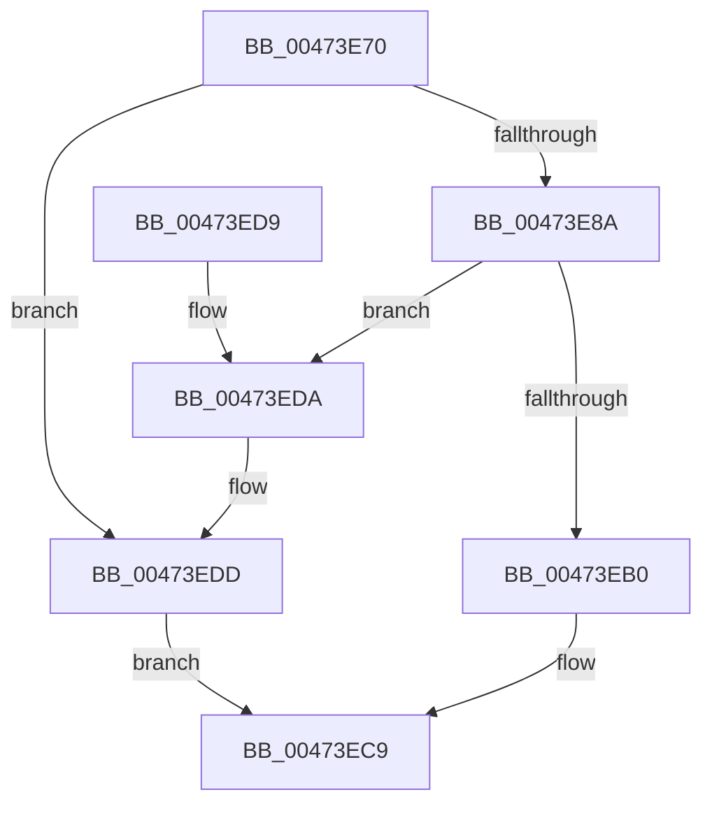

# CBufferAllocate

- RVA: `0x00473E70`–`0x00473EE1` (길이 `113` bytes)
- VA: `0x0000000140473E70`
- 실행 섹션: `.text`
- PDB 이름 있음: `예`; PDB Function 태그: `예`
- unwind 정보 RVA: `0x0006383C`
- 디코드: `34`개 명령, `113/113` bytes 표시
- 미해석 바이트: `0` (있으면 어셈블리에 `.byte`로 보존)

> 이 문서는 커널 이미지의 기계어와 PDB 기호를 분석해 생성했습니다. 4번과 5번은 함수 원형과 자료형을 바이너리 사용 방식에서 추정한 C 해석이며 원본 소스 복구 결과는 아닙니다.

## 1. Dependencies

- 직접 호출 지점: **2**; 고유 호출 대상: **2**
- 직접 호출자로 확인된 함수: **1**
- RIP 상대 이미지 참조: **0**

### Outgoing calls
- `0x00473EA3` → [ExAllocatePoolWithTag](../../poolcode/B8/ExAllocatePoolWithTag_function_00B82010.md) (function, `0x00B82010`)
- `0x00473EB8` → [memset](../6C/memset_function_006C6C40.md) (function, `0x006C6C40`)

### Direct callers
- [CreateNewEventEntry](CreateNewEventEntry_function_00473C00.md) at `0x00473C92`

### Static image references
- 디코드된 RIP-relative 메모리 참조가 없습니다.

## 2. Other-region calls and transfers

- 다른 실행 섹션으로 향하는 call: **1**
  - `0x00473EA3` → [ExAllocatePoolWithTag](../../poolcode/B8/ExAllocatePoolWithTag_function_00B82010.md) (`.text` → `POOLCODE`)
- 별도 외부 분기/꼬리 이동을 확인하지 못했습니다.

## 3. Assembly (complete function range)

```asm
00473E70  48 89 5C 24 08                  mov qword ptr [rsp + 8], rbx
00473E75  48 89 74 24 10                  mov qword ptr [rsp + 0x10], rsi
00473E7A  57                              push rdi
00473E7B  48 83 EC 20                     sub rsp, 0x20
00473E7F  49 8B F0                        mov rsi, r8
00473E82  48 8B FA                        mov rdi, rdx
00473E85  4D 85 C0                        test r8, r8
00473E88  74 53                           je 0x140473edd
00473E8A  F6 D9                           neg cl
00473E8C  41 B8 54 72 41 47               mov r8d, 0x47417254
00473E92  48 8B D6                        mov rdx, rsi
00473E95  1B C9                           sbb ecx, ecx
00473E97  81 E1 01 FE FF FF               and ecx, 0xfffffe01
00473E9D  81 C1 00 02 00 00               add ecx, 0x200
00473EA3  E8 68 E1 70 00                  call 0x140b82010
00473EA8  48 8B D8                        mov rbx, rax
00473EAB  48 85 C0                        test rax, rax
00473EAE  74 2A                           je 0x140473eda
00473EB0  4C 8B C6                        mov r8, rsi
00473EB3  33 D2                           xor edx, edx
00473EB5  48 8B C8                        mov rcx, rax
00473EB8  E8 83 2D 25 00                  call 0x1406c6c40
00473EBD  B8 01 00 00 00                  mov eax, 1
00473EC2  48 89 1F                        mov qword ptr [rdi], rbx
00473EC5  48 89 77 08                     mov qword ptr [rdi + 8], rsi
00473EC9  48 8B 5C 24 30                  mov rbx, qword ptr [rsp + 0x30]
00473ECE  48 8B 74 24 38                  mov rsi, qword ptr [rsp + 0x38]
00473ED3  48 83 C4 20                     add rsp, 0x20
00473ED7  5F                              pop rdi
00473ED8  C3                              ret
00473ED9  CC                              int3
00473EDA  48 89 1F                        mov qword ptr [rdi], rbx
00473EDD  33 C0                           xor eax, eax
00473EDF  EB E8                           jmp 0x140473ec9
```

## 4. C-style interpretation (structured pseudocode)

```c
__int64 __fastcall CBufferAllocate(unsigned __int8 a1, __int64 a2, __int64 a3)
{
    __int64 result;
    __int64 v_rsp;
    unsigned __int64 v_stack_p10;
    unsigned __int64 v_stack_p8;

    v_stack_p8 = v_rbx;
    v_stack_p10 = v_rsi;
    v_rsp = (v_rsp) - (32);
    if (a3 == 0) goto loc_00473EDD;
    a1 = (unsigned __int8)(-(a1));
    a1 = (unsigned int)((a1) & (0xFFFFFE01ULL));
    a1 = (unsigned int)((a1) + (512));
    result = ExAllocatePoolWithTag(a1, a3, (unsigned int)(0x47417254ULL), a4);
    if (result == 0) goto loc_00473EDA;
    a2 = 0;
    result = memset(result, a2, a3, a4);
    *(unsigned __int64 *)(a2) = result;
    *(unsigned __int64 *)(a2 + 8) = a3;
loc_00473EC9:
    v_rsp = (v_rsp) + (32);
    return 1;
loc_00473EDA:
    *(unsigned __int64 *)(a2) = v_stack_p8;
loc_00473EDD:
    result = 0;
    goto loc_00473EC9;
}
```

## 5. (Beta) C Style

```c
int64_t CBufferAllocate(uint8_t Arg1, void *Arg2, int64_t Arg3)
{
    uint8_t *arg2 = (uint8_t *)Arg2;

    int64_t result;
    int64_t local_rsp;
    uint64_t v_stack_p10;
    uint64_t v_stack_p8;

    v_stack_p8 = local_rbx;
    v_stack_p10 = local_rsi;
    local_rsp = (local_rsp) - (32);
    if (Arg3 == 0) goto loc_00473EDD;
    Arg1 = (uint8_t)(-(Arg1));
    Arg1 = (uint32_t)((Arg1) & (0xFFFFFE01ULL));
    Arg1 = (uint32_t)((Arg1) + (512));
    result = ExAllocatePoolWithTag(Arg1, Arg3, (uint32_t)(0x47417254ULL), a4);
    if (result == 0) goto loc_00473EDA;
    Arg2 = 0;
    result = memset(result, Arg2, Arg3, a4);
    *(uint64_t *)(arg2) = result;
    *(uint64_t *)(arg2 + 0x8) = Arg3;
loc_00473EC9:
    local_rsp = (local_rsp) + (32);
    return 1;
loc_00473EDA:
    *(uint64_t *)(arg2) = v_stack_p8;
loc_00473EDD:
    result = 0;
    goto loc_00473EC9;
}
```

### 관측된 메모리 오프셋

구조체 형식이 확인되지 않은 접근은 인자 기준의 오프셋으로만 기록했습니다.

| 기준 인자 | 오프셋 표현 | 폭 (bit) | 접근 |
|---|---:|---:|---|
| `Arg2` | `+ 0x0` | `64` | `W` |
| `Arg2` | `+ 0x8` | `64` | `W` |

## 6. Execution-region graph

[열기: 2D/3D 그래프와 함수 탐색 컨트롤 패널](../../../control-panel.html?section=text&rva=0x00473E70&view=graph)

- 2D 그래프는 위에서 아래로 흐르고, 3D 그래프는 빈 공간을 드래그해 회전합니다. Shift+드래그는 이동, 휠은 확대·축소, 함수 노드 선택은 대상 보고서 이동입니다.

### Static fallback


