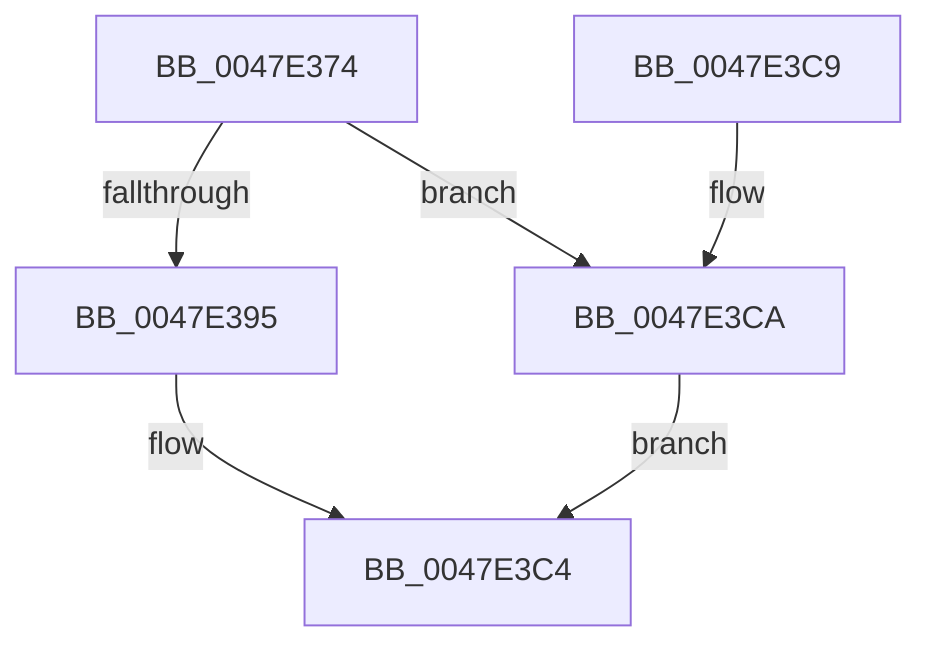

# CcAllocateInitializeMbcb

- RVA: `0x0047E374`–`0x0047E3CC` (길이 `88` bytes)
- VA: `0x000000014047E374`
- 실행 섹션: `.text`
- PDB 이름 있음: `예`; PDB Function 태그: `아니요`
- unwind 정보 RVA: `0x0005DDFC`
- 디코드: `24`개 명령, `88/88` bytes 표시
- 미해석 바이트: `0` (있으면 어셈블리에 `.byte`로 보존)

> 이 문서는 커널 이미지의 기계어와 PDB 기호를 분석해 생성했습니다. 4번과 5번은 함수 원형과 자료형을 바이너리 사용 방식에서 추정한 C 해석이며 원본 소스 복구 결과는 아닙니다.

## 1. Dependencies

- 직접 호출 지점: **1**; 고유 호출 대상: **1**
- 직접 호출자로 확인된 함수: **1**
- RIP 상대 이미지 참조: **0**

### Outgoing calls
- `0x0047E388` → [ExAllocatePoolWithTag](../../poolcode/B8/ExAllocatePoolWithTag_function_00B82010.md) (function, `0x00B82010`)

### Direct callers
- [CcSetDirtyInMask](../3C/CcSetDirtyInMask_function_003CB688.md) at `0x003CBB2E`

### Static image references
- 디코드된 RIP-relative 메모리 참조가 없습니다.

## 2. Other-region calls and transfers

- 다른 실행 섹션으로 향하는 call: **1**
  - `0x0047E388` → [ExAllocatePoolWithTag](../../poolcode/B8/ExAllocatePoolWithTag_function_00B82010.md) (`.text` → `POOLCODE`)
- 별도 외부 분기/꼬리 이동을 확인하지 못했습니다.

## 3. Assembly (complete function range)

```asm
0047E374  48 83 EC 28                     sub rsp, 0x28
0047E378  BA C0 00 00 00                  mov edx, 0xc0
0047E37D  B9 00 06 00 00                  mov ecx, 0x600
0047E382  41 B8 43 63 4D 62               mov r8d, 0x624d6343
0047E388  E8 83 3C 70 00                  call 0x140b82010
0047E38D  48 8B D0                        mov rdx, rax
0047E390  48 85 C0                        test rax, rax
0047E393  74 35                           je 0x14047e3ca
0047E395  66 C7 00 FB 02                  mov word ptr [rax], 0x2fb
0047E39A  48 8D 48 10                     lea rcx, [rax + 0x10]
0047E39E  48 83 C0 30                     add rax, 0x30
0047E3A2  48 89 48 08                     mov qword ptr [rax + 8], rcx
0047E3A6  48 89 08                        mov qword ptr [rax], rcx
0047E3A9  48 89 01                        mov qword ptr [rcx], rax
0047E3AC  48 89 41 08                     mov qword ptr [rcx + 8], rax
0047E3B0  48 8D 42 60                     lea rax, [rdx + 0x60]
0047E3B4  83 4A 48 FF                     or dword ptr [rdx + 0x48], 0xffffffff
0047E3B8  48 83 4A 28 FF                  or qword ptr [rdx + 0x28], 0xffffffffffffffff
0047E3BD  48 89 42 58                     mov qword ptr [rdx + 0x58], rax
0047E3C1  48 8B C2                        mov rax, rdx
0047E3C4  48 83 C4 28                     add rsp, 0x28
0047E3C8  C3                              ret
0047E3C9  CC                              int3
0047E3CA  EB F8                           jmp 0x14047e3c4
```

## 4. C-style interpretation (structured pseudocode)

```c
__int64 __fastcall CcAllocateInitializeMbcb(void)
{
    __int64 result;
    __int64 v_rsp;

    v_rsp = (v_rsp) - (40);
    result = ExAllocatePoolWithTag((unsigned int)(0x600ULL), 192, (unsigned int)(0x624D6343ULL), a4);
    if (result == 0) goto loc_0047E3CA;
    *(unsigned __int16 *)(result) = 763;
    result = (result) + (48);
    *(unsigned __int64 *)(result + 8) = result + 16;
    *(unsigned __int64 *)(result) = result + 16;
    *(unsigned __int64 *)(result + 16) = result;
    *(unsigned __int64 *)(result + 16 + 8) = result;
    *(unsigned __int64 *)(result + 88) = result + 96;
loc_0047E3C4:
    v_rsp = (v_rsp) + (40);
    return result;
loc_0047E3CA:
    goto loc_0047E3C4;
}
```

## 5. (Beta) C Style

```c
void CcAllocateInitializeMbcb(void)
{
    int64_t result;
    int64_t local_rsp;

    local_rsp = (local_rsp) - (40);
    result = ExAllocatePoolWithTag((uint32_t)(0x600ULL), 192, (uint32_t)(0x624D6343ULL), a4);
    if (result == 0) goto loc_0047E3CA;
    *(uint16_t *)(result) = 763;
    result = (result) + (48);
    *(uint64_t *)(result + 0x8) = result + 16;
    *(uint64_t *)(result) = result + 16;
    *(uint64_t *)(result + 0x10) = result;
    *(uint64_t *)(result + 0x10 + 0x8) = result;
    *(uint64_t *)(result + 0x58) = result + 96;
loc_0047E3C4:
    local_rsp = (local_rsp) + (40);
    return result;
loc_0047E3CA:
    goto loc_0047E3C4;
}
```

## 6. Execution-region graph

[열기: 2D/3D 그래프와 함수 탐색 컨트롤 패널](../../../control-panel.html?section=text&rva=0x0047E374&view=graph)

- 2D 그래프는 위에서 아래로 흐르고, 3D 그래프는 빈 공간을 드래그해 회전합니다. Shift+드래그는 이동, 휠은 확대·축소, 함수 노드 선택은 대상 보고서 이동입니다.

### Static fallback


