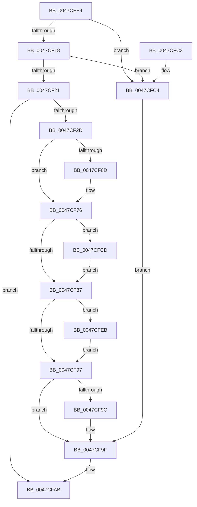

# CcCalculatePagesToWriteForVolume

- RVA: `0x0047CEF4`–`0x0047CFFA` (길이 `262` bytes)
- VA: `0x000000014047CEF4`
- 실행 섹션: `.text`
- PDB 이름 있음: `예`; PDB Function 태그: `아니요`
- unwind 정보 RVA: `0x000AD8F8`
- 디코드: `73`개 명령, `262/262` bytes 표시
- 미해석 바이트: `0` (있으면 어셈블리에 `.byte`로 보존)

> 이 문서는 커널 이미지의 기계어와 PDB 기호를 분석해 생성했습니다. 4번과 5번은 함수 원형과 자료형을 바이너리 사용 방식에서 추정한 C 해석이며 원본 소스 복구 결과는 아닙니다.

## 1. Dependencies

- 직접 호출 지점: **0**; 고유 호출 대상: **0**
- 직접 호출자로 확인된 함수: **2**
- RIP 상대 이미지 참조: **1**

### Outgoing calls
- 직접 디코드된 call 명령이 없습니다.

### Direct callers
- [CcLazyWriteScanVolume](../38/CcLazyWriteScanVolume_function_00388DC0.md) at `0x00388F17`
- [CcNotifyExternalCachesInternal](../3C/CcNotifyExternalCachesInternal_function_003C9E00.md) at `0x003C9E84`

### Static image references
- `0x0047CF57` → RVA `0x00E0A870` (`.data`; read)

## 2. Other-region calls and transfers

- 다른 실행 섹션으로 향하는 call: **0**
- 별도 외부 분기/꼬리 이동을 확인하지 못했습니다.

## 3. Assembly (complete function range)

```asm
0047CEF4  48 8B C4                        mov rax, rsp
0047CEF7  48 89 58 08                     mov qword ptr [rax + 8], rbx
0047CEFB  48 89 68 10                     mov qword ptr [rax + 0x10], rbp
0047CEFF  48 89 70 18                     mov qword ptr [rax + 0x18], rsi
0047CF03  48 89 78 20                     mov qword ptr [rax + 0x20], rdi
0047CF07  33 DB                           xor ebx, ebx
0047CF09  8D 42 FF                        lea eax, [rdx - 1]
0047CF0C  4C 8B D9                        mov r11, rcx
0047CF0F  83 F8 01                        cmp eax, 1
0047CF12  0F 86 AC 00 00 00               jbe 0x14047cfc4
0047CF18  83 FA 10                        cmp edx, 0x10
0047CF1B  0F 84 A3 00 00 00               je 0x14047cfc4
0047CF21  4C 8B 89 E0 03 00 00            mov r9, qword ptr [rcx + 0x3e0]
0047CF28  4D 85 C9                        test r9, r9
0047CF2B  74 7E                           je 0x14047cfab
0047CF2D  48 8B B1 E8 03 00 00            mov rsi, qword ptr [rcx + 0x3e8]
0047CF34  33 D2                           xor edx, edx
0047CF36  44 8B 81 F0 03 00 00            mov r8d, dword ptr [rcx + 0x3f0]
0047CF3D  49 8B C1                        mov rax, r9
0047CF40  8B A9 10 04 00 00               mov ebp, dword ptr [rcx + 0x410]
0047CF46  4D 8B D1                        mov r10, r9
0047CF49  8B 89 10 06 00 00               mov ecx, dword ptr [rcx + 0x610]
0047CF4F  48 F7 F1                        div rcx
0047CF52  8B CB                           mov ecx, ebx
0047CF54  48 8B F8                        mov rdi, rax
0047CF57  8B 05 13 D9 98 00               mov eax, dword ptr [rip + 0x98d913]
0047CF5D  48 3B F8                        cmp rdi, rax
0047CF60  4B 8D 04 08                     lea rax, [r8 + r9]
0047CF64  49 0F 46 F9                     cmovbe rdi, r9
0047CF68  48 3B C6                        cmp rax, rsi
0047CF6B  76 09                           jbe 0x14047cf76
0047CF6D  41 8B C8                        mov ecx, r8d
0047CF70  48 2B CE                        sub rcx, rsi
0047CF73  49 03 C9                        add rcx, r9
0047CF76  4D 8B C2                        mov r8, r10
0047CF79  48 8B C5                        mov rax, rbp
0047CF7C  4C 2B C7                        sub r8, rdi
0047CF7F  4C 03 C1                        add r8, rcx
0047CF82  4C 3B C5                        cmp r8, rbp
0047CF85  77 46                           ja 0x14047cfcd
0047CF87  49 8B 8B F8 03 00 00            mov rcx, qword ptr [r11 + 0x3f8]
0047CF8E  4C 8D 0C 1F                     lea r9, [rdi + rbx]
0047CF92  4C 3B D1                        cmp r10, rcx
0047CF95  77 54                           ja 0x14047cfeb
0047CF97  4D 3B CA                        cmp r9, r10
0047CF9A  76 03                           jbe 0x14047cf9f
0047CF9C  4D 8B CA                        mov r9, r10
0047CF9F  B8 FF FF FF FF                  mov eax, 0xffffffff
0047CFA4  4C 3B C8                        cmp r9, rax
0047CFA7  4C 0F 47 C8                     cmova r9, rax
0047CFAB  48 8B 5C 24 08                  mov rbx, qword ptr [rsp + 8]
0047CFB0  41 8B C1                        mov eax, r9d
0047CFB3  48 8B 6C 24 10                  mov rbp, qword ptr [rsp + 0x10]
0047CFB8  48 8B 74 24 18                  mov rsi, qword ptr [rsp + 0x18]
0047CFBD  48 8B 7C 24 20                  mov rdi, qword ptr [rsp + 0x20]
0047CFC2  C3                              ret
0047CFC3  CC                              int3
0047CFC4  4C 8B 89 E0 03 00 00            mov r9, qword ptr [rcx + 0x3e0]
0047CFCB  EB D2                           jmp 0x14047cf9f
0047CFCD  41 8B 8B 14 06 00 00            mov ecx, dword ptr [r11 + 0x614]
0047CFD4  4C 2B C0                        sub r8, rax
0047CFD7  49 8B C0                        mov rax, r8
0047CFDA  33 D2                           xor edx, edx
0047CFDC  48 F7 F1                        div rcx
0047CFDF  48 85 C0                        test rax, rax
0047CFE2  4C 0F 45 C0                     cmovne r8, rax
0047CFE6  49 8B D8                        mov rbx, r8
0047CFE9  EB 9C                           jmp 0x14047cf87
0047CFEB  49 8B C2                        mov rax, r10
0047CFEE  48 2B C1                        sub rax, rcx
0047CFF1  49 3B C1                        cmp rax, r9
0047CFF4  4C 0F 47 C8                     cmova r9, rax
0047CFF8  EB 9D                           jmp 0x14047cf97
```

## 4. C-style interpretation (structured pseudocode)

```c
__int64 __fastcall CcCalculatePagesToWriteForVolume(__int64 a1, __int64 a2)
{
    __int64 result;
    __int64 v_rbx;
    __int64 v_rdi;
    unsigned __int64 v_stack_p10;
    unsigned __int64 v_stack_p18;
    unsigned __int64 v_stack_p20;
    unsigned __int64 v_stack_p8;

    *(unsigned __int64 *)(v_rsp + 8) = v_rbx;
    *(unsigned __int64 *)(v_rsp + 16) = v_rbp;
    *(unsigned __int64 *)(v_rsp + 24) = v_rsi;
    *(unsigned __int64 *)(v_rsp + 32) = v_rdi;
    v_rbx = 0;
    if (((unsigned int)(a2 - 1)) <= 1) goto loc_0047CFC4;
    if (((unsigned int)(a2)) == 16) goto loc_0047CFC4;
    if (*(unsigned __int64 *)(a1 + 992) == 0) goto loc_0047CFAB;
    a2 = 0;
    v_rdi = *(unsigned __int64 *)(a1 + 992);
    if ((*(unsigned __int64 *)(a1 + 992)) <= ((unsigned int)(*(unsigned int *)(v_rip + 10017043)))) { v_rdi = *(unsigned __int64 *)(a1 + 992); }
    if (((unsigned int)(*(unsigned int *)(a1 + 1008)) + *(unsigned __int64 *)(a1 + 992) * 1) >= = (*(unsigned __int64 *)(a1 + 1000))) {
        a1 = (unsigned int)((unsigned int)(*(unsigned int *)(a1 + 1008)));
        a1 = (a1) - (*(unsigned __int64 *)(a1 + 1000));
        a1 = (a1) + (*(unsigned __int64 *)(a1 + 992));
    }
    a3 = (*(unsigned __int64 *)(a1 + 992)) - (v_rdi);
    a3 = (a3) + (a1);
    if (a3 > ((unsigned int)(*(unsigned int *)(a1 + 1040)))) goto loc_0047CFCD;
loc_0047CF87:
    if ((*(unsigned __int64 *)(a1 + 992)) > (*(unsigned __int64 *)(a1 + 1016))) goto loc_0047CFEB;
loc_0047CF97:
    if ((v_rdi + v_rbx * 1) >= = (*(unsigned __int64 *)(a1 + 992))) {
        a4 = *(unsigned __int64 *)(a1 + 992);
    }
    if (a4 > ((unsigned int)(0xFFFFFFFFULL))) { a4 = (unsigned int)(0xFFFFFFFFULL); }
loc_0047CFAB:
    return (unsigned int)((unsigned int)(a4));
loc_0047CFC4:
    goto loc_0047CF9F;
loc_0047CFCD:
    a3 = (a3) - ((unsigned int)((unsigned int)(a4)));
    a2 = 0;
    if (a3 != 0) { a3 = a3; }
    goto loc_0047CF87;
loc_0047CFEB:
    result = (*(unsigned __int64 *)(a1 + 992)) - ((unsigned int)(*(unsigned int *)(a1 + 1556)));
    a4 = *(unsigned __int64 *)(*(unsigned __int64 *)(a1 + 1016) + 992);
    if (result > (*(unsigned __int64 *)(*(unsigned __int64 *)(a1 + 1016) + 992))) { a4 = result; }
    goto loc_0047CF97;
}
```

## 5. (Beta) C Style

```c
int64_t CcCalculatePagesToWriteForVolume(void *Arg1, void *Arg2)
{
    uint8_t *arg1 = (uint8_t *)Arg1;
    uint8_t *arg2 = (uint8_t *)Arg2;

    int64_t result;
    int64_t local_rbx;
    int64_t local_rdi;
    uint64_t v_stack_p10;
    uint64_t v_stack_p18;
    uint64_t v_stack_p20;
    uint64_t v_stack_p8;

    *(uint64_t *)(local_rsp + 0x8) = local_rbx;
    *(uint64_t *)(local_rsp + 0x10) = local_rbp;
    *(uint64_t *)(local_rsp + 0x18) = local_rsi;
    *(uint64_t *)(local_rsp + 0x20) = local_rdi;
    local_rbx = 0;
    if (((uint32_t)(Arg2 - 1)) <= 1) goto loc_0047CFC4;
    if (((uint32_t)(Arg2)) == 16) goto loc_0047CFC4;
    if (*(uint64_t *)(arg1 + 0x3E0) == 0) goto loc_0047CFAB;
    Arg2 = 0;
    local_rdi = *(uint64_t *)(arg1 + 0x3E0);
    if ((*(uint64_t *)(arg1 + 0x3E0)) <= ((uint32_t)(*(uint32_t *)(v_rip + 0x98D913)))) { local_rdi = *(uint64_t *)(arg1 + 0x3E0); }
    if (((uint32_t)(*(uint32_t *)(arg1 + 0x3F0)) + *(uint64_t *)(arg1 + 0x3E0) * 1) >= = (*(uint64_t *)(arg1 + 0x3E8))) {
        Arg1 = (uint32_t)((uint32_t)(*(uint32_t *)(arg1 + 0x3F0)));
        Arg1 = (Arg1) - (*(uint64_t *)(arg1 + 0x3E8));
        Arg1 = (Arg1) + (*(uint64_t *)(arg1 + 0x3E0));
    }
    a3 = (*(uint64_t *)(arg1 + 0x3E0)) - (local_rdi);
    a3 = (a3) + (Arg1);
    if (a3 > ((uint32_t)(*(uint32_t *)(arg1 + 0x410)))) goto loc_0047CFCD;
loc_0047CF87:
    if ((*(uint64_t *)(arg1 + 0x3E0)) > (*(uint64_t *)(arg1 + 0x3F8))) goto loc_0047CFEB;
loc_0047CF97:
    if ((local_rdi + local_rbx * 1) >= = (*(uint64_t *)(arg1 + 0x3E0))) {
        a4 = *(uint64_t *)(arg1 + 0x3E0);
    }
    if (a4 > ((uint32_t)(0xFFFFFFFFULL))) { a4 = (uint32_t)(0xFFFFFFFFULL); }
loc_0047CFAB:
    return (uint32_t)((uint32_t)(a4));
loc_0047CFC4:
    goto loc_0047CF9F;
loc_0047CFCD:
    a3 = (a3) - ((uint32_t)((uint32_t)(a4)));
    Arg2 = 0;
    if (a3 != 0) { a3 = a3; }
    goto loc_0047CF87;
loc_0047CFEB:
    result = (*(uint64_t *)(arg1 + 0x3E0)) - ((uint32_t)(*(uint32_t *)(arg1 + 0x614)));
    a4 = *(uint64_t *)(*(uint64_t *)(arg1 + 0x3F8) + 0x3E0);
    if (result > (*(uint64_t *)(*(uint64_t *)(arg1 + 0x3F8) + 0x3E0))) { a4 = result; }
    goto loc_0047CF97;
}
```

### 관측된 메모리 오프셋

구조체 형식이 확인되지 않은 접근은 인자 기준의 오프셋으로만 기록했습니다.

| 기준 인자 | 오프셋 표현 | 폭 (bit) | 접근 |
|---|---:|---:|---|
| `Arg1` | `+ 0x3E0` | `64` | `R` |
| `Arg1` | `+ 0x3E8` | `64` | `R` |
| `Arg1` | `+ 0x3F0` | `32` | `R` |
| `Arg1` | `+ 0x3F8` | `64` | `R` |
| `Arg1` | `+ 0x410` | `32` | `R` |
| `Arg1` | `+ 0x610` | `32` | `R` |
| `Arg1` | `+ 0x614` | `32` | `R` |
| `Arg2` | `- 0x1` | `32` | `R` |

## 6. Execution-region graph

[열기: 2D/3D 그래프와 함수 탐색 컨트롤 패널](../../../control-panel.html?section=text&rva=0x0047CEF4&view=graph)

- 2D 그래프는 위에서 아래로 흐르고, 3D 그래프는 빈 공간을 드래그해 회전합니다. Shift+드래그는 이동, 휠은 확대·축소, 함수 노드 선택은 대상 보고서 이동입니다.

### Static fallback


