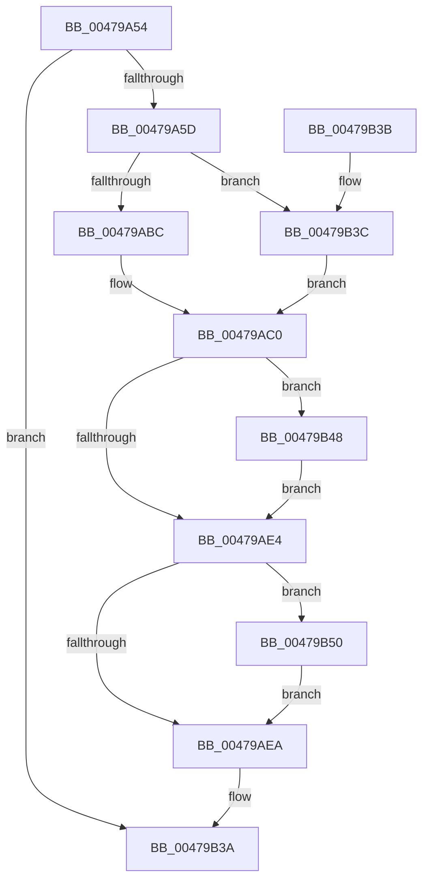

# CcPerfLogFlushCache

- RVA: `0x00479A54`–`0x00479B58` (길이 `260` bytes)
- VA: `0x0000000140479A54`
- 실행 섹션: `.text`
- PDB 이름 있음: `예`; PDB Function 태그: `아니요`
- unwind 정보 RVA: `0x000ACFE0`
- 디코드: `71`개 명령, `260/260` bytes 표시
- 미해석 바이트: `0` (있으면 어셈블리에 `.byte`로 보존)

> 이 문서는 커널 이미지의 기계어와 PDB 기호를 분석해 생성했습니다. 4번과 5번은 함수 원형과 자료형을 바이너리 사용 방식에서 추정한 C 해석이며 원본 소스 복구 결과는 아닙니다.

## 1. Dependencies

- 직접 호출 지점: **4**; 고유 호출 대상: **4**
- 직접 호출자로 확인된 함수: **1**
- RIP 상대 이미지 참조: **1**

### Outgoing calls
- `0x00479A94` → [CcReferenceSharedCacheMapFileObject](../23/CcReferenceSharedCacheMapFileObject_function_002379BC.md) (function, `0x002379BC`)
- `0x00479AAE` → [ObFastDereferenceObjectDeferDelete](../23/ObFastDereferenceObjectDeferDelete_function_002378C0.md) (function, `0x002378C0`)
- `0x00479B15` → [EtwTraceKernelEvent](../23/EtwTraceKernelEvent_function_00235350.md) (function, `0x00235350`)
- `0x00479B21` → [_security_check_cookie](../6A/_security_check_cookie_function_006AC640.md) (function, `0x006AC640`)

### Direct callers
- [CcFlushCachePreProcess](../35/CcFlushCachePreProcess_function_0035A9B0.md) at `0x0035AFCE`

### Static image references
- `0x00479A72` → RVA `0x00E0A740` (`.data`; read)

## 2. Other-region calls and transfers

- 다른 실행 섹션으로 향하는 call: **0**
- 별도 외부 분기/꼬리 이동을 확인하지 못했습니다.

## 3. Assembly (complete function range)

```asm
00479A54  48 85 D2                        test rdx, rdx
00479A57  0F 84 DD 00 00 00               je 0x140479b3a
00479A5D  48 89 5C 24 08                  mov qword ptr [rsp + 8], rbx
00479A62  48 89 74 24 18                  mov qword ptr [rsp + 0x18], rsi
00479A67  55                              push rbp
00479A68  57                              push rdi
00479A69  41 56                           push r14
00479A6B  48 8B EC                        mov rbp, rsp
00479A6E  48 83 EC 70                     sub rsp, 0x70
00479A72  48 8B 05 C7 0C 99 00            mov rax, qword ptr [rip + 0x990cc7]
00479A79  48 33 C4                        xor rax, rsp
00479A7C  48 89 45 F8                     mov qword ptr [rbp - 8], rax
00479A80  48 83 65 E0 00                  and qword ptr [rbp - 0x20], 0
00479A85  4C 8B F1                        mov r14, rcx
00479A88  48 8B CA                        mov rcx, rdx
00479A8B  41 8B F1                        mov esi, r9d
00479A8E  49 8B F8                        mov rdi, r8
00479A91  48 8B DA                        mov rbx, rdx
00479A94  E8 23 DF DB FF                  call 0x1402379bc
00479A99  48 8D 4B 60                     lea rcx, [rbx + 0x60]
00479A9D  41 B8 43 63 53 63               mov r8d, 0x63536343
00479AA3  48 8B 50 18                     mov rdx, qword ptr [rax + 0x18]
00479AA7  48 89 55 C8                     mov qword ptr [rbp - 0x38], rdx
00479AAB  48 8B D0                        mov rdx, rax
00479AAE  E8 0D DE DB FF                  call 0x1402378c0
00479AB3  48 85 FF                        test rdi, rdi
00479AB6  0F 85 80 00 00 00               jne 0x140479b3c
00479ABC  48 21 7D D0                     and qword ptr [rbp - 0x30], rdi
00479AC0  8B 83 98 00 00 00               mov eax, dword ptr [rbx + 0x98]
00479AC6  89 45 DC                        mov dword ptr [rbp - 0x24], eax
00479AC9  33 C0                           xor eax, eax
00479ACB  38 45 40                        cmp byte ptr [rbp + 0x40], al
00479ACE  4C 89 75 C0                     mov qword ptr [rbp - 0x40], r14
00479AD2  89 75 D8                        mov dword ptr [rbp - 0x28], esi
00479AD5  8D 50 01                        lea edx, [rax + 1]
00479AD8  0F 45 C2                        cmovne eax, edx
00479ADB  80 7D 48 00                     cmp byte ptr [rbp + 0x48], 0
00479ADF  89 45 E0                        mov dword ptr [rbp - 0x20], eax
00479AE2  75 64                           jne 0x140479b48
00479AE4  80 7D 50 00                     cmp byte ptr [rbp + 0x50], 0
00479AE8  75 66                           jne 0x140479b50
00479AEA  83 65 F4 00                     and dword ptr [rbp - 0xc], 0
00479AEE  48 8D 45 C0                     lea rax, [rbp - 0x40]
00479AF2  41 B9 09 16 00 00               mov r9d, 0x1609
00479AF8  48 89 45 E8                     mov qword ptr [rbp - 0x18], rax
00479AFC  41 B8 00 00 02 80               mov r8d, 0x80020000
00479B02  C7 45 F0 28 00 00 00            mov dword ptr [rbp - 0x10], 0x28
00479B09  48 8D 4D E8                     lea rcx, [rbp - 0x18]
00479B0D  C7 44 24 20 02 19 50 00         mov dword ptr [rsp + 0x20], 0x501902
00479B15  E8 36 B8 DB FF                  call 0x140235350
00479B1A  48 8B 4D F8                     mov rcx, qword ptr [rbp - 8]
00479B1E  48 33 CC                        xor rcx, rsp
00479B21  E8 1A 2B 23 00                  call 0x1406ac640
00479B26  4C 8D 5C 24 70                  lea r11, [rsp + 0x70]
00479B2B  49 8B 5B 20                     mov rbx, qword ptr [r11 + 0x20]
00479B2F  49 8B 73 30                     mov rsi, qword ptr [r11 + 0x30]
00479B33  49 8B E3                        mov rsp, r11
00479B36  41 5E                           pop r14
00479B38  5F                              pop rdi
00479B39  5D                              pop rbp
00479B3A  C3                              ret
00479B3B  CC                              int3
00479B3C  48 8B 07                        mov rax, qword ptr [rdi]
00479B3F  48 89 45 D0                     mov qword ptr [rbp - 0x30], rax
00479B43  E9 78 FF FF FF                  jmp 0x140479ac0
00479B48  83 C8 02                        or eax, 2
00479B4B  89 45 E0                        mov dword ptr [rbp - 0x20], eax
00479B4E  EB 94                           jmp 0x140479ae4
00479B50  83 C8 04                        or eax, 4
00479B53  89 45 E0                        mov dword ptr [rbp - 0x20], eax
00479B56  EB 92                           jmp 0x140479aea
```

## 4. C-style interpretation (structured pseudocode)

```c
__int64 __fastcall CcPerfLogFlushCache(__int64 a1, __int64 a2, __int64 a3, int a4, unsigned __int8 a5, unsigned __int8 a6, unsigned __int8 a7)
{
    __int64 result;
    __int64 v_rsp;
    unsigned __int64 v_stack_m18;
    unsigned __int64 v_stack_m20;
    unsigned int v_stack_m24;
    unsigned int v_stack_m28;
    unsigned __int64 v_stack_m30;
    unsigned __int64 v_stack_m38;
    unsigned int v_stack_m3C;
    unsigned int v_stack_m40;
    unsigned __int64 v_stack_m48;
    unsigned __int64 v_stack_m50;
    unsigned __int64 v_stack_m58;
    unsigned int v_stack_m68;
    unsigned __int64 v_stack_p18;
    unsigned __int64 v_stack_p8;

    if (a2 == 0) goto loc_00479B3A;
    v_stack_p8 = v_rbx;
    v_stack_p18 = v_rsi;
    v_rsp = (v_rsp) - (112);
    result = (*(unsigned __int64 *)(v_rip + 10030279)) ^ (v_rsp);
    v_stack_m20 = result;
    result = CcReferenceSharedCacheMapFileObject(a2, a2, a3, a4);
    v_stack_m50 = *(unsigned __int64 *)(result + 24);
    result = ObFastDereferenceObjectDeferDelete(a2 + 96, result, (unsigned int)(0x63536343ULL), a4);
    if (a3 != 0) goto loc_00479B3C;
loc_00479AC0:
    v_stack_m3C = (unsigned int)((unsigned int)(*(unsigned int *)(a2 + 152)));
    result = 0;
    v_stack_m58 = a1;
    v_stack_m40 = (unsigned int)((unsigned int)(a4));
    if (a5 != 0) { result = (unsigned int)(result + 1); }
    v_stack_m38 = (unsigned int)(result);
    if (a6 != 0) goto loc_00479B48;
loc_00479AE4:
    if (a7 != 0) goto loc_00479B50;
loc_00479AEA:
    v_stack_m30 = v_stack_m58;
    v_stack_m28 = 40;
    v_stack_m68 = 0x501902ULL;
    result = EtwTraceKernelEvent(v_stack_m30, result + 1, (unsigned int)(0x80020000ULL), (unsigned int)(0x1609ULL));
    a1 = (v_stack_m20) ^ (v_rsp);
    result = _security_check_cookie(a1, result + 1, (unsigned int)(0x80020000ULL), (unsigned int)(0x1609ULL));
loc_00479B3A:
    return result;
loc_00479B3C:
    v_stack_m48 = *(unsigned __int64 *)(a3);
    goto loc_00479AC0;
loc_00479B48:
    result = (unsigned int)((*(unsigned __int64 *)(a3)) | (2));
    v_stack_m38 = (unsigned int)(result);
    goto loc_00479AE4;
loc_00479B50:
    result = (unsigned int)((result) | (4));
    v_stack_m38 = (unsigned int)(result);
    goto loc_00479AEA;
}
```

## 5. (Beta) C Style

```c
int64_t CcPerfLogFlushCache(int64_t Arg1, int64_t Arg2, int64_t Arg3, int32_t Arg4, uint8_t Arg5, uint8_t Arg6, uint8_t Arg7)
{
    int64_t result;
    int64_t local_rsp;
    uint64_t v_stack_m18;
    uint64_t v_stack_m20;
    uint32_t v_stack_m24;
    uint32_t v_stack_m28;
    uint64_t v_stack_m30;
    uint64_t v_stack_m38;
    uint32_t v_stack_m3C;
    uint32_t v_stack_m40;
    uint64_t v_stack_m48;
    uint64_t v_stack_m50;
    uint64_t v_stack_m58;
    uint32_t v_stack_m68;
    uint64_t v_stack_p18;
    uint64_t v_stack_p8;

    if (Arg2 == 0) goto loc_00479B3A;
    v_stack_p8 = local_rbx;
    v_stack_p18 = local_rsi;
    local_rsp = (local_rsp) - (112);
    result = (*(uint64_t *)(v_rip + 0x990CC7)) ^ (local_rsp);
    v_stack_m20 = result;
    result = CcReferenceSharedCacheMapFileObject(Arg2, Arg2, Arg3, Arg4);
    v_stack_m50 = *(uint64_t *)(result + 0x18);
    result = ObFastDereferenceObjectDeferDelete(Arg2 + 96, result, (uint32_t)(0x63536343ULL), Arg4);
    if (Arg3 != 0) goto loc_00479B3C;
loc_00479AC0:
    v_stack_m3C = (uint32_t)((uint32_t)(*(uint32_t *)(Arg2 + 0x98)));
    result = 0;
    v_stack_m58 = Arg1;
    v_stack_m40 = (uint32_t)((uint32_t)(Arg4));
    if (Arg5 != 0) { result = (uint32_t)(result + 1); }
    v_stack_m38 = (uint32_t)(result);
    if (Arg6 != 0) goto loc_00479B48;
loc_00479AE4:
    if (Arg7 != 0) goto loc_00479B50;
loc_00479AEA:
    v_stack_m30 = v_stack_m58;
    v_stack_m28 = 40;
    v_stack_m68 = 0x501902ULL;
    result = EtwTraceKernelEvent(v_stack_m30, result + 1, (uint32_t)(0x80020000ULL), (uint32_t)(0x1609ULL));
    Arg1 = (v_stack_m20) ^ (local_rsp);
    result = _security_check_cookie(Arg1, result + 1, (uint32_t)(0x80020000ULL), (uint32_t)(0x1609ULL));
loc_00479B3A:
    return result;
loc_00479B3C:
    v_stack_m48 = *(uint64_t *)(Arg3);
    goto loc_00479AC0;
loc_00479B48:
    result = (uint32_t)((*(uint64_t *)(Arg3)) | (2));
    v_stack_m38 = (uint32_t)(result);
    goto loc_00479AE4;
loc_00479B50:
    result = (uint32_t)((result) | (4));
    v_stack_m38 = (uint32_t)(result);
    goto loc_00479AEA;
}
```

## 6. Execution-region graph

[열기: 2D/3D 그래프와 함수 탐색 컨트롤 패널](../../../control-panel.html?section=text&rva=0x00479A54&view=graph)

- 2D 그래프는 위에서 아래로 흐르고, 3D 그래프는 빈 공간을 드래그해 회전합니다. Shift+드래그는 이동, 휠은 확대·축소, 함수 노드 선택은 대상 보고서 이동입니다.

### Static fallback


