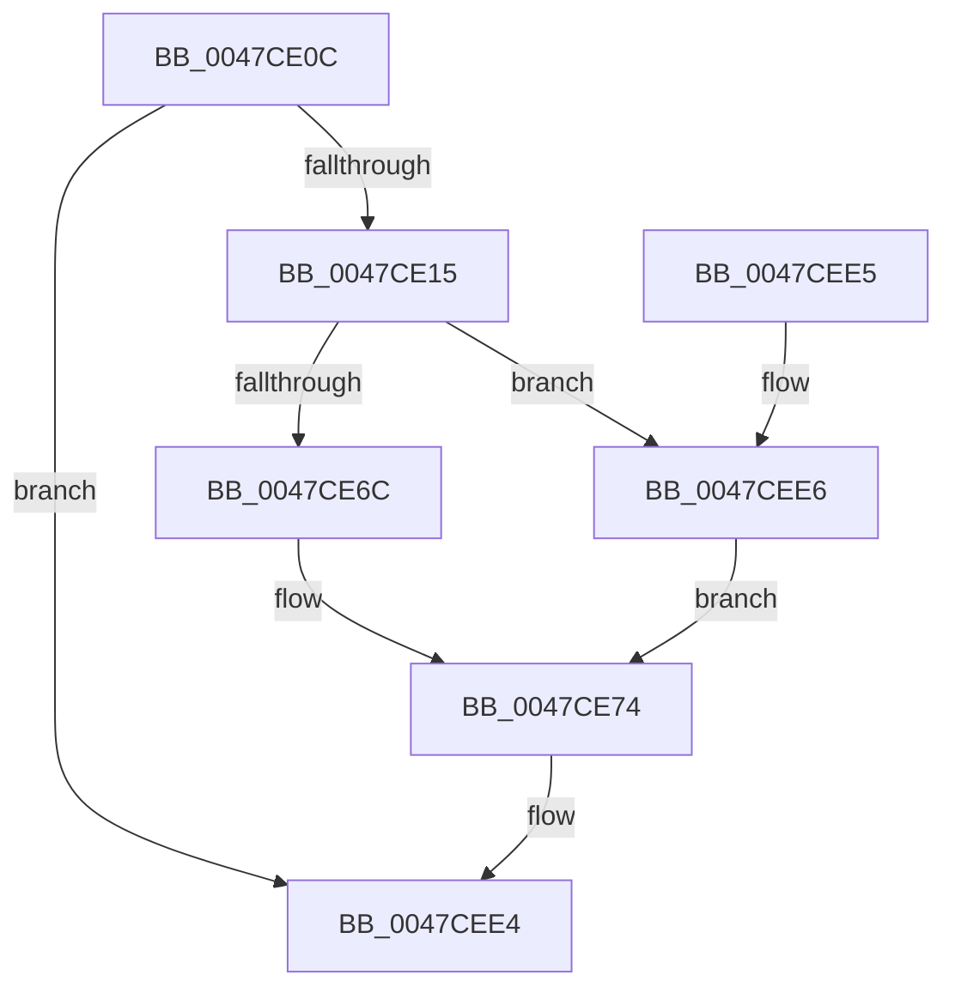

# CcPerfLogFlushSection

- RVA: `0x0047CE0C`–`0x0047CEEE` (길이 `226` bytes)
- VA: `0x000000014047CE0C`
- 실행 섹션: `.text`
- PDB 이름 있음: `예`; PDB Function 태그: `아니요`
- unwind 정보 RVA: `0x000AD8D8`
- 디코드: `53`개 명령, `226/226` bytes 표시
- 미해석 바이트: `0` (있으면 어셈블리에 `.byte`로 보존)

> 이 문서는 커널 이미지의 기계어와 PDB 기호를 분석해 생성했습니다. 4번과 5번은 함수 원형과 자료형을 바이너리 사용 방식에서 추정한 C 해석이며 원본 소스 복구 결과는 아닙니다.

## 1. Dependencies

- 직접 호출 지점: **4**; 고유 호출 대상: **4**
- 직접 호출자로 확인된 함수: **3**
- RIP 상대 이미지 참조: **1**

### Outgoing calls
- `0x0047CE47` → [CcReferenceSharedCacheMapFileObject](../23/CcReferenceSharedCacheMapFileObject_function_002379BC.md) (function, `0x002379BC`)
- `0x0047CE62` → [ObFastDereferenceObjectDeferDelete](../23/ObFastDereferenceObjectDeferDelete_function_002378C0.md) (function, `0x002378C0`)
- `0x0047CEBD` → [EtwTraceKernelEvent](../23/EtwTraceKernelEvent_function_00235350.md) (function, `0x00235350`)
- `0x0047CECA` → [_security_check_cookie](../6A/_security_check_cookie_function_006AC640.md) (function, `0x006AC640`)

### Direct callers
- [CcFlushCachePostProcessOneRange](../35/CcFlushCachePostProcessOneRange_function_00359710.md) at `0x00359C1B`
- [CcFlushCachePreProcess](../35/CcFlushCachePreProcess_function_0035A9B0.md) at `0x0035AFF0`
- [CcUnpinRepinnedBcb](../49/CcUnpinRepinnedBcb_function_0049F560.md) at `0x0049F6D6`

### Static image references
- `0x0047CE29` → RVA `0x00E0A740` (`.data`; read)

## 2. Other-region calls and transfers

- 다른 실행 섹션으로 향하는 call: **0**
- 별도 외부 분기/꼬리 이동을 확인하지 못했습니다.

## 3. Assembly (complete function range)

```asm
0047CE0C  48 85 D2                        test rdx, rdx
0047CE0F  0F 84 CF 00 00 00               je 0x14047cee4
0047CE15  48 89 5C 24 08                  mov qword ptr [rsp + 8], rbx
0047CE1A  48 89 6C 24 18                  mov qword ptr [rsp + 0x18], rbp
0047CE1F  48 89 74 24 20                  mov qword ptr [rsp + 0x20], rsi
0047CE24  57                              push rdi
0047CE25  48 83 EC 70                     sub rsp, 0x70
0047CE29  48 8B 05 10 D9 98 00            mov rax, qword ptr [rip + 0x98d910]
0047CE30  48 33 C4                        xor rax, rsp
0047CE33  48 89 44 24 60                  mov qword ptr [rsp + 0x60], rax
0047CE38  48 8B E9                        mov rbp, rcx
0047CE3B  41 8B F1                        mov esi, r9d
0047CE3E  48 8B CA                        mov rcx, rdx
0047CE41  49 8B D8                        mov rbx, r8
0047CE44  48 8B FA                        mov rdi, rdx
0047CE47  E8 70 AB DB FF                  call 0x1402379bc
0047CE4C  48 8D 4F 60                     lea rcx, [rdi + 0x60]
0047CE50  41 B8 43 63 53 63               mov r8d, 0x63536343
0047CE56  48 8B D0                        mov rdx, rax
0047CE59  4C 8B 48 18                     mov r9, qword ptr [rax + 0x18]
0047CE5D  4C 89 4C 24 48                  mov qword ptr [rsp + 0x48], r9
0047CE62  E8 59 AA DB FF                  call 0x1402378c0
0047CE67  48 85 DB                        test rbx, rbx
0047CE6A  74 7A                           je 0x14047cee6
0047CE6C  48 8B 03                        mov rax, qword ptr [rbx]
0047CE6F  48 89 44 24 50                  mov qword ptr [rsp + 0x50], rax
0047CE74  8B 84 24 A0 00 00 00            mov eax, dword ptr [rsp + 0xa0]
0047CE7B  48 8D 4C 24 30                  lea rcx, [rsp + 0x30]
0047CE80  83 64 24 3C 00                  and dword ptr [rsp + 0x3c], 0
0047CE85  41 B9 0A 16 00 00               mov r9d, 0x160a
0047CE8B  89 44 24 5C                     mov dword ptr [rsp + 0x5c], eax
0047CE8F  BA 01 00 00 00                  mov edx, 1
0047CE94  48 8D 44 24 40                  lea rax, [rsp + 0x40]
0047CE99  48 89 6C 24 40                  mov qword ptr [rsp + 0x40], rbp
0047CE9E  41 B8 00 00 02 80               mov r8d, 0x80020000
0047CEA4  48 89 44 24 30                  mov qword ptr [rsp + 0x30], rax
0047CEA9  89 74 24 58                     mov dword ptr [rsp + 0x58], esi
0047CEAD  C7 44 24 38 20 00 00 00         mov dword ptr [rsp + 0x38], 0x20
0047CEB5  C7 44 24 20 02 19 50 00         mov dword ptr [rsp + 0x20], 0x501902
0047CEBD  E8 8E 84 DB FF                  call 0x140235350
0047CEC2  48 8B 4C 24 60                  mov rcx, qword ptr [rsp + 0x60]
0047CEC7  48 33 CC                        xor rcx, rsp
0047CECA  E8 71 F7 22 00                  call 0x1406ac640
0047CECF  4C 8D 5C 24 70                  lea r11, [rsp + 0x70]
0047CED4  49 8B 5B 10                     mov rbx, qword ptr [r11 + 0x10]
0047CED8  49 8B 6B 20                     mov rbp, qword ptr [r11 + 0x20]
0047CEDC  49 8B 73 28                     mov rsi, qword ptr [r11 + 0x28]
0047CEE0  49 8B E3                        mov rsp, r11
0047CEE3  5F                              pop rdi
0047CEE4  C3                              ret
0047CEE5  CC                              int3
0047CEE6  48 83 64 24 50 00               and qword ptr [rsp + 0x50], 0
0047CEEC  EB 86                           jmp 0x14047ce74
```

## 4. C-style interpretation (structured pseudocode)

```c
__int64 __fastcall CcPerfLogFlushSection(__int64 a1, __int64 a2, __int64 a3, int a4, unsigned int a5)
{
    __int64 result;
    __int64 v_rsp;
    unsigned __int64 v_stack_m18;
    unsigned int v_stack_m1C;
    unsigned int v_stack_m20;
    unsigned __int64 v_stack_m28;
    unsigned __int64 v_stack_m30;
    unsigned __int64 v_stack_m38;
    unsigned int v_stack_m3C;
    unsigned int v_stack_m40;
    unsigned __int64 v_stack_m48;
    unsigned int v_stack_m58;
    unsigned __int64 v_stack_m8;
    unsigned __int64 v_stack_p18;
    unsigned __int64 v_stack_p20;
    unsigned __int64 v_stack_p8;

    if (a2 == 0) goto loc_0047CEE4;
    v_stack_p8 = v_rbx;
    v_stack_p18 = v_rbp;
    v_stack_p20 = v_rsi;
    v_rsp = (v_rsp) - (112);
    result = (*(unsigned __int64 *)(v_rip + 10017040)) ^ (v_rsp);
    v_stack_m18 = result;
    result = CcReferenceSharedCacheMapFileObject(a2, a2, a3, a4);
    v_stack_m30 = *(unsigned __int64 *)(result + 24);
    result = ObFastDereferenceObjectDeferDelete(a2 + 96, result, (unsigned int)(0x63536343ULL), *(unsigned __int64 *)(result + 24));
    if (a3 == 0) goto loc_0047CEE6;
    v_stack_m28 = *(unsigned __int64 *)(a3);
loc_0047CE74:
    v_stack_m1C = (unsigned int)((unsigned int)(a5));
    v_stack_m38 = a1;
    v_stack_m48 = v_stack_m38;
    v_stack_m20 = (unsigned int)((unsigned int)(a4));
    v_stack_m40 = 32;
    v_stack_m58 = 0x501902ULL;
    result = EtwTraceKernelEvent(v_stack_m48, 1, (unsigned int)(0x80020000ULL), (unsigned int)(0x160AULL));
    a1 = (v_stack_m18) ^ (v_rsp);
    result = _security_check_cookie(a1, 1, (unsigned int)(0x80020000ULL), (unsigned int)(0x160AULL));
loc_0047CEE4:
    return result;
loc_0047CEE6:
    goto loc_0047CE74;
}
```

## 5. (Beta) C Style

```c
int64_t CcPerfLogFlushSection(int64_t Arg1, int64_t Arg2, int64_t Arg3, int32_t Arg4, uint32_t Arg5)
{
    int64_t result;
    int64_t local_rsp;
    uint64_t v_stack_m18;
    uint32_t v_stack_m1C;
    uint32_t v_stack_m20;
    uint64_t v_stack_m28;
    uint64_t v_stack_m30;
    uint64_t v_stack_m38;
    uint32_t v_stack_m3C;
    uint32_t v_stack_m40;
    uint64_t v_stack_m48;
    uint32_t v_stack_m58;
    uint64_t v_stack_m8;
    uint64_t v_stack_p18;
    uint64_t v_stack_p20;
    uint64_t v_stack_p8;

    if (Arg2 == 0) goto loc_0047CEE4;
    v_stack_p8 = local_rbx;
    v_stack_p18 = local_rbp;
    v_stack_p20 = local_rsi;
    local_rsp = (local_rsp) - (112);
    result = (*(uint64_t *)(v_rip + 0x98D910)) ^ (local_rsp);
    v_stack_m18 = result;
    result = CcReferenceSharedCacheMapFileObject(Arg2, Arg2, Arg3, Arg4);
    v_stack_m30 = *(uint64_t *)(result + 0x18);
    result = ObFastDereferenceObjectDeferDelete(Arg2 + 96, result, (uint32_t)(0x63536343ULL), *(uint64_t *)(result + 0x18));
    if (Arg3 == 0) goto loc_0047CEE6;
    v_stack_m28 = *(uint64_t *)(Arg3);
loc_0047CE74:
    v_stack_m1C = (uint32_t)((uint32_t)(Arg5));
    v_stack_m38 = Arg1;
    v_stack_m48 = v_stack_m38;
    v_stack_m20 = (uint32_t)((uint32_t)(Arg4));
    v_stack_m40 = 32;
    v_stack_m58 = 0x501902ULL;
    result = EtwTraceKernelEvent(v_stack_m48, 1, (uint32_t)(0x80020000ULL), (uint32_t)(0x160AULL));
    Arg1 = (v_stack_m18) ^ (local_rsp);
    result = _security_check_cookie(Arg1, 1, (uint32_t)(0x80020000ULL), (uint32_t)(0x160AULL));
loc_0047CEE4:
    return result;
loc_0047CEE6:
    goto loc_0047CE74;
}
```

## 6. Execution-region graph

[열기: 2D/3D 그래프와 함수 탐색 컨트롤 패널](../../../control-panel.html?section=text&rva=0x0047CE0C&view=graph)

- 2D 그래프는 위에서 아래로 흐르고, 3D 그래프는 빈 공간을 드래그해 회전합니다. Shift+드래그는 이동, 휠은 확대·축소, 함수 노드 선택은 대상 보고서 이동입니다.

### Static fallback


