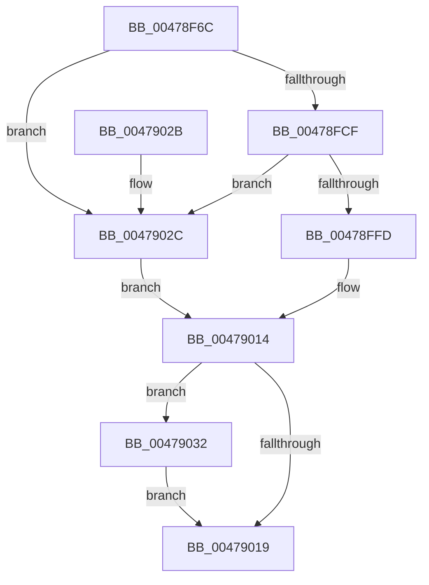

# CmSiCreateEvent

- RVA: `0x00478F6C`–`0x00479039` (길이 `205` bytes)
- VA: `0x0000000140478F6C`
- 실행 섹션: `.text`
- PDB 이름 있음: `예`; PDB Function 태그: `아니요`
- unwind 정보 RVA: `0x000ACEC0`
- 디코드: `56`개 명령, `205/205` bytes 표시
- 미해석 바이트: `0` (있으면 어셈블리에 `.byte`로 보존)

> 이 문서는 커널 이미지의 기계어와 PDB 기호를 분석해 생성했습니다. 4번과 5번은 함수 원형과 자료형을 바이너리 사용 방식에서 추정한 C 해석이며 원본 소스 복구 결과는 아닙니다.

## 1. Dependencies

- 직접 호출 지점: **3**; 고유 호출 대상: **3**
- 직접 호출자로 확인된 함수: **2**
- RIP 상대 이미지 참조: **0**

### Outgoing calls
- `0x00478FC4` → [ZwCreateEvent](../6A/ZwCreateEvent_function_006AD9D0.md) (function, `0x006AD9D0`)
- `0x00478FF2` → [ObReferenceObjectByHandle](../../page/86/ObReferenceObjectByHandle_function_00868DB0.md) (function, `0x00868DB0`)
- `0x00479032` → [ZwClose](../6A/ZwClose_function_006AD2B0.md) (function, `0x006AD2B0`)

### Direct callers
- [CmpHiveCacheCreateHiveEntry](../../page/7F/CmpHiveCacheCreateHiveEntry_function_007F5A68.md) at `0x007F5AE9`
- [CmpOpenHiveFile](../../page/87/CmpOpenHiveFile_function_0087A71C.md) at `0x0087A814`

### Static image references
- 디코드된 RIP-relative 메모리 참조가 없습니다.

## 2. Other-region calls and transfers

- 다른 실행 섹션으로 향하는 call: **1**
  - `0x00478FF2` → [ObReferenceObjectByHandle](../../page/86/ObReferenceObjectByHandle_function_00868DB0.md) (`.text` → `PAGE`)
- 별도 외부 분기/꼬리 이동을 확인하지 못했습니다.

## 3. Assembly (complete function range)

```asm
00478F6C  48 89 5C 24 08                  mov qword ptr [rsp + 8], rbx
00478F71  48 89 7C 24 10                  mov qword ptr [rsp + 0x10], rdi
00478F76  55                              push rbp
00478F77  48 8B EC                        mov rbp, rsp
00478F7A  48 83 EC 60                     sub rsp, 0x60
00478F7E  83 65 EC 00                     and dword ptr [rbp - 0x14], 0
00478F82  4C 8D 45 D0                     lea r8, [rbp - 0x30]
00478F86  48 83 65 20 00                  and qword ptr [rbp + 0x20], 0
00478F8B  48 8D 4D 20                     lea rcx, [rbp + 0x20]
00478F8F  48 83 65 D8 00                  and qword ptr [rbp - 0x28], 0
00478F94  48 8B FA                        mov rdi, rdx
00478F97  48 83 65 E0 00                  and qword ptr [rbp - 0x20], 0
00478F9C  0F 57 C0                        xorps xmm0, xmm0
00478F9F  48 C7 45 D0 30 00 00 00         mov qword ptr [rbp - 0x30], 0x30
00478FA7  BA 03 00 1F 00                  mov edx, 0x1f0003
00478FAC  83 65 D4 00                     and dword ptr [rbp - 0x2c], 0
00478FB0  45 33 C9                        xor r9d, r9d
00478FB3  F3 0F 7F 45 F0                  movdqu xmmword ptr [rbp - 0x10], xmm0
00478FB8  C7 45 E8 00 02 00 00            mov dword ptr [rbp - 0x18], 0x200
00478FBF  C6 44 24 20 00                  mov byte ptr [rsp + 0x20], 0
00478FC4  E8 07 4A 23 00                  call 0x1406ad9d0
00478FC9  8B D8                           mov ebx, eax
00478FCB  85 C0                           test eax, eax
00478FCD  78 5D                           js 0x14047902c
00478FCF  48 83 64 24 28 00               and qword ptr [rsp + 0x28], 0
00478FD5  48 8D 45 28                     lea rax, [rbp + 0x28]
00478FD9  48 8B 4D 20                     mov rcx, qword ptr [rbp + 0x20]
00478FDD  45 33 C9                        xor r9d, r9d
00478FE0  48 83 65 28 00                  and qword ptr [rbp + 0x28], 0
00478FE5  45 33 C0                        xor r8d, r8d
00478FE8  BA 03 00 1F 00                  mov edx, 0x1f0003
00478FED  48 89 44 24 20                  mov qword ptr [rsp + 0x20], rax
00478FF2  E8 B9 FD 3E 00                  call 0x140868db0
00478FF7  8B D8                           mov ebx, eax
00478FF9  85 C0                           test eax, eax
00478FFB  78 2F                           js 0x14047902c
00478FFD  48 8B 45 20                     mov rax, qword ptr [rbp + 0x20]
00479001  33 C9                           xor ecx, ecx
00479003  48 89 07                        mov qword ptr [rdi], rax
00479006  33 DB                           xor ebx, ebx
00479008  48 8B 45 28                     mov rax, qword ptr [rbp + 0x28]
0047900C  48 89 47 08                     mov qword ptr [rdi + 8], rax
00479010  48 89 4D 20                     mov qword ptr [rbp + 0x20], rcx
00479014  48 85 C9                        test rcx, rcx
00479017  75 19                           jne 0x140479032
00479019  48 8B 7C 24 78                  mov rdi, qword ptr [rsp + 0x78]
0047901E  8B C3                           mov eax, ebx
00479020  48 8B 5C 24 70                  mov rbx, qword ptr [rsp + 0x70]
00479025  48 83 C4 60                     add rsp, 0x60
00479029  5D                              pop rbp
0047902A  C3                              ret
0047902B  CC                              int3
0047902C  48 8B 4D 20                     mov rcx, qword ptr [rbp + 0x20]
00479030  EB E2                           jmp 0x140479014
00479032  E8 79 42 23 00                  call 0x1406ad2b0
00479037  EB E0                           jmp 0x140479019
```

## 4. C-style interpretation (structured pseudocode)

```c
__int64 __fastcall CmSiCreateEvent(__int64 a1, __int64 a2, __int64 a3, int a4)
{
    __int64 result;
    __int64 v_rbx;
    __int64 v_rsp;
    unsigned __int64 v_stack_m18;
    unsigned int v_stack_m1C;
    unsigned int v_stack_m20;
    unsigned __int64 v_stack_m28;
    unsigned __int64 v_stack_m30;
    unsigned int v_stack_m34;
    unsigned __int64 v_stack_m38;
    unsigned __int64 v_stack_m40;
    unsigned __int8 v_stack_m48;
    unsigned __int64 v_stack_p10;
    unsigned __int64 v_stack_p18;
    unsigned __int64 v_stack_p20;
    unsigned __int64 v_stack_p8;

    v_stack_p8 = v_rbx;
    v_stack_p10 = v_rdi;
    v_rsp = (v_rsp) - (96);
    v_stack_m38 = 48;
    a4 = 0;
    v_stack_m18 = v_xmm0;
    v_stack_m20 = 512;
    v_stack_m48 = 0;
    result = ZwCreateEvent(v_stack_p18, (unsigned int)(0x1F0003ULL), v_stack_m38, a4);
    if (sign_flag) goto loc_0047902C;
    a4 = 0;
    a3 = 0;
    v_stack_m48 = v_stack_p20;
    result = ObReferenceObjectByHandle(v_stack_p18, (unsigned int)(0x1F0003ULL), a3, a4);
    if (sign_flag) goto loc_0047902C;
    a1 = 0;
    *(unsigned __int64 *)(a2) = v_stack_p18;
    v_rbx = 0;
    *(unsigned __int64 *)(a2 + 8) = v_stack_p20;
    v_stack_p18 = 0;
loc_00479014:
    if (0 != 0) goto loc_00479032;
loc_00479019:
    v_rsp = (v_rsp) + (96);
    return 0;
loc_0047902C:
    goto loc_00479014;
loc_00479032:
    result = ZwClose(v_stack_p18, (unsigned int)(0x1F0003ULL), a3, a4);
    goto loc_00479019;
}
```

## 5. (Beta) C Style

```c
int64_t CmSiCreateEvent(int64_t Arg1, void *Arg2, int64_t Arg3, int32_t Arg4)
{
    uint8_t *arg2 = (uint8_t *)Arg2;

    int64_t result;
    int64_t local_rbx;
    int64_t local_rsp;
    uint64_t v_stack_m18;
    uint32_t v_stack_m1C;
    uint32_t v_stack_m20;
    uint64_t v_stack_m28;
    uint64_t v_stack_m30;
    uint32_t v_stack_m34;
    uint64_t v_stack_m38;
    uint64_t v_stack_m40;
    uint8_t v_stack_m48;
    uint64_t v_stack_p10;
    uint64_t v_stack_p18;
    uint64_t v_stack_p20;
    uint64_t v_stack_p8;

    v_stack_p8 = local_rbx;
    v_stack_p10 = local_rdi;
    local_rsp = (local_rsp) - (96);
    v_stack_m38 = 48;
    Arg4 = 0;
    v_stack_m18 = v_xmm0;
    v_stack_m20 = 512;
    v_stack_m48 = 0;
    result = ZwCreateEvent(v_stack_p18, (uint32_t)(0x1F0003ULL), v_stack_m38, Arg4);
    if (sign_flag) goto loc_0047902C;
    Arg4 = 0;
    Arg3 = 0;
    v_stack_m48 = v_stack_p20;
    result = ObReferenceObjectByHandle(v_stack_p18, (uint32_t)(0x1F0003ULL), Arg3, Arg4);
    if (sign_flag) goto loc_0047902C;
    Arg1 = 0;
    *(uint64_t *)(arg2) = v_stack_p18;
    local_rbx = 0;
    *(uint64_t *)(arg2 + 0x8) = v_stack_p20;
    v_stack_p18 = 0;
loc_00479014:
    if (0 != 0) goto loc_00479032;
loc_00479019:
    local_rsp = (local_rsp) + (96);
    return 0;
loc_0047902C:
    goto loc_00479014;
loc_00479032:
    result = ZwClose(v_stack_p18, (uint32_t)(0x1F0003ULL), Arg3, Arg4);
    goto loc_00479019;
}
```

### 관측된 메모리 오프셋

구조체 형식이 확인되지 않은 접근은 인자 기준의 오프셋으로만 기록했습니다.

| 기준 인자 | 오프셋 표현 | 폭 (bit) | 접근 |
|---|---:|---:|---|
| `Arg2` | `+ 0x0` | `64` | `W` |
| `Arg2` | `+ 0x8` | `64` | `W` |

## 6. Execution-region graph

[열기: 2D/3D 그래프와 함수 탐색 컨트롤 패널](../../../control-panel.html?section=text&rva=0x00478F6C&view=graph)

- 2D 그래프는 위에서 아래로 흐르고, 3D 그래프는 빈 공간을 드래그해 회전합니다. Shift+드래그는 이동, 휠은 확대·축소, 함수 노드 선택은 대상 보고서 이동입니다.

### Static fallback


