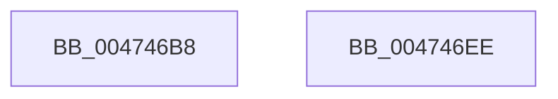

# CmSiProtectViewOfSection

- RVA: `0x004746B8`–`0x004746EF` (길이 `55` bytes)
- VA: `0x00000001404746B8`
- 실행 섹션: `.text`
- PDB 이름 있음: `예`; PDB Function 태그: `아니요`
- unwind 정보 RVA: `0x000AC7F4`
- 디코드: `15`개 명령, `55/55` bytes 표시
- 미해석 바이트: `0` (있으면 어셈블리에 `.byte`로 보존)

> 이 문서는 커널 이미지의 기계어와 PDB 기호를 분석해 생성했습니다. 4번과 5번은 함수 원형과 자료형을 바이너리 사용 방식에서 추정한 C 해석이며 원본 소스 복구 결과는 아닙니다.

## 1. Dependencies

- 직접 호출 지점: **1**; 고유 호출 대상: **1**
- 직접 호출자로 확인된 함수: **10**
- RIP 상대 이미지 참조: **0**

### Outgoing calls
- `0x004746E4` → [ZwProtectVirtualMemory](../6A/ZwProtectVirtualMemory_function_006ADAD0.md) (function, `0x006ADAD0`)

### Direct callers
- [HvpViewMapMigrateCOWData](../../page/7E/HvpViewMapMigrateCOWData_function_007EEC0C.md) at `0x007EED5C`
- [HvpViewMapMakeViewRangeUnCOWByCaller](../../page/9B/HvpViewMapMakeViewRangeUnCOWByCaller_function_009B549C.md) at `0x009B550E`
- [HvpViewMapMakeViewRangeReadOnly](../../page/9B/HvpViewMapMakeViewRangeReadOnly_function_009B5AC8.md) at `0x009B5B08`
- [HvpViewMapMakeViewRangeCOWByCaller](../../page/9B/HvpViewMapMakeViewRangeCOWByCaller_function_009B5BB4.md) at `0x009B5BFB`
- [HvpViewMapMakeViewRangeValid](../../page/9B/HvpViewMapMakeViewRangeValid_function_009B5E00.md) at `0x009B5E57`
- [HvpViewMapMakeViewRangeValid](../../page/9B/HvpViewMapMakeViewRangeValid_function_009B5E00.md) at `0x009B5FEB`
- [HvpViewMapMakeViewRangeValid](../../page/9B/HvpViewMapMakeViewRangeValid_function_009B5E00.md) at `0x009B6015`
- [HvpViewMapMakeViewRangeValid](../../page/9B/HvpViewMapMakeViewRangeValid_function_009B5E00.md) at `0x009B6052`
- [HvpViewMapCreateView](../../page/9B/HvpViewMapCreateView_function_009B6310.md) at `0x009B63C0`
- [HvpMappedViewConvertRegionFromLockedToCOWByPolicy](../../page/9B/HvpMappedViewConvertRegionFromLockedToCOWByPolicy_function_009B75B8.md) at `0x009B760B`
- [HvpMappedViewConvertRegionFromLockedToCOWByPolicy](../../page/9B/HvpMappedViewConvertRegionFromLockedToCOWByPolicy_function_009B75B8.md) at `0x009B7641`
- [HvpViewMapMakeViewRangeUnCOWByPolicy](../../page/9B/HvpViewMapMakeViewRangeUnCOWByPolicy_function_009B76A8.md) at `0x009B7763`
- [HvpViewMapMakeViewRangeInvalid](../../page/9B/HvpViewMapMakeViewRangeInvalid_function_009B7770.md) at `0x009B780F`
- [sub_00B2DD4A](../../page/B2/Unknown_function_00B2DD4A.md) at `0x00B2DD82`

### Static image references
- 디코드된 RIP-relative 메모리 참조가 없습니다.

## 2. Other-region calls and transfers

- 다른 실행 섹션으로 향하는 call: **0**
- 별도 외부 분기/꼬리 이동을 확인하지 못했습니다.

## 3. Assembly (complete function range)

```asm
004746B8  4C 8B DC                        mov r11, rsp
004746BB  49 89 4B 08                     mov qword ptr [r11 + 8], rcx
004746BF  48 83 EC 38                     sub rsp, 0x38
004746C3  48 8B 0A                        mov rcx, qword ptr [rdx]
004746C6  49 8D 53 10                     lea rdx, [r11 + 0x10]
004746CA  48 8B 44 24 68                  mov rax, qword ptr [rsp + 0x68]
004746CF  4D 89 43 10                     mov qword ptr [r11 + 0x10], r8
004746D3  4D 8D 43 08                     lea r8, [r11 + 8]
004746D7  4D 89 4B 08                     mov qword ptr [r11 + 8], r9
004746DB  44 8B 4C 24 60                  mov r9d, dword ptr [rsp + 0x60]
004746E0  49 89 43 E8                     mov qword ptr [r11 - 0x18], rax
004746E4  E8 E7 93 23 00                  call 0x1406adad0
004746E9  48 83 C4 38                     add rsp, 0x38
004746ED  C3                              ret
004746EE  CC                              int3
```

## 4. C-style interpretation (structured pseudocode)

```c
__int64 __fastcall CmSiProtectViewOfSection(__int64 a1, __int64 a2, __int64 a3, __int64 a4, unsigned int a5, __int64 a6)
{
    __int64 result;
    __int64 v_rsp;

    *(unsigned __int64 *)(v_rsp + 8) = a1;
    v_rsp = (v_rsp) - (56);
    *(unsigned __int64 *)(v_rsp + 16) = a3;
    *(unsigned __int64 *)(v_rsp + 8) = a4;
    *(unsigned __int64 *)(v_rsp - 24) = a6;
    result = ZwProtectVirtualMemory(*(unsigned __int64 *)(a2), v_rsp + 16, v_rsp + 8, (unsigned int)(a5));
    v_rsp = (v_rsp) + (56);
    return result;
}
```

## 5. (Beta) C Style

```c
int64_t CmSiProtectViewOfSection(int64_t Arg1, void *Arg2, int64_t Arg3, int64_t Arg4, uint32_t Arg5, int64_t Arg6)
{
    uint8_t *arg2 = (uint8_t *)Arg2;

    int64_t result;
    int64_t local_rsp;

    *(uint64_t *)(local_rsp + 0x8) = Arg1;
    local_rsp = (local_rsp) - (56);
    *(uint64_t *)(local_rsp + 0x10) = Arg3;
    *(uint64_t *)(local_rsp + 0x8) = Arg4;
    *(uint64_t *)(local_rsp - 0x18) = Arg6;
    result = ZwProtectVirtualMemory(*(uint64_t *)(arg2), local_rsp + 16, local_rsp + 8, (uint32_t)(Arg5));
    local_rsp = (local_rsp) + (56);
    return result;
}
```

### 관측된 메모리 오프셋

구조체 형식이 확인되지 않은 접근은 인자 기준의 오프셋으로만 기록했습니다.

| 기준 인자 | 오프셋 표현 | 폭 (bit) | 접근 |
|---|---:|---:|---|
| `Arg2` | `+ 0x0` | `64` | `R` |

## 6. Execution-region graph

[열기: 2D/3D 그래프와 함수 탐색 컨트롤 패널](../../../control-panel.html?section=text&rva=0x004746B8&view=graph)

- 2D 그래프는 위에서 아래로 흐르고, 3D 그래프는 빈 공간을 드래그해 회전합니다. Shift+드래그는 이동, 휠은 확대·축소, 함수 노드 선택은 대상 보고서 이동입니다.

### Static fallback


