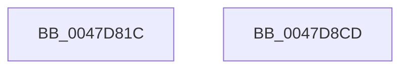

# CmSiReleaseProcessLockedPagesCharge

- RVA: `0x0047D81C`–`0x0047D8CE` (길이 `178` bytes)
- VA: `0x000000014047D81C`
- 실행 섹션: `.text`
- PDB 이름 있음: `예`; PDB Function 태그: `아니요`
- unwind 정보 RVA: `0x000ADB18`
- 디코드: `47`개 명령, `178/178` bytes 표시
- 미해석 바이트: `0` (있으면 어셈블리에 `.byte`로 보존)

> 이 문서는 커널 이미지의 기계어와 PDB 기호를 분석해 생성했습니다. 4번과 5번은 함수 원형과 자료형을 바이너리 사용 방식에서 추정한 C 해석이며 원본 소스 복구 결과는 아닙니다.

## 1. Dependencies

- 직접 호출 지점: **6**; 고유 호출 대상: **6**
- 직접 호출자로 확인된 함수: **4**
- RIP 상대 이미지 참조: **1**

### Outgoing calls
- `0x0047D858` → [KeStackAttachProcess](../21/KeStackAttachProcess_function_00216800.md) (function, `0x00216800`)
- `0x0047D861` → [CmSiRWLockAcquireExclusive](../../page/A1/CmSiRWLockAcquireExclusive_function_00A1679C.md) (function, `0x00A1679C`)
- `0x0047D88E` → [MmAdjustWorkingSetSizeEx](MmAdjustWorkingSetSizeEx_function_0047D8D4.md) (function, `0x0047D8D4`)
- `0x0047D89F` → [CmSiRWLockReleaseExclusive](../../page/A0/CmSiRWLockReleaseExclusive_function_00A0DAB0.md) (function, `0x00A0DAB0`)
- `0x0047D8AB` → [KiUnstackDetachProcess](../21/KiUnstackDetachProcess_function_00217D30.md) (function, `0x00217D30`)
- `0x0047D8B8` → [_security_check_cookie](../6A/_security_check_cookie_function_006AC640.md) (function, `0x006AC640`)

### Direct callers
- [HvpViewMapMakeViewRangeCOWByCaller](../../page/9B/HvpViewMapMakeViewRangeCOWByCaller_function_009B5BB4.md) at `0x009B5C72`
- [HvpViewMapAcquireChargesAndLockViewPages](../../page/9B/HvpViewMapAcquireChargesAndLockViewPages_function_009B6480.md) at `0x009B64E2`
- [HvpViewMapFreeView](../../page/9B/HvpViewMapFreeView_function_009B6F9C.md) at `0x009B6FD7`
- [HvpViewMapReleaseChargesAndUnlockViewPages](../../page/9B/HvpViewMapReleaseChargesAndUnlockViewPages_function_009B7870.md) at `0x009B788B`

### Static image references
- `0x0047D828` → RVA `0x00E0A740` (`.data`; read)

## 2. Other-region calls and transfers

- 다른 실행 섹션으로 향하는 call: **2**
  - `0x0047D861` → [CmSiRWLockAcquireExclusive](../../page/A1/CmSiRWLockAcquireExclusive_function_00A1679C.md) (`.text` → `PAGE`)
  - `0x0047D89F` → [CmSiRWLockReleaseExclusive](../../page/A0/CmSiRWLockReleaseExclusive_function_00A0DAB0.md) (`.text` → `PAGE`)
- 별도 외부 분기/꼬리 이동을 확인하지 못했습니다.

## 3. Assembly (complete function range)

```asm
0047D81C  48 89 5C 24 18                  mov qword ptr [rsp + 0x18], rbx
0047D821  55                              push rbp
0047D822  56                              push rsi
0047D823  57                              push rdi
0047D824  48 83 EC 70                     sub rsp, 0x70
0047D828  48 8B 05 11 CF 98 00            mov rax, qword ptr [rip + 0x98cf11]
0047D82F  48 33 C4                        xor rax, rsp
0047D832  48 89 44 24 68                  mov qword ptr [rsp + 0x68], rax
0047D837  0F 57 C0                        xorps xmm0, xmm0
0047D83A  48 8B EA                        mov rbp, rdx
0047D83D  48 8B F1                        mov rsi, rcx
0047D840  48 8D 54 24 38                  lea rdx, [rsp + 0x38]
0047D845  48 8B 49 08                     mov rcx, qword ptr [rcx + 8]
0047D849  0F 11 44 24 38                  movups xmmword ptr [rsp + 0x38], xmm0
0047D84E  0F 11 44 24 48                  movups xmmword ptr [rsp + 0x48], xmm0
0047D853  0F 11 44 24 58                  movups xmmword ptr [rsp + 0x58], xmm0
0047D858  E8 A3 8F D9 FF                  call 0x140216800
0047D85D  48 8D 4E 10                     lea rcx, [rsi + 0x10]
0047D861  E8 36 8F 59 00                  call 0x140a1679c
0047D866  48 8B 5E 20                     mov rbx, qword ptr [rsi + 0x20]
0047D86A  48 8D 44 24 30                  lea rax, [rsp + 0x30]
0047D86F  48 8B 56 28                     mov rdx, qword ptr [rsi + 0x28]
0047D873  48 2B DD                        sub rbx, rbp
0047D876  48 89 44 24 28                  mov qword ptr [rsp + 0x28], rax
0047D87B  48 8B CB                        mov rcx, rbx
0047D87E  83 64 24 20 00                  and dword ptr [rsp + 0x20], 0
0047D883  45 33 C9                        xor r9d, r9d
0047D886  45 33 C0                        xor r8d, r8d
0047D889  C6 44 24 30 00                  mov byte ptr [rsp + 0x30], 0
0047D88E  E8 41 00 00 00                  call 0x14047d8d4
0047D893  48 29 6E 18                     sub qword ptr [rsi + 0x18], rbp
0047D897  48 8D 4E 10                     lea rcx, [rsi + 0x10]
0047D89B  48 89 5E 20                     mov qword ptr [rsi + 0x20], rbx
0047D89F  E8 0C 02 59 00                  call 0x140a0dab0
0047D8A4  33 D2                           xor edx, edx
0047D8A6  48 8D 4C 24 38                  lea rcx, [rsp + 0x38]
0047D8AB  E8 80 A4 D9 FF                  call 0x140217d30
0047D8B0  48 8B 4C 24 68                  mov rcx, qword ptr [rsp + 0x68]
0047D8B5  48 33 CC                        xor rcx, rsp
0047D8B8  E8 83 ED 22 00                  call 0x1406ac640
0047D8BD  48 8B 9C 24 A0 00 00 00         mov rbx, qword ptr [rsp + 0xa0]
0047D8C5  48 83 C4 70                     add rsp, 0x70
0047D8C9  5F                              pop rdi
0047D8CA  5E                              pop rsi
0047D8CB  5D                              pop rbp
0047D8CC  C3                              ret
0047D8CD  CC                              int3
```

## 4. C-style interpretation (structured pseudocode)

```c
__int64 __fastcall CmSiReleaseProcessLockedPagesCharge(__int64 a1, __int64 a2, int a3, int a4)
{
    __int64 result;
    __int64 v_rbx;
    __int64 v_rsp;
    unsigned __int64 v_stack_m20;
    unsigned __int64 v_stack_m30;
    unsigned __int64 v_stack_m40;
    unsigned __int64 v_stack_m50;
    unsigned __int64 v_stack_m58;
    unsigned __int64 v_stack_m60;
    unsigned int v_stack_m68;
    unsigned __int64 v_stack_p18;

    v_stack_p18 = v_rbx;
    v_rsp = (v_rsp) - (112);
    result = (*(unsigned __int64 *)(v_rip + 10014481)) ^ (v_rsp);
    v_stack_m20 = result;
    v_stack_m50 = v_xmm0;
    v_stack_m40 = v_xmm0;
    v_stack_m30 = v_xmm0;
    result = KeStackAttachProcess(*(unsigned __int64 *)(a1 + 8), v_stack_m50, a3, a4);
    result = CmSiRWLockAcquireExclusive(a1 + 16, v_stack_m50, a3, a4);
    v_rbx = (*(unsigned __int64 *)(a1 + 32)) - (a2);
    v_stack_m60 = v_stack_m58;
    a4 = 0;
    a3 = 0;
    v_stack_m58 = 0;
    result = MmAdjustWorkingSetSizeEx(v_rbx, *(unsigned __int64 *)(a1 + 40), a3, a4);
    *(unsigned __int64 *)(a1 + 32) = v_rbx;
    result = CmSiRWLockReleaseExclusive(a1 + 16, *(unsigned __int64 *)(a1 + 40), a3, a4);
    a2 = 0;
    result = KiUnstackDetachProcess(v_stack_m50, a2, a3, a4);
    a1 = (v_stack_m20) ^ (v_rsp);
    result = _security_check_cookie(a1, a2, a3, a4);
    v_rsp = (v_rsp) + (112);
    return result;
}
```

## 5. (Beta) C Style

```c
int64_t CmSiReleaseProcessLockedPagesCharge(void *Arg1, int64_t Arg2, int32_t Arg3, int32_t Arg4)
{
    uint8_t *arg1 = (uint8_t *)Arg1;

    int64_t result;
    int64_t local_rbx;
    int64_t local_rsp;
    uint64_t v_stack_m20;
    uint64_t v_stack_m30;
    uint64_t v_stack_m40;
    uint64_t v_stack_m50;
    uint64_t v_stack_m58;
    uint64_t v_stack_m60;
    uint32_t v_stack_m68;
    uint64_t v_stack_p18;

    v_stack_p18 = local_rbx;
    local_rsp = (local_rsp) - (112);
    result = (*(uint64_t *)(v_rip + 0x98CF11)) ^ (local_rsp);
    v_stack_m20 = result;
    v_stack_m50 = v_xmm0;
    v_stack_m40 = v_xmm0;
    v_stack_m30 = v_xmm0;
    result = KeStackAttachProcess(*(uint64_t *)(arg1 + 0x8), v_stack_m50, Arg3, Arg4);
    result = CmSiRWLockAcquireExclusive(Arg1 + 16, v_stack_m50, Arg3, Arg4);
    local_rbx = (*(uint64_t *)(arg1 + 0x20)) - (Arg2);
    v_stack_m60 = v_stack_m58;
    Arg4 = 0;
    Arg3 = 0;
    v_stack_m58 = 0;
    result = MmAdjustWorkingSetSizeEx(local_rbx, *(uint64_t *)(arg1 + 0x28), Arg3, Arg4);
    *(uint64_t *)(arg1 + 0x20) = local_rbx;
    result = CmSiRWLockReleaseExclusive(Arg1 + 16, *(uint64_t *)(arg1 + 0x28), Arg3, Arg4);
    Arg2 = 0;
    result = KiUnstackDetachProcess(v_stack_m50, Arg2, Arg3, Arg4);
    Arg1 = (v_stack_m20) ^ (local_rsp);
    result = _security_check_cookie(Arg1, Arg2, Arg3, Arg4);
    local_rsp = (local_rsp) + (112);
    return result;
}
```

### 관측된 메모리 오프셋

구조체 형식이 확인되지 않은 접근은 인자 기준의 오프셋으로만 기록했습니다.

| 기준 인자 | 오프셋 표현 | 폭 (bit) | 접근 |
|---|---:|---:|---|
| `Arg1` | `+ 0x8` | `64` | `R` |
| `Arg1` | `+ 0x10` | `64` | `R` |
| `Arg1` | `+ 0x18` | `64` | `R/W` |
| `Arg1` | `+ 0x20` | `64` | `R` |
| `Arg1` | `+ 0x20` | `64` | `W` |
| `Arg1` | `+ 0x28` | `64` | `R` |

## 6. Execution-region graph

[열기: 2D/3D 그래프와 함수 탐색 컨트롤 패널](../../../control-panel.html?section=text&rva=0x0047D81C&view=graph)

- 2D 그래프는 위에서 아래로 흐르고, 3D 그래프는 빈 공간을 드래그해 회전합니다. Shift+드래그는 이동, 휠은 확대·축소, 함수 노드 선택은 대상 보고서 이동입니다.

### Static fallback


