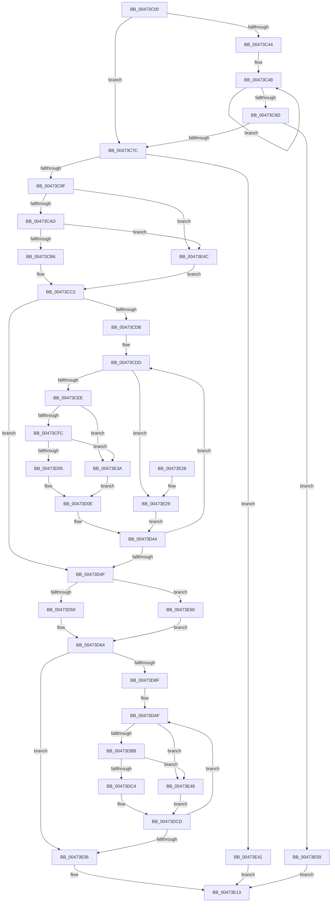

# CreateNewEventEntry

- RVA: `0x00473C00`–`0x00473E67` (길이 `615` bytes)
- VA: `0x0000000140473C00`
- 실행 섹션: `.text`
- PDB 이름 있음: `예`; PDB Function 태그: `예`
- unwind 정보 RVA: `0x000AC600`
- 디코드: `165`개 명령, `615/615` bytes 표시
- 미해석 바이트: `0` (있으면 어셈블리에 `.byte`로 보존)

> 이 문서는 커널 이미지의 기계어와 PDB 기호를 분석해 생성했습니다. 4번과 5번은 함수 원형과 자료형을 바이너리 사용 방식에서 추정한 C 해석이며 원본 소스 복구 결과는 아닙니다.

## 1. Dependencies

- 직접 호출 지점: **3**; 고유 호출 대상: **2**
- 직접 호출자로 확인된 함수: **1**
- RIP 상대 이미지 참조: **0**

### Outgoing calls
- `0x00473C92` → [CBufferAllocate](CBufferAllocate_function_00473E70.md) (function, `0x00473E70`)
- `0x00473D1B` → [memcpy](../6C/memcpy_function_006C6840.md) (function, `0x006C6840`)
- `0x00473DD4` → [memcpy](../6C/memcpy_function_006C6840.md) (function, `0x006C6840`)

### Direct callers
- [InsertEventEntryInLookUpTable](../2F/InsertEventEntryInLookUpTable_function_002F1424.md) at `0x002F1680`

### Static image references
- 디코드된 RIP-relative 메모리 참조가 없습니다.

## 2. Other-region calls and transfers

- 다른 실행 섹션으로 향하는 call: **0**
- 별도 외부 분기/꼬리 이동을 확인하지 못했습니다.

## 3. Assembly (complete function range)

```asm
00473C00  48 89 5C 24 08                  mov qword ptr [rsp + 8], rbx
00473C05  48 89 54 24 10                  mov qword ptr [rsp + 0x10], rdx
00473C0A  55                              push rbp
00473C0B  56                              push rsi
00473C0C  57                              push rdi
00473C0D  41 54                           push r12
00473C0F  41 55                           push r13
00473C11  41 56                           push r14
00473C13  41 57                           push r15
00473C15  48 83 EC 30                     sub rsp, 0x30
00473C19  48 8B 84 24 A0 00 00 00         mov rax, qword ptr [rsp + 0xa0]
00473C21  4D 8B E9                        mov r13, r9
00473C24  45 0F B6 F8                     movzx r15d, r8b
00473C28  45 33 D2                        xor r10d, r10d
00473C2B  45 33 C0                        xor r8d, r8d
00473C2E  45 32 C9                        xor r9b, r9b
00473C31  0F 57 C0                        xorps xmm0, xmm0
00473C34  44 8A D9                        mov r11b, cl
00473C37  4C 21 00                        and qword ptr [rax], r8
00473C3A  0F 11 44 24 20                  movups xmmword ptr [rsp + 0x20], xmm0
00473C3F  45 84 FF                        test r15b, r15b
00473C42  74 38                           je 0x140473c7c
00473C44  49 8D 55 08                     lea rdx, [r13 + 8]
00473C48  8B 0A                           mov ecx, dword ptr [rdx]
00473C4A  41 80 F9 02                     cmp r9b, 2
00473C4E  48 8D 52 10                     lea rdx, [rdx + 0x10]
00473C52  4A 8D 04 11                     lea rax, [rcx + r10]
00473C56  4C 0F 43 D0                     cmovae r10, rax
00473C5A  4A 8D 04 01                     lea rax, [rcx + r8]
00473C5E  49 0F 43 C0                     cmovae rax, r8
00473C62  41 FE C1                        inc r9b
00473C65  4C 8B C0                        mov r8, rax
00473C68  45 3A CF                        cmp r9b, r15b
00473C6B  72 DB                           jb 0x140473c48
00473C6D  49 03 C2                        add rax, r10
00473C70  48 3D FF FF 00 00               cmp rax, 0xffff
00473C76  0F 87 DD 01 00 00               ja 0x140473e59
00473C7C  49 8B FF                        mov rdi, r15
00473C7F  48 8D 54 24 20                  lea rdx, [rsp + 0x20]
00473C84  48 C1 E7 04                     shl rdi, 4
00473C88  41 8A CB                        mov cl, r11b
00473C8B  4C 8D 47 2E                     lea r8, [rdi + 0x2e]
00473C8F  4D 03 C2                        add r8, r10
00473C92  E8 D9 01 00 00                  call 0x140473e70
00473C97  85 C0                           test eax, eax
00473C99  0F 84 A2 01 00 00               je 0x140473e41
00473C9F  48 8B 5C 24 28                  mov rbx, qword ptr [rsp + 0x28]
00473CA4  48 85 FF                        test rdi, rdi
00473CA7  0F 84 9F 01 00 00               je 0x140473e4c
00473CAD  48 3B DF                        cmp rbx, rdi
00473CB0  0F 82 96 01 00 00               jb 0x140473e4c
00473CB6  4C 8B 74 24 20                  mov r14, qword ptr [rsp + 0x20]
00473CBB  48 2B DF                        sub rbx, rdi
00473CBE  4D 8D 24 3E                     lea r12, [r14 + rdi]
00473CC2  0F B6 B4 24 90 00 00 00         movzx esi, byte ptr [rsp + 0x90]
00473CCA  40 32 ED                        xor bpl, bpl
00473CCD  8B C6                           mov eax, esi
00473CCF  83 C0 02                        add eax, 2
00473CD2  89 84 24 80 00 00 00            mov dword ptr [rsp + 0x80], eax
00473CD9  74 74                           je 0x140473d4f
00473CDB  8B C8                           mov ecx, eax
00473CDD  40 0F B6 FD                     movzx edi, bpl
00473CE1  48 03 FF                        add rdi, rdi
00473CE4  40 80 FD 02                     cmp bpl, 2
00473CE8  0F 82 3B 01 00 00               jb 0x140473e29
00473CEE  45 8B 44 FD 08                  mov r8d, dword ptr [r13 + rdi*8 + 8]
00473CF3  4D 85 C0                        test r8, r8
00473CF6  0F 84 3E 01 00 00               je 0x140473e3a
00473CFC  49 3B D8                        cmp rbx, r8
00473CFF  0F 82 35 01 00 00               jb 0x140473e3a
00473D05  49 8B C4                        mov rax, r12
00473D08  4D 03 E0                        add r12, r8
00473D0B  49 2B D8                        sub rbx, r8
00473D0E  49 8B 54 FD 00                  mov rdx, qword ptr [r13 + rdi*8]
00473D13  48 8B C8                        mov rcx, rax
00473D16  48 89 44 24 20                  mov qword ptr [rsp + 0x20], rax
00473D1B  E8 20 2B 25 00                  call 0x1406c6840
00473D20  48 8B 44 24 20                  mov rax, qword ptr [rsp + 0x20]
00473D25  8B 8C 24 80 00 00 00            mov ecx, dword ptr [rsp + 0x80]
00473D2C  49 89 04 FE                     mov qword ptr [r14 + rdi*8], rax
00473D30  41 8B 44 FD 0C                  mov eax, dword ptr [r13 + rdi*8 + 0xc]
00473D35  41 89 44 FE 0C                  mov dword ptr [r14 + rdi*8 + 0xc], eax
00473D3A  41 8B 44 FD 08                  mov eax, dword ptr [r13 + rdi*8 + 8]
00473D3F  41 89 44 FE 08                  mov dword ptr [r14 + rdi*8 + 8], eax
00473D44  40 FE C5                        inc bpl
00473D47  40 0F B6 C5                     movzx eax, bpl
00473D4B  3B C1                           cmp eax, ecx
00473D4D  72 8E                           jb 0x140473cdd
00473D4F  48 83 FB 2E                     cmp rbx, 0x2e
00473D53  0F 82 07 01 00 00               jb 0x140473e60
00473D59  49 8B FC                        mov rdi, r12
00473D5C  49 83 C4 2E                     add r12, 0x2e
00473D60  48 83 EB 2E                     sub rbx, 0x2e
00473D64  48 8B 44 24 78                  mov rax, qword ptr [rsp + 0x78]
00473D69  4C 89 77 10                     mov qword ptr [rdi + 0x10], r14
00473D6D  0F 10 00                        movups xmm0, xmmword ptr [rax]
00473D70  8B 84 24 98 00 00 00            mov eax, dword ptr [rsp + 0x98]
00473D77  40 88 77 2D                     mov byte ptr [rdi + 0x2d], sil
00473D7B  40 80 C6 02                     add sil, 2
00473D7F  44 88 7F 2C                     mov byte ptr [rdi + 0x2c], r15b
00473D83  89 47 28                        mov dword ptr [rdi + 0x28], eax
00473D86  F3 0F 7F 07                     movdqu xmmword ptr [rdi], xmm0
00473D8A  41 3A F7                        cmp sil, r15b
00473D8D  73 77                           jae 0x140473e06
00473D8F  44 0F B6 F6                     movzx r14d, sil
00473D93  48 C7 C5 F8 FF FF FF            mov rbp, 0xfffffffffffffff8
00473D9A  49 C1 E6 04                     shl r14, 4
00473D9E  49 2B ED                        sub rbp, r13
00473DA1  49 83 C6 08                     add r14, 8
00473DA5  4D 03 F5                        add r14, r13
00473DA8  44 2A FE                        sub r15b, sil
00473DAB  45 0F B6 FF                     movzx r15d, r15b
00473DAF  45 8B 06                        mov r8d, dword ptr [r14]
00473DB2  4D 85 C0                        test r8, r8
00473DB5  0F 84 8D 00 00 00               je 0x140473e48
00473DBB  49 3B D8                        cmp rbx, r8
00473DBE  0F 82 84 00 00 00               jb 0x140473e48
00473DC4  49 8B F4                        mov rsi, r12
00473DC7  4D 03 E0                        add r12, r8
00473DCA  49 2B D8                        sub rbx, r8
00473DCD  49 8B 56 F8                     mov rdx, qword ptr [r14 - 8]
00473DD1  48 8B CE                        mov rcx, rsi
00473DD4  E8 67 2A 25 00                  call 0x1406c6840
00473DD9  48 8B 47 10                     mov rax, qword ptr [rdi + 0x10]
00473DDD  49 8D 14 2E                     lea rdx, [r14 + rbp]
00473DE1  48 89 34 02                     mov qword ptr [rdx + rax], rsi
00473DE5  41 8B 46 04                     mov eax, dword ptr [r14 + 4]
00473DE9  48 8B 4F 10                     mov rcx, qword ptr [rdi + 0x10]
00473DED  89 44 0A 0C                     mov dword ptr [rdx + rcx + 0xc], eax
00473DF1  41 8B 06                        mov eax, dword ptr [r14]
00473DF4  49 83 C6 10                     add r14, 0x10
00473DF8  48 8B 4F 10                     mov rcx, qword ptr [rdi + 0x10]
00473DFC  89 44 0A 08                     mov dword ptr [rdx + rcx + 8], eax
00473E00  49 83 EF 01                     sub r15, 1
00473E04  75 A9                           jne 0x140473daf
00473E06  48 8B 84 24 A0 00 00 00         mov rax, qword ptr [rsp + 0xa0]
00473E0E  48 89 38                        mov qword ptr [rax], rdi
00473E11  33 C0                           xor eax, eax
00473E13  48 8B 5C 24 70                  mov rbx, qword ptr [rsp + 0x70]
00473E18  48 83 C4 30                     add rsp, 0x30
00473E1C  41 5F                           pop r15
00473E1E  41 5E                           pop r14
00473E20  41 5D                           pop r13
00473E22  41 5C                           pop r12
00473E24  5F                              pop rdi
00473E25  5E                              pop rsi
00473E26  5D                              pop rbp
00473E27  C3                              ret
00473E28  CC                              int3
00473E29  41 0F 10 44 FD 00               movups xmm0, xmmword ptr [r13 + rdi*8]
00473E2F  F3 41 0F 7F 04 FE               movdqu xmmword ptr [r14 + rdi*8], xmm0
00473E35  E9 0A FF FF FF                  jmp 0x140473d44
00473E3A  33 C0                           xor eax, eax
00473E3C  E9 CD FE FF FF                  jmp 0x140473d0e
00473E41  B8 17 00 00 C0                  mov eax, 0xc0000017
00473E46  EB CB                           jmp 0x140473e13
00473E48  33 F6                           xor esi, esi
00473E4A  EB 81                           jmp 0x140473dcd
00473E4C  4C 8B 64 24 20                  mov r12, qword ptr [rsp + 0x20]
00473E51  45 33 F6                        xor r14d, r14d
00473E54  E9 69 FE FF FF                  jmp 0x140473cc2
00473E59  B8 95 00 00 C0                  mov eax, 0xc0000095
00473E5E  EB B3                           jmp 0x140473e13
00473E60  33 FF                           xor edi, edi
00473E62  E9 FD FE FF FF                  jmp 0x140473d64
```

## 4. C-style interpretation (structured pseudocode)

```c
__int64 __fastcall CreateNewEventEntry(unsigned __int8 a1, __int64 a2, int a3, __int64 a4, unsigned __int8 a5, unsigned int a6, __int64 a7)
{
    __int64 result;
    __int64 v_r10;
    __int64 v_r12;
    __int64 v_r14;
    __int64 v_r15;
    __int64 v_rbp;
    __int64 v_rbx;
    __int64 v_rdi;
    __int64 v_rsi;
    __int64 v_rsp;
    unsigned __int64 v_stack_m40;
    unsigned __int64 v_stack_m48;
    unsigned __int64 v_stack_p10;
    unsigned int v_stack_p18;
    unsigned __int64 v_stack_p20;
    unsigned __int64 v_stack_p8;

    v_stack_p8 = v_rbx;
    v_stack_p10 = a2;
    v_rsp = (v_rsp) - (48);
    v_r10 = 0;
    a3 = 0;
    a4 = 0;
    v_stack_m48 = v_xmm0;
    if ((unsigned __int8)((unsigned __int8)(a3)) == 0) goto loc_00473C7C;
loc_00473C48:
    if (0 >= 2) { v_r10 = (unsigned int)(*(unsigned int *)(a4 + 8)) + v_r10 * 1; }
    result = (unsigned int)(*(unsigned int *)(a4 + 8)) + a3 * 1;
    if (0 >= 2) { result = 0; }
    a4 = (unsigned __int8)((a4) + 1);
    if (((unsigned __int8)(a4)) < ((unsigned __int8)((unsigned __int8)(a3)))) goto loc_00473C48;
    result = (result) + (v_r10);
    if (result > 0xFFFFULL) goto loc_00473E59;
loc_00473C7C:
    v_rdi = ((unsigned __int8)(a3)) << (4);
    a3 = (v_rdi + 46) + (v_r10);
    result = CBufferAllocate(a1, v_stack_m48, a3, a4);
    if ((unsigned int)(result) == 0) goto loc_00473E41;
    if (v_rdi == 0) goto loc_00473E4C;
    if (v_stack_m40 < v_rdi) goto loc_00473E4C;
    v_rbx = (v_stack_m40) - (v_rdi);
loc_00473CC2:
    v_rbp = 0;
    result = (unsigned int)(((unsigned int)(a5)) + (2));
    v_stack_p18 = (unsigned int)(result);
    if (condition_is_equal) goto loc_00473D4F;
loc_00473CDD:
    v_rdi = (0) + (0);
    if (0 < 2) goto loc_00473E29;
    if ((unsigned int)(*(unsigned int *)(a4 + v_rdi * 8 + 8)) == 0) goto loc_00473E3A;
    if (v_rbx < ((unsigned int)(*(unsigned int *)(a4 + v_rdi * 8 + 8)))) goto loc_00473E3A;
    v_r12 = (v_stack_m48 + v_rdi * 1) + ((unsigned int)(*(unsigned int *)(a4 + v_rdi * 8 + 8)));
    v_rbx = (v_rbx) - ((unsigned int)(*(unsigned int *)(a4 + v_rdi * 8 + 8)));
loc_00473D0E:
    v_stack_m48 = v_stack_m48 + v_rdi * 1;
    result = memcpy(v_stack_m48 + v_rdi * 1, *(unsigned __int64 *)(a4 + v_rdi * 8), (unsigned int)(*(unsigned int *)(a4 + v_rdi * 8 + 8)), a4);
    *(unsigned __int64 *)(v_stack_m48 + v_rdi * 8) = v_stack_m48;
    *(unsigned int *)(v_stack_m48 + v_rdi * 8 + 12) = (unsigned int)((unsigned int)(*(unsigned int *)(a4 + v_rdi * 8 + 12)));
    *(unsigned int *)(v_stack_m48 + v_rdi * 8 + 8) = (unsigned int)((unsigned int)(*(unsigned int *)(a4 + v_rdi * 8 + 8)));
loc_00473D44:
    v_rbp = (unsigned __int8)((v_rbp) + 1);
    if (((unsigned int)((unsigned __int8)(v_rbp))) < ((unsigned int)((unsigned int)(v_stack_p18)))) goto loc_00473CDD;
loc_00473D4F:
    if (v_rbx < 46) goto loc_00473E60;
    v_r12 = (v_r12) + (46);
    v_rbx = (v_rbx) - (46);
loc_00473D64:
    *(unsigned __int64 *)(v_r12 + 16) = v_stack_m48;
    *(unsigned __int8 *)(v_r12 + 45) = a5;
    v_rsi = (unsigned __int8)((a5) + (2));
    *(unsigned __int8 *)(v_r12 + 44) = (unsigned __int8)((unsigned __int8)(a3));
    *(unsigned int *)(v_r12 + 40) = (unsigned int)((unsigned int)(a6));
    *(unsigned __int64 *)(v_r12) = v_xmm0;
    if (((unsigned __int8)(v_rsi)) >= ((unsigned __int8)((unsigned __int8)(a3)))) goto loc_00473E06;
    v_r14 = ((unsigned __int8)(v_rsi)) << (4);
    v_rbp = (-8) - (a4);
    v_r14 = (v_r14) + (8);
    v_r14 = (v_r14) + (a4);
    v_r15 = (unsigned __int8)(((unsigned __int8)(a3)) - ((unsigned __int8)(v_rsi)));
loc_00473DAF:
    if ((unsigned int)(*(unsigned int *)(v_r14)) == 0) goto loc_00473E48;
    if (v_rbx < ((unsigned int)(*(unsigned int *)(v_r14)))) goto loc_00473E48;
    v_r12 = (v_r12) + ((unsigned int)(*(unsigned int *)(v_r14)));
    v_rbx = (v_rbx) - ((unsigned int)(*(unsigned int *)(v_r14)));
loc_00473DCD:
    result = memcpy(v_r12, *(unsigned __int64 *)(v_r14 - 8), (unsigned int)(*(unsigned int *)(v_r14)), a4);
    *(unsigned __int64 *)(v_r14 + v_rbp * 1 + *(unsigned __int64 *)(v_r12 + 16) * 1) = v_r12;
    *(unsigned int *)(v_r14 + v_rbp * 1 + *(unsigned __int64 *)(v_r12 + 16) * 1 + 12) = (unsigned int)((unsigned int)(*(unsigned int *)(v_r14 + 4)));
    v_r14 = (v_r14) + (16);
    *(unsigned int *)(v_r14 + v_rbp * 1 + *(unsigned __int64 *)(v_r12 + 16) * 1 + 8) = (unsigned int)((unsigned int)(*(unsigned int *)(v_r14)));
    v_r15 = ((unsigned __int8)(v_r15)) - (1);
    if (condition_is_not_equal) goto loc_00473DAF;
loc_00473E06:
    *(unsigned __int64 *)(a7) = v_r12;
    result = 0;
loc_00473E13:
    v_rsp = (v_rsp) + (48);
    return result;
loc_00473E29:
    *(unsigned __int64 *)(v_r14 + v_r12 * 8) = v_xmm0;
    goto loc_00473D44;
loc_00473E3A:
    result = 0;
    goto loc_00473D0E;
loc_00473E41:
    goto loc_00473E13;
loc_00473E48:
    v_rsi = 0;
    goto loc_00473DCD;
loc_00473E4C:
    v_r14 = 0;
    goto loc_00473CC2;
loc_00473E59:
    goto loc_00473E13;
loc_00473E60:
    v_rdi = 0;
    goto loc_00473D64;
}
```

## 5. (Beta) C Style

```c
int64_t CreateNewEventEntry(uint8_t Arg1, int64_t Arg2, int32_t Arg3, void *Arg4, uint8_t Arg5, uint32_t Arg6, void *Arg7)
{
    uint8_t *arg4 = (uint8_t *)Arg4;
    uint8_t *arg7 = (uint8_t *)Arg7;

    int64_t result;
    int64_t local_r10;
    int64_t local_r12;
    int64_t local_r14;
    int64_t local_r15;
    int64_t local_rbp;
    int64_t local_rbx;
    int64_t local_rdi;
    int64_t local_rsi;
    int64_t local_rsp;
    uint64_t v_stack_m40;
    uint64_t v_stack_m48;
    uint64_t v_stack_p10;
    uint32_t v_stack_p18;
    uint64_t v_stack_p20;
    uint64_t v_stack_p8;

    v_stack_p8 = local_rbx;
    v_stack_p10 = Arg2;
    local_rsp = (local_rsp) - (48);
    local_r10 = 0;
    Arg3 = 0;
    Arg4 = 0;
    v_stack_m48 = v_xmm0;
    if ((uint8_t)((uint8_t)(Arg3)) == 0) goto loc_00473C7C;
loc_00473C48:
    if (0 >= 2) { local_r10 = (uint32_t)(*(uint32_t *)(arg4 + 0x8)) + local_r10 * 1; }
    result = (uint32_t)(*(uint32_t *)(arg4 + 0x8)) + Arg3 * 1;
    if (0 >= 2) { result = 0; }
    Arg4 = (uint8_t)((Arg4) + 1);
    if (((uint8_t)(Arg4)) < ((uint8_t)((uint8_t)(Arg3)))) goto loc_00473C48;
    result = (result) + (local_r10);
    if (result > 0xFFFFULL) goto loc_00473E59;
loc_00473C7C:
    local_rdi = ((uint8_t)(Arg3)) << (4);
    Arg3 = (local_rdi + 46) + (local_r10);
    result = CBufferAllocate(Arg1, v_stack_m48, Arg3, Arg4);
    if ((uint32_t)(result) == 0) goto loc_00473E41;
    if (local_rdi == 0) goto loc_00473E4C;
    if (v_stack_m40 < local_rdi) goto loc_00473E4C;
    local_rbx = (v_stack_m40) - (local_rdi);
loc_00473CC2:
    local_rbp = 0;
    result = (uint32_t)(((uint32_t)(Arg5)) + (2));
    v_stack_p18 = (uint32_t)(result);
    if (condition_is_equal) goto loc_00473D4F;
loc_00473CDD:
    local_rdi = (0) + (0);
    if (0 < 2) goto loc_00473E29;
    if ((uint32_t)(*(uint32_t *)(arg4 + local_rdi * 8 + 0x8)) == 0) goto loc_00473E3A;
    if (local_rbx < ((uint32_t)(*(uint32_t *)(arg4 + local_rdi * 8 + 0x8)))) goto loc_00473E3A;
    local_r12 = (v_stack_m48 + local_rdi * 1) + ((uint32_t)(*(uint32_t *)(arg4 + local_rdi * 8 + 0x8)));
    local_rbx = (local_rbx) - ((uint32_t)(*(uint32_t *)(arg4 + local_rdi * 8 + 0x8)));
loc_00473D0E:
    v_stack_m48 = v_stack_m48 + local_rdi * 1;
    result = memcpy(v_stack_m48 + local_rdi * 1, *(uint64_t *)(arg4 + local_rdi * 8), (uint32_t)(*(uint32_t *)(arg4 + local_rdi * 8 + 0x8)), Arg4);
    *(uint64_t *)(v_stack_m48 + local_rdi * 8) = v_stack_m48;
    *(uint32_t *)(v_stack_m48 + local_rdi * 8 + 0xC) = (uint32_t)((uint32_t)(*(uint32_t *)(arg4 + local_rdi * 8 + 0xC)));
    *(uint32_t *)(v_stack_m48 + local_rdi * 8 + 0x8) = (uint32_t)((uint32_t)(*(uint32_t *)(arg4 + local_rdi * 8 + 0x8)));
loc_00473D44:
    local_rbp = (uint8_t)((local_rbp) + 1);
    if (((uint32_t)((uint8_t)(local_rbp))) < ((uint32_t)((uint32_t)(v_stack_p18)))) goto loc_00473CDD;
loc_00473D4F:
    if (local_rbx < 46) goto loc_00473E60;
    local_r12 = (local_r12) + (46);
    local_rbx = (local_rbx) - (46);
loc_00473D64:
    *(uint64_t *)(local_r12 + 0x10) = v_stack_m48;
    *(uint8_t *)(local_r12 + 0x2D) = Arg5;
    local_rsi = (uint8_t)((Arg5) + (2));
    *(uint8_t *)(local_r12 + 0x2C) = (uint8_t)((uint8_t)(Arg3));
    *(uint32_t *)(local_r12 + 0x28) = (uint32_t)((uint32_t)(Arg6));
    *(uint64_t *)(local_r12) = v_xmm0;
    if (((uint8_t)(local_rsi)) >= ((uint8_t)((uint8_t)(Arg3)))) goto loc_00473E06;
    local_r14 = ((uint8_t)(local_rsi)) << (4);
    local_rbp = (-8) - (Arg4);
    local_r14 = (local_r14) + (8);
    local_r14 = (local_r14) + (Arg4);
    local_r15 = (uint8_t)(((uint8_t)(Arg3)) - ((uint8_t)(local_rsi)));
loc_00473DAF:
    if ((uint32_t)(*(uint32_t *)(local_r14)) == 0) goto loc_00473E48;
    if (local_rbx < ((uint32_t)(*(uint32_t *)(local_r14)))) goto loc_00473E48;
    local_r12 = (local_r12) + ((uint32_t)(*(uint32_t *)(local_r14)));
    local_rbx = (local_rbx) - ((uint32_t)(*(uint32_t *)(local_r14)));
loc_00473DCD:
    result = memcpy(local_r12, *(uint64_t *)(local_r14 - 0x8), (uint32_t)(*(uint32_t *)(local_r14)), Arg4);
    *(uint64_t *)(local_r14 + local_rbp * 1 + *(uint64_t *)(local_r12 + 0x10) * 1) = local_r12;
    *(uint32_t *)(local_r14 + local_rbp * 1 + *(uint64_t *)(local_r12 + 0x10) * 1 + 0xC) = (uint32_t)((uint32_t)(*(uint32_t *)(local_r14 + 0x4)));
    local_r14 = (local_r14) + (16);
    *(uint32_t *)(local_r14 + local_rbp * 1 + *(uint64_t *)(local_r12 + 0x10) * 1 + 0x8) = (uint32_t)((uint32_t)(*(uint32_t *)(local_r14)));
    local_r15 = ((uint8_t)(local_r15)) - (1);
    if (condition_is_not_equal) goto loc_00473DAF;
loc_00473E06:
    *(uint64_t *)(arg7) = local_r12;
    result = 0;
loc_00473E13:
    local_rsp = (local_rsp) + (48);
    return result;
loc_00473E29:
    *(uint64_t *)(local_r14 + local_r12 * 8) = v_xmm0;
    goto loc_00473D44;
loc_00473E3A:
    result = 0;
    goto loc_00473D0E;
loc_00473E41:
    goto loc_00473E13;
loc_00473E48:
    local_rsi = 0;
    goto loc_00473DCD;
loc_00473E4C:
    local_r14 = 0;
    goto loc_00473CC2;
loc_00473E59:
    goto loc_00473E13;
loc_00473E60:
    local_rdi = 0;
    goto loc_00473D64;
}
```

### 관측된 메모리 오프셋

구조체 형식이 확인되지 않은 접근은 인자 기준의 오프셋으로만 기록했습니다.

| 기준 인자 | 오프셋 표현 | 폭 (bit) | 접근 |
|---|---:|---:|---|
| `Arg4` | `+ 0x0` | `32` | `R` |
| `Arg4` | `+ 0x0 + rdi*8` | `64` | `R` |
| `Arg4` | `+ 0x0 + rdi*8` | `128` | `R` |
| `Arg4` | `+ 0x8` | `64` | `R` |
| `Arg4` | `+ 0x8 + rdi*8` | `32` | `R` |
| `Arg4` | `+ 0xC + rdi*8` | `32` | `R` |
| `Arg4` | `+ 0x10` | `64` | `R` |
| `Arg7` | `+ 0x0` | `64` | `R/W` |
| `Arg7` | `+ 0x0` | `64` | `W` |

## 6. Execution-region graph

[열기: 2D/3D 그래프와 함수 탐색 컨트롤 패널](../../../control-panel.html?section=text&rva=0x00473C00&view=graph)

- 2D 그래프는 위에서 아래로 흐르고, 3D 그래프는 빈 공간을 드래그해 회전합니다. Shift+드래그는 이동, 휠은 확대·축소, 함수 노드 선택은 대상 보고서 이동입니다.

### Static fallback


