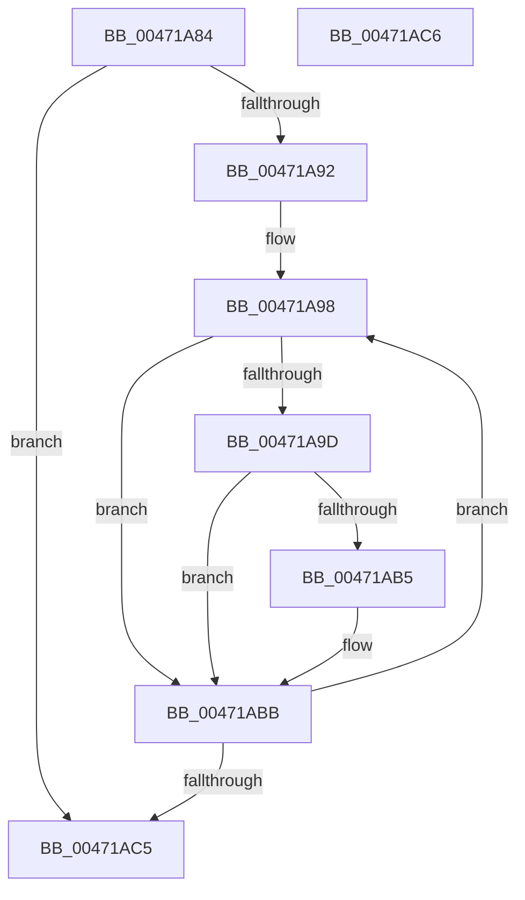

# EtwpMapMetaProviderKeywords

- RVA: `0x00471A84`–`0x00471AC7` (길이 `67` bytes)
- VA: `0x0000000140471A84`
- 실행 섹션: `.text`
- PDB 이름 있음: `예`; PDB Function 태그: `아니요`
- unwind 정보 RVA: `0x000DB714`
- 디코드: `23`개 명령, `67/67` bytes 표시
- 미해석 바이트: `0` (있으면 어셈블리에 `.byte`로 보존)

> 이 문서는 커널 이미지의 기계어와 PDB 기호를 분석해 생성했습니다. 4번과 5번은 함수 원형과 자료형을 바이너리 사용 방식에서 추정한 C 해석이며 원본 소스 복구 결과는 아닙니다.

## 1. Dependencies

- 직접 호출 지점: **0**; 고유 호출 대상: **0**
- 직접 호출자로 확인된 함수: **1**
- RIP 상대 이미지 참조: **0**

### Outgoing calls
- 직접 디코드된 call 명령이 없습니다.

### Direct callers
- [sub_009E8C24](../../page/9E/Unknown_function_009E8C24.md) at `0x009E91F4`

### Static image references
- 디코드된 RIP-relative 메모리 참조가 없습니다.

## 2. Other-region calls and transfers

- 다른 실행 섹션으로 향하는 call: **0**
- 별도 외부 분기/꼬리 이동을 확인하지 못했습니다.

## 3. Assembly (complete function range)

```asm
00471A84  49 83 20 00                     and qword ptr [r8], 0
00471A88  4C 8B DA                        mov r11, rdx
00471A8B  8B 41 08                        mov eax, dword ptr [rcx + 8]
00471A8E  85 C0                           test eax, eax
00471A90  74 33                           je 0x140471ac5
00471A92  4C 8B 09                        mov r9, qword ptr [rcx]
00471A95  44 8B D0                        mov r10d, eax
00471A98  4D 85 DB                        test r11, r11
00471A9B  74 1E                           je 0x140471abb
00471A9D  41 8B 51 08                     mov edx, dword ptr [r9 + 8]
00471AA1  8B C2                           mov eax, edx
00471AA3  48 C1 E8 1D                     shr rax, 0x1d
00471AA7  41 8B 0C 83                     mov ecx, dword ptr [r11 + rax*4]
00471AAB  23 CA                           and ecx, edx
00471AAD  F7 C1 FF FF FF 1F               test ecx, 0x1fffffff
00471AB3  74 06                           je 0x140471abb
00471AB5  49 8B 01                        mov rax, qword ptr [r9]
00471AB8  49 09 00                        or qword ptr [r8], rax
00471ABB  49 83 C1 10                     add r9, 0x10
00471ABF  49 83 EA 01                     sub r10, 1
00471AC3  75 D3                           jne 0x140471a98
00471AC5  C3                              ret
00471AC6  CC                              int3
```

## 4. C-style interpretation (structured pseudocode)

```c
__int64 __fastcall EtwpMapMetaProviderKeywords(__int64 a1, __int64 a2, __int64 a3)
{
    __int64 result;
    __int64 v_r10;

    if ((unsigned int)((unsigned int)(*(unsigned int *)(a1 + 8))) == 0) goto loc_00471AC5;
loc_00471A98:
    if (a2 == 0) goto loc_00471ABB;
    result = ((unsigned int)((unsigned int)((unsigned int)(*(unsigned int *)(*(unsigned __int64 *)(a1) + 8))))) >> (29);
    a1 = (unsigned int)(((unsigned int)(*(unsigned int *)(a2 + result * 4))) & ((unsigned int)((unsigned int)(*(unsigned int *)(*(unsigned __int64 *)(a1) + 8)))));
    if ((((unsigned int)(a1)) & (0x1FFFFFFFULL)) != 0) {
        result = *(unsigned __int64 *)(*(unsigned __int64 *)(a1));
    }
    a4 = (*(unsigned __int64 *)(a1)) + (16);
    v_r10 = ((unsigned int)((unsigned int)((unsigned int)(*(unsigned int *)(a1 + 8))))) - (1);
    if (condition_is_not_equal) goto loc_00471A98;
loc_00471AC5:
    return result;
}
```

## 5. (Beta) C Style

```c
int64_t EtwpMapMetaProviderKeywords(void *Arg1, int64_t Arg2, void *Arg3)
{
    uint8_t *arg1 = (uint8_t *)Arg1;
    uint8_t *arg3 = (uint8_t *)Arg3;

    int64_t result;
    int64_t local_r10;

    if ((uint32_t)((uint32_t)(*(uint32_t *)(arg1 + 0x8))) == 0) goto loc_00471AC5;
loc_00471A98:
    if (Arg2 == 0) goto loc_00471ABB;
    result = ((uint32_t)((uint32_t)((uint32_t)(*(uint32_t *)(*(uint64_t *)(arg1) + 0x8))))) >> (29);
    Arg1 = (uint32_t)(((uint32_t)(*(uint32_t *)(Arg2 + result * 4))) & ((uint32_t)((uint32_t)(*(uint32_t *)(*(uint64_t *)(arg1) + 0x8)))));
    if ((((uint32_t)(Arg1)) & (0x1FFFFFFFULL)) != 0) {
        result = *(uint64_t *)(*(uint64_t *)(arg1));
    }
    a4 = (*(uint64_t *)(arg1)) + (16);
    local_r10 = ((uint32_t)((uint32_t)((uint32_t)(*(uint32_t *)(arg1 + 0x8))))) - (1);
    if (condition_is_not_equal) goto loc_00471A98;
loc_00471AC5:
    return result;
}
```

### 관측된 메모리 오프셋

구조체 형식이 확인되지 않은 접근은 인자 기준의 오프셋으로만 기록했습니다.

| 기준 인자 | 오프셋 표현 | 폭 (bit) | 접근 |
|---|---:|---:|---|
| `Arg1` | `+ 0x0` | `64` | `R` |
| `Arg1` | `+ 0x8` | `32` | `R` |
| `Arg3` | `+ 0x0` | `64` | `R/W` |

## 6. Execution-region graph

[열기: 2D/3D 그래프와 함수 탐색 컨트롤 패널](../../../control-panel.html?section=text&rva=0x00471A84&view=graph)

- 2D 그래프는 위에서 아래로 흐르고, 3D 그래프는 빈 공간을 드래그해 회전합니다. Shift+드래그는 이동, 휠은 확대·축소, 함수 노드 선택은 대상 보고서 이동입니다.

### Static fallback


