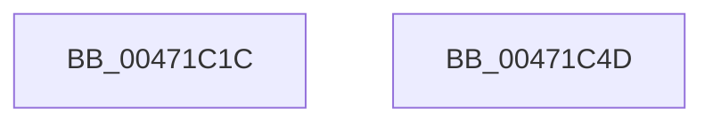

# EtwpTiFillThreadIdentity

- RVA: `0x00471C1C`–`0x00471C4E` (길이 `50` bytes)
- VA: `0x0000000140471C1C`
- 실행 섹션: `.text`
- PDB 이름 있음: `예`; PDB Function 태그: `아니요`
- unwind 정보 RVA: `0x000DB714`
- 디코드: `11`개 명령, `50/50` bytes 표시
- 미해석 바이트: `0` (있으면 어셈블리에 `.byte`로 보존)

> 이 문서는 커널 이미지의 기계어와 PDB 기호를 분석해 생성했습니다. 4번과 5번은 함수 원형과 자료형을 바이너리 사용 방식에서 추정한 C 해석이며 원본 소스 복구 결과는 아닙니다.

## 1. Dependencies

- 직접 호출 지점: **0**; 고유 호출 대상: **0**
- 직접 호출자로 확인된 함수: **15**
- RIP 상대 이미지 참조: **0**

### Outgoing calls
- 직접 디코드된 call 명령이 없습니다.

### Direct callers
- [EtwTimLogProhibitLowILImageMap](../../page/7B/EtwTimLogProhibitLowILImageMap_function_007BB1F4.md) at `0x007BB332`
- [EtwTimLogProhibitNonMicrosoftBinaries](../../page/7B/EtwTimLogProhibitNonMicrosoftBinaries_function_007BB550.md) at `0x007BB68C`
- [EtwTiLogProtectExecVm](../../page/88/EtwTiLogProtectExecVm_function_00881A48.md) at `0x00881C46`
- [EtwTiLogAllocExecVm](../../page/88/EtwTiLogAllocExecVm_function_00882944.md) at `0x00882A21`
- [NtMapViewOfSection](../../page/89/NtMapViewOfSection_function_008986E0.md) at `0x00898AB3`
- [EtwTiLogImpersonateClient](../../page/8C/EtwTiLogImpersonateClient_function_008CC9D0.md) at `0x008CCB7E`
- [EtwTiLogReadWriteVm](../../page/9B/EtwTiLogReadWriteVm_function_009BB7C8.md) at `0x009BB9C2`
- [EtwTiLogSetContextThread](../../page/A2/EtwTiLogSetContextThread_function_00A2FC70.md) at `0x00A2FD63`
- [EtwTiLogSetContextThread](../../page/A2/EtwTiLogSetContextThread_function_00A2FC70.md) at `0x00A2FD9C`
- [EtwTiLogSuspendResumeThread](../../page/A3/EtwTiLogSuspendResumeThread_function_00A34DE0.md) at `0x00A34EC1`
- [EtwTiLogSuspendResumeThread](../../page/A3/EtwTiLogSuspendResumeThread_function_00A34DE0.md) at `0x00A34EFE`
- [EtwTimLogProhibitChildProcessCreation](../../page/A4/EtwTimLogProhibitChildProcessCreation_function_00A43694.md) at `0x00A43827`
- [EtwTiLogMapExecView](../../page/A5/EtwTiLogMapExecView_function_00A573E0.md) at `0x00A574A4`
- [EtwpTimLogMitigationForProcess](../../page/A8/EtwpTimLogMitigationForProcess_function_00A81E6C.md) at `0x00A81F9D`
- [sub_00B1B7C0](../../page/B1/Unknown_function_00B1B7C0.md) at `0x00B1B804`
- [sub_00B20A40](../../page/B2/Unknown_function_00B20A40.md) at `0x00B20A9D`
- [sub_00B41E06](../../page/B4/Unknown_function_00B41E06.md) at `0x00B41E48`

### Static image references
- 디코드된 RIP-relative 메모리 참조가 없습니다.

## 2. Other-region calls and transfers

- 다른 실행 섹션으로 향하는 call: **0**
- 별도 외부 분기/꼬리 이동을 확인하지 못했습니다.

## 3. Assembly (complete function range)

```asm
00471C1C  83 61 0C 00                     and dword ptr [rcx + 0xc], 0
00471C20  48 8D 82 10 05 00 00            lea rax, [rdx + 0x510]
00471C27  48 89 01                        mov qword ptr [rcx], rax
00471C2A  48 8D 82 C0 04 00 00            lea rax, [rdx + 0x4c0]
00471C31  C7 41 08 04 00 00 00            mov dword ptr [rcx + 8], 4
00471C38  83 61 1C 00                     and dword ptr [rcx + 0x1c], 0
00471C3C  48 89 41 10                     mov qword ptr [rcx + 0x10], rax
00471C40  B8 02 00 00 00                  mov eax, 2
00471C45  C7 41 18 08 00 00 00            mov dword ptr [rcx + 0x18], 8
00471C4C  C3                              ret
00471C4D  CC                              int3
```

## 4. C-style interpretation (structured pseudocode)

```c
__int64 __fastcall EtwpTiFillThreadIdentity(__int64 a1, __int64 a2)
{
    *(unsigned __int64 *)(a1) = a2 + 1296;
    *(unsigned int *)(a1 + 8) = 4;
    *(unsigned __int64 *)(a1 + 16) = a2 + 1216;
    *(unsigned int *)(a1 + 24) = 8;
    return 2;
}
```

## 5. (Beta) C Style

```c
int64_t EtwpTiFillThreadIdentity(void *Arg1, void *Arg2)
{
    uint8_t *arg1 = (uint8_t *)Arg1;
    uint8_t *arg2 = (uint8_t *)Arg2;

    *(void **)(arg1) = Arg2 + 1296;
    *(uint32_t *)(arg1 + 0x8) = 4;
    *(void **)(arg1 + 0x10) = Arg2 + 1216;
    *(uint32_t *)(arg1 + 0x18) = 8;
    return 2;
}
```

### 관측된 메모리 오프셋

구조체 형식이 확인되지 않은 접근은 인자 기준의 오프셋으로만 기록했습니다.

| 기준 인자 | 오프셋 표현 | 폭 (bit) | 접근 |
|---|---:|---:|---|
| `Arg1` | `+ 0x0` | `64` | `W` |
| `Arg1` | `+ 0x8` | `32` | `W` |
| `Arg1` | `+ 0xC` | `32` | `R/W` |
| `Arg1` | `+ 0x10` | `64` | `W` |
| `Arg1` | `+ 0x18` | `32` | `W` |
| `Arg1` | `+ 0x1C` | `32` | `R/W` |
| `Arg2` | `+ 0x4C0` | `64` | `R` |
| `Arg2` | `+ 0x510` | `64` | `R` |

## 6. Execution-region graph

[열기: 2D/3D 그래프와 함수 탐색 컨트롤 패널](../../../control-panel.html?section=text&rva=0x00471C1C&view=graph)

- 2D 그래프는 위에서 아래로 흐르고, 3D 그래프는 빈 공간을 드래그해 회전합니다. Shift+드래그는 이동, 휠은 확대·축소, 함수 노드 선택은 대상 보고서 이동입니다.

### Static fallback


