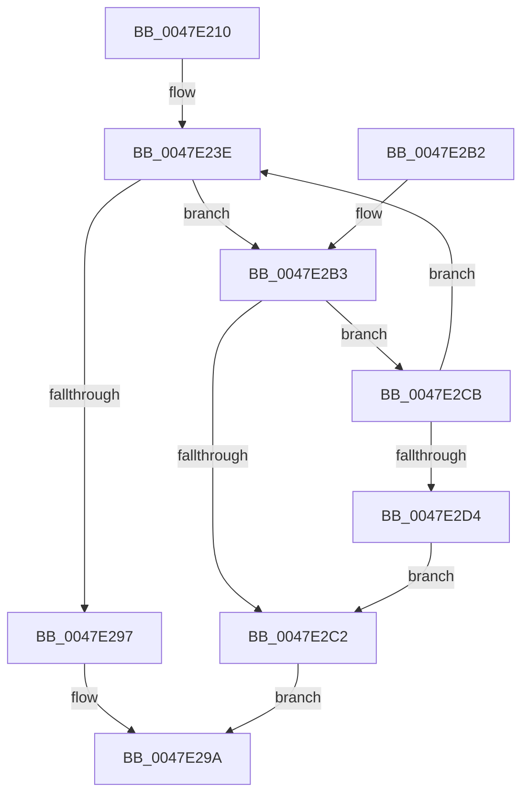

# ExFastReplenishHandleTableEntry

- RVA: `0x0047E210`–`0x0047E2D6` (길이 `198` bytes)
- VA: `0x000000014047E210`
- 실행 섹션: `.text`
- PDB 이름 있음: `예`; PDB Function 태그: `아니요`
- unwind 정보 RVA: `0x000ADD6C`
- 디코드: `57`개 명령, `198/198` bytes 표시
- 미해석 바이트: `0` (있으면 어셈블리에 `.byte`로 보존)

> 이 문서는 커널 이미지의 기계어와 PDB 기호를 분석해 생성했습니다. 4번과 5번은 함수 원형과 자료형을 바이너리 사용 방식에서 추정한 C 해석이며 원본 소스 복구 결과는 아닙니다.

## 1. Dependencies

- 직접 호출 지점: **0**; 고유 호출 대상: **0**
- 직접 호출자로 확인된 함수: **4**
- RIP 상대 이미지 참조: **0**

### Outgoing calls
- 직접 디코드된 call 명령이 없습니다.

### Direct callers
- [ObWaitForMultipleObjects](../../page/86/ObWaitForMultipleObjects_function_00868DF0.md) at `0x008694FE`
- [ObpReferenceObjectByHandleWithTag](../../page/86/ObpReferenceObjectByHandleWithTag_function_00869650.md) at `0x00869CBF`
- [NtWriteFile](../../page/8E/NtWriteFile_function_008E92D0.md) at `0x008E9715`
- [sub_0094C011](../../page/94/Unknown_function_0094C011.md) at `0x0094C150`

### Static image references
- 디코드된 RIP-relative 메모리 참조가 없습니다.

## 2. Other-region calls and transfers

- 다른 실행 섹션으로 향하는 call: **0**
- 별도 외부 분기/꼬리 이동을 확인하지 못했습니다.

## 3. Assembly (complete function range)

```asm
0047E210  48 89 5C 24 08                  mov qword ptr [rsp + 8], rbx
0047E215  48 89 6C 24 10                  mov qword ptr [rsp + 0x10], rbp
0047E21A  48 89 74 24 18                  mov qword ptr [rsp + 0x18], rsi
0047E21F  57                              push rdi
0047E220  48 83 EC 10                     sub rsp, 0x10
0047E224  4C 8B CA                        mov r9, rdx
0047E227  4D 63 D8                        movsxd r11, r8d
0047E22A  48 8B 12                        mov rdx, qword ptr [rdx]
0047E22D  48 8B F9                        mov rdi, rcx
0047E230  4C 8B D2                        mov r10, rdx
0047E233  BE FF FF 00 00                  mov esi, 0xffff
0047E238  49 C1 EA 14                     shr r10, 0x14
0047E23C  33 ED                           xor ebp, ebp
0047E23E  41 0F 10 01                     movups xmm0, xmmword ptr [r9]
0047E242  48 D1 EA                        shr rdx, 1
0047E245  0F B7 C2                        movzx eax, dx
0047E248  49 8B 51 08                     mov rdx, qword ptr [r9 + 8]
0047E24C  49 03 C3                        add rax, r11
0047E24F  48 3B C6                        cmp rax, rsi
0047E252  48 8B C8                        mov rcx, rax
0047E255  0F 11 04 24                     movups xmmword ptr [rsp], xmm0
0047E259  48 0F 4F CE                     cmovg rcx, rsi
0047E25D  4C 8D 80 01 00 FF FF            lea r8, [rax - 0xffff]
0047E264  0F B7 D9                        movzx ebx, cx
0047E267  48 8B 4C 24 08                  mov rcx, qword ptr [rsp + 8]
0047E26C  4C 0F 4E C5                     cmovle r8, rbp
0047E270  66 48 0F 7E C0                  movq rax, xmm0
0047E275  48 03 DB                        add rbx, rbx
0047E278  48 25 01 00 FE FF               and rax, 0xfffffffffffe0001
0047E27E  48 0B D8                        or rbx, rax
0047E281  49 8B 01                        mov rax, qword ptr [r9]
0047E284  F0 48 0F C7 0F                  lock cmpxchg16b xmmword ptr [rdi]
0047E289  49 89 01                        mov qword ptr [r9], rax
0047E28C  0F 94 C0                        sete al
0047E28F  49 89 51 08                     mov qword ptr [r9 + 8], rdx
0047E293  84 C0                           test al, al
0047E295  74 1C                           je 0x14047e2b3
0047E297  4D 8B D8                        mov r11, r8
0047E29A  48 8B 5C 24 20                  mov rbx, qword ptr [rsp + 0x20]
0047E29F  41 8B C3                        mov eax, r11d
0047E2A2  48 8B 6C 24 28                  mov rbp, qword ptr [rsp + 0x28]
0047E2A7  48 8B 74 24 30                  mov rsi, qword ptr [rsp + 0x30]
0047E2AC  48 83 C4 10                     add rsp, 0x10
0047E2B0  5F                              pop rdi
0047E2B1  C3                              ret
0047E2B2  CC                              int3
0047E2B3  49 8B 11                        mov rdx, qword ptr [r9]
0047E2B6  48 8B C2                        mov rax, rdx
0047E2B9  48 C1 E8 14                     shr rax, 0x14
0047E2BD  49 3B C2                        cmp rax, r10
0047E2C0  74 09                           je 0x14047e2cb
0047E2C2  49 89 49 08                     mov qword ptr [r9 + 8], rcx
0047E2C6  49 89 19                        mov qword ptr [r9], rbx
0047E2C9  EB CF                           jmp 0x14047e29a
0047E2CB  F6 C2 01                        test dl, 1
0047E2CE  0F 85 6A FF FF FF               jne 0x14047e23e
0047E2D4  EB EC                           jmp 0x14047e2c2
```

## 4. C-style interpretation (structured pseudocode)

```c
__int64 __fastcall ExFastReplenishHandleTableEntry(__int64 a1, __int64 a2, int a3)
{
    __int64 result;
    __int64 v_r10;
    __int64 v_rbp;
    __int64 v_rbx;
    __int64 v_rsp;
    unsigned __int64 v_stack_m10;
    unsigned __int64 v_stack_m18;
    unsigned __int64 v_stack_p10;
    unsigned __int64 v_stack_p18;
    unsigned __int64 v_stack_p8;

    v_stack_p8 = v_rbx;
    v_stack_p10 = v_rbp;
    v_stack_p18 = v_rsi;
    v_rsp = (v_rsp) - (16);
    v_r10 = (*(unsigned __int64 *)(a2)) >> (20);
    v_rbp = 0;
loc_0047E23E:
    a2 = (*(unsigned __int64 *)(a2)) >> (1);
    result = ((unsigned __int16)(a2)) + ((int)(a3));
    v_stack_m18 = v_xmm0;
    a1 = result;
    if (result > ((unsigned int)(0xFFFFULL))) { a1 = (unsigned int)(0xFFFFULL); }
    a3 = result - 65535;
    if (result <= ((unsigned int)(0xFFFFULL))) { a3 = 0; }
    v_rbx = ((unsigned __int16)(a1)) + ((unsigned __int16)(a1));
    result = (result) & (0xFFFFFFFFFFFE0001ULL);
    v_rbx = (v_rbx) | (result);
    *(unsigned __int64 *)(a2) = *(unsigned __int64 *)(a2);
    result = (condition_is_equal) ? 1 : 0;
    *(unsigned __int64 *)(a2 + 8) = *(unsigned __int64 *)(a2 + 8);
    if ((unsigned __int8)(result) == 0) goto loc_0047E2B3;
loc_0047E29A:
    v_rsp = (v_rsp) + (16);
    return (unsigned int)(a3);
loc_0047E2B3:
    result = (*(unsigned __int64 *)(a2)) >> (20);
    if (result == v_r10) goto loc_0047E2CB;
loc_0047E2C2:
    *(unsigned __int64 *)(a2 + 8) = v_stack_m10;
    *(unsigned __int64 *)(a2) = v_stack_p8;
    goto loc_0047E29A;
loc_0047E2CB:
    if ((((unsigned __int8)(*(unsigned __int64 *)(a2))) & (1)) != 0) goto loc_0047E23E;
    goto loc_0047E2C2;
}
```

## 5. (Beta) C Style

```c
int64_t ExFastReplenishHandleTableEntry(void *Arg1, void *Arg2, int32_t Arg3)
{
    uint8_t *arg1 = (uint8_t *)Arg1;
    uint8_t *arg2 = (uint8_t *)Arg2;

    int64_t result;
    int64_t local_r10;
    int64_t local_rbp;
    int64_t local_rbx;
    int64_t local_rsp;
    uint64_t v_stack_m10;
    uint64_t v_stack_m18;
    uint64_t v_stack_p10;
    uint64_t v_stack_p18;
    uint64_t v_stack_p8;

    v_stack_p8 = local_rbx;
    v_stack_p10 = local_rbp;
    v_stack_p18 = local_rsi;
    local_rsp = (local_rsp) - (16);
    local_r10 = (*(uint64_t *)(arg2)) >> (20);
    local_rbp = 0;
loc_0047E23E:
    Arg2 = (*(uint64_t *)(arg2)) >> (1);
    result = ((uint16_t)(Arg2)) + ((int32_t)(Arg3));
    v_stack_m18 = v_xmm0;
    Arg1 = result;
    if (result > ((uint32_t)(0xFFFFULL))) { Arg1 = (uint32_t)(0xFFFFULL); }
    Arg3 = result - 65535;
    if (result <= ((uint32_t)(0xFFFFULL))) { Arg3 = 0; }
    local_rbx = ((uint16_t)(Arg1)) + ((uint16_t)(Arg1));
    result = (result) & (0xFFFFFFFFFFFE0001ULL);
    local_rbx = (local_rbx) | (result);
    *(uint64_t *)(arg2) = *(uint64_t *)(arg2);
    result = (condition_is_equal) ? 1 : 0;
    *(uint64_t *)(arg2 + 0x8) = *(uint64_t *)(arg2 + 0x8);
    if ((uint8_t)(result) == 0) goto loc_0047E2B3;
loc_0047E29A:
    local_rsp = (local_rsp) + (16);
    return (uint32_t)(Arg3);
loc_0047E2B3:
    result = (*(uint64_t *)(arg2)) >> (20);
    if (result == local_r10) goto loc_0047E2CB;
loc_0047E2C2:
    *(uint64_t *)(arg2 + 0x8) = v_stack_m10;
    *(uint64_t *)(arg2) = v_stack_p8;
    goto loc_0047E29A;
loc_0047E2CB:
    if ((((uint8_t)(*(uint64_t *)(arg2))) & (1)) != 0) goto loc_0047E23E;
    goto loc_0047E2C2;
}
```

### 관측된 메모리 오프셋

구조체 형식이 확인되지 않은 접근은 인자 기준의 오프셋으로만 기록했습니다.

| 기준 인자 | 오프셋 표현 | 폭 (bit) | 접근 |
|---|---:|---:|---|
| `Arg1` | `+ 0x0` | `128` | `R` |
| `Arg2` | `+ 0x0` | `64` | `R` |
| `Arg2` | `+ 0x0` | `64` | `W` |
| `Arg2` | `+ 0x0` | `128` | `R` |
| `Arg2` | `+ 0x8` | `64` | `R` |
| `Arg2` | `+ 0x8` | `64` | `W` |

## 6. Execution-region graph

[열기: 2D/3D 그래프와 함수 탐색 컨트롤 패널](../../../control-panel.html?section=text&rva=0x0047E210&view=graph)

- 2D 그래프는 위에서 아래로 흐르고, 3D 그래프는 빈 공간을 드래그해 회전합니다. Shift+드래그는 이동, 휠은 확대·축소, 함수 노드 선택은 대상 보고서 이동입니다.

### Static fallback


