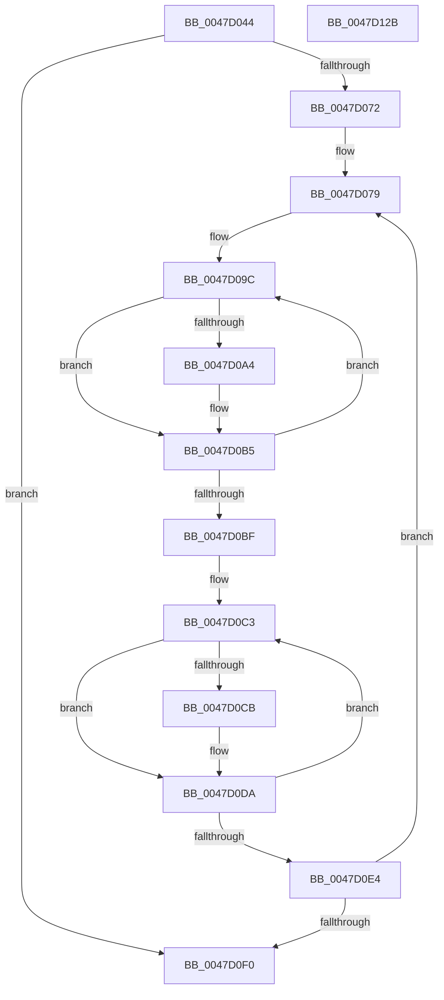

# ExHeapQueryPoolUsage

- RVA: `0x0047D044`–`0x0047D12C` (길이 `232` bytes)
- VA: `0x000000014047D044`
- 실행 섹션: `.text`
- PDB 이름 있음: `예`; PDB Function 태그: `아니요`
- unwind 정보 RVA: `0x000AD910`
- 디코드: `61`개 명령, `232/232` bytes 표시
- 미해석 바이트: `0` (있으면 어셈블리에 `.byte`로 보존)

> 이 문서는 커널 이미지의 기계어와 PDB 기호를 분석해 생성했습니다. 4번과 5번은 함수 원형과 자료형을 바이너리 사용 방식에서 추정한 C 해석이며 원본 소스 복구 결과는 아닙니다.

## 1. Dependencies

- 직접 호출 지점: **0**; 고유 호출 대상: **0**
- 직접 호출자로 확인된 함수: **1**
- RIP 상대 이미지 참조: **2**

### Outgoing calls
- 직접 디코드된 call 명령이 없습니다.

### Direct callers
- [ExQueryPoolUsage](ExQueryPoolUsage_function_0047D000.md) at `0x0047D031`

### Static image references
- `0x0047D063` → RVA `0x00E6BF10` (`.data`; read)
- `0x0047D072` → RVA `0x00E68600` (`.data`; read)

## 2. Other-region calls and transfers

- 다른 실행 섹션으로 향하는 call: **0**
- 별도 외부 분기/꼬리 이동을 확인하지 못했습니다.

## 3. Assembly (complete function range)

```asm
0047D044  48 8B C4                        mov rax, rsp
0047D047  48 89 58 08                     mov qword ptr [rax + 8], rbx
0047D04B  48 89 70 10                     mov qword ptr [rax + 0x10], rsi
0047D04F  48 89 78 18                     mov qword ptr [rax + 0x18], rdi
0047D053  4C 89 78 20                     mov qword ptr [rax + 0x20], r15
0047D057  83 21 00                        and dword ptr [rcx], 0
0047D05A  45 33 D2                        xor r10d, r10d
0047D05D  83 22 00                        and dword ptr [rdx], 0
0047D060  49 8B F9                        mov rdi, r9
0047D063  44 39 15 A6 EE 9E 00            cmp dword ptr [rip + 0x9eeea6], r10d
0047D06A  49 8B F0                        mov rsi, r8
0047D06D  4C 8B D9                        mov r11, rcx
0047D070  76 7E                           jbe 0x14047d0f0
0047D072  4C 8D 3D 87 B5 9E 00            lea r15, [rip + 0x9eb587]
0047D079  41 8B C2                        mov eax, r10d
0047D07C  4D 8D 8F 40 39 00 00            lea r9, [r15 + 0x3940]
0047D083  48 69 C8 C0 20 00 00            imul rcx, rax, 0x20c0
0047D08A  4D 8D 87 50 39 00 00            lea r8, [r15 + 0x3950]
0047D091  BB 02 00 00 00                  mov ebx, 2
0047D096  4C 03 C9                        add r9, rcx
0047D099  4C 03 C1                        add r8, rcx
0047D09C  49 8B 08                        mov rcx, qword ptr [r8]
0047D09F  48 85 C9                        test rcx, rcx
0047D0A2  74 11                           je 0x14047d0b5
0047D0A4  48 8B 81 88 00 00 00            mov rax, qword ptr [rcx + 0x88]
0047D0AB  41 01 03                        add dword ptr [r11], eax
0047D0AE  48 8B 41 60                     mov rax, qword ptr [rcx + 0x60]
0047D0B2  41 01 03                        add dword ptr [r11], eax
0047D0B5  49 83 C0 08                     add r8, 8
0047D0B9  48 83 EB 01                     sub rbx, 1
0047D0BD  75 DD                           jne 0x14047d09c
0047D0BF  44 8D 43 02                     lea r8d, [rbx + 2]
0047D0C3  49 8B 09                        mov rcx, qword ptr [r9]
0047D0C6  48 85 C9                        test rcx, rcx
0047D0C9  74 0F                           je 0x14047d0da
0047D0CB  48 8B 81 88 00 00 00            mov rax, qword ptr [rcx + 0x88]
0047D0D2  01 02                           add dword ptr [rdx], eax
0047D0D4  48 8B 41 60                     mov rax, qword ptr [rcx + 0x60]
0047D0D8  01 02                           add dword ptr [rdx], eax
0047D0DA  49 83 C1 08                     add r9, 8
0047D0DE  49 83 E8 01                     sub r8, 1
0047D0E2  75 DF                           jne 0x14047d0c3
0047D0E4  41 FF C2                        inc r10d
0047D0E7  44 3B 15 22 EE 9E 00            cmp r10d, dword ptr [rip + 0x9eee22]
0047D0EE  72 89                           jb 0x14047d079
0047D0F0  83 26 00                        and dword ptr [rsi], 0
0047D0F3  83 27 00                        and dword ptr [rdi], 0
0047D0F6  48 8B 44 24 28                  mov rax, qword ptr [rsp + 0x28]
0047D0FB  48 8B 5C 24 08                  mov rbx, qword ptr [rsp + 8]
0047D100  48 8B 74 24 10                  mov rsi, qword ptr [rsp + 0x10]
0047D105  48 8B 7C 24 18                  mov rdi, qword ptr [rsp + 0x18]
0047D10A  83 20 00                        and dword ptr [rax], 0
0047D10D  48 8B 44 24 30                  mov rax, qword ptr [rsp + 0x30]
0047D112  4C 8B 7C 24 20                  mov r15, qword ptr [rsp + 0x20]
0047D117  83 20 00                        and dword ptr [rax], 0
0047D11A  48 8B 44 24 38                  mov rax, qword ptr [rsp + 0x38]
0047D11F  83 20 00                        and dword ptr [rax], 0
0047D122  48 8B 44 24 40                  mov rax, qword ptr [rsp + 0x40]
0047D127  83 20 00                        and dword ptr [rax], 0
0047D12A  C3                              ret
0047D12B  CC                              int3
```

## 4. C-style interpretation (structured pseudocode)

```c
__int64 __fastcall ExHeapQueryPoolUsage(__int64 a1, __int64 a2, __int64 a3, __int64 a4, __int64 a5, __int64 a6, __int64 a7, __int64 a8)
{
    __int64 result;
    __int64 v_r10;
    __int64 v_rbx;
    unsigned __int64 v_stack_p10;
    unsigned __int64 v_stack_p18;
    unsigned __int64 v_stack_p20;
    unsigned __int64 v_stack_p8;

    *(unsigned __int64 *)(v_rsp + 8) = v_rbx;
    *(unsigned __int64 *)(v_rsp + 16) = v_rsi;
    *(unsigned __int64 *)(v_rsp + 24) = v_rdi;
    *(unsigned __int64 *)(v_rsp + 32) = v_r15;
    v_r10 = 0;
    if ((*(unsigned int *)(v_rip + 10415782)) <= 0) goto loc_0047D0F0;
loc_0047D079:
    a1 = (a1) * (0);
    a4 = (v_rip + 10401159 + 14656) + (a1);
    a3 = (v_rip + 10401159 + 14672) + (a1);
loc_0047D09C:
    result = 0;
    if (*(unsigned __int64 *)(a3) != 0) {
        result = *(unsigned __int64 *)(*(unsigned __int64 *)(a3) + 136);
        result = *(unsigned __int64 *)(*(unsigned __int64 *)(a3) + 96);
    }
    a3 = (a3) + (8);
    v_rbx = (2) - (1);
    if (condition_is_not_equal) goto loc_0047D09C;
loc_0047D0C3:
    if (*(unsigned __int64 *)(a4) != 0) {
        result = *(unsigned __int64 *)(*(unsigned __int64 *)(a4) + 136);
        result = *(unsigned __int64 *)(*(unsigned __int64 *)(a4) + 96);
    }
    a4 = (a4) + (8);
    a3 = (v_rbx + 2) - (1);
    if (condition_is_not_equal) goto loc_0047D0C3;
    v_r10 = (unsigned int)((v_r10) + 1);
    if (((unsigned int)(v_r10)) < (*(unsigned int *)(v_rip + 10415650))) goto loc_0047D079;
loc_0047D0F0:
    return a8;
}
```

## 5. (Beta) C Style

```c
void *ExHeapQueryPoolUsage(void *Arg1, void *Arg2, void *Arg3, void *Arg4, void *Arg5, void *Arg6, void *Arg7, void *Arg8)
{
    uint8_t *arg1 = (uint8_t *)Arg1;
    uint8_t *arg2 = (uint8_t *)Arg2;
    uint8_t *arg3 = (uint8_t *)Arg3;
    uint8_t *arg4 = (uint8_t *)Arg4;
    uint8_t *arg5 = (uint8_t *)Arg5;
    uint8_t *arg6 = (uint8_t *)Arg6;
    uint8_t *arg7 = (uint8_t *)Arg7;
    uint8_t *arg8 = (uint8_t *)Arg8;

    int64_t result;
    int64_t local_r10;
    int64_t local_rbx;
    uint64_t v_stack_p10;
    uint64_t v_stack_p18;
    uint64_t v_stack_p20;
    uint64_t v_stack_p8;

    *(uint64_t *)(local_rsp + 0x8) = local_rbx;
    *(uint64_t *)(local_rsp + 0x10) = local_rsi;
    *(uint64_t *)(local_rsp + 0x18) = local_rdi;
    *(uint64_t *)(local_rsp + 0x20) = local_r15;
    local_r10 = 0;
    if ((*(uint32_t *)(v_rip + 0x9EEEA6)) <= 0) goto loc_0047D0F0;
loc_0047D079:
    Arg1 = (Arg1) * (0);
    Arg4 = (v_rip + 10401159 + 14656) + (Arg1);
    Arg3 = (v_rip + 10401159 + 14672) + (Arg1);
loc_0047D09C:
    result = 0;
    if (*(uint64_t *)(arg3) != 0) {
        result = *(uint64_t *)(*(uint64_t *)(arg3) + 0x88);
        result = *(uint64_t *)(*(uint64_t *)(arg3) + 0x60);
    }
    Arg3 = (Arg3) + (8);
    local_rbx = (2) - (1);
    if (condition_is_not_equal) goto loc_0047D09C;
loc_0047D0C3:
    if (*(uint64_t *)(arg4) != 0) {
        result = *(uint64_t *)(*(uint64_t *)(arg4) + 0x88);
        result = *(uint64_t *)(*(uint64_t *)(arg4) + 0x60);
    }
    Arg4 = (Arg4) + (8);
    Arg3 = (local_rbx + 2) - (1);
    if (condition_is_not_equal) goto loc_0047D0C3;
    local_r10 = (uint32_t)((local_r10) + 1);
    if (((uint32_t)(local_r10)) < (*(uint32_t *)(v_rip + 0x9EEE22))) goto loc_0047D079;
loc_0047D0F0:
    return Arg8;
}
```

### 관측된 메모리 오프셋

구조체 형식이 확인되지 않은 접근은 인자 기준의 오프셋으로만 기록했습니다.

| 기준 인자 | 오프셋 표현 | 폭 (bit) | 접근 |
|---|---:|---:|---|
| `Arg1` | `+ 0x0` | `32` | `R/W` |
| `Arg2` | `+ 0x0` | `32` | `R/W` |
| `Arg3` | `+ 0x0` | `32` | `R/W` |
| `Arg4` | `+ 0x0` | `32` | `R/W` |
| `Arg5` | `+ 0x0` | `32` | `R/W` |
| `Arg6` | `+ 0x0` | `32` | `R/W` |
| `Arg7` | `+ 0x0` | `32` | `R/W` |
| `Arg8` | `+ 0x0` | `32` | `R/W` |

## 6. Execution-region graph

[열기: 2D/3D 그래프와 함수 탐색 컨트롤 패널](../../../control-panel.html?section=text&rva=0x0047D044&view=graph)

- 2D 그래프는 위에서 아래로 흐르고, 3D 그래프는 빈 공간을 드래그해 회전합니다. Shift+드래그는 이동, 휠은 확대·축소, 함수 노드 선택은 대상 보고서 이동입니다.

### Static fallback


