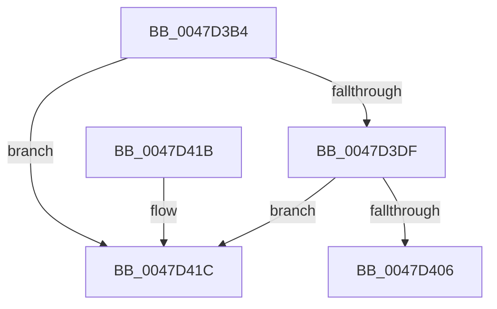

# ExQueueWorkItemToPrivatePool

- RVA: `0x0047D3B4`–`0x0047D43A` (길이 `134` bytes)
- VA: `0x000000014047D3B4`
- 실행 섹션: `.text`
- PDB 이름 있음: `예`; PDB Function 태그: `아니요`
- unwind 정보 RVA: `0x000ADAA0`
- 디코드: `38`개 명령, `134/134` bytes 표시
- 미해석 바이트: `0` (있으면 어셈블리에 `.byte`로 보존)

> 이 문서는 커널 이미지의 기계어와 PDB 기호를 분석해 생성했습니다. 4번과 5번은 함수 원형과 자료형을 바이너리 사용 방식에서 추정한 C 해석이며 원본 소스 복구 결과는 아닙니다.

## 1. Dependencies

- 직접 호출 지점: **3**; 고유 호출 대상: **3**
- 직접 호출자로 확인된 함수: **1**
- RIP 상대 이미지 참조: **0**

### Outgoing calls
- `0x0047D3E2` → [ExpValidateWorkItem](../35/ExpValidateWorkItem_function_00358680.md) (function, `0x00358680`)
- `0x0047D3FD` → [ExpQueueWorkItem](../35/ExpQueueWorkItem_function_00358400.md) (function, `0x00358400`)
- `0x0047D434` → [KeBugCheckEx](../4F/KeBugCheckEx_function_004FD660.md) (function, `0x004FD660`)

### Direct callers
- [SMKM_STORE_MGR&lt;SM_TRAITS&gt;::SmAsyncReadQueueInsert](../39/SMKM_STORE_MGR_SM_TRAITS_SmAsyncReadQueueInsert_function_0039120C.md) at `0x00391361`

### Static image references
- 디코드된 RIP-relative 메모리 참조가 없습니다.

## 2. Other-region calls and transfers

- 다른 실행 섹션으로 향하는 call: **0**
- 별도 외부 분기/꼬리 이동을 확인하지 못했습니다.

## 3. Assembly (complete function range)

```asm
0047D3B4  48 89 5C 24 08                  mov qword ptr [rsp + 8], rbx
0047D3B9  48 89 6C 24 10                  mov qword ptr [rsp + 0x10], rbp
0047D3BE  48 89 74 24 18                  mov qword ptr [rsp + 0x18], rsi
0047D3C3  57                              push rdi
0047D3C4  48 83 EC 30                     sub rsp, 0x30
0047D3C8  49 8D 41 FF                     lea rax, [r9 - 1]
0047D3CC  49 8B F1                        mov rsi, r9
0047D3CF  8B DA                           mov ebx, edx
0047D3D1  48 8B F9                        mov rdi, rcx
0047D3D4  BD FF FF FF FF                  mov ebp, 0xffffffff
0047D3D9  48 83 F8 06                     cmp rax, 6
0047D3DD  77 3D                           ja 0x14047d41c
0047D3DF  83 C2 20                        add edx, 0x20
0047D3E2  E8 99 B2 ED FF                  call 0x140358680
0047D3E7  48 8B 4C 24 60                  mov rcx, qword ptr [rsp + 0x60]
0047D3EC  44 8B CD                        mov r9d, ebp
0047D3EF  44 8B C3                        mov r8d, ebx
0047D3F2  89 74 24 20                     mov dword ptr [rsp + 0x20], esi
0047D3F6  48 8B D7                        mov rdx, rdi
0047D3F9  48 8B 49 10                     mov rcx, qword ptr [rcx + 0x10]
0047D3FD  E8 FE AF ED FF                  call 0x140358400
0047D402  84 C0                           test al, al
0047D404  74 16                           je 0x14047d41c
0047D406  48 8B 5C 24 40                  mov rbx, qword ptr [rsp + 0x40]
0047D40B  48 8B 6C 24 48                  mov rbp, qword ptr [rsp + 0x48]
0047D410  48 8B 74 24 50                  mov rsi, qword ptr [rsp + 0x50]
0047D415  48 83 C4 30                     add rsp, 0x30
0047D419  5F                              pop rdi
0047D41A  C3                              ret
0047D41B  CC                              int3
0047D41C  8D 43 20                        lea eax, [rbx + 0x20]
0047D41F  48 89 6C 24 20                  mov qword ptr [rsp + 0x20], rbp
0047D424  4C 63 C8                        movsxd r9, eax
0047D427  4C 8B C7                        mov r8, rdi
0047D42A  BA 05 00 00 00                  mov edx, 5
0047D42F  B9 E4 00 00 00                  mov ecx, 0xe4
0047D434  E8 27 02 08 00                  call 0x1404fd660
0047D439  CC                              int3
```

## 4. C-style interpretation (structured pseudocode)

```c
__int64 __fastcall ExQueueWorkItemToPrivatePool(__int64 a1, int a2, __int64 a3, __int64 a4, __int64 a5)
{
    __int64 result;
    __int64 v_rsp;
    unsigned int v_stack_m18;
    unsigned __int64 v_stack_p10;
    unsigned __int64 v_stack_p18;
    unsigned __int64 v_stack_p20;
    unsigned __int64 v_stack_p8;

    v_stack_p8 = v_rbx;
    v_stack_p10 = v_rbp;
    v_stack_p18 = v_rsi;
    v_rsp = (v_rsp) - (48);
    if ((a4 - 1) > 6) goto loc_0047D41C;
    a2 = (unsigned int)((a2) + (32));
    result = ExpValidateWorkItem(a1, a2, a3, a4);
    v_stack_m18 = (unsigned int)(a4);
    result = ExpQueueWorkItem(*(unsigned __int64 *)(a5 + 16), a1, (unsigned int)((unsigned int)((unsigned int)(a2))), (unsigned int)((unsigned int)((unsigned int)(0xFFFFFFFFULL))));
    if ((unsigned __int8)(result) == 0) goto loc_0047D41C;
    v_rsp = (v_rsp) + (48);
    return result;
loc_0047D41C:
    v_stack_p20 = v_stack_p10;
    result = KeBugCheckEx(228, 5, a1, (int)((unsigned int)(v_stack_p8 + 32)));
    return result;
}
```

## 5. (Beta) C Style

```c
int64_t ExQueueWorkItemToPrivatePool(int64_t Arg1, void *Arg2, int64_t Arg3, void *Arg4, void *Arg5)
{
    uint8_t *arg2 = (uint8_t *)Arg2;
    uint8_t *arg4 = (uint8_t *)Arg4;
    uint8_t *arg5 = (uint8_t *)Arg5;

    int64_t result;
    int64_t local_rsp;
    uint32_t v_stack_m18;
    uint64_t v_stack_p10;
    uint64_t v_stack_p18;
    uint64_t v_stack_p20;
    uint64_t v_stack_p8;

    v_stack_p8 = local_rbx;
    v_stack_p10 = local_rbp;
    v_stack_p18 = local_rsi;
    local_rsp = (local_rsp) - (48);
    if ((Arg4 - 1) > 6) goto loc_0047D41C;
    Arg2 = (uint32_t)((Arg2) + (32));
    result = ExpValidateWorkItem(Arg1, Arg2, Arg3, Arg4);
    v_stack_m18 = (uint32_t)(Arg4);
    result = ExpQueueWorkItem(*(uint64_t *)(arg5 + 0x10), Arg1, (uint32_t)((uint32_t)((uint32_t)(Arg2))), (uint32_t)((uint32_t)((uint32_t)(0xFFFFFFFFULL))));
    if ((uint8_t)(result) == 0) goto loc_0047D41C;
    local_rsp = (local_rsp) + (48);
    return result;
loc_0047D41C:
    v_stack_p20 = v_stack_p10;
    result = KeBugCheckEx(228, 5, Arg1, (int32_t)((uint32_t)(v_stack_p8 + 32)));
    return result;
}
```

### 관측된 메모리 오프셋

구조체 형식이 확인되지 않은 접근은 인자 기준의 오프셋으로만 기록했습니다.

| 기준 인자 | 오프셋 표현 | 폭 (bit) | 접근 |
|---|---:|---:|---|
| `Arg2` | `+ 0x20` | `32` | `R` |
| `Arg4` | `- 0x1` | `64` | `R` |
| `Arg5` | `+ 0x10` | `64` | `R` |

## 6. Execution-region graph

[열기: 2D/3D 그래프와 함수 탐색 컨트롤 패널](../../../control-panel.html?section=text&rva=0x0047D3B4&view=graph)

- 2D 그래프는 위에서 아래로 흐르고, 3D 그래프는 빈 공간을 드래그해 회전합니다. Shift+드래그는 이동, 휠은 확대·축소, 함수 노드 선택은 대상 보고서 이동입니다.

### Static fallback


