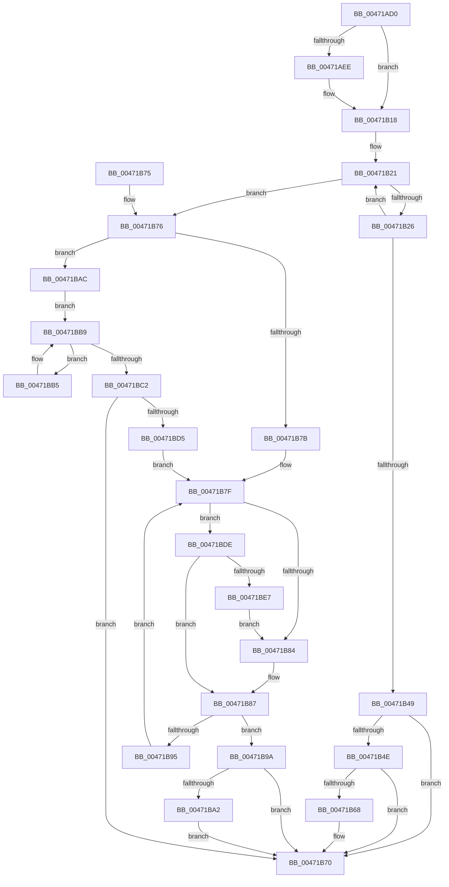

# ExfReleasePushLockSharedEx

- RVA: `0x00471AD0`–`0x00471BE9` (길이 `281` bytes)
- VA: `0x0000000140471AD0`
- 실행 섹션: `.text`
- PDB 이름 있음: `예`; PDB Function 태그: `아니요`
- unwind 정보 RVA: `0x000AC2F4`
- 디코드: `84`개 명령, `281/281` bytes 표시
- 미해석 바이트: `0` (있으면 어셈블리에 `.byte`로 보존)

> 이 문서는 커널 이미지의 기계어와 PDB 기호를 분석해 생성했습니다. 4번과 5번은 함수 원형과 자료형을 바이너리 사용 방식에서 추정한 C 해석이며 원본 소스 복구 결과는 아닙니다.

## 1. Dependencies

- 직접 호출 지점: **1**; 고유 호출 대상: **1**
- 직접 호출자로 확인된 함수: **1**
- RIP 상대 이미지 참조: **0**

### Outgoing calls
- `0x00471BA5` → [ExpWakePushLock](../34/ExpWakePushLock_function_00341050.md) (function, `0x00341050`)

### Direct callers
- [sub_0026379F](../26/Unknown_function_0026379F.md) at `0x002637FB`
- [sub_0026379F](../26/Unknown_function_0026379F.md) at `0x0026385A`

### Static image references
- 디코드된 RIP-relative 메모리 참조가 없습니다.

## 2. Other-region calls and transfers

- 다른 실행 섹션으로 향하는 call: **0**
- 별도 외부 분기/꼬리 이동을 확인하지 못했습니다.

## 3. Assembly (complete function range)

```asm
00471AD0  48 83 EC 48                     sub rsp, 0x48
00471AD4  33 C0                           xor eax, eax
00471AD6  0F 57 C0                        xorps xmm0, xmm0
00471AD9  48 89 44 24 30                  mov qword ptr [rsp + 0x30], rax
00471ADE  4C 8B CA                        mov r9, rdx
00471AE1  4C 8B D1                        mov r10, rcx
00471AE4  0F 11 44 24 20                  movups xmmword ptr [rsp + 0x20], xmm0
00471AE9  48 85 D2                        test rdx, rdx
00471AEC  74 2A                           je 0x140471b18
00471AEE  65 48 8B 04 25 88 01 00 00      mov rax, qword ptr gs:[0x188]
00471AF7  48 89 44 24 30                  mov qword ptr [rsp + 0x30], rax
00471AFC  8B 80 54 01 00 00               mov eax, dword ptr [rax + 0x154]
00471B02  89 44 24 28                     mov dword ptr [rsp + 0x28], eax
00471B06  0F 31                           rdtsc
00471B08  48 C1 E2 20                     shl rdx, 0x20
00471B0C  48 0B C2                        or rax, rdx
00471B0F  49 83 21 00                     and qword ptr [r9], 0
00471B13  48 89 44 24 20                  mov qword ptr [rsp + 0x20], rax
00471B18  0F 0D 09                        prefetchw byte ptr [rcx]
00471B1B  48 8B 09                        mov rcx, qword ptr [rcx]
00471B1E  41 B3 02                        mov r11b, 2
00471B21  41 84 CB                        test r11b, cl
00471B24  75 50                           jne 0x140471b76
00471B26  45 33 C0                        xor r8d, r8d
00471B29  48 8D 41 F0                     lea rax, [rcx - 0x10]
00471B2D  48 8B D1                        mov rdx, rcx
00471B30  48 83 E2 F0                     and rdx, 0xfffffffffffffff0
00471B34  48 83 FA 10                     cmp rdx, 0x10
00471B38  4C 0F 45 C0                     cmovne r8, rax
00471B3C  48 8B C1                        mov rax, rcx
00471B3F  F0 4D 0F B1 02                  lock cmpxchg qword ptr [r10], r8
00471B44  48 8B C8                        mov rcx, rax
00471B47  75 D8                           jne 0x140471b21
00471B49  4D 85 C9                        test r9, r9
00471B4C  74 22                           je 0x140471b70
00471B4E  0F 31                           rdtsc
00471B50  8B 4C 24 28                     mov ecx, dword ptr [rsp + 0x28]
00471B54  48 C1 E2 20                     shl rdx, 0x20
00471B58  48 0B C2                        or rax, rdx
00471B5B  48 8B 54 24 30                  mov rdx, qword ptr [rsp + 0x30]
00471B60  39 8A 54 01 00 00               cmp dword ptr [rdx + 0x154], ecx
00471B66  75 08                           jne 0x140471b70
00471B68  48 2B 44 24 20                  sub rax, qword ptr [rsp + 0x20]
00471B6D  49 89 01                        mov qword ptr [r9], rax
00471B70  48 83 C4 48                     add rsp, 0x48
00471B74  C3                              ret
00471B75  CC                              int3
00471B76  F6 C1 08                        test cl, 8
00471B79  75 31                           jne 0x140471bac
00471B7B  49 83 C8 FF                     or r8, 0xffffffffffffffff
00471B7F  F6 C1 04                        test cl, 4
00471B82  74 5A                           je 0x140471bde
00471B84  49 8B C0                        mov rax, r8
00471B87  48 8D 14 08                     lea rdx, [rax + rcx]
00471B8B  48 8B C1                        mov rax, rcx
00471B8E  F0 49 0F B1 12                  lock cmpxchg qword ptr [r10], rdx
00471B93  74 05                           je 0x140471b9a
00471B95  48 8B C8                        mov rcx, rax
00471B98  EB E5                           jmp 0x140471b7f
00471B9A  80 E1 06                        and cl, 6
00471B9D  41 3A CB                        cmp cl, r11b
00471BA0  75 CE                           jne 0x140471b70
00471BA2  49 8B CA                        mov rcx, r10
00471BA5  E8 A6 F4 EC FF                  call 0x140341050
00471BAA  EB C4                           jmp 0x140471b70
00471BAC  48 8B C1                        mov rax, rcx
00471BAF  48 83 E0 F0                     and rax, 0xfffffffffffffff0
00471BB3  EB 04                           jmp 0x140471bb9
00471BB5  48 8B 40 18                     mov rax, qword ptr [rax + 0x18]
00471BB9  48 8B 50 20                     mov rdx, qword ptr [rax + 0x20]
00471BBD  48 85 D2                        test rdx, rdx
00471BC0  74 F3                           je 0x140471bb5
00471BC2  49 83 C8 FF                     or r8, 0xffffffffffffffff
00471BC6  41 8B C0                        mov eax, r8d
00471BC9  F0 0F C1 42 30                  lock xadd dword ptr [rdx + 0x30], eax
00471BCE  41 03 C0                        add eax, r8d
00471BD1  85 C0                           test eax, eax
00471BD3  7F 9B                           jg 0x140471b70
00471BD5  49 C7 C0 F7 FF FF FF            mov r8, 0xfffffffffffffff7
00471BDC  EB A1                           jmp 0x140471b7f
00471BDE  49 8D 40 04                     lea rax, [r8 + 4]
00471BE2  41 84 CB                        test r11b, cl
00471BE5  75 A0                           jne 0x140471b87
00471BE7  EB 9B                           jmp 0x140471b84
```

## 4. C-style interpretation (structured pseudocode)

```c
__int64 __fastcall ExfReleasePushLockSharedEx(__int64 a1, __int64 a2, int a3)
{
    __int64 result;
    __int64 v_rsp;
    unsigned __int64 v_stack_m18;
    unsigned int v_stack_m20;
    unsigned __int64 v_stack_m28;

    v_rsp = (v_rsp) - (72);
    result = 0;
    v_stack_m18 = 0;
    v_stack_m28 = v_xmm0;
    if (a2 != 0) {
        result = *(unsigned __int64 *)(gs_base + (0 + 392));
        v_stack_m18 = result;
        result = *(unsigned int *)(result + 340);
        v_stack_m20 = (unsigned int)(result);
        a2 = (a2) << (32);
        result = (result) | (a2);
        v_stack_m28 = result;
    }
loc_00471B21:
    if (((2) & ((unsigned __int8)(*(unsigned __int64 *)(a1)))) != 0) goto loc_00471B76;
    a3 = 0;
    a2 = (*(unsigned __int64 *)(a1)) & (-16);
    if (a2 != 16) { a3 = *(unsigned __int64 *)(a1) - 16; }
    if (a2 != 16) goto loc_00471B21;
    if (a2 == 0) goto loc_00471B70;
    a2 = (a2) << (32);
    result = (*(unsigned __int64 *)(a1)) | (a2);
    if ((*(unsigned int *)(v_stack_m18 + 340)) == ((unsigned int)((unsigned int)(v_stack_m20)))) {
        result = (result) - (v_stack_m28);
        *(unsigned __int64 *)(a2) = result;
    }
    v_rsp = (v_rsp) + (72);
    return result;
loc_00471B76:
    if ((((unsigned __int8)((unsigned int)(v_stack_m20))) & (8)) != 0) goto loc_00471BAC;
    a3 = (a3) | (-1);
loc_00471B7F:
    if ((((unsigned __int8)((unsigned int)(v_stack_m20))) & (4)) == 0) goto loc_00471BDE;
loc_00471B84:
loc_00471B87:
    if ((((unsigned __int8)((unsigned int)(v_stack_m20))) & (4)) == 0) goto loc_00471B9A;
    goto loc_00471B7F;
loc_00471B9A:
    a1 = (unsigned __int8)(((unsigned int)(v_stack_m20)) & (6));
    if (((unsigned __int8)(a1)) != 2) goto loc_00471B70;
    result = ExpWakePushLock(a1, a3 + (unsigned int)(v_stack_m20) * 1, a3, a2);
    goto loc_00471B70;
loc_00471BAC:
    result = (a1) & (-16);
    goto loc_00471BB9;
loc_00471BB5:
loc_00471BB9:
    if (*(unsigned __int64 *)(*(unsigned __int64 *)(result + 24) + 32) == 0) goto loc_00471BB5;
    a3 = (a3) | (-1);
    result = (unsigned int)(((unsigned int)(a3)) + (a3));
    if (condition_is_greater) goto loc_00471B70;
    goto loc_00471B7F;
loc_00471BDE:
    if (((2) & ((unsigned __int8)(a1))) != 0) goto loc_00471B87;
    goto loc_00471B84;
}
```

## 5. (Beta) C Style

```c
int64_t ExfReleasePushLockSharedEx(void *Arg1, void *Arg2, int32_t Arg3)
{
    uint8_t *arg1 = (uint8_t *)Arg1;
    uint8_t *arg2 = (uint8_t *)Arg2;

    int64_t result;
    int64_t local_rsp;
    uint64_t v_stack_m18;
    uint32_t v_stack_m20;
    uint64_t v_stack_m28;

    local_rsp = (local_rsp) - (72);
    result = 0;
    v_stack_m18 = 0;
    v_stack_m28 = v_xmm0;
    if (Arg2 != NULL) {
        result = *(uint64_t *)(gs_base + (0 + 0x188));
        v_stack_m18 = result;
        result = *(uint32_t *)(result + 0x154);
        v_stack_m20 = (uint32_t)(result);
        Arg2 = (Arg2) << (32);
        result = (result) | (Arg2);
        v_stack_m28 = result;
    }
loc_00471B21:
    if (((2) & ((uint8_t)(*(uint64_t *)(arg1)))) != 0) goto loc_00471B76;
    Arg3 = 0;
    Arg2 = (*(uint64_t *)(arg1)) & (-16);
    if (Arg2 != 16) { Arg3 = *(uint64_t *)(arg1) - 16; }
    if (Arg2 != 16) goto loc_00471B21;
    if (Arg2 == NULL) goto loc_00471B70;
    Arg2 = (Arg2) << (32);
    result = (*(uint64_t *)(arg1)) | (Arg2);
    if ((*(uint32_t *)(v_stack_m18 + 0x154)) == ((uint32_t)((uint32_t)(v_stack_m20)))) {
        result = (result) - (v_stack_m28);
        *(uint64_t *)(arg2) = result;
    }
    local_rsp = (local_rsp) + (72);
    return result;
loc_00471B76:
    if ((((uint8_t)((uint32_t)(v_stack_m20))) & (8)) != 0) goto loc_00471BAC;
    Arg3 = (Arg3) | (-1);
loc_00471B7F:
    if ((((uint8_t)((uint32_t)(v_stack_m20))) & (4)) == 0) goto loc_00471BDE;
loc_00471B84:
loc_00471B87:
    if ((((uint8_t)((uint32_t)(v_stack_m20))) & (4)) == 0) goto loc_00471B9A;
    goto loc_00471B7F;
loc_00471B9A:
    Arg1 = (uint8_t)(((uint32_t)(v_stack_m20)) & (6));
    if (((uint8_t)(Arg1)) != 2) goto loc_00471B70;
    result = ExpWakePushLock(Arg1, Arg3 + (uint32_t)(v_stack_m20) * 1, Arg3, Arg2);
    goto loc_00471B70;
loc_00471BAC:
    result = (Arg1) & (-16);
    goto loc_00471BB9;
loc_00471BB5:
loc_00471BB9:
    if (*(uint64_t *)(*(uint64_t *)(result + 0x18) + 0x20) == 0) goto loc_00471BB5;
    Arg3 = (Arg3) | (-1);
    result = (uint32_t)(((uint32_t)(Arg3)) + (Arg3));
    if (condition_is_greater) goto loc_00471B70;
    goto loc_00471B7F;
loc_00471BDE:
    if (((2) & ((uint8_t)(Arg1))) != 0) goto loc_00471B87;
    goto loc_00471B84;
}
```

### 관측된 메모리 오프셋

구조체 형식이 확인되지 않은 접근은 인자 기준의 오프셋으로만 기록했습니다.

| 기준 인자 | 오프셋 표현 | 폭 (bit) | 접근 |
|---|---:|---:|---|
| `Arg1` | `+ 0x0` | `8` | `R` |
| `Arg1` | `+ 0x0` | `64` | `R` |
| `Arg2` | `+ 0x0` | `64` | `R/W` |

## 6. Execution-region graph

[열기: 2D/3D 그래프와 함수 탐색 컨트롤 패널](../../../control-panel.html?section=text&rva=0x00471AD0&view=graph)

- 2D 그래프는 위에서 아래로 흐르고, 3D 그래프는 빈 공간을 드래그해 회전합니다. Shift+드래그는 이동, 휠은 확대·축소, 함수 노드 선택은 대상 보고서 이동입니다.

### Static fallback


