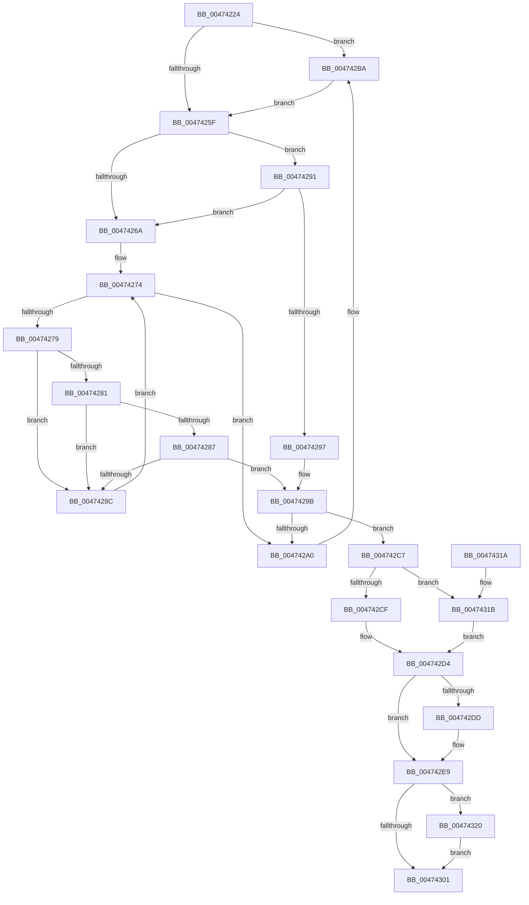

# ExpFastResourceLegacyRelease

- RVA: `0x00474224`–`0x0047432C` (길이 `264` bytes)
- VA: `0x0000000140474224`
- 실행 섹션: `.text`
- PDB 이름 있음: `예`; PDB Function 태그: `아니요`
- unwind 정보 RVA: `0x000AC6F0`
- 디코드: `79`개 명령, `264/264` bytes 표시
- 미해석 바이트: `0` (있으면 어셈블리에 `.byte`로 보존)

> 이 문서는 커널 이미지의 기계어와 PDB 기호를 분석해 생성했습니다. 4번과 5번은 함수 원형과 자료형을 바이너리 사용 방식에서 추정한 C 해석이며 원본 소스 복구 결과는 아닙니다.

## 1. Dependencies

- 직접 호출 지점: **5**; 고유 호출 대상: **5**
- 직접 호출자로 확인된 함수: **1**
- RIP 상대 이미지 참조: **1**

### Outgoing calls
- `0x004742B4` → [KeBugCheckEx](../4F/KeBugCheckEx_function_004FD660.md) (function, `0x004FD660`)
- `0x004742C0` → [KiRaiseIrqlProcessIrqlFlags](../4F/KiRaiseIrqlProcessIrqlFlags_function_004F56FC.md) (function, `0x004F56FC`)
- `0x004742E4` → [KiLowerIrqlProcessIrqlFlags](../4F/KiLowerIrqlProcessIrqlFlags_function_004F5698.md) (function, `0x004F5698`)
- `0x004742F7` → [ExReleaseFastResource](../26/ExReleaseFastResource_function_002613D0.md) (function, `0x002613D0`)
- `0x00474325` → [ExFreePoolWithTag](../../poolcode/B8/ExFreePoolWithTag_function_00B82870.md) (function, `0x00B82870`)

### Direct callers
- [sub_006DA0BC](../6D/Unknown_function_006DA0BC.md) at `0x006DA0BC`

### Static image references
- `0x00474256` → RVA `0x00FC6D20` (`ALMOSTRO`; read)

## 2. Other-region calls and transfers

- 다른 실행 섹션으로 향하는 call: **1**
  - `0x00474325` → [ExFreePoolWithTag](../../poolcode/B8/ExFreePoolWithTag_function_00B82870.md) (`.text` → `POOLCODE`)
- 별도 외부 분기/꼬리 이동을 확인하지 못했습니다.

## 3. Assembly (complete function range)

```asm
00474224  48 89 5C 24 08                  mov qword ptr [rsp + 8], rbx
00474229  48 89 6C 24 10                  mov qword ptr [rsp + 0x10], rbp
0047422E  48 89 74 24 18                  mov qword ptr [rsp + 0x18], rsi
00474233  57                              push rdi
00474234  41 54                           push r12
00474236  41 56                           push r14
00474238  48 83 EC 30                     sub rsp, 0x30
0047423C  65 48 8B 2C 25 88 01 00 00      mov rbp, qword ptr gs:[0x188]
00474245  48 8B F9                        mov rdi, rcx
00474248  45 0F 20 C6                     mov r14, cr8
0047424C  41 BC 02 00 00 00               mov r12d, 2
00474252  45 0F 22 C4                     mov cr8, r12
00474256  83 3D C3 2A B5 00 00            cmp dword ptr [rip + 0xb52ac3], 0
0047425D  75 5B                           jne 0x1404742ba
0047425F  48 8B 07                        mov rax, qword ptr [rdi]
00474262  40 B6 01                        mov sil, 1
00474265  40 84 C6                        test sil, al
00474268  75 27                           jne 0x140474291
0047426A  48 8D 85 B8 06 00 00            lea rax, [rbp + 0x6b8]
00474271  48 8B 18                        mov rbx, qword ptr [rax]
00474274  48 3B D8                        cmp rbx, rax
00474277  74 27                           je 0x1404742a0
00474279  8A 4B 25                        mov cl, byte ptr [rbx + 0x25]
0047427C  41 84 CC                        test r12b, cl
0047427F  75 0B                           jne 0x14047428c
00474281  48 39 7B 18                     cmp qword ptr [rbx + 0x18], rdi
00474285  75 05                           jne 0x14047428c
00474287  40 84 CE                        test sil, cl
0047428A  75 0F                           jne 0x14047429b
0047428C  48 8B 1B                        mov rbx, qword ptr [rbx]
0047428F  EB E3                           jmp 0x140474274
00474291  48 39 6F 50                     cmp qword ptr [rdi + 0x50], rbp
00474295  75 D3                           jne 0x14047426a
00474297  48 8D 5F 40                     lea rbx, [rdi + 0x40]
0047429B  48 85 DB                        test rbx, rbx
0047429E  75 27                           jne 0x1404742c7
004742A0  48 83 64 24 20 00               and qword ptr [rsp + 0x20], 0
004742A6  45 33 C9                        xor r9d, r9d
004742A9  4C 8B C5                        mov r8, rbp
004742AC  48 8B D7                        mov rdx, rdi
004742AF  B9 E3 00 00 00                  mov ecx, 0xe3
004742B4  E8 A7 93 08 00                  call 0x1404fd660
004742B9  CC                              int3
004742BA  41 8A D4                        mov dl, r12b
004742BD  41 8A CE                        mov cl, r14b
004742C0  E8 37 14 08 00                  call 0x1404f56fc
004742C5  EB 98                           jmp 0x14047425f
004742C7  8A 43 25                        mov al, byte ptr [rbx + 0x25]
004742CA  41 84 C4                        test r12b, al
004742CD  75 4C                           jne 0x14047431b
004742CF  24 FE                           and al, 0xfe
004742D1  88 43 25                        mov byte ptr [rbx + 0x25], al
004742D4  83 3D 45 2A B5 00 00            cmp dword ptr [rip + 0xb52a45], 0
004742DB  74 0C                           je 0x1404742e9
004742DD  44 0F 20 C1                     mov rcx, cr8
004742E1  41 8A D6                        mov dl, r14b
004742E4  E8 AF 13 08 00                  call 0x1404f5698
004742E9  41 0F B6 C6                     movzx eax, r14b
004742ED  44 0F 22 C0                     mov cr8, rax
004742F1  48 8B D3                        mov rdx, rbx
004742F4  48 8B CF                        mov rcx, rdi
004742F7  E8 D4 D0 DE FF                  call 0x1402613d0
004742FC  40 84 F6                        test sil, sil
004742FF  75 1F                           jne 0x140474320
00474301  48 8B 5C 24 50                  mov rbx, qword ptr [rsp + 0x50]
00474306  48 8B 6C 24 58                  mov rbp, qword ptr [rsp + 0x58]
0047430B  48 8B 74 24 60                  mov rsi, qword ptr [rsp + 0x60]
00474310  48 83 C4 30                     add rsp, 0x30
00474314  41 5E                           pop r14
00474316  41 5C                           pop r12
00474318  5F                              pop rdi
00474319  C3                              ret
0047431A  CC                              int3
0047431B  40 32 F6                        xor sil, sil
0047431E  EB B4                           jmp 0x1404742d4
00474320  33 D2                           xor edx, edx
00474322  48 8B CB                        mov rcx, rbx
00474325  E8 46 E5 70 00                  call 0x140b82870
0047432A  EB D5                           jmp 0x140474301
```

## 4. C-style interpretation (structured pseudocode)

```c
__int64 __fastcall ExpFastResourceLegacyRelease(__int64 a1, __int64 a2, __int64 a3, int a4)
{
    __int64 result;
    __int64 v_rsi;
    __int64 v_rsp;
    unsigned __int64 v_stack_m28;
    unsigned __int64 v_stack_p10;
    unsigned __int64 v_stack_p18;
    unsigned __int64 v_stack_p8;

    v_stack_p8 = v_rbx;
    v_stack_p10 = v_rbp;
    v_stack_p18 = v_rsi;
    v_rsp = (v_rsp) - (48);
    if ((*(unsigned int *)(v_rip + 11872963)) != 0) goto loc_004742BA;
loc_0047425F:
    if (((1) & ((unsigned __int8)(*(unsigned __int64 *)(a1)))) != 0) goto loc_00474291;
loc_0047426A:
loc_00474274:
    if ((*(unsigned __int64 *)(*(unsigned __int64 *)(gs_base + (0 + 392)) + 1720)) == (*(unsigned __int64 *)(gs_base + (0 + 392)) + 1720)) goto loc_004742A0;
    if (((2) & ((unsigned __int8)(*(unsigned __int8 *)(*(unsigned __int64 *)(*(unsigned __int64 *)(gs_base + (0 + 392)) + 1720) + 37)))) != 0) goto loc_0047428C;
    if ((*(unsigned __int64 *)(*(unsigned __int64 *)(*(unsigned __int64 *)(gs_base + (0 + 392)) + 1720) + 24)) != a1) goto loc_0047428C;
    if (((1) & ((unsigned __int8)(*(unsigned __int8 *)(*(unsigned __int64 *)(*(unsigned __int64 *)(gs_base + (0 + 392)) + 1720) + 37)))) != 0) goto loc_0047429B;
loc_0047428C:
    goto loc_00474274;
loc_00474291:
    if ((*(unsigned __int64 *)(a1 + 80)) != (*(unsigned __int64 *)(gs_base + (0 + 392)))) goto loc_0047426A;
loc_0047429B:
    if (a1 + 64 != 0) goto loc_004742C7;
loc_004742A0:
    a4 = 0;
    result = KeBugCheckEx(227, a1, *(unsigned __int64 *)(gs_base + (0 + 392)), a4);
loc_004742BA:
    result = KiRaiseIrqlProcessIrqlFlags((unsigned __int8)(v_cr8), 2, *(unsigned __int64 *)(gs_base + (0 + 392)), a4);
    goto loc_0047425F;
loc_004742C7:
    if (((2) & ((unsigned __int8)(*(unsigned __int8 *)(a1 + 64 + 37)))) != 0) goto loc_0047431B;
    result = (unsigned __int8)((*(unsigned __int8 *)(a1 + 64 + 37)) & (254));
    *(unsigned __int8 *)(a1 + 64 + 37) = (unsigned __int8)(result);
loc_004742D4:
    if ((*(unsigned int *)(v_rip + 11872837)) != 0) {
        a1 = 2;
        a2 = (unsigned __int8)(v_cr8);
        result = KiLowerIrqlProcessIrqlFlags(a1, a2, *(unsigned __int64 *)(gs_base + (0 + 392)), a4);
    }
    result = ExReleaseFastResource(a1, a1 + 64, *(unsigned __int64 *)(gs_base + (0 + 392)), a4);
    if (1 != 0) goto loc_00474320;
loc_00474301:
    v_rsp = (v_rsp) + (48);
    return result;
loc_0047431B:
    v_rsi = 0;
    goto loc_004742D4;
loc_00474320:
    a2 = 0;
    result = ExFreePoolWithTag(v_stack_p8, a2, *(unsigned __int64 *)(gs_base + (0 + 392)), a4);
    goto loc_00474301;
}
```

## 5. (Beta) C Style

```c
int64_t ExpFastResourceLegacyRelease(void *Arg1, int64_t Arg2, int64_t Arg3, int32_t Arg4)
{
    uint8_t *arg1 = (uint8_t *)Arg1;

    int64_t result;
    int64_t local_rsi;
    int64_t local_rsp;
    uint64_t v_stack_m28;
    uint64_t v_stack_p10;
    uint64_t v_stack_p18;
    uint64_t v_stack_p8;

    v_stack_p8 = local_rbx;
    v_stack_p10 = local_rbp;
    v_stack_p18 = local_rsi;
    local_rsp = (local_rsp) - (48);
    if ((*(uint32_t *)(v_rip + 0xB52AC3)) != 0) goto loc_004742BA;
loc_0047425F:
    if (((1) & ((uint8_t)(*(uint64_t *)(arg1)))) != 0) goto loc_00474291;
loc_0047426A:
loc_00474274:
    if ((*(uint64_t *)(*(uint64_t *)(gs_base + (0 + 0x188)) + 0x6B8)) == (*(uint64_t *)(gs_base + (0 + 0x188)) + 1720)) goto loc_004742A0;
    if (((2) & ((uint8_t)(*(uint8_t *)(*(uint64_t *)(*(uint64_t *)(gs_base + (0 + 0x188)) + 0x6B8) + 0x25)))) != 0) goto loc_0047428C;
    if ((*(uint64_t *)(*(uint64_t *)(*(uint64_t *)(gs_base + (0 + 0x188)) + 0x6B8) + 0x18)) != Arg1) goto loc_0047428C;
    if (((1) & ((uint8_t)(*(uint8_t *)(*(uint64_t *)(*(uint64_t *)(gs_base + (0 + 0x188)) + 0x6B8) + 0x25)))) != 0) goto loc_0047429B;
loc_0047428C:
    goto loc_00474274;
loc_00474291:
    if ((*(uint64_t *)(arg1 + 0x50)) != (*(uint64_t *)(gs_base + (0 + 0x188)))) goto loc_0047426A;
loc_0047429B:
    if (Arg1 + 64 != 0) goto loc_004742C7;
loc_004742A0:
    Arg4 = 0;
    result = KeBugCheckEx(227, Arg1, *(uint64_t *)(gs_base + (0 + 0x188)), Arg4);
loc_004742BA:
    result = KiRaiseIrqlProcessIrqlFlags((uint8_t)(v_cr8), 2, *(uint64_t *)(gs_base + (0 + 0x188)), Arg4);
    goto loc_0047425F;
loc_004742C7:
    if (((2) & ((uint8_t)(*(uint8_t *)(arg1 + 0x40 + 0x25)))) != 0) goto loc_0047431B;
    result = (uint8_t)((*(uint8_t *)(arg1 + 0x40 + 0x25)) & (254));
    *(uint8_t *)(arg1 + 0x40 + 0x25) = (uint8_t)(result);
loc_004742D4:
    if ((*(uint32_t *)(v_rip + 0xB52A45)) != 0) {
        Arg1 = 2;
        Arg2 = (uint8_t)(v_cr8);
        result = KiLowerIrqlProcessIrqlFlags(Arg1, Arg2, *(uint64_t *)(gs_base + (0 + 0x188)), Arg4);
    }
    result = ExReleaseFastResource(Arg1, Arg1 + 64, *(uint64_t *)(gs_base + (0 + 0x188)), Arg4);
    if (1 != 0) goto loc_00474320;
loc_00474301:
    local_rsp = (local_rsp) + (48);
    return result;
loc_0047431B:
    local_rsi = 0;
    goto loc_004742D4;
loc_00474320:
    Arg2 = 0;
    result = ExFreePoolWithTag(v_stack_p8, Arg2, *(uint64_t *)(gs_base + (0 + 0x188)), Arg4);
    goto loc_00474301;
}
```

### 관측된 메모리 오프셋

구조체 형식이 확인되지 않은 접근은 인자 기준의 오프셋으로만 기록했습니다.

| 기준 인자 | 오프셋 표현 | 폭 (bit) | 접근 |
|---|---:|---:|---|
| `Arg1` | `+ 0x0` | `64` | `R` |
| `Arg1` | `+ 0x40` | `64` | `R` |
| `Arg1` | `+ 0x50` | `64` | `R` |

## 6. Execution-region graph

[열기: 2D/3D 그래프와 함수 탐색 컨트롤 패널](../../../control-panel.html?section=text&rva=0x00474224&view=graph)

- 2D 그래프는 위에서 아래로 흐르고, 3D 그래프는 빈 공간을 드래그해 회전합니다. Shift+드래그는 이동, 휠은 확대·축소, 함수 노드 선택은 대상 보고서 이동입니다.

### Static fallback


