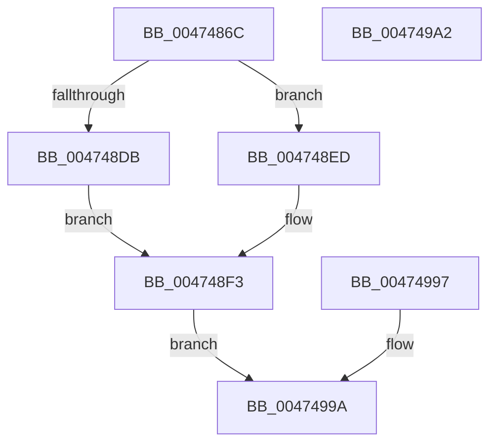

# ExpGetSystemEmulationBasicInformation

- RVA: `0x0047486C`–`0x004749A3` (길이 `311` bytes)
- VA: `0x000000014047486C`
- 실행 섹션: `.text`
- PDB 이름 있음: `예`; PDB Function 태그: `아니요`
- unwind 정보 RVA: `0x000AC998`
- 디코드: `67`개 명령, `311/311` bytes 표시
- 미해석 바이트: `0` (있으면 어셈블리에 `.byte`로 보존)

> 이 문서는 커널 이미지의 기계어와 PDB 기호를 분석해 생성했습니다. 4번과 5번은 함수 원형과 자료형을 바이너리 사용 방식에서 추정한 C 해석이며 원본 소스 복구 결과는 아닙니다.

## 1. Dependencies

- 직접 호출 지점: **0**; 고유 호출 대상: **0**
- 직접 호출자로 확인된 함수: **1**
- RIP 상대 이미지 참조: **4**

### Outgoing calls
- 직접 디코드된 call 명령이 없습니다.

### Direct callers
- [ExpQuerySystemInformation](../../page/A5/ExpQuerySystemInformation_function_00A57858.md) at `0x00A589A1`

### Static image references
- `0x004748B8` → RVA `0x00FC6AA0` (`ALMOSTRO`; read)
- `0x004748D2` → RVA `0x00FC7120` (`ALMOSTRO`; read)
- `0x004748DD` → RVA `0x00FC7128` (`ALMOSTRO`; read)
- `0x00474925` → RVA `0x00E30088` (`.data`; read)

## 2. Other-region calls and transfers

- 다른 실행 섹션으로 향하는 call: **0**
- 별도 외부 분기/꼬리 이동을 확인하지 못했습니다.

## 3. Assembly (complete function range)

```asm
0047486C  48 83 EC 38                     sub rsp, 0x38
00474870  4C 8B D9                        mov r11, rcx
00474873  45 33 D2                        xor r10d, r10d
00474876  65 48 8B 04 25 88 01 00 00      mov rax, qword ptr gs:[0x188]
0047487F  48 8B 90 B8 00 00 00            mov rdx, qword ptr [rax + 0xb8]
00474886  4C 8B 82 68 03 00 00            mov r8, qword ptr [rdx + 0x368]
0047488D  65 48 8B 04 25 88 01 00 00      mov rax, qword ptr gs:[0x188]
00474896  48 8B 90 B8 00 00 00            mov rdx, qword ptr [rax + 0xb8]
0047489D  44 0F B7 8A AE 04 00 00         movzx r9d, word ptr [rdx + 0x4ae]
004748A5  65 48 8B 04 25 88 01 00 00      mov rax, qword ptr gs:[0x188]
004748AE  0F B7 88 48 02 00 00            movzx ecx, word ptr [rax + 0x248]
004748B5  45 89 13                        mov dword ptr [r11], r10d
004748B8  8B 05 E2 21 B5 00               mov eax, dword ptr [rip + 0xb521e2]
004748BE  41 89 43 04                     mov dword ptr [r11 + 4], eax
004748C2  41 C7 43 08 00 10 00 00         mov dword ptr [r11 + 8], 0x1000
004748CA  41 C7 43 18 00 00 01 00         mov dword ptr [r11 + 0x18], 0x10000
004748D2  66 3B 0D 47 28 B5 00            cmp cx, word ptr [rip + 0xb52847]
004748D9  73 12                           jae 0x1404748ed
004748DB  8B C1                           mov eax, ecx
004748DD  48 8D 0D 44 28 B5 00            lea rcx, [rip + 0xb52844]
004748E4  48 8B 0C C1                     mov rcx, qword ptr [rcx + rax*8]
004748E8  48 8B D1                        mov rdx, rcx
004748EB  EB 06                           jmp 0x1404748f3
004748ED  49 8B CA                        mov rcx, r10
004748F0  49 8B D2                        mov rdx, r10
004748F3  48 89 4C 24 50                  mov qword ptr [rsp + 0x50], rcx
004748F8  48 C1 EA 20                     shr rdx, 0x20
004748FC  8B C1                           mov eax, ecx
004748FE  48 0B D0                        or rdx, rax
00474901  49 89 53 30                     mov qword ptr [r11 + 0x30], rdx
00474905  F3 48 0F B8 C2                  popcnt rax, rdx
0047490A  89 44 24 48                     mov dword ptr [rsp + 0x48], eax
0047490E  41 88 43 38                     mov byte ptr [r11 + 0x38], al
00474912  49 C7 43 20 00 00 01 00         mov qword ptr [r11 + 0x20], 0x10000
0047491A  49 8D 40 FF                     lea rax, [r8 - 1]
0047491E  49 89 43 28                     mov qword ptr [r11 + 0x28], rax
00474922  4D 8B C1                        mov r8, r9
00474925  48 8B 05 5C B7 9B 00            mov rax, qword ptr [rip + 0x9bb75c]
0047492C  4A 8B 0C C8                     mov rcx, qword ptr [rax + r9*8]
00474930  48 8B 91 50 48 00 00            mov rdx, qword ptr [rcx + 0x4850]
00474937  48 89 54 24 58                  mov qword ptr [rsp + 0x58], rdx
0047493C  41 B9 FF FF FF FF               mov r9d, 0xffffffff
00474942  41 8B C1                        mov eax, r9d
00474945  49 3B D1                        cmp rdx, r9
00474948  0F 46 C2                        cmovbe eax, edx
0047494B  41 89 43 0C                     mov dword ptr [r11 + 0xc], eax
0047494F  48 8B 05 32 B7 9B 00            mov rax, qword ptr [rip + 0x9bb732]
00474956  4A 8B 0C C0                     mov rcx, qword ptr [rax + r8*8]
0047495A  48 8B 91 40 48 00 00            mov rdx, qword ptr [rcx + 0x4840]
00474961  48 89 54 24 20                  mov qword ptr [rsp + 0x20], rdx
00474966  41 8B C1                        mov eax, r9d
00474969  49 3B D1                        cmp rdx, r9
0047496C  0F 46 C2                        cmovbe eax, edx
0047496F  41 89 43 10                     mov dword ptr [r11 + 0x10], eax
00474973  48 8B 05 0E B7 9B 00            mov rax, qword ptr [rip + 0x9bb70e]
0047497A  4A 8B 0C C0                     mov rcx, qword ptr [rax + r8*8]
0047497E  48 8B 81 48 48 00 00            mov rax, qword ptr [rcx + 0x4848]
00474985  48 89 44 24 28                  mov qword ptr [rsp + 0x28], rax
0047498A  49 3B C1                        cmp rax, r9
0047498D  44 0F 46 C8                     cmovbe r9d, eax
00474991  45 89 4B 14                     mov dword ptr [r11 + 0x14], r9d
00474995  EB 03                           jmp 0x14047499a
00474997  44 8B D0                        mov r10d, eax
0047499A  41 8B C2                        mov eax, r10d
0047499D  48 83 C4 38                     add rsp, 0x38
004749A1  C3                              ret
004749A2  CC                              int3
```

## 4. C-style interpretation (structured pseudocode)

```c
__int64 __fastcall ExpGetSystemEmulationBasicInformation(__int64 a1)
{
    __int64 result;
    __int64 v_r10;
    __int64 v_rsp;
    unsigned __int64 v_stack_m10;
    unsigned __int64 v_stack_m18;
    unsigned int v_stack_p10;
    unsigned __int64 v_stack_p18;
    unsigned __int64 v_stack_p20;

    v_rsp = (v_rsp) - (56);
    v_r10 = 0;
    *(unsigned int *)(a1) = 0;
    *(unsigned int *)(a1 + 4) = (unsigned int)((unsigned int)(*(unsigned int *)(v_rip + 11870690)));
    *(unsigned int *)(a1 + 8) = 0x1000ULL;
    *(unsigned int *)(a1 + 24) = 0x10000ULL;
    if (((unsigned __int16)(*(unsigned __int16 *)(*(unsigned __int64 *)(gs_base + (0 + 392)) + 584))) >= (*(unsigned __int16 *)(v_rip + 11872327))) goto loc_004748ED;
    goto loc_004748F3;
loc_004748ED:
loc_004748F3:
    v_stack_p18 = 0;
    a2 = (0) >> (32);
    a2 = (a2) | (0);
    *(unsigned __int64 *)(a1 + 48) = a2;
    v_stack_p10 = 0;
    *(unsigned __int8 *)(a1 + 56) = 0;
    *(unsigned __int64 *)(a1 + 32) = 0x10000ULL;
    *(unsigned __int64 *)(a1 + 40) = *(unsigned __int64 *)(*(unsigned __int64 *)(*(unsigned __int64 *)(gs_base + (0 + 392)) + 184) + 872) - 1;
    v_stack_p20 = *(unsigned __int64 *)(*(unsigned __int64 *)(*(unsigned __int64 *)(v_rip + 10205020) + *(unsigned __int16 *)(*(unsigned __int64 *)(*(unsigned __int64 *)(gs_base + (0 + 392)) + 184) + 1198) * 8) + 18512);
    result = (unsigned int)((unsigned int)((unsigned int)(0xFFFFFFFFULL)));
    if ((*(unsigned __int64 *)(*(unsigned __int64 *)(*(unsigned __int64 *)(v_rip + 10205020) + *(unsigned __int16 *)(*(unsigned __int64 *)(*(unsigned __int64 *)(gs_base + (0 + 392)) + 184) + 1198) * 8) + 18512)) <= ((unsigned int)(0xFFFFFFFFULL))) { result = (unsigned int)(*(unsigned __int64 *)(*(unsigned __int64 *)(*(unsigned __int64 *)(v_rip + 10205020) + *(unsigned __int16 *)(*(unsigned __int64 *)(*(unsigned __int64 *)(gs_base + (0 + 392)) + 184) + 1198) * 8) + 18512)); }
    *(unsigned int *)(a1 + 12) = (unsigned int)(result);
    v_stack_m18 = *(unsigned __int64 *)(*(unsigned __int64 *)(*(unsigned __int64 *)(v_rip + 10204978) + *(unsigned __int16 *)(*(unsigned __int64 *)(*(unsigned __int64 *)(gs_base + (0 + 392)) + 184) + 1198) * 8) + 18496);
    result = (unsigned int)((unsigned int)((unsigned int)(0xFFFFFFFFULL)));
    if ((*(unsigned __int64 *)(*(unsigned __int64 *)(*(unsigned __int64 *)(v_rip + 10204978) + *(unsigned __int16 *)(*(unsigned __int64 *)(*(unsigned __int64 *)(gs_base + (0 + 392)) + 184) + 1198) * 8) + 18496)) <= ((unsigned int)(0xFFFFFFFFULL))) { result = (unsigned int)(*(unsigned __int64 *)(*(unsigned __int64 *)(*(unsigned __int64 *)(v_rip + 10204978) + *(unsigned __int16 *)(*(unsigned __int64 *)(*(unsigned __int64 *)(gs_base + (0 + 392)) + 184) + 1198) * 8) + 18496)); }
    *(unsigned int *)(a1 + 16) = (unsigned int)(result);
    v_stack_m10 = *(unsigned __int64 *)(*(unsigned __int64 *)(*(unsigned __int64 *)(v_rip + 10204942) + *(unsigned __int16 *)(*(unsigned __int64 *)(*(unsigned __int64 *)(gs_base + (0 + 392)) + 184) + 1198) * 8) + 18504);
    a4 = (unsigned int)(0xFFFFFFFFULL);
    if ((*(unsigned __int64 *)(*(unsigned __int64 *)(*(unsigned __int64 *)(v_rip + 10204942) + *(unsigned __int16 *)(*(unsigned __int64 *)(*(unsigned __int64 *)(gs_base + (0 + 392)) + 184) + 1198) * 8) + 18504)) <= ((unsigned int)(0xFFFFFFFFULL))) { a4 = (unsigned int)(*(unsigned __int64 *)(*(unsigned __int64 *)(*(unsigned __int64 *)(v_rip + 10204942) + *(unsigned __int16 *)(*(unsigned __int64 *)(*(unsigned __int64 *)(gs_base + (0 + 392)) + 184) + 1198) * 8) + 18504)); }
    *(unsigned int *)(a1 + 20) = (unsigned int)(a4);
    goto loc_0047499A;
loc_0047499A:
    v_rsp = (v_rsp) + (56);
    return 0;
}
```

## 5. (Beta) C Style

```c
int64_t ExpGetSystemEmulationBasicInformation(void *Arg1)
{
    uint8_t *arg1 = (uint8_t *)Arg1;

    int64_t result;
    int64_t local_r10;
    int64_t local_rsp;
    uint64_t v_stack_m10;
    uint64_t v_stack_m18;
    uint32_t v_stack_p10;
    uint64_t v_stack_p18;
    uint64_t v_stack_p20;

    local_rsp = (local_rsp) - (56);
    local_r10 = 0;
    *(uint32_t *)(arg1) = 0;
    *(uint32_t *)(arg1 + 0x4) = (uint32_t)((uint32_t)(*(uint32_t *)(v_rip + 0xB521E2)));
    *(uint32_t *)(arg1 + 0x8) = 0x1000ULL;
    *(uint32_t *)(arg1 + 0x18) = 0x10000ULL;
    if (((uint16_t)(*(uint16_t *)(*(uint64_t *)(gs_base + (0 + 0x188)) + 0x248))) >= (*(uint16_t *)(v_rip + 0xB52847))) goto loc_004748ED;
    goto loc_004748F3;
loc_004748ED:
loc_004748F3:
    v_stack_p18 = 0;
    a2 = (0) >> (32);
    a2 = (a2) | (0);
    *(uint64_t *)(arg1 + 0x30) = a2;
    v_stack_p10 = 0;
    *(uint8_t *)(arg1 + 0x38) = 0;
    *(uint64_t *)(arg1 + 0x20) = 0x10000ULL;
    *(uint64_t *)(arg1 + 0x28) = *(uint64_t *)(*(uint64_t *)(*(uint64_t *)(gs_base + (0 + 0x188)) + 0xB8) + 0x368) - 1;
    v_stack_p20 = *(uint64_t *)(*(uint64_t *)(*(uint64_t *)(v_rip + 0x9BB75C) + *(uint16_t *)(*(uint64_t *)(*(uint64_t *)(gs_base + (0 + 0x188)) + 0xB8) + 0x4AE) * 8) + 0x4850);
    result = (uint32_t)((uint32_t)((uint32_t)(0xFFFFFFFFULL)));
    if ((*(uint64_t *)(*(uint64_t *)(*(uint64_t *)(v_rip + 0x9BB75C) + *(uint16_t *)(*(uint64_t *)(*(uint64_t *)(gs_base + (0 + 0x188)) + 0xB8) + 0x4AE) * 8) + 0x4850)) <= ((uint32_t)(0xFFFFFFFFULL))) { result = (uint32_t)(*(uint64_t *)(*(uint64_t *)(*(uint64_t *)(v_rip + 0x9BB75C) + *(uint16_t *)(*(uint64_t *)(*(uint64_t *)(gs_base + (0 + 0x188)) + 0xB8) + 0x4AE) * 8) + 0x4850)); }
    *(uint32_t *)(arg1 + 0xC) = (uint32_t)(result);
    v_stack_m18 = *(uint64_t *)(*(uint64_t *)(*(uint64_t *)(v_rip + 0x9BB732) + *(uint16_t *)(*(uint64_t *)(*(uint64_t *)(gs_base + (0 + 0x188)) + 0xB8) + 0x4AE) * 8) + 0x4840);
    result = (uint32_t)((uint32_t)((uint32_t)(0xFFFFFFFFULL)));
    if ((*(uint64_t *)(*(uint64_t *)(*(uint64_t *)(v_rip + 0x9BB732) + *(uint16_t *)(*(uint64_t *)(*(uint64_t *)(gs_base + (0 + 0x188)) + 0xB8) + 0x4AE) * 8) + 0x4840)) <= ((uint32_t)(0xFFFFFFFFULL))) { result = (uint32_t)(*(uint64_t *)(*(uint64_t *)(*(uint64_t *)(v_rip + 0x9BB732) + *(uint16_t *)(*(uint64_t *)(*(uint64_t *)(gs_base + (0 + 0x188)) + 0xB8) + 0x4AE) * 8) + 0x4840)); }
    *(uint32_t *)(arg1 + 0x10) = (uint32_t)(result);
    v_stack_m10 = *(uint64_t *)(*(uint64_t *)(*(uint64_t *)(v_rip + 0x9BB70E) + *(uint16_t *)(*(uint64_t *)(*(uint64_t *)(gs_base + (0 + 0x188)) + 0xB8) + 0x4AE) * 8) + 0x4848);
    a4 = (uint32_t)(0xFFFFFFFFULL);
    if ((*(uint64_t *)(*(uint64_t *)(*(uint64_t *)(v_rip + 0x9BB70E) + *(uint16_t *)(*(uint64_t *)(*(uint64_t *)(gs_base + (0 + 0x188)) + 0xB8) + 0x4AE) * 8) + 0x4848)) <= ((uint32_t)(0xFFFFFFFFULL))) { a4 = (uint32_t)(*(uint64_t *)(*(uint64_t *)(*(uint64_t *)(v_rip + 0x9BB70E) + *(uint16_t *)(*(uint64_t *)(*(uint64_t *)(gs_base + (0 + 0x188)) + 0xB8) + 0x4AE) * 8) + 0x4848)); }
    *(uint32_t *)(arg1 + 0x14) = (uint32_t)(a4);
    goto loc_0047499A;
loc_0047499A:
    local_rsp = (local_rsp) + (56);
    return 0;
}
```

### 관측된 메모리 오프셋

구조체 형식이 확인되지 않은 접근은 인자 기준의 오프셋으로만 기록했습니다.

| 기준 인자 | 오프셋 표현 | 폭 (bit) | 접근 |
|---|---:|---:|---|
| `Arg1` | `+ 0x0` | `32` | `W` |
| `Arg1` | `+ 0x4` | `32` | `W` |
| `Arg1` | `+ 0x8` | `32` | `W` |
| `Arg1` | `+ 0xC` | `32` | `W` |
| `Arg1` | `+ 0x10` | `32` | `W` |
| `Arg1` | `+ 0x14` | `32` | `W` |
| `Arg1` | `+ 0x18` | `32` | `W` |
| `Arg1` | `+ 0x20` | `64` | `W` |
| `Arg1` | `+ 0x28` | `64` | `W` |
| `Arg1` | `+ 0x30` | `64` | `W` |
| `Arg1` | `+ 0x38` | `8` | `W` |

## 6. Execution-region graph

[열기: 2D/3D 그래프와 함수 탐색 컨트롤 패널](../../../control-panel.html?section=text&rva=0x0047486C&view=graph)

- 2D 그래프는 위에서 아래로 흐르고, 3D 그래프는 빈 공간을 드래그해 회전합니다. Shift+드래그는 이동, 휠은 확대·축소, 함수 노드 선택은 대상 보고서 이동입니다.

### Static fallback


