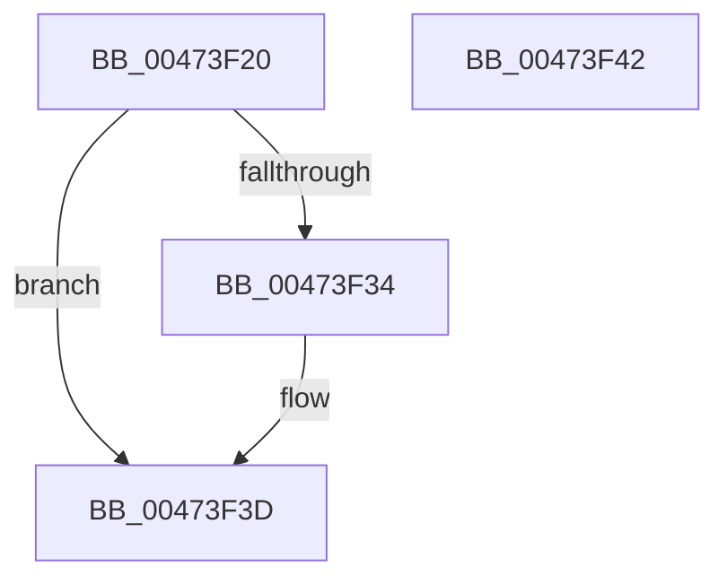

# FsRtlGetSupportedFeatures

- RVA: `0x00473F20`–`0x00473F43` (길이 `35` bytes)
- VA: `0x0000000140473F20`
- 실행 섹션: `.text`
- PDB 이름 있음: `예`; PDB Function 태그: `아니요`
- unwind 정보 RVA: `0x0005C788`
- 디코드: `11`개 명령, `35/35` bytes 표시
- 미해석 바이트: `0` (있으면 어셈블리에 `.byte`로 보존)

> 이 문서는 커널 이미지의 기계어와 PDB 기호를 분석해 생성했습니다. 4번과 5번은 함수 원형과 자료형을 바이너리 사용 방식에서 추정한 C 해석이며 원본 소스 복구 결과는 아닙니다.

## 1. Dependencies

- 직접 호출 지점: **1**; 고유 호출 대상: **1**
- 직접 호출자로 확인된 함수: **2**
- RIP 상대 이미지 참조: **1**

### Outgoing calls
- `0x00473F38` → [guard_dispatch_icall](../6B/guard_dispatch_icall_function_006BAAD0.md) (function, `0x006BAAD0`)

### Direct callers
- [IopXxxControlFile](../../page/8E/IopXxxControlFile_function_008E9AD0.md) at `0x008EA832`
- [IopQueryInformation](../../page/9D/IopQueryInformation_function_009D8370.md) at `0x009D8465`

### Static image references
- `0x00473F28` → RVA `0x00E65BF0` (`.data`; read)

## 2. Other-region calls and transfers

- 다른 실행 섹션으로 향하는 call: **0**
- 별도 외부 분기/꼬리 이동을 확인하지 못했습니다.

## 3. Assembly (complete function range)

```asm
00473F20  48 83 EC 28                     sub rsp, 0x28
00473F24  33 C0                           xor eax, eax
00473F26  89 02                           mov dword ptr [rdx], eax
00473F28  4C 8B 05 C1 1C 9F 00            mov r8, qword ptr [rip + 0x9f1cc1]
00473F2F  4D 85 C0                        test r8, r8
00473F32  74 09                           je 0x140473f3d
00473F34  49 8B 40 10                     mov rax, qword ptr [r8 + 0x10]
00473F38  E8 93 6B 24 00                  call 0x1406baad0
00473F3D  48 83 C4 28                     add rsp, 0x28
00473F41  C3                              ret
00473F42  CC                              int3
```

## 4. C-style interpretation (structured pseudocode)

```c
__int64 __fastcall FsRtlGetSupportedFeatures(__int64 a1, __int64 a2)
{
    __int64 result;
    __int64 v_rsp;

    v_rsp = (v_rsp) - (40);
    result = 0;
    *(unsigned int *)(a2) = 0;
    if (*(unsigned __int64 *)(v_rip + 10427585) != 0) {
        result = *(unsigned __int64 *)(*(unsigned __int64 *)(v_rip + 10427585) + 16);
        result = guard_dispatch_icall(a1, a2, *(unsigned __int64 *)(v_rip + 10427585), a4);
    }
    v_rsp = (v_rsp) + (40);
    return result;
}
```

## 5. (Beta) C Style

```c
int64_t FsRtlGetSupportedFeatures(int64_t Arg1, void *Arg2)
{
    uint8_t *arg2 = (uint8_t *)Arg2;

    int64_t result;
    int64_t local_rsp;

    local_rsp = (local_rsp) - (40);
    result = 0;
    *(uint32_t *)(arg2) = 0;
    if (*(uint64_t *)(v_rip + 0x9F1CC1) != 0) {
        result = *(uint64_t *)(*(uint64_t *)(v_rip + 0x9F1CC1) + 0x10);
        result = guard_dispatch_icall(Arg1, Arg2, *(uint64_t *)(v_rip + 0x9F1CC1), a4);
    }
    local_rsp = (local_rsp) + (40);
    return result;
}
```

### 관측된 메모리 오프셋

구조체 형식이 확인되지 않은 접근은 인자 기준의 오프셋으로만 기록했습니다.

| 기준 인자 | 오프셋 표현 | 폭 (bit) | 접근 |
|---|---:|---:|---|
| `Arg2` | `+ 0x0` | `32` | `W` |

## 6. Execution-region graph

[열기: 2D/3D 그래프와 함수 탐색 컨트롤 패널](../../../control-panel.html?section=text&rva=0x00473F20&view=graph)

- 2D 그래프는 위에서 아래로 흐르고, 3D 그래프는 빈 공간을 드래그해 회전합니다. Shift+드래그는 이동, 휠은 확대·축소, 함수 노드 선택은 대상 보고서 이동입니다.

### Static fallback


