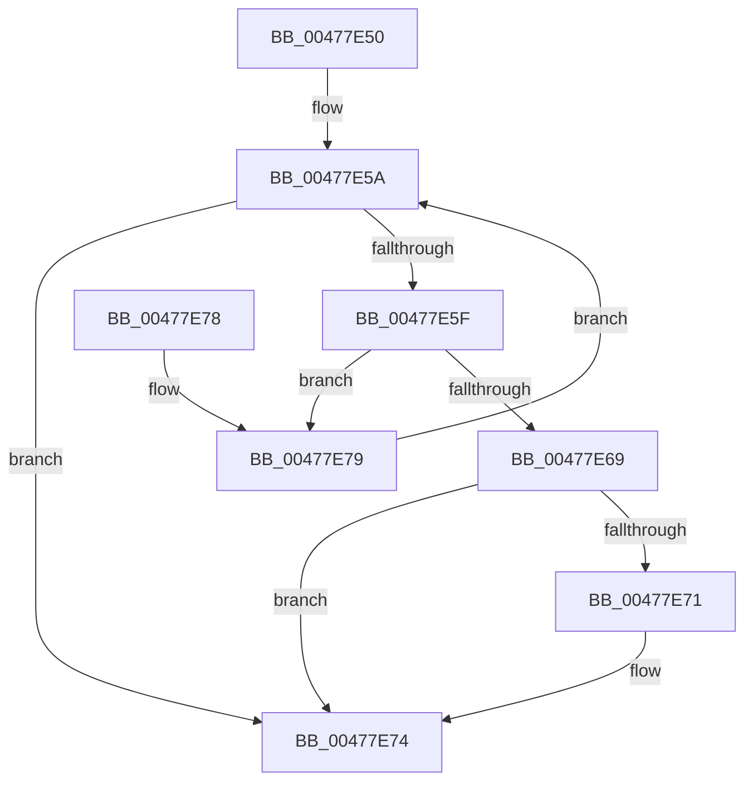

# FsRtlpCallerIsAtomicRequestor

- RVA: `0x00477E50`–`0x00477E7E` (길이 `46` bytes)
- VA: `0x0000000140477E50`
- 실행 섹션: `.text`
- PDB 이름 있음: `예`; PDB Function 태그: `아니요`
- unwind 정보 RVA: `0x000DB714`
- 디코드: `17`개 명령, `46/46` bytes 표시
- 미해석 바이트: `0` (있으면 어셈블리에 `.byte`로 보존)

> 이 문서는 커널 이미지의 기계어와 PDB 기호를 분석해 생성했습니다. 4번과 5번은 함수 원형과 자료형을 바이너리 사용 방식에서 추정한 C 해석이며 원본 소스 복구 결과는 아닙니다.

## 1. Dependencies

- 직접 호출 지점: **0**; 고유 호출 대상: **0**
- 직접 호출자로 확인된 함수: **2**
- RIP 상대 이미지 참조: **0**

### Outgoing calls
- 직접 디코드된 call 명령이 없습니다.

### Direct callers
- [FsRtlpRequestShareableOplock](../4E/FsRtlpRequestShareableOplock_function_004E6EC8.md) at `0x004E6FA4`
- [sub_00B3115E](../../page/B3/Unknown_function_00B3115E.md) at `0x00B31261`

### Static image references
- 디코드된 RIP-relative 메모리 참조가 없습니다.

## 2. Other-region calls and transfers

- 다른 실행 섹션으로 향하는 call: **0**
- 별도 외부 분기/꼬리 이동을 확인하지 못했습니다.

## 3. Assembly (complete function range)

```asm
00477E50  4C 8D 51 78                     lea r10, [rcx + 0x78]
00477E54  45 32 C9                        xor r9b, r9b
00477E57  49 8B 02                        mov rax, qword ptr [r10]
00477E5A  49 3B C2                        cmp rax, r10
00477E5D  74 15                           je 0x140477e74
00477E5F  48 8D 48 C8                     lea rcx, [rax - 0x38]
00477E63  48 3B 51 18                     cmp rdx, qword ptr [rcx + 0x18]
00477E67  75 10                           jne 0x140477e79
00477E69  41 B1 01                        mov r9b, 1
00477E6C  4D 85 C0                        test r8, r8
00477E6F  74 03                           je 0x140477e74
00477E71  49 89 08                        mov qword ptr [r8], rcx
00477E74  41 8A C1                        mov al, r9b
00477E77  C3                              ret
00477E78  CC                              int3
00477E79  48 8B 00                        mov rax, qword ptr [rax]
00477E7C  EB DC                           jmp 0x140477e5a
```

## 4. C-style interpretation (structured pseudocode)

```c
__int64 __fastcall FsRtlpCallerIsAtomicRequestor(__int64 a1, __int64 a2, __int64 a3, unsigned __int8 a4)
{
    a4 = 0;
loc_00477E5A:
    if ((*(unsigned __int64 *)(a1 + 120)) == (a1 + 120)) goto loc_00477E74;
    if (a2 != (*(unsigned __int64 *)(*(unsigned __int64 *)(a1 + 120) - 56 + 24))) goto loc_00477E79;
    if (a3 != 0) {
        *(unsigned __int64 *)(a3) = *(unsigned __int64 *)(a1 + 120) - 56;
    }
    return 1;
loc_00477E79:
    goto loc_00477E5A;
}
```

## 5. (Beta) C Style

```c
int64_t FsRtlpCallerIsAtomicRequestor(void *Arg1, int64_t Arg2, int64_t Arg3, uint8_t Arg4)
{
    uint8_t *arg1 = (uint8_t *)Arg1;

    Arg4 = 0;
loc_00477E5A:
    if ((*(uint64_t *)(arg1 + 0x78)) == (Arg1 + 120)) goto loc_00477E74;
    if (Arg2 != (*(uint64_t *)(*(uint64_t *)(arg1 + 0x78) - 0x38 + 0x18))) goto loc_00477E79;
    if (Arg3 != 0) {
        *(uint64_t *)(Arg3) = *(uint64_t *)(arg1 + 0x78) - 56;
    }
    return 1;
loc_00477E79:
    goto loc_00477E5A;
}
```

### 관측된 메모리 오프셋

구조체 형식이 확인되지 않은 접근은 인자 기준의 오프셋으로만 기록했습니다.

| 기준 인자 | 오프셋 표현 | 폭 (bit) | 접근 |
|---|---:|---:|---|
| `Arg1` | `+ 0x0` | `64` | `R` |
| `Arg1` | `+ 0x78` | `64` | `R` |

## 6. Execution-region graph

[열기: 2D/3D 그래프와 함수 탐색 컨트롤 패널](../../../control-panel.html?section=text&rva=0x00477E50&view=graph)

- 2D 그래프는 위에서 아래로 흐르고, 3D 그래프는 빈 공간을 드래그해 회전합니다. Shift+드래그는 이동, 휠은 확대·축소, 함수 노드 선택은 대상 보고서 이동입니다.

### Static fallback


