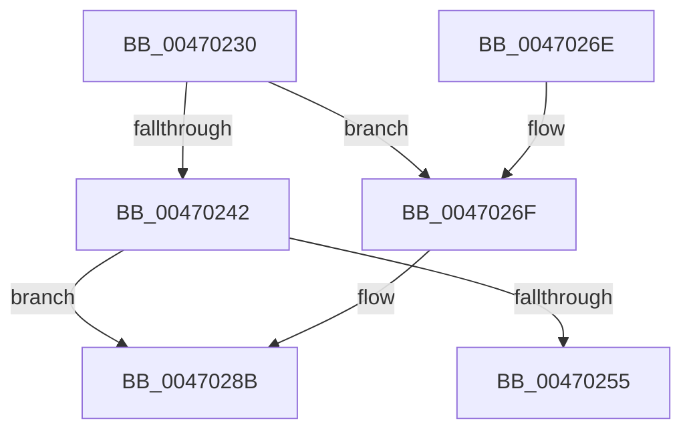

# HalGetCommonBufferFromVectorByIndex

- RVA: `0x00470230`–`0x004702A6` (길이 `118` bytes)
- VA: `0x0000000140470230`
- 실행 섹션: `.text`
- PDB 이름 있음: `예`; PDB Function 태그: `아니요`
- unwind 정보 RVA: `0x000ABCFC`
- 디코드: `34`개 명령, `118/118` bytes 표시
- 미해석 바이트: `0` (있으면 어셈블리에 `.byte`로 보존)

> 이 문서는 커널 이미지의 기계어와 PDB 기호를 분석해 생성했습니다. 4번과 5번은 함수 원형과 자료형을 바이너리 사용 방식에서 추정한 C 해석이며 원본 소스 복구 결과는 아닙니다.

## 1. Dependencies

- 직접 호출 지점: **2**; 고유 호출 대상: **1**
- 직접 호출자로 확인된 함수: **0**
- RIP 상대 이미지 참조: **0**

### Outgoing calls
- `0x00470285` → [KeBugCheckEx](../4F/KeBugCheckEx_function_004FD660.md) (function, `0x004FD660`)
- `0x004702A0` → [KeBugCheckEx](../4F/KeBugCheckEx_function_004FD660.md) (function, `0x004FD660`)

### Direct callers
- 이 함수 시작 RVA로 연결되는 직접 call은 확인되지 않았습니다. 간접 호출은 완전히 역산할 수 없습니다.

### Static image references
- 디코드된 RIP-relative 메모리 참조가 없습니다.

## 2. Other-region calls and transfers

- 다른 실행 섹션으로 향하는 call: **0**
- 별도 외부 분기/꼬리 이동을 확인하지 못했습니다.

## 3. Assembly (complete function range)

```asm
00470230  48 83 EC 38                     sub rsp, 0x38
00470234  8B 42 18                        mov eax, dword ptr [rdx + 0x18]
00470237  4D 8B D1                        mov r10, r9
0047023A  41 8B C8                        mov ecx, r8d
0047023D  44 3B C0                        cmp r8d, eax
00470240  73 2D                           jae 0x14047026f
00470242  48 8B 42 40                     mov rax, qword ptr [rdx + 0x40]
00470246  44 8B C1                        mov r8d, ecx
00470249  4D 03 C0                        add r8, r8
0047024C  4E 8B 0C C0                     mov r9, qword ptr [rax + r8*8]
00470250  4D 85 C9                        test r9, r9
00470253  74 36                           je 0x14047028b
00470255  4D 89 0A                        mov qword ptr [r10], r9
00470258  48 8B 42 40                     mov rax, qword ptr [rdx + 0x40]
0047025C  4A 8B 4C C0 08                  mov rcx, qword ptr [rax + r8*8 + 8]
00470261  48 8B 44 24 60                  mov rax, qword ptr [rsp + 0x60]
00470266  48 89 08                        mov qword ptr [rax], rcx
00470269  48 83 C4 38                     add rsp, 0x38
0047026D  C3                              ret
0047026E  CC                              int3
0047026F  48 83 64 24 20 00               and qword ptr [rsp + 0x20], 0
00470275  4C 8B C9                        mov r9, rcx
00470278  B9 DC 01 00 00                  mov ecx, 0x1dc
0047027D  4C 8B C0                        mov r8, rax
00470280  BA 03 00 00 00                  mov edx, 3
00470285  E8 D6 D3 08 00                  call 0x1404fd660
0047028A  CC                              int3
0047028B  48 83 64 24 20 00               and qword ptr [rsp + 0x20], 0
00470291  45 33 C9                        xor r9d, r9d
00470294  4C 8B C1                        mov r8, rcx
00470297  B9 DC 01 00 00                  mov ecx, 0x1dc
0047029C  41 8D 51 04                     lea edx, [r9 + 4]
004702A0  E8 BB D3 08 00                  call 0x1404fd660
004702A5  CC                              int3
```

## 4. C-style interpretation (structured pseudocode)

```c
__int64 __fastcall HalGetCommonBufferFromVectorByIndex(__int64 a1, __int64 a2, int a3, __int64 a4, __int64 a5)
{
    __int64 result;
    __int64 v_rsp;
    unsigned __int64 v_stack_p20;

    v_rsp = (v_rsp) - (56);
    if (a3 >= ((unsigned int)((unsigned int)(*(unsigned int *)(a2 + 24))))) goto loc_0047026F;
    a3 = ((unsigned int)((unsigned int)((unsigned int)(a3)))) + ((unsigned int)((unsigned int)((unsigned int)(a3))));
    if (*(unsigned __int64 *)(*(unsigned __int64 *)(a2 + 64) + a3 * 8) == 0) goto loc_0047028B;
    *(unsigned __int64 *)(a4) = *(unsigned __int64 *)(*(unsigned __int64 *)(a2 + 64) + a3 * 8);
    *(unsigned __int64 *)(a5) = *(unsigned __int64 *)(*(unsigned __int64 *)(a2 + 64) + a3 * 8 + 8);
    v_rsp = (v_rsp) + (56);
    return a5;
loc_0047026F:
    result = KeBugCheckEx(476, 3, a5, *(unsigned __int64 *)(*(unsigned __int64 *)(a2 + 64) + a3 * 8 + 8));
loc_0047028B:
    a4 = 0;
    result = KeBugCheckEx(476, a4 + 4, 476, a4);
    return result;
}
```

## 5. (Beta) C Style

```c
void *HalGetCommonBufferFromVectorByIndex(int64_t Arg1, void *Arg2, int32_t Arg3, void *Arg4, void *Arg5)
{
    uint8_t *arg2 = (uint8_t *)Arg2;
    uint8_t *arg4 = (uint8_t *)Arg4;
    uint8_t *arg5 = (uint8_t *)Arg5;

    int64_t result;
    int64_t local_rsp;
    uint64_t v_stack_p20;

    local_rsp = (local_rsp) - (56);
    if (Arg3 >= ((uint32_t)((uint32_t)(*(uint32_t *)(arg2 + 0x18))))) goto loc_0047026F;
    Arg3 = ((uint32_t)((uint32_t)((uint32_t)(Arg3)))) + ((uint32_t)((uint32_t)((uint32_t)(Arg3))));
    if (*(uint64_t *)(*(uint64_t *)(arg2 + 0x40) + Arg3 * 8) == 0) goto loc_0047028B;
    *(uint64_t *)(arg4) = *(uint64_t *)(*(uint64_t *)(arg2 + 0x40) + Arg3 * 8);
    *(uint64_t *)(arg5) = *(uint64_t *)(*(uint64_t *)(arg2 + 0x40) + Arg3 * 8 + 0x8);
    local_rsp = (local_rsp) + (56);
    return Arg5;
loc_0047026F:
    result = KeBugCheckEx(476, 3, Arg5, *(uint64_t *)(*(uint64_t *)(arg2 + 0x40) + Arg3 * 8 + 0x8));
loc_0047028B:
    Arg4 = 0;
    result = KeBugCheckEx(476, Arg4 + 4, 476, Arg4);
    return result;
}
```

### 관측된 메모리 오프셋

구조체 형식이 확인되지 않은 접근은 인자 기준의 오프셋으로만 기록했습니다.

| 기준 인자 | 오프셋 표현 | 폭 (bit) | 접근 |
|---|---:|---:|---|
| `Arg2` | `+ 0x18` | `32` | `R` |
| `Arg2` | `+ 0x40` | `64` | `R` |
| `Arg4` | `+ 0x0` | `64` | `W` |
| `Arg5` | `+ 0x0` | `64` | `W` |

## 6. Execution-region graph

[열기: 2D/3D 그래프와 함수 탐색 컨트롤 패널](../../../control-panel.html?section=text&rva=0x00470230&view=graph)

- 2D 그래프는 위에서 아래로 흐르고, 3D 그래프는 빈 공간을 드래그해 회전합니다. Shift+드래그는 이동, 휠은 확대·축소, 함수 노드 선택은 대상 보고서 이동입니다.

### Static fallback


