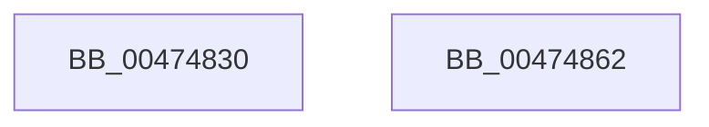

# HaliPciInterfaceWriteConfig

- RVA: `0x00474830`–`0x00474863` (길이 `51` bytes)
- VA: `0x0000000140474830`
- 실행 섹션: `.text`
- PDB 이름 있음: `예`; PDB Function 태그: `아니요`
- unwind 정보 RVA: `0x000697A4`
- 디코드: `15`개 명령, `51/51` bytes 표시
- 미해석 바이트: `0` (있으면 어셈블리에 `.byte`로 보존)

> 이 문서는 커널 이미지의 기계어와 PDB 기호를 분석해 생성했습니다. 4번과 5번은 함수 원형과 자료형을 바이너리 사용 방식에서 추정한 C 해석이며 원본 소스 복구 결과는 아닙니다.

## 1. Dependencies

- 직접 호출 지점: **1**; 고유 호출 대상: **1**
- 직접 호출자로 확인된 함수: **2**
- RIP 상대 이미지 참조: **0**

### Outgoing calls
- `0x00474855` → [HalpPCIConfig](../23/HalpPCIConfig_function_00235980.md) (function, `0x00235980`)

### Direct callers
- [HaliHandlePCIConfigSpaceAccess](../56/HaliHandlePCIConfigSpaceAccess_function_00563110.md) at `0x005631AB`
- [HalpKdWritePCIConfig](../56/HalpKdWritePCIConfig_function_0056E880.md) at `0x0056E89B`

### Static image references
- 디코드된 RIP-relative 메모리 참조가 없습니다.

## 2. Other-region calls and transfers

- 다른 실행 섹션으로 향하는 call: **0**
- 별도 외부 분기/꼬리 이동을 확인하지 못했습니다.

## 3. Assembly (complete function range)

```asm
00474830  40 53                           push rbx
00474832  48 83 EC 40                     sub rsp, 0x40
00474836  44 8B 54 24 70                  mov r10d, dword ptr [rsp + 0x70]
0047483B  8B CA                           mov ecx, edx
0047483D  8B 5C 24 78                     mov ebx, dword ptr [rsp + 0x78]
00474841  C7 44 24 30 01 00 00 00         mov dword ptr [rsp + 0x30], 1
00474849  C1 E9 08                        shr ecx, 8
0047484C  89 5C 24 28                     mov dword ptr [rsp + 0x28], ebx
00474850  44 89 54 24 20                  mov dword ptr [rsp + 0x20], r10d
00474855  E8 26 11 DC FF                  call 0x140235980
0047485A  8B C3                           mov eax, ebx
0047485C  48 83 C4 40                     add rsp, 0x40
00474860  5B                              pop rbx
00474861  C3                              ret
00474862  CC                              int3
```

## 4. C-style interpretation (structured pseudocode)

```c
__int64 __fastcall HaliPciInterfaceWriteConfig(__int64 a1, int a2, __int64 a3, __int64 a4, unsigned int a5, unsigned int a6)
{
    __int64 result;
    __int64 v_rsp;
    unsigned int v_stack_m18;
    unsigned int v_stack_m20;
    unsigned int v_stack_m28;

    v_rsp = (v_rsp) - (64);
    v_stack_m18 = 1;
    a1 = (unsigned int)(((unsigned int)(a2)) >> (8));
    v_stack_m20 = (unsigned int)((unsigned int)(a6));
    v_stack_m28 = (unsigned int)((unsigned int)(a5));
    result = HalpPCIConfig(a1, a2, a3, a4);
    v_rsp = (v_rsp) + (64);
    return (unsigned int)((unsigned int)((unsigned int)(a6)));
}
```

## 5. (Beta) C Style

```c
int64_t HaliPciInterfaceWriteConfig(int64_t Arg1, int32_t Arg2, int64_t Arg3, int64_t Arg4, uint32_t Arg5, uint32_t Arg6)
{
    int64_t result;
    int64_t local_rsp;
    uint32_t v_stack_m18;
    uint32_t v_stack_m20;
    uint32_t v_stack_m28;

    local_rsp = (local_rsp) - (64);
    v_stack_m18 = 1;
    Arg1 = (uint32_t)(((uint32_t)(Arg2)) >> (8));
    v_stack_m20 = (uint32_t)((uint32_t)(Arg6));
    v_stack_m28 = (uint32_t)((uint32_t)(Arg5));
    result = HalpPCIConfig(Arg1, Arg2, Arg3, Arg4);
    local_rsp = (local_rsp) + (64);
    return (uint32_t)((uint32_t)((uint32_t)(Arg6)));
}
```

## 6. Execution-region graph

[열기: 2D/3D 그래프와 함수 탐색 컨트롤 패널](../../../control-panel.html?section=text&rva=0x00474830&view=graph)

- 2D 그래프는 위에서 아래로 흐르고, 3D 그래프는 빈 공간을 드래그해 회전합니다. Shift+드래그는 이동, 휠은 확대·축소, 함수 노드 선택은 대상 보고서 이동입니다.

### Static fallback


