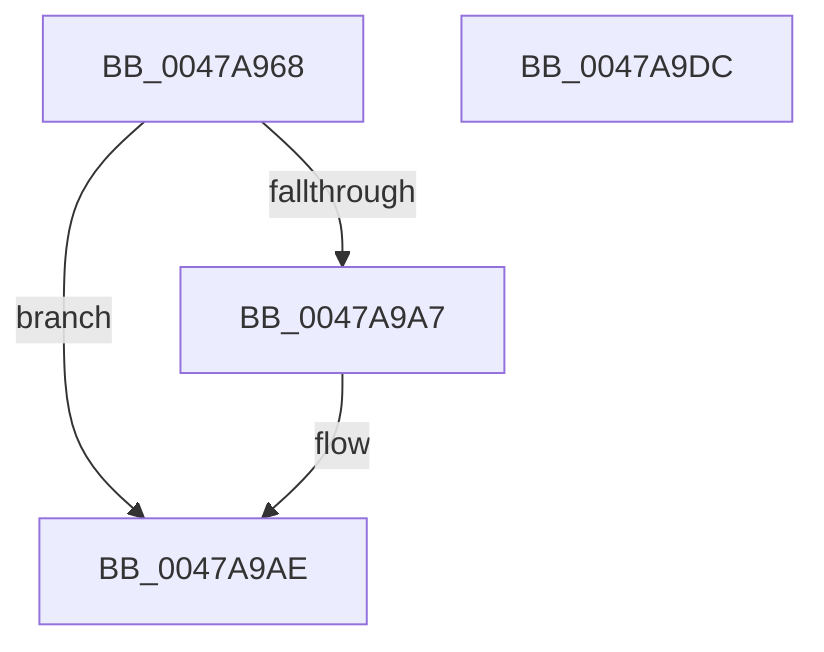

# HalpBuddyAllocatorBltAdd

- RVA: `0x0047A968`–`0x0047A9DD` (길이 `117` bytes)
- VA: `0x000000014047A968`
- 실행 섹션: `.text`
- PDB 이름 있음: `예`; PDB Function 태그: `아니요`
- unwind 정보 RVA: `0x0006C8E8`
- 디코드: `33`개 명령, `117/117` bytes 표시
- 미해석 바이트: `0` (있으면 어셈블리에 `.byte`로 보존)

> 이 문서는 커널 이미지의 기계어와 PDB 기호를 분석해 생성했습니다. 4번과 5번은 함수 원형과 자료형을 바이너리 사용 방식에서 추정한 C 해석이며 원본 소스 복구 결과는 아닙니다.

## 1. Dependencies

- 직접 호출 지점: **2**; 고유 호출 대상: **2**
- 직접 호출자로 확인된 함수: **4**
- RIP 상대 이미지 참조: **0**

### Outgoing calls
- `0x0047A98E` → [KeAcquireSpinLockRaiseToDpc](../20/KeAcquireSpinLockRaiseToDpc_function_00208470.md) (function, `0x00208470`)
- `0x0047A9C2` → [KeReleaseSpinLock](../39/KeReleaseSpinLock_function_00392BA0.md) (function, `0x00392BA0`)

### Direct callers
- [HalpBuddyAllocatorFreeLogicalAddress](../30/HalpBuddyAllocatorFreeLogicalAddress_function_00307140.md) at `0x003071E9`
- [HalpBuddyAllocatorAllocateLogicalAddress](../30/HalpBuddyAllocatorAllocateLogicalAddress_function_00307EE0.md) at `0x0030815B`
- [HalpBuddyAllocatorDeleteSubtree](HalpBuddyAllocatorDeleteSubtree_function_0047A890.md) at `0x0047A946`
- [HalpBuddyAllocatorReserveLogicalAddress](../57/HalpBuddyAllocatorReserveLogicalAddress_function_00575D00.md) at `0x00575DB8`
- [HalpBuddyAllocatorReserveLogicalAddress](../57/HalpBuddyAllocatorReserveLogicalAddress_function_00575D00.md) at `0x00575DC4`
- [HalpBuddyAllocatorReserveLogicalAddress](../57/HalpBuddyAllocatorReserveLogicalAddress_function_00575D00.md) at `0x00575EAA`
- [HalpBuddyAllocatorReserveLogicalAddress](../57/HalpBuddyAllocatorReserveLogicalAddress_function_00575D00.md) at `0x00575EB6`

### Static image references
- 디코드된 RIP-relative 메모리 참조가 없습니다.

## 2. Other-region calls and transfers

- 다른 실행 섹션으로 향하는 call: **0**
- 별도 외부 분기/꼬리 이동을 확인하지 못했습니다.

## 3. Assembly (complete function range)

```asm
0047A968  48 89 5C 24 10                  mov qword ptr [rsp + 0x10], rbx
0047A96D  48 89 6C 24 18                  mov qword ptr [rsp + 0x18], rbp
0047A972  48 89 74 24 20                  mov qword ptr [rsp + 0x20], rsi
0047A977  57                              push rdi
0047A978  48 83 EC 20                     sub rsp, 0x20
0047A97C  48 8B 41 38                     mov rax, qword ptr [rcx + 0x38]
0047A980  48 8B F1                        mov rsi, rcx
0047A983  48 8D 4A 68                     lea rcx, [rdx + 0x68]
0047A987  48 8B FA                        mov rdi, rdx
0047A98A  48 0F BC D8                     bsf rbx, rax
0047A98E  E8 DD DA D8 FF                  call 0x140208470
0047A993  8D 4B F4                        lea ecx, [rbx - 0xc]
0047A996  48 C1 E1 04                     shl rcx, 4
0047A99A  48 03 4F 60                     add rcx, qword ptr [rdi + 0x60]
0047A99E  48 8B 51 08                     mov rdx, qword ptr [rcx + 8]
0047A9A2  48 39 0A                        cmp qword ptr [rdx], rcx
0047A9A5  74 07                           je 0x14047a9ae
0047A9A7  B9 03 00 00 00                  mov ecx, 3
0047A9AC  CD 29                           int 0x29
0047A9AE  48 89 0E                        mov qword ptr [rsi], rcx
0047A9B1  48 89 56 08                     mov qword ptr [rsi + 8], rdx
0047A9B5  48 89 32                        mov qword ptr [rdx], rsi
0047A9B8  8A D0                           mov dl, al
0047A9BA  48 89 71 08                     mov qword ptr [rcx + 8], rsi
0047A9BE  48 8D 4F 68                     lea rcx, [rdi + 0x68]
0047A9C2  E8 D9 81 F1 FF                  call 0x140392ba0
0047A9C7  48 8B 5C 24 38                  mov rbx, qword ptr [rsp + 0x38]
0047A9CC  48 8B 6C 24 40                  mov rbp, qword ptr [rsp + 0x40]
0047A9D1  48 8B 74 24 48                  mov rsi, qword ptr [rsp + 0x48]
0047A9D6  48 83 C4 20                     add rsp, 0x20
0047A9DA  5F                              pop rdi
0047A9DB  C3                              ret
0047A9DC  CC                              int3
```

## 4. C-style interpretation (structured pseudocode)

```c
__int64 __fastcall HalpBuddyAllocatorBltAdd(__int64 a1, __int64 a2)
{
    __int64 result;
    __int64 v_rsp;
    unsigned __int64 v_stack_p10;
    unsigned __int64 v_stack_p18;
    unsigned __int64 v_stack_p20;

    v_stack_p10 = v_rbx;
    v_stack_p18 = v_rbp;
    v_stack_p20 = v_rsi;
    v_rsp = (v_rsp) - (32);
    result = KeAcquireSpinLockRaiseToDpc(a2 + 104, a2, a3, a4);
    a1 = (v_rbx - 12) << (4);
    a1 = (a1) + (*(unsigned __int64 *)(a2 + 96));
    if ((*(unsigned __int64 *)(*(unsigned __int64 *)(a1 + 8))) != a1) {
        a1 = 3;
    }
    *(unsigned __int64 *)(a1) = a1;
    *(unsigned __int64 *)(a1 + 8) = *(unsigned __int64 *)(a1 + 8);
    *(unsigned __int64 *)(*(unsigned __int64 *)(a1 + 8)) = a1;
    *(unsigned __int64 *)(a1 + 8) = a1;
    result = KeReleaseSpinLock(a2 + 104, (unsigned __int8)(result), a3, a4);
    v_rsp = (v_rsp) + (32);
    return result;
}
```

## 5. (Beta) C Style

```c
int64_t HalpBuddyAllocatorBltAdd(void *Arg1, void *Arg2)
{
    uint8_t *arg1 = (uint8_t *)Arg1;
    uint8_t *arg2 = (uint8_t *)Arg2;

    int64_t result;
    int64_t local_rsp;
    uint64_t v_stack_p10;
    uint64_t v_stack_p18;
    uint64_t v_stack_p20;

    v_stack_p10 = local_rbx;
    v_stack_p18 = local_rbp;
    v_stack_p20 = local_rsi;
    local_rsp = (local_rsp) - (32);
    result = KeAcquireSpinLockRaiseToDpc(Arg2 + 104, Arg2, a3, a4);
    Arg1 = (local_rbx - 12) << (4);
    Arg1 = (Arg1) + (*(uint64_t *)(arg2 + 0x60));
    if ((*(uint64_t *)(*(uint64_t *)(arg1 + 0x8))) != Arg1) {
        Arg1 = 3;
    }
    *(void **)(arg1) = Arg1;
    *(uint64_t *)(arg1 + 0x8) = *(uint64_t *)(arg1 + 0x8);
    *(void **)(*(uint64_t *)(arg1 + 0x8)) = Arg1;
    *(void **)(arg1 + 0x8) = Arg1;
    result = KeReleaseSpinLock(Arg2 + 104, (uint8_t)(result), a3, a4);
    local_rsp = (local_rsp) + (32);
    return result;
}
```

### 관측된 메모리 오프셋

구조체 형식이 확인되지 않은 접근은 인자 기준의 오프셋으로만 기록했습니다.

| 기준 인자 | 오프셋 표현 | 폭 (bit) | 접근 |
|---|---:|---:|---|
| `Arg1` | `+ 0x0` | `64` | `W` |
| `Arg1` | `+ 0x8` | `64` | `W` |
| `Arg1` | `+ 0x38` | `64` | `R` |
| `Arg2` | `+ 0x60` | `64` | `R` |
| `Arg2` | `+ 0x68` | `64` | `R` |

## 6. Execution-region graph

[열기: 2D/3D 그래프와 함수 탐색 컨트롤 패널](../../../control-panel.html?section=text&rva=0x0047A968&view=graph)

- 2D 그래프는 위에서 아래로 흐르고, 3D 그래프는 빈 공간을 드래그해 회전합니다. Shift+드래그는 이동, 휠은 확대·축소, 함수 노드 선택은 대상 보고서 이동입니다.

### Static fallback


