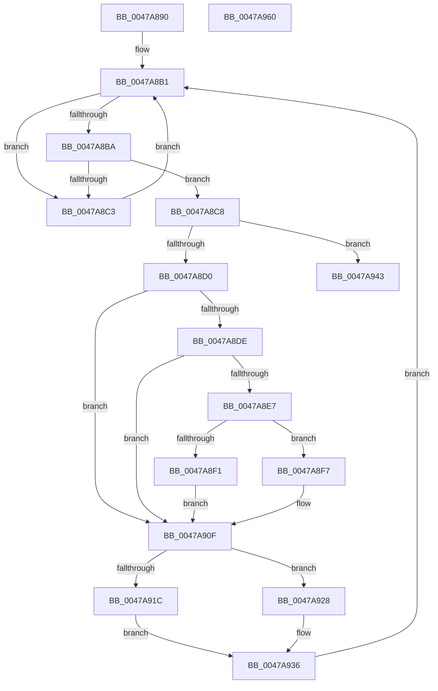

# HalpBuddyAllocatorDeleteSubtree

- RVA: `0x0047A890`–`0x0047A961` (길이 `209` bytes)
- VA: `0x000000014047A890`
- 실행 섹션: `.text`
- PDB 이름 있음: `예`; PDB Function 태그: `아니요`
- unwind 정보 RVA: `0x0005C954`
- 디코드: `60`개 명령, `209/209` bytes 표시
- 미해석 바이트: `0` (있으면 어셈블리에 `.byte`로 보존)

> 이 문서는 커널 이미지의 기계어와 PDB 기호를 분석해 생성했습니다. 4번과 5번은 함수 원형과 자료형을 바이너리 사용 방식에서 추정한 C 해석이며 원본 소스 복구 결과는 아닙니다.

## 1. Dependencies

- 직접 호출 지점: **4**; 고유 호출 대상: **3**
- 직접 호출자로 확인된 함수: **2**
- RIP 상대 이미지 참조: **0**

### Outgoing calls
- `0x0047A8D3` → [HalpBuddyAllocatorBltRemove](../57/HalpBuddyAllocatorBltRemove_function_00575AC0.md) (function, `0x00575AC0`)
- `0x0047A91C` → [HalpMmAllocCtxFree](../3E/HalpMmAllocCtxFree_function_003E1904.md) (function, `0x003E1904`)
- `0x0047A92C` → [HalpMmAllocCtxFree](../3E/HalpMmAllocCtxFree_function_003E1904.md) (function, `0x003E1904`)
- `0x0047A946` → [HalpBuddyAllocatorBltAdd](HalpBuddyAllocatorBltAdd_function_0047A968.md) (function, `0x0047A968`)

### Direct callers
- [HalpBuddyAllocatorAllocateLogicalAddress](../30/HalpBuddyAllocatorAllocateLogicalAddress_function_00307EE0.md) at `0x0030818D`
- [HalpBuddyAllocatorCleanUp](../57/HalpBuddyAllocatorCleanUp_function_00575B10.md) at `0x00575B1D`

### Static image references
- 디코드된 RIP-relative 메모리 참조가 없습니다.

## 2. Other-region calls and transfers

- 다른 실행 섹션으로 향하는 call: **0**
- 별도 외부 분기/꼬리 이동을 확인하지 못했습니다.

## 3. Assembly (complete function range)

```asm
0047A890  48 89 5C 24 08                  mov qword ptr [rsp + 8], rbx
0047A895  48 89 6C 24 10                  mov qword ptr [rsp + 0x10], rbp
0047A89A  48 89 74 24 18                  mov qword ptr [rsp + 0x18], rsi
0047A89F  57                              push rdi
0047A8A0  48 83 EC 20                     sub rsp, 0x20
0047A8A4  48 8B EA                        mov rbp, rdx
0047A8A7  C6 42 48 00                     mov byte ptr [rdx + 0x48], 0
0047A8AB  48 8B F9                        mov rdi, rcx
0047A8AE  48 8B DA                        mov rbx, rdx
0047A8B1  48 8B 43 18                     mov rax, qword ptr [rbx + 0x18]
0047A8B5  48 85 C0                        test rax, rax
0047A8B8  75 09                           jne 0x14047a8c3
0047A8BA  48 8B 43 20                     mov rax, qword ptr [rbx + 0x20]
0047A8BE  48 85 C0                        test rax, rax
0047A8C1  74 05                           je 0x14047a8c8
0047A8C3  48 8B D8                        mov rbx, rax
0047A8C6  EB E9                           jmp 0x14047a8b1
0047A8C8  48 8B D7                        mov rdx, rdi
0047A8CB  48 3B DD                        cmp rbx, rbp
0047A8CE  74 73                           je 0x14047a943
0047A8D0  48 8B CB                        mov rcx, rbx
0047A8D3  E8 E8 B1 0F 00                  call 0x140575ac0
0047A8D8  80 7B 48 00                     cmp byte ptr [rbx + 0x48], 0
0047A8DC  74 31                           je 0x14047a90f
0047A8DE  48 8B 4B 40                     mov rcx, qword ptr [rbx + 0x40]
0047A8E2  48 85 C9                        test rcx, rcx
0047A8E5  74 28                           je 0x14047a90f
0047A8E7  48 8D 47 50                     lea rax, [rdi + 0x50]
0047A8EB  48 39 43 28                     cmp qword ptr [rbx + 0x28], rax
0047A8EF  75 06                           jne 0x14047a8f7
0047A8F1  48 29 4F 48                     sub qword ptr [rdi + 0x48], rcx
0047A8F5  EB 18                           jmp 0x14047a90f
0047A8F7  48 8B 47 38                     mov rax, qword ptr [rdi + 0x38]
0047A8FB  48 2B 43 40                     sub rax, qword ptr [rbx + 0x40]
0047A8FF  48 89 47 38                     mov qword ptr [rdi + 0x38], rax
0047A903  48 8B 47 40                     mov rax, qword ptr [rdi + 0x40]
0047A907  48 2B 43 38                     sub rax, qword ptr [rbx + 0x38]
0047A90B  48 89 47 40                     mov qword ptr [rdi + 0x40], rax
0047A90F  48 8B 73 10                     mov rsi, qword ptr [rbx + 0x10]
0047A913  48 8B 56 18                     mov rdx, qword ptr [rsi + 0x18]
0047A917  48 3B D3                        cmp rdx, rbx
0047A91A  75 0C                           jne 0x14047a928
0047A91C  E8 E3 6F F6 FF                  call 0x1403e1904
0047A921  48 83 66 18 00                  and qword ptr [rsi + 0x18], 0
0047A926  EB 0E                           jmp 0x14047a936
0047A928  48 8B 56 20                     mov rdx, qword ptr [rsi + 0x20]
0047A92C  E8 D3 6F F6 FF                  call 0x1403e1904
0047A931  48 83 66 20 00                  and qword ptr [rsi + 0x20], 0
0047A936  F0 48 FF 4F 30                  lock dec qword ptr [rdi + 0x30]
0047A93B  48 8B DE                        mov rbx, rsi
0047A93E  E9 6E FF FF FF                  jmp 0x14047a8b1
0047A943  48 8B CD                        mov rcx, rbp
0047A946  E8 1D 00 00 00                  call 0x14047a968
0047A94B  48 8B 5C 24 30                  mov rbx, qword ptr [rsp + 0x30]
0047A950  48 8B 6C 24 38                  mov rbp, qword ptr [rsp + 0x38]
0047A955  48 8B 74 24 40                  mov rsi, qword ptr [rsp + 0x40]
0047A95A  48 83 C4 20                     add rsp, 0x20
0047A95E  5F                              pop rdi
0047A95F  C3                              ret
0047A960  CC                              int3
```

## 4. C-style interpretation (structured pseudocode)

```c
__int64 __fastcall HalpBuddyAllocatorDeleteSubtree(__int64 a1, __int64 a2)
{
    __int64 result;
    __int64 v_rsp;
    unsigned __int64 v_stack_p10;
    unsigned __int64 v_stack_p18;
    unsigned __int64 v_stack_p8;

    v_stack_p8 = v_rbx;
    v_stack_p10 = v_rbp;
    v_stack_p18 = v_rsi;
    v_rsp = (v_rsp) - (32);
    *(unsigned __int8 *)(a2 + 72) = 0;
loc_0047A8B1:
    if (*(unsigned __int64 *)(a2 + 24) != 0) goto loc_0047A8C3;
    if (*(unsigned __int64 *)(a2 + 32) == 0) goto loc_0047A8C8;
loc_0047A8C3:
    goto loc_0047A8B1;
loc_0047A8C8:
    if ((*(unsigned __int64 *)(a2 + 32)) == a2) goto loc_0047A943;
    result = HalpBuddyAllocatorBltRemove(*(unsigned __int64 *)(a2 + 32), a1, a3, a4);
    if ((*(unsigned __int8 *)(*(unsigned __int64 *)(a2 + 32) + 72)) == 0) goto loc_0047A90F;
    if (*(unsigned __int64 *)(*(unsigned __int64 *)(a2 + 32) + 64) == 0) goto loc_0047A90F;
    if ((*(unsigned __int64 *)(*(unsigned __int64 *)(a2 + 32) + 40)) != (a1 + 80)) goto loc_0047A8F7;
    goto loc_0047A90F;
loc_0047A8F7:
    result = (*(unsigned __int64 *)(a1 + 56)) - (*(unsigned __int64 *)(*(unsigned __int64 *)(a2 + 32) + 64));
    *(unsigned __int64 *)(a1 + 56) = result;
    result = (*(unsigned __int64 *)(a1 + 64)) - (*(unsigned __int64 *)(*(unsigned __int64 *)(a2 + 32) + 56));
    *(unsigned __int64 *)(a1 + 64) = result;
loc_0047A90F:
    if ((*(unsigned __int64 *)(*(unsigned __int64 *)(*(unsigned __int64 *)(a2 + 32) + 16) + 24)) != (*(unsigned __int64 *)(a2 + 32))) goto loc_0047A928;
    result = HalpMmAllocCtxFree(*(unsigned __int64 *)(*(unsigned __int64 *)(a2 + 32) + 64), *(unsigned __int64 *)(*(unsigned __int64 *)(*(unsigned __int64 *)(a2 + 32) + 16) + 24), a3, a4);
    goto loc_0047A936;
loc_0047A928:
    result = HalpMmAllocCtxFree(*(unsigned __int64 *)(*(unsigned __int64 *)(a2 + 32) + 64), *(unsigned __int64 *)(*(unsigned __int64 *)(*(unsigned __int64 *)(a2 + 32) + 16) + 32), a3, a4);
loc_0047A936:
    goto loc_0047A8B1;
loc_0047A943:
    result = HalpBuddyAllocatorBltAdd(a2, *(unsigned __int64 *)(*(unsigned __int64 *)(*(unsigned __int64 *)(a2 + 32) + 16) + 32), a3, a4);
    v_rsp = (v_rsp) + (32);
    return result;
}
```

## 5. (Beta) C Style

```c
int64_t HalpBuddyAllocatorDeleteSubtree(void *Arg1, void *Arg2)
{
    uint8_t *arg1 = (uint8_t *)Arg1;
    uint8_t *arg2 = (uint8_t *)Arg2;

    int64_t result;
    int64_t local_rsp;
    uint64_t v_stack_p10;
    uint64_t v_stack_p18;
    uint64_t v_stack_p8;

    v_stack_p8 = local_rbx;
    v_stack_p10 = local_rbp;
    v_stack_p18 = local_rsi;
    local_rsp = (local_rsp) - (32);
    *(uint8_t *)(arg2 + 0x48) = 0;
loc_0047A8B1:
    if (*(uint64_t *)(arg2 + 0x18) != 0) goto loc_0047A8C3;
    if (*(uint64_t *)(arg2 + 0x20) == 0) goto loc_0047A8C8;
loc_0047A8C3:
    goto loc_0047A8B1;
loc_0047A8C8:
    if ((*(uint64_t *)(arg2 + 0x20)) == Arg2) goto loc_0047A943;
    result = HalpBuddyAllocatorBltRemove(*(uint64_t *)(arg2 + 0x20), Arg1, a3, a4);
    if ((*(uint8_t *)(*(uint64_t *)(arg2 + 0x20) + 0x48)) == 0) goto loc_0047A90F;
    if (*(uint64_t *)(*(uint64_t *)(arg2 + 0x20) + 0x40) == 0) goto loc_0047A90F;
    if ((*(uint64_t *)(*(uint64_t *)(arg2 + 0x20) + 0x28)) != (Arg1 + 80)) goto loc_0047A8F7;
    goto loc_0047A90F;
loc_0047A8F7:
    result = (*(uint64_t *)(arg1 + 0x38)) - (*(uint64_t *)(*(uint64_t *)(arg2 + 0x20) + 0x40));
    *(uint64_t *)(arg1 + 0x38) = result;
    result = (*(uint64_t *)(arg1 + 0x40)) - (*(uint64_t *)(*(uint64_t *)(arg2 + 0x20) + 0x38));
    *(uint64_t *)(arg1 + 0x40) = result;
loc_0047A90F:
    if ((*(uint64_t *)(*(uint64_t *)(*(uint64_t *)(arg2 + 0x20) + 0x10) + 0x18)) != (*(uint64_t *)(arg2 + 0x20))) goto loc_0047A928;
    result = HalpMmAllocCtxFree(*(uint64_t *)(*(uint64_t *)(arg2 + 0x20) + 0x40), *(uint64_t *)(*(uint64_t *)(*(uint64_t *)(arg2 + 0x20) + 0x10) + 0x18), a3, a4);
    goto loc_0047A936;
loc_0047A928:
    result = HalpMmAllocCtxFree(*(uint64_t *)(*(uint64_t *)(arg2 + 0x20) + 0x40), *(uint64_t *)(*(uint64_t *)(*(uint64_t *)(arg2 + 0x20) + 0x10) + 0x20), a3, a4);
loc_0047A936:
    goto loc_0047A8B1;
loc_0047A943:
    result = HalpBuddyAllocatorBltAdd(Arg2, *(uint64_t *)(*(uint64_t *)(*(uint64_t *)(arg2 + 0x20) + 0x10) + 0x20), a3, a4);
    local_rsp = (local_rsp) + (32);
    return result;
}
```

### 관측된 메모리 오프셋

구조체 형식이 확인되지 않은 접근은 인자 기준의 오프셋으로만 기록했습니다.

| 기준 인자 | 오프셋 표현 | 폭 (bit) | 접근 |
|---|---:|---:|---|
| `Arg1` | `+ 0x30` | `64` | `R/W` |
| `Arg1` | `+ 0x38` | `64` | `R` |
| `Arg1` | `+ 0x38` | `64` | `W` |
| `Arg1` | `+ 0x40` | `64` | `R` |
| `Arg1` | `+ 0x40` | `64` | `W` |
| `Arg1` | `+ 0x48` | `64` | `R/W` |
| `Arg1` | `+ 0x50` | `64` | `R` |
| `Arg2` | `+ 0x48` | `8` | `W` |

## 6. Execution-region graph

[열기: 2D/3D 그래프와 함수 탐색 컨트롤 패널](../../../control-panel.html?section=text&rva=0x0047A890&view=graph)

- 2D 그래프는 위에서 아래로 흐르고, 3D 그래프는 빈 공간을 드래그해 회전합니다. Shift+드래그는 이동, 휠은 확대·축소, 함수 노드 선택은 대상 보고서 이동입니다.

### Static fallback


