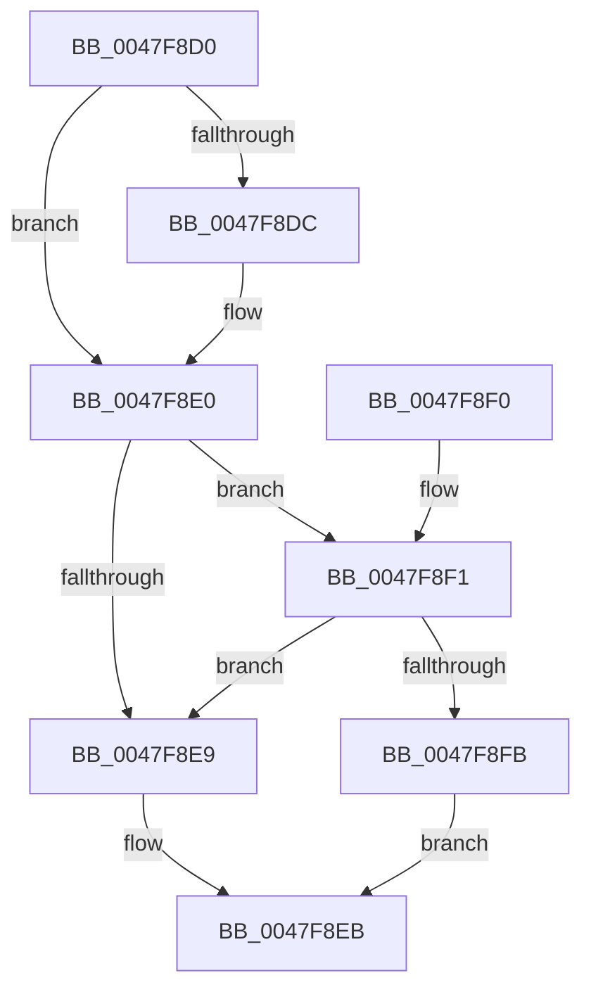

# HalpInvokeIsrForGsiv

- RVA: `0x0047F8D0`–`0x0047F912` (길이 `66` bytes)
- VA: `0x000000014047F8D0`
- 실행 섹션: `.text`
- PDB 이름 있음: `예`; PDB Function 태그: `아니요`
- unwind 정보 RVA: `0x00073864`
- 디코드: `22`개 명령, `66/66` bytes 표시
- 미해석 바이트: `0` (있으면 어셈블리에 `.byte`로 보존)

> 이 문서는 커널 이미지의 기계어와 PDB 기호를 분석해 생성했습니다. 4번과 5번은 함수 원형과 자료형을 바이너리 사용 방식에서 추정한 C 해석이며 원본 소스 복구 결과는 아닙니다.

## 1. Dependencies

- 직접 호출 지점: **1**; 고유 호출 대상: **1**
- 직접 호출자로 확인된 함수: **0**
- RIP 상대 이미지 참조: **0**

### Outgoing calls
- `0x0047F90B` → [KeDispatchSecondaryInterrupt](KeDispatchSecondaryInterrupt_function_0047F920.md) (function, `0x0047F920`)

### Direct callers
- 이 함수 시작 RVA로 연결되는 직접 call은 확인되지 않았습니다. 간접 호출은 완전히 역산할 수 없습니다.

### Static image references
- 디코드된 RIP-relative 메모리 참조가 없습니다.

## 2. Other-region calls and transfers

- 다른 실행 섹션으로 향하는 call: **0**
- 별도 외부 분기/꼬리 이동을 확인하지 못했습니다.

## 3. Assembly (complete function range)

```asm
0047F8D0  48 83 EC 28                     sub rsp, 0x28
0047F8D4  4C 8B D2                        mov r10, rdx
0047F8D7  4D 85 C0                        test r8, r8
0047F8DA  74 04                           je 0x14047f8e0
0047F8DC  41 83 20 00                     and dword ptr [r8], 0
0047F8E0  44 8B 4A 10                     mov r9d, dword ptr [rdx + 0x10]
0047F8E4  41 3B C9                        cmp ecx, r9d
0047F8E7  73 08                           jae 0x14047f8f1
0047F8E9  32 C0                           xor al, al
0047F8EB  48 83 C4 28                     add rsp, 0x28
0047F8EF  C3                              ret
0047F8F0  CC                              int3
0047F8F1  8B 52 14                        mov edx, dword ptr [rdx + 0x14]
0047F8F4  41 03 D1                        add edx, r9d
0047F8F7  3B CA                           cmp ecx, edx
0047F8F9  73 EE                           jae 0x14047f8e9
0047F8FB  41 2B C9                        sub ecx, r9d
0047F8FE  33 D2                           xor edx, edx
0047F900  48 03 C9                        add rcx, rcx
0047F903  41 8B 8C CA A8 00 00 00         mov ecx, dword ptr [r10 + rcx*8 + 0xa8]
0047F90B  E8 10 00 00 00                  call 0x14047f920
0047F910  EB D9                           jmp 0x14047f8eb
```

## 4. C-style interpretation (structured pseudocode)

```c
__int64 __fastcall HalpInvokeIsrForGsiv(int a1, __int64 a2, __int64 a3)
{
    __int64 result;
    __int64 v_rsp;

    v_rsp = (v_rsp) - (40);
    if (a3 != 0) {
    }
    if (a1 >= ((unsigned int)((unsigned int)(*(unsigned int *)(a2 + 16))))) goto loc_0047F8F1;
loc_0047F8E9:
    result = 0;
loc_0047F8EB:
    v_rsp = (v_rsp) + (40);
    return result;
loc_0047F8F1:
    a2 = (unsigned int)(((unsigned int)(*(unsigned int *)(a2 + 20))) + ((unsigned int)((unsigned int)(*(unsigned int *)(a2 + 16)))));
    if (a1 >= ((unsigned int)(a2))) goto loc_0047F8E9;
    a1 = (unsigned int)((a1) - ((unsigned int)((unsigned int)(*(unsigned int *)(a2 + 16)))));
    a2 = 0;
    a1 = (a1) + (a1);
    result = KeDispatchSecondaryInterrupt((unsigned int)(*(unsigned int *)(a2 + a1 * 8 + 168)), a2, a3, (unsigned int)(*(unsigned int *)(a2 + 16)));
    goto loc_0047F8EB;
}
```

## 5. (Beta) C Style

```c
int64_t HalpInvokeIsrForGsiv(int32_t Arg1, void *Arg2, int64_t Arg3)
{
    uint8_t *arg2 = (uint8_t *)Arg2;

    int64_t result;
    int64_t local_rsp;

    local_rsp = (local_rsp) - (40);
    if (Arg3 != 0) {
    }
    if (Arg1 >= ((uint32_t)((uint32_t)(*(uint32_t *)(arg2 + 0x10))))) goto loc_0047F8F1;
loc_0047F8E9:
    result = 0;
loc_0047F8EB:
    local_rsp = (local_rsp) + (40);
    return result;
loc_0047F8F1:
    Arg2 = (uint32_t)(((uint32_t)(*(uint32_t *)(arg2 + 0x14))) + ((uint32_t)((uint32_t)(*(uint32_t *)(arg2 + 0x10)))));
    if (Arg1 >= ((uint32_t)(Arg2))) goto loc_0047F8E9;
    Arg1 = (uint32_t)((Arg1) - ((uint32_t)((uint32_t)(*(uint32_t *)(arg2 + 0x10)))));
    Arg2 = 0;
    Arg1 = (Arg1) + (Arg1);
    result = KeDispatchSecondaryInterrupt((uint32_t)(*(uint32_t *)(arg2 + Arg1 * 8 + 0xA8)), Arg2, Arg3, (uint32_t)(*(uint32_t *)(arg2 + 0x10)));
    goto loc_0047F8EB;
}
```

### 관측된 메모리 오프셋

구조체 형식이 확인되지 않은 접근은 인자 기준의 오프셋으로만 기록했습니다.

| 기준 인자 | 오프셋 표현 | 폭 (bit) | 접근 |
|---|---:|---:|---|
| `Arg2` | `+ 0x10` | `32` | `R` |
| `Arg2` | `+ 0x14` | `32` | `R` |
| `Arg2` | `+ 0xA8 + rcx*8` | `32` | `R` |

## 6. Execution-region graph

[열기: 2D/3D 그래프와 함수 탐색 컨트롤 패널](../../../control-panel.html?section=text&rva=0x0047F8D0&view=graph)

- 2D 그래프는 위에서 아래로 흐르고, 3D 그래프는 빈 공간을 드래그해 회전합니다. Shift+드래그는 이동, 휠은 확대·축소, 함수 노드 선택은 대상 보고서 이동입니다.

### Static fallback


