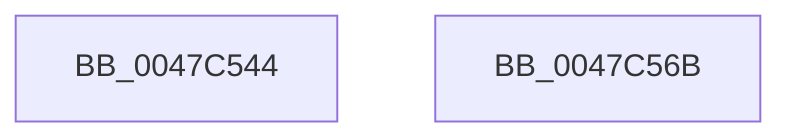

# HalpPciMarkHiberPhase

- RVA: `0x0047C544`–`0x0047C56C` (길이 `40` bytes)
- VA: `0x000000014047C544`
- 실행 섹션: `.text`
- PDB 이름 있음: `예`; PDB Function 태그: `아니요`
- unwind 정보 RVA: `0x0005D2F4`
- 디코드: `9`개 명령, `40/40` bytes 표시
- 미해석 바이트: `0` (있으면 어셈블리에 `.byte`로 보존)

> 이 문서는 커널 이미지의 기계어와 PDB 기호를 분석해 생성했습니다. 4번과 5번은 함수 원형과 자료형을 바이너리 사용 방식에서 추정한 C 해석이며 원본 소스 복구 결과는 아닙니다.

## 1. Dependencies

- 직접 호출 지점: **1**; 고유 호출 대상: **1**
- 직접 호출자로 확인된 함수: **1**
- RIP 상대 이미지 참조: **1**

### Outgoing calls
- `0x0047C561` → [PoSetHiberRange](PoSetHiberRange_function_0047C580.md) (function, `0x0047C580`)

### Direct callers
- [HaliLocateHiberRanges](../../pagelk/B5/HaliLocateHiberRanges_function_00B5CE50.md) at `0x00B5CF37`

### Static image references
- `0x0047C556` → RVA `0x00FC1708` (`.data`; read)

## 2. Other-region calls and transfers

- 다른 실행 섹션으로 향하는 call: **0**
- 별도 외부 분기/꼬리 이동을 확인하지 못했습니다.

## 3. Assembly (complete function range)

```asm
0047C544  48 83 EC 38                     sub rsp, 0x38
0047C548  41 B9 08 00 00 00               mov r9d, 8
0047C54E  C7 44 24 20 48 50 63 69         mov dword ptr [rsp + 0x20], 0x69635048
0047C556  4C 8D 05 AB 51 B4 00            lea r8, [rip + 0xb451ab]
0047C55D  41 8D 51 FA                     lea edx, [r9 - 6]
0047C561  E8 1A 00 00 00                  call 0x14047c580
0047C566  48 83 C4 38                     add rsp, 0x38
0047C56A  C3                              ret
0047C56B  CC                              int3
```

## 4. C-style interpretation (structured pseudocode)

```c
__int64 __fastcall HalpPciMarkHiberPhase(void)
{
    __int64 result;
    __int64 v_rsp;
    unsigned int v_stack_m18;

    v_rsp = (v_rsp) - (56);
    v_stack_m18 = 0x69635048ULL;
    result = PoSetHiberRange(a1, 8 - 6, v_rip + 11817387, 8);
    v_rsp = (v_rsp) + (56);
    return result;
}
```

## 5. (Beta) C Style

```c
void HalpPciMarkHiberPhase(void)
{
    int64_t result;
    int64_t local_rsp;
    uint32_t v_stack_m18;

    local_rsp = (local_rsp) - (56);
    v_stack_m18 = 0x69635048ULL;
    result = PoSetHiberRange(a1, 8 - 6, v_rip + 11817387, 8);
    local_rsp = (local_rsp) + (56);
    return result;
}
```

## 6. Execution-region graph

[열기: 2D/3D 그래프와 함수 탐색 컨트롤 패널](../../../control-panel.html?section=text&rva=0x0047C544&view=graph)

- 2D 그래프는 위에서 아래로 흐르고, 3D 그래프는 빈 공간을 드래그해 회전합니다. Shift+드래그는 이동, 휠은 확대·축소, 함수 노드 선택은 대상 보고서 이동입니다.

### Static fallback


