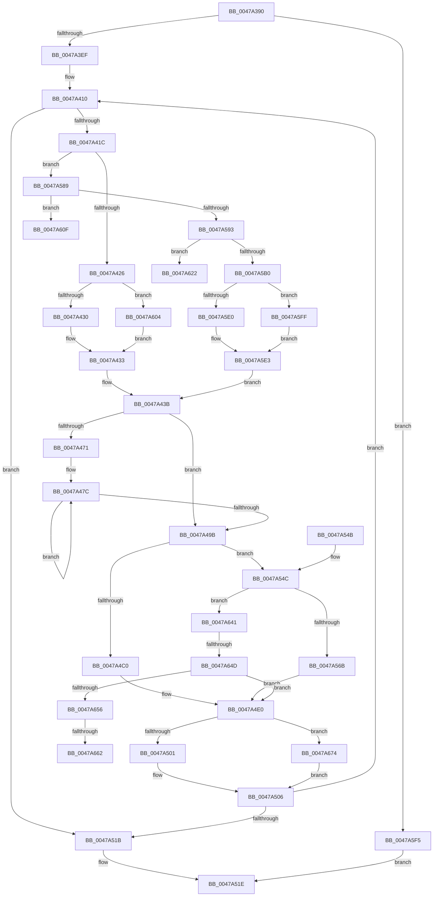

# HvlDmaMapDeviceSparsePages

- RVA: `0x0047A390`–`0x0047A67E` (길이 `750` bytes)
- VA: `0x000000014047A390`
- 실행 섹션: `.text`
- PDB 이름 있음: `예`; PDB Function 태그: `예`
- unwind 정보 RVA: `0x000AD174`
- 디코드: `185`개 명령, `750/750` bytes 표시
- 미해석 바이트: `0` (있으면 어셈블리에 `.byte`로 보존)

> 이 문서는 커널 이미지의 기계어와 PDB 기호를 분석해 생성했습니다. 4번과 5번은 함수 원형과 자료형을 바이너리 사용 방식에서 추정한 C 해석이며 원본 소스 복구 결과는 아닙니다.

## 1. Dependencies

- 직접 호출 지점: **11**; 고유 호출 대상: **10**
- 직접 호출자로 확인된 함수: **0**
- RIP 상대 이미지 참조: **3**

### Outgoing calls
- `0x0047A4D4` → [HvcallFastExtended](../31/HvcallFastExtended_function_003130E0.md) (function, `0x003130E0`)
- `0x0047A4F1` → [HvlpHvStatusIsInsufficientMemory](../30/HvlpHvStatusIsInsufficientMemory_function_00307BB0.md) (function, `0x00307BB0`)
- `0x0047A501` → [HvlpHvToNtStatus](../30/HvlpHvToNtStatus_function_00307BD8.md) (function, `0x00307BD8`)
- `0x0047A525` → [_security_check_cookie](../6A/_security_check_cookie_function_006AC640.md) (function, `0x006AC640`)
- `0x0047A552` → [HvcallInitiateHypercall](../31/HvcallInitiateHypercall_function_00313630.md) (function, `0x00313630`)
- `0x0047A57F` → [ExpInterlockedPushEntrySList](../6B/ExpInterlockedPushEntrySList_function_006BA5B0.md) (function, `0x006BA5B0`)
- `0x0047A5A3` → [ExpInterlockedPopEntrySList](../6B/ExpInterlockedPopEntrySList_function_006BA570.md) (function, `0x006BA570`)
- `0x0047A617` → [KeDisableInterrupts](../21/KeDisableInterrupts_function_00217BE0.md) (function, `0x00217BE0`)
- `0x0047A62A` → [KeDisableInterrupts](../21/KeDisableInterrupts_function_00217BE0.md) (function, `0x00217BE0`)
- `0x0047A669` → [KiLowerIrqlProcessIrqlFlags](../4F/KiLowerIrqlProcessIrqlFlags_function_004F5698.md) (function, `0x004F5698`)
- `0x0047A674` → [HvlpHandleInsufficientMemory](../58/HvlpHandleInsufficientMemory_function_00584514.md) (function, `0x00584514`)

### Direct callers
- 이 함수 시작 RVA로 연결되는 직접 call은 확인되지 않았습니다. 간접 호출은 완전히 역산할 수 없습니다.

### Static image references
- `0x0047A3B3` → RVA `0x00E0A740` (`.data`; read)
- `0x0047A589` → RVA `0x00FC6A90` (`ALMOSTRO`; read)
- `0x0047A656` → RVA `0x00FC6D20` (`ALMOSTRO`; read)

## 2. Other-region calls and transfers

- 다른 실행 섹션으로 향하는 call: **0**
- call이 아닌 외부 분기/꼬리 이동: **5**
  - `0x0047A61D` → [sub_006F48A4](../6F/Unknown_function_006F48A4.md) (`tail-transfer`)
  - `0x0047A63C` → [sub_006F48A4](../6F/Unknown_function_006F48A4.md) (`tail-transfer`)
  - `0x0047A647` → [sub_006F48A4 + 0x31](../6F/Unknown_function_006F48A4.md) (`tail-transfer`)
  - `0x0047A65C` → [sub_006F48A4 + 0x24](../6F/Unknown_function_006F48A4.md) (`tail-transfer`)
  - `0x0047A66F` → [sub_006F48A4 + 0x24](../6F/Unknown_function_006F48A4.md) (`tail-transfer`)

## 3. Assembly (complete function range)

```asm
0047A390  48 8B C4                        mov rax, rsp
0047A393  48 89 58 08                     mov qword ptr [rax + 8], rbx
0047A397  48 89 70 10                     mov qword ptr [rax + 0x10], rsi
0047A39B  48 89 78 18                     mov qword ptr [rax + 0x18], rdi
0047A39F  55                              push rbp
0047A3A0  41 54                           push r12
0047A3A2  41 55                           push r13
0047A3A4  41 56                           push r14
0047A3A6  41 57                           push r15
0047A3A8  48 8D 68 A1                     lea rbp, [rax - 0x5f]
0047A3AC  48 81 EC 00 01 00 00            sub rsp, 0x100
0047A3B3  48 8B 05 86 03 99 00            mov rax, qword ptr [rip + 0x990386]
0047A3BA  48 33 C4                        xor rax, rsp
0047A3BD  48 89 45 27                     mov qword ptr [rbp + 0x27], rax
0047A3C1  80 79 04 00                     cmp byte ptr [rcx + 4], 0
0047A3C5  0F 57 C0                        xorps xmm0, xmm0
0047A3C8  49 8B D8                        mov rbx, r8
0047A3CB  89 54 24 30                     mov dword ptr [rsp + 0x30], edx
0047A3CF  4D 8B F1                        mov r14, r9
0047A3D2  48 89 5D 9F                     mov qword ptr [rbp - 0x61], rbx
0047A3D6  0F 11 44 24 40                  movups xmmword ptr [rsp + 0x40], xmm0
0047A3DB  44 8B DA                        mov r11d, edx
0047A3DE  4C 8B C9                        mov r9, rcx
0047A3E1  0F 11 45 87                     movups xmmword ptr [rbp - 0x79], xmm0
0047A3E5  48 89 4D 97                     mov qword ptr [rbp - 0x69], rcx
0047A3E9  0F 85 06 02 00 00               jne 0x14047a5f5
0047A3EF  48 8B 7D 8F                     mov rdi, qword ptr [rbp - 0x71]
0047A3F3  33 C0                           xor eax, eax
0047A3F5  40 8A 74 24 48                  mov sil, byte ptr [rsp + 0x48]
0047A3FA  45 33 E4                        xor r12d, r12d
0047A3FD  48 C7 44 24 38 C7 00 00 00      mov qword ptr [rsp + 0x38], 0xc7
0047A406  44 8B 6C 24 3C                  mov r13d, dword ptr [rsp + 0x3c]
0047A40B  44 8B 7C 24 38                  mov r15d, dword ptr [rsp + 0x38]
0047A410  49 8B 16                        mov rdx, qword ptr [r14]
0047A413  48 85 D2                        test rdx, rdx
0047A416  0F 84 FF 00 00 00               je 0x14047a51b
0047A41C  48 83 FA 05                     cmp rdx, 5
0047A420  0F 87 63 01 00 00               ja 0x14047a589
0047A426  48 8D 4D B7                     lea rcx, [rbp - 0x49]
0047A42A  0F 83 D4 01 00 00               jae 0x14047a604
0047A430  44 8B C2                        mov r8d, edx
0047A433  41 B2 01                        mov r10b, 1
0047A436  41 0F BA EF 10                  bts r15d, 0x10
0047A43B  48 83 61 08 00                  and qword ptr [rcx + 8], 0
0047A440  48 83 61 10 00                  and qword ptr [rcx + 0x10], 0
0047A445  48 83 61 18 00                  and qword ptr [rcx + 0x18], 0
0047A44A  48 83 09 FF                     or qword ptr [rcx], 0xffffffffffffffff
0047A44E  83 61 10 F0                     and dword ptr [rcx + 0x10], 0xfffffff0
0047A452  41 8B 01                        mov eax, dword ptr [r9]
0047A455  45 85 DB                        test r11d, r11d
0047A458  89 41 14                        mov dword ptr [rcx + 0x14], eax
0047A45B  B8 00 00 01 00                  mov eax, 0x10000
0047A460  41 0F 45 C3                     cmovne eax, r11d
0047A464  44 89 7C 24 38                  mov dword ptr [rsp + 0x38], r15d
0047A469  89 41 1C                        mov dword ptr [rcx + 0x1c], eax
0047A46C  45 85 C0                        test r8d, r8d
0047A46F  74 2A                           je 0x14047a49b
0047A471  48 83 C1 28                     add rcx, 0x28
0047A475  45 8B C8                        mov r9d, r8d
0047A478  4A 8D 14 E3                     lea rdx, [rbx + r12*8]
0047A47C  48 8B 02                        mov rax, qword ptr [rdx]
0047A47F  48 C1 E0 0C                     shl rax, 0xc
0047A483  48 89 41 F8                     mov qword ptr [rcx - 8], rax
0047A487  48 8B 02                        mov rax, qword ptr [rdx]
0047A48A  48 8D 52 08                     lea rdx, [rdx + 8]
0047A48E  48 89 01                        mov qword ptr [rcx], rax
0047A491  48 8D 49 10                     lea rcx, [rcx + 0x10]
0047A495  49 83 E9 01                     sub r9, 1
0047A499  75 E1                           jne 0x14047a47c
0047A49B  41 81 E5 00 F0 FF FF            and r13d, 0xfffff000
0047A4A2  41 8B C0                        mov eax, r8d
0047A4A5  25 FF 0F 00 00                  and eax, 0xfff
0047A4AA  44 0B E8                        or r13d, eax
0047A4AD  44 89 6C 24 3C                  mov dword ptr [rsp + 0x3c], r13d
0047A4B2  48 8B 4C 24 38                  mov rcx, qword ptr [rsp + 0x38]
0047A4B7  45 84 D2                        test r10b, r10b
0047A4BA  0F 84 8C 00 00 00               je 0x14047a54c
0047A4C0  83 64 24 20 00                  and dword ptr [rsp + 0x20], 0
0047A4C5  48 8D 55 B7                     lea rdx, [rbp - 0x49]
0047A4C9  41 83 C0 02                     add r8d, 2
0047A4CD  45 33 C9                        xor r9d, r9d
0047A4D0  41 C1 E0 04                     shl r8d, 4
0047A4D4  E8 07 8C E9 FF                  call 0x1403130e0
0047A4D9  48 8B D8                        mov rbx, rax
0047A4DC  48 89 45 A7                     mov qword ptr [rbp - 0x59], rax
0047A4E0  8B 45 AB                        mov eax, dword ptr [rbp - 0x55]
0047A4E3  0F B7 CB                        movzx ecx, bx
0047A4E6  25 FF 0F 00 00                  and eax, 0xfff
0047A4EB  49 29 06                        sub qword ptr [r14], rax
0047A4EE  4C 03 E0                        add r12, rax
0047A4F1  E8 BA D6 E8 FF                  call 0x140307bb0
0047A4F6  0F B7 CB                        movzx ecx, bx
0047A4F9  84 C0                           test al, al
0047A4FB  0F 85 73 01 00 00               jne 0x14047a674
0047A501  E8 D2 D6 E8 FF                  call 0x140307bd8
0047A506  4C 8B 4D 97                     mov r9, qword ptr [rbp - 0x69]
0047A50A  44 8B 5C 24 30                  mov r11d, dword ptr [rsp + 0x30]
0047A50F  48 8B 5D 9F                     mov rbx, qword ptr [rbp - 0x61]
0047A513  85 C0                           test eax, eax
0047A515  0F 89 F5 FE FF FF               jns 0x14047a410
0047A51B  4D 89 26                        mov qword ptr [r14], r12
0047A51E  48 8B 4D 27                     mov rcx, qword ptr [rbp + 0x27]
0047A522  48 33 CC                        xor rcx, rsp
0047A525  E8 16 21 23 00                  call 0x1406ac640
0047A52A  4C 8D 9C 24 00 01 00 00         lea r11, [rsp + 0x100]
0047A532  49 8B 5B 30                     mov rbx, qword ptr [r11 + 0x30]
0047A536  49 8B 73 38                     mov rsi, qword ptr [r11 + 0x38]
0047A53A  49 8B 7B 40                     mov rdi, qword ptr [r11 + 0x40]
0047A53E  49 8B E3                        mov rsp, r11
0047A541  41 5F                           pop r15
0047A543  41 5E                           pop r14
0047A545  41 5D                           pop r13
0047A547  41 5C                           pop r12
0047A549  5D                              pop rbp
0047A54A  C3                              ret
0047A54B  CC                              int3
0047A54C  45 33 C0                        xor r8d, r8d
0047A54F  48 8B D7                        mov rdx, rdi
0047A552  E8 D9 90 E9 FF                  call 0x140313630
0047A557  48 8B D8                        mov rbx, rax
0047A55A  48 89 45 A7                     mov qword ptr [rbp - 0x59], rax
0047A55E  33 C0                           xor eax, eax
0047A560  F6 44 24 40 01                  test byte ptr [rsp + 0x40], 1
0047A565  0F 84 D6 00 00 00               je 0x14047a641
0047A56B  48 8B 55 87                     mov rdx, qword ptr [rbp - 0x79]
0047A56F  48 8B 4C 24 48                  mov rcx, qword ptr [rsp + 0x48]
0047A574  48 81 C1 C0 8B 00 00            add rcx, 0x8bc0
0047A57B  48 89 7A 10                     mov qword ptr [rdx + 0x10], rdi
0047A57F  E8 2C 00 24 00                  call 0x1406ba5b0
0047A584  E9 57 FF FF FF                  jmp 0x14047a4e0
0047A589  8B 05 01 C5 B4 00               mov eax, dword ptr [rip + 0xb4c501]
0047A58F  A8 08                           test al, 8
0047A591  74 7C                           je 0x14047a60f
0047A593  65 48 8B 1C 25 20 00 00 00      mov rbx, qword ptr gs:[0x20]
0047A59C  48 8D 8B C0 8B 00 00            lea rcx, [rbx + 0x8bc0]
0047A5A3  E8 C8 FF 23 00                  call 0x1406ba570
0047A5A8  48 8B C8                        mov rcx, rax
0047A5AB  48 85 C0                        test rax, rax
0047A5AE  74 72                           je 0x14047a622
0047A5B0  48 8B 78 10                     mov rdi, qword ptr [rax + 0x10]
0047A5B4  4C 8B 4D 97                     mov r9, qword ptr [rbp - 0x69]
0047A5B8  44 8B 5C 24 30                  mov r11d, dword ptr [rsp + 0x30]
0047A5BD  48 89 5C 24 48                  mov qword ptr [rsp + 0x48], rbx
0047A5C2  48 8B 5D 9F                     mov rbx, qword ptr [rbp - 0x61]
0047A5C6  C7 44 24 40 01 00 00 00         mov dword ptr [rsp + 0x40], 1
0047A5CE  48 89 45 87                     mov qword ptr [rbp - 0x79], rax
0047A5D2  B8 FE 00 00 00                  mov eax, 0xfe
0047A5D7  48 89 7D 8F                     mov qword ptr [rbp - 0x71], rdi
0047A5DB  49 39 06                        cmp qword ptr [r14], rax
0047A5DE  72 1F                           jb 0x14047a5ff
0047A5E0  44 8B C0                        mov r8d, eax
0047A5E3  48 8B 74 24 48                  mov rsi, qword ptr [rsp + 0x48]
0047A5E8  45 32 D2                        xor r10b, r10b
0047A5EB  41 0F BA F7 10                  btr r15d, 0x10
0047A5F0  E9 46 FE FF FF                  jmp 0x14047a43b
0047A5F5  B8 BB 00 00 C0                  mov eax, 0xc00000bb
0047A5FA  E9 1F FF FF FF                  jmp 0x14047a51e
0047A5FF  45 8B 06                        mov r8d, dword ptr [r14]
0047A602  EB DF                           jmp 0x14047a5e3
0047A604  41 B8 05 00 00 00               mov r8d, 5
0047A60A  E9 24 FE FF FF                  jmp 0x14047a433
0047A60F  C7 44 24 40 04 00 00 00         mov dword ptr [rsp + 0x40], 4
0047A617  E8 C4 D5 D9 FF                  call 0x140217be0
0047A61C  90                              nop
0047A61D  E9 82 A2 27 00                  jmp 0x1406f48a4
0047A622  C7 44 24 40 04 00 00 00         mov dword ptr [rsp + 0x40], 4
0047A62A  E8 B1 D5 D9 FF                  call 0x140217be0
0047A62F  4C 8B 4D 97                     mov r9, qword ptr [rbp - 0x69]
0047A633  44 8B 5C 24 30                  mov r11d, dword ptr [rsp + 0x30]
0047A638  48 8B 5D 9F                     mov rbx, qword ptr [rbp - 0x61]
0047A63C  E9 63 A2 27 00                  jmp 0x1406f48a4
0047A641  B2 02                           mov dl, 2
0047A643  84 54 24 40                     test byte ptr [rsp + 0x40], dl
0047A647  0F 84 88 A2 27 00               je 0x1406f48d5
0047A64D  40 3A F2                        cmp sil, dl
0047A650  0F 83 8A FE FF FF               jae 0x14047a4e0
0047A656  39 05 C4 C6 B4 00               cmp dword ptr [rip + 0xb4c6c4], eax
0047A65C  0F 84 66 A2 27 00               je 0x1406f48c8
0047A662  44 0F 20 C1                     mov rcx, cr8
0047A666  40 8A D6                        mov dl, sil
0047A669  E8 2A B0 07 00                  call 0x1404f5698
0047A66E  90                              nop
0047A66F  E9 54 A2 27 00                  jmp 0x1406f48c8
0047A674  E8 9B 9E 10 00                  call 0x140584514
0047A679  E9 88 FE FF FF                  jmp 0x14047a506
```

## 4. C-style interpretation (structured pseudocode)

```c
__int64 __fastcall HvlDmaMapDeviceSparsePages(__int64 a1, int a2, __int64 a3, __int64 a4)
{
    __int64 result;
    __int64 v_r10;
    __int64 v_r12;
    __int64 v_r13;
    __int64 v_rsp;
    unsigned int v_stack_m108;
    unsigned __int64 v_stack_m28;
    unsigned __int64 v_stack_mB8;
    unsigned __int8 v_stack_mC0;
    unsigned int v_stack_mD0;
    unsigned __int8 v_stack_mE0;
    unsigned __int64 v_stack_mE8;
    unsigned int v_stack_mEC;
    unsigned __int64 v_stack_mF0;
    unsigned int v_stack_mF8;

    *(unsigned __int64 *)(v_rsp + 8) = v_rbx;
    *(unsigned __int64 *)(v_rsp + 16) = v_rsi;
    *(unsigned __int64 *)(v_rsp + 24) = v_rdi;
    v_rsp = (v_rsp) - (256);
    result = (*(unsigned __int64 *)(v_rip + 10027910)) ^ (v_rsp);
    *(unsigned __int64 *)(v_rsp - 95 + 39) = result;
    v_stack_mF8 = a2;
    *(unsigned __int64 *)(v_rsp - 95 - 97) = a3;
    v_stack_mE8 = v_xmm0;
    *(unsigned __int64 *)(v_rsp - 95 - 121) = v_xmm0;
    *(unsigned __int64 *)(v_rsp - 95 - 105) = a1;
    if ((*(unsigned __int8 *)(a1 + 4)) != 0) goto loc_0047A5F5;
    result = 0;
    v_r12 = 0;
    v_stack_mF0 = 199;
loc_0047A410:
    if (*(unsigned __int64 *)(a4) == 0) goto loc_0047A51B;
    if ((*(unsigned __int64 *)(a4)) > 5) goto loc_0047A589;
    if ((*(unsigned __int64 *)(a4)) >= 5) goto loc_0047A604;
loc_0047A433:
loc_0047A43B:
    *(unsigned int *)(v_rsp - 95 - 73 + 20) = (unsigned int)((unsigned int)(*(unsigned int *)(a1)));
    result = (unsigned int)(0x10000ULL);
    if ((unsigned int)((unsigned int)(a2)) != 0) { result = (unsigned int)((unsigned int)(a2)); }
    v_stack_mF0 = (unsigned int)((unsigned int)(v_stack_mF0));
    *(unsigned int *)(v_rsp - 95 - 73 + 28) = (unsigned int)(result);
    if ((unsigned int)((unsigned int)((unsigned int)(*(unsigned __int64 *)(a4)))) == 0) goto loc_0047A49B;
    a1 = (v_rsp - 95 - 73) + (40);
loc_0047A47C:
    result = (*(unsigned __int64 *)(a3 + v_r12 * 8)) << (12);
    *(unsigned __int64 *)(a1 - 8) = result;
    *(unsigned __int64 *)(a1) = *(unsigned __int64 *)(a3 + v_r12 * 8);
    a4 = ((unsigned int)((unsigned int)((unsigned int)((unsigned int)(*(unsigned __int64 *)(a4)))))) - (1);
    if (condition_is_not_equal) goto loc_0047A47C;
loc_0047A49B:
    v_r13 = (unsigned int)(((unsigned int)(v_stack_mEC)) & (0xFFFFF000ULL));
    result = (unsigned int)(((unsigned int)((unsigned int)((unsigned int)((unsigned int)(*(unsigned __int64 *)(a4)))))) & (0xFFFULL));
    v_r13 = (unsigned int)((v_r13) | ((unsigned int)(result)));
    v_stack_mEC = (unsigned int)(v_r13);
    if (1 == 0) goto loc_0047A54C;
    a3 = (unsigned int)(((unsigned int)((unsigned int)(*(unsigned __int64 *)(a4)))) + (2));
    a4 = 0;
    a3 = (unsigned int)((a3) << (4));
    result = HvcallFastExtended(v_stack_mF0, v_rsp - 95 - 73, a3, a4);
    *(unsigned __int64 *)(v_rsp - 95 - 89) = result;
loc_0047A4E0:
    result = (unsigned int)(((unsigned int)(*(unsigned int *)(v_rsp - 95 - 85))) & (0xFFFULL));
    v_r12 = (v_r12) + (result);
    result = HvlpHvStatusIsInsufficientMemory((unsigned __int16)(result), v_rsp - 95 - 73, a3, a4);
    if ((unsigned __int8)(result) != 0) goto loc_0047A674;
    result = HvlpHvToNtStatus((unsigned __int16)(result), v_rsp - 95 - 73, a3, a4);
loc_0047A506:
    if (!sign_flag) goto loc_0047A410;
loc_0047A51B:
    *(unsigned __int64 *)(a4) = v_r12;
loc_0047A51E:
    a1 = (*(unsigned __int64 *)(v_rsp - 95 + 39)) ^ (v_rsp);
    result = _security_check_cookie(a1, v_rsp - 95 - 73, a3, *(unsigned __int64 *)(v_rsp - 95 - 105));
    return result;
loc_0047A54C:
    a3 = 0;
    result = HvcallInitiateHypercall(a1, *(unsigned __int64 *)(v_stack_m28 + 64), a3, *(unsigned __int64 *)(v_rsp - 95 - 105));
    *(unsigned __int64 *)(v_rsp - 95 - 89) = result;
    result = 0;
    if (((v_stack_mC0) & (1)) == 0) goto loc_0047A641;
    a1 = (v_stack_mB8) + (0x8BC0ULL);
    *(unsigned __int64 *)(*(unsigned __int64 *)(v_rsp - 95 - 121) + 16) = *(unsigned __int64 *)(v_stack_m28 + 64);
    result = ExpInterlockedPushEntrySList(a1, *(unsigned __int64 *)(v_rsp - 95 - 121), a3, *(unsigned __int64 *)(v_rsp - 95 - 105));
    goto loc_0047A4E0;
loc_0047A589:
    if ((((unsigned __int8)((unsigned int)(*(unsigned int *)(v_rip + 11846913)))) & (8)) == 0) goto loc_0047A60F;
    result = ExpInterlockedPopEntrySList(*(unsigned __int64 *)(gs_base + (0 + 32)) + 35776, *(unsigned __int64 *)(v_rsp - 95 - 121), a3, *(unsigned __int64 *)(v_rsp - 95 - 105));
    if (result == 0) goto loc_0047A622;
    v_stack_mB8 = *(unsigned __int64 *)(gs_base + (0 + 32));
    v_stack_mC0 = 1;
    *(unsigned __int64 *)(v_rsp - 95 - 121) = result;
    *(unsigned __int64 *)(v_rsp - 95 - 113) = *(unsigned __int64 *)(result + 16);
    if ((*(unsigned __int64 *)(a4)) < 254) goto loc_0047A5FF;
loc_0047A5E3:
    v_r10 = 0;
    goto loc_0047A43B;
loc_0047A5F5:
    goto loc_0047A51E;
loc_0047A5FF:
    goto loc_0047A5E3;
loc_0047A604:
    goto loc_0047A433;
loc_0047A60F:
    v_stack_mC0 = 4;
    result = KeDisableInterrupts(result, *(unsigned __int64 *)(v_rsp - 95 - 121), 5, *(unsigned __int64 *)(v_rsp - 95 - 105));
loc_0047A622:
    v_stack_mC0 = 4;
    result = KeDisableInterrupts(result, *(unsigned __int64 *)(v_rsp - 95 - 121), 5, *(unsigned __int64 *)(v_rsp - 95 - 105));
loc_0047A641:
    if (((unsigned __int8)(v_stack_mB8)) >= 2) goto loc_0047A4E0;
    result = KiLowerIrqlProcessIrqlFlags(v_cr8, (unsigned __int8)(v_stack_mB8), 5, *(unsigned __int64 *)(v_rsp - 95 - 105));
loc_0047A674:
    result = HvlpHandleInsufficientMemory(v_cr8, (unsigned __int8)(v_stack_mB8), 5, *(unsigned __int64 *)(v_rsp - 95 - 105));
    goto loc_0047A506;
}
```

## 5. (Beta) C Style

```c
int64_t HvlDmaMapDeviceSparsePages(void *Arg1, int32_t Arg2, int64_t Arg3, void *Arg4)
{
    uint8_t *arg1 = (uint8_t *)Arg1;
    uint8_t *arg4 = (uint8_t *)Arg4;

    int64_t result;
    int64_t local_r10;
    int64_t local_r12;
    int64_t local_r13;
    int64_t local_rsp;
    uint32_t v_stack_m108;
    uint64_t v_stack_m28;
    uint64_t v_stack_mB8;
    uint8_t v_stack_mC0;
    uint32_t v_stack_mD0;
    uint8_t v_stack_mE0;
    uint64_t v_stack_mE8;
    uint32_t v_stack_mEC;
    uint64_t v_stack_mF0;
    uint32_t v_stack_mF8;

    *(uint64_t *)(local_rsp + 0x8) = local_rbx;
    *(uint64_t *)(local_rsp + 0x10) = local_rsi;
    *(uint64_t *)(local_rsp + 0x18) = local_rdi;
    local_rsp = (local_rsp) - (256);
    result = (*(uint64_t *)(v_rip + 0x990386)) ^ (local_rsp);
    *(uint64_t *)(local_rsp - 0x5F + 0x27) = result;
    v_stack_mF8 = Arg2;
    *(uint64_t *)(local_rsp - 0x5F - 0x61) = Arg3;
    v_stack_mE8 = v_xmm0;
    *(uint64_t *)(local_rsp - 0x5F - 0x79) = v_xmm0;
    *(void **)(local_rsp - 0x5F - 0x69) = Arg1;
    if ((*(uint8_t *)(arg1 + 0x4)) != 0) goto loc_0047A5F5;
    result = 0;
    local_r12 = 0;
    v_stack_mF0 = 199;
loc_0047A410:
    if (*(uint64_t *)(arg4) == 0) goto loc_0047A51B;
    if ((*(uint64_t *)(arg4)) > 5) goto loc_0047A589;
    if ((*(uint64_t *)(arg4)) >= 5) goto loc_0047A604;
loc_0047A433:
loc_0047A43B:
    *(uint32_t *)(local_rsp - 0x5F - 0x49 + 0x14) = (uint32_t)((uint32_t)(*(uint32_t *)(arg1)));
    result = (uint32_t)(0x10000ULL);
    if ((uint32_t)((uint32_t)(Arg2)) != 0) { result = (uint32_t)((uint32_t)(Arg2)); }
    v_stack_mF0 = (uint32_t)((uint32_t)(v_stack_mF0));
    *(uint32_t *)(local_rsp - 0x5F - 0x49 + 0x1C) = (uint32_t)(result);
    if ((uint32_t)((uint32_t)((uint32_t)(*(uint64_t *)(arg4)))) == 0) goto loc_0047A49B;
    Arg1 = (local_rsp - 95 - 73) + (40);
loc_0047A47C:
    result = (*(uint64_t *)(Arg3 + local_r12 * 8)) << (12);
    *(uint64_t *)(arg1 - 0x8) = result;
    *(uint64_t *)(arg1) = *(uint64_t *)(Arg3 + local_r12 * 8);
    Arg4 = ((uint32_t)((uint32_t)((uint32_t)((uint32_t)(*(uint64_t *)(arg4)))))) - (1);
    if (condition_is_not_equal) goto loc_0047A47C;
loc_0047A49B:
    local_r13 = (uint32_t)(((uint32_t)(v_stack_mEC)) & (0xFFFFF000ULL));
    result = (uint32_t)(((uint32_t)((uint32_t)((uint32_t)((uint32_t)(*(uint64_t *)(arg4)))))) & (0xFFFULL));
    local_r13 = (uint32_t)((local_r13) | ((uint32_t)(result)));
    v_stack_mEC = (uint32_t)(local_r13);
    if (1 == 0) goto loc_0047A54C;
    Arg3 = (uint32_t)(((uint32_t)((uint32_t)(*(uint64_t *)(arg4)))) + (2));
    Arg4 = 0;
    Arg3 = (uint32_t)((Arg3) << (4));
    result = HvcallFastExtended(v_stack_mF0, local_rsp - 95 - 73, Arg3, Arg4);
    *(uint64_t *)(local_rsp - 0x5F - 0x59) = result;
loc_0047A4E0:
    result = (uint32_t)(((uint32_t)(*(uint32_t *)(local_rsp - 0x5F - 0x55))) & (0xFFFULL));
    local_r12 = (local_r12) + (result);
    result = HvlpHvStatusIsInsufficientMemory((uint16_t)(result), local_rsp - 95 - 73, Arg3, Arg4);
    if ((uint8_t)(result) != 0) goto loc_0047A674;
    result = HvlpHvToNtStatus((uint16_t)(result), local_rsp - 95 - 73, Arg3, Arg4);
loc_0047A506:
    if (!sign_flag) goto loc_0047A410;
loc_0047A51B:
    *(uint64_t *)(arg4) = local_r12;
loc_0047A51E:
    Arg1 = (*(uint64_t *)(local_rsp - 0x5F + 0x27)) ^ (local_rsp);
    result = _security_check_cookie(Arg1, local_rsp - 95 - 73, Arg3, *(uint64_t *)(local_rsp - 0x5F - 0x69));
    return result;
loc_0047A54C:
    Arg3 = 0;
    result = HvcallInitiateHypercall(Arg1, *(uint64_t *)(v_stack_m28 + 0x40), Arg3, *(uint64_t *)(local_rsp - 0x5F - 0x69));
    *(uint64_t *)(local_rsp - 0x5F - 0x59) = result;
    result = 0;
    if (((v_stack_mC0) & (1)) == 0) goto loc_0047A641;
    Arg1 = (v_stack_mB8) + (0x8BC0ULL);
    *(uint64_t *)(*(uint64_t *)(local_rsp - 0x5F - 0x79) + 0x10) = *(uint64_t *)(v_stack_m28 + 0x40);
    result = ExpInterlockedPushEntrySList(Arg1, *(uint64_t *)(local_rsp - 0x5F - 0x79), Arg3, *(uint64_t *)(local_rsp - 0x5F - 0x69));
    goto loc_0047A4E0;
loc_0047A589:
    if ((((uint8_t)((uint32_t)(*(uint32_t *)(v_rip + 0xB4C501)))) & (8)) == 0) goto loc_0047A60F;
    result = ExpInterlockedPopEntrySList(*(uint64_t *)(gs_base + (0 + 0x20)) + 35776, *(uint64_t *)(local_rsp - 0x5F - 0x79), Arg3, *(uint64_t *)(local_rsp - 0x5F - 0x69));
    if (result == 0) goto loc_0047A622;
    v_stack_mB8 = *(uint64_t *)(gs_base + (0 + 0x20));
    v_stack_mC0 = 1;
    *(uint64_t *)(local_rsp - 0x5F - 0x79) = result;
    *(uint64_t *)(local_rsp - 0x5F - 0x71) = *(uint64_t *)(result + 0x10);
    if ((*(uint64_t *)(arg4)) < 254) goto loc_0047A5FF;
loc_0047A5E3:
    local_r10 = 0;
    goto loc_0047A43B;
loc_0047A5F5:
    goto loc_0047A51E;
loc_0047A5FF:
    goto loc_0047A5E3;
loc_0047A604:
    goto loc_0047A433;
loc_0047A60F:
    v_stack_mC0 = 4;
    result = KeDisableInterrupts(result, *(uint64_t *)(local_rsp - 0x5F - 0x79), 5, *(uint64_t *)(local_rsp - 0x5F - 0x69));
loc_0047A622:
    v_stack_mC0 = 4;
    result = KeDisableInterrupts(result, *(uint64_t *)(local_rsp - 0x5F - 0x79), 5, *(uint64_t *)(local_rsp - 0x5F - 0x69));
loc_0047A641:
    if (((uint8_t)(v_stack_mB8)) >= 2) goto loc_0047A4E0;
    result = KiLowerIrqlProcessIrqlFlags(v_cr8, (uint8_t)(v_stack_mB8), 5, *(uint64_t *)(local_rsp - 0x5F - 0x69));
loc_0047A674:
    result = HvlpHandleInsufficientMemory(v_cr8, (uint8_t)(v_stack_mB8), 5, *(uint64_t *)(local_rsp - 0x5F - 0x69));
    goto loc_0047A506;
}
```

### 관측된 메모리 오프셋

구조체 형식이 확인되지 않은 접근은 인자 기준의 오프셋으로만 기록했습니다.

| 기준 인자 | 오프셋 표현 | 폭 (bit) | 접근 |
|---|---:|---:|---|
| `Arg1` | `+ 0x4` | `8` | `R` |
| `Arg4` | `+ 0x0` | `32` | `R` |
| `Arg4` | `+ 0x0` | `64` | `R` |
| `Arg4` | `+ 0x0` | `64` | `R/W` |
| `Arg4` | `+ 0x0` | `64` | `W` |

## 6. Execution-region graph

[열기: 2D/3D 그래프와 함수 탐색 컨트롤 패널](../../../control-panel.html?section=text&rva=0x0047A390&view=graph)

- 2D 그래프는 위에서 아래로 흐르고, 3D 그래프는 빈 공간을 드래그해 회전합니다. Shift+드래그는 이동, 휠은 확대·축소, 함수 노드 선택은 대상 보고서 이동입니다.

### Static fallback


