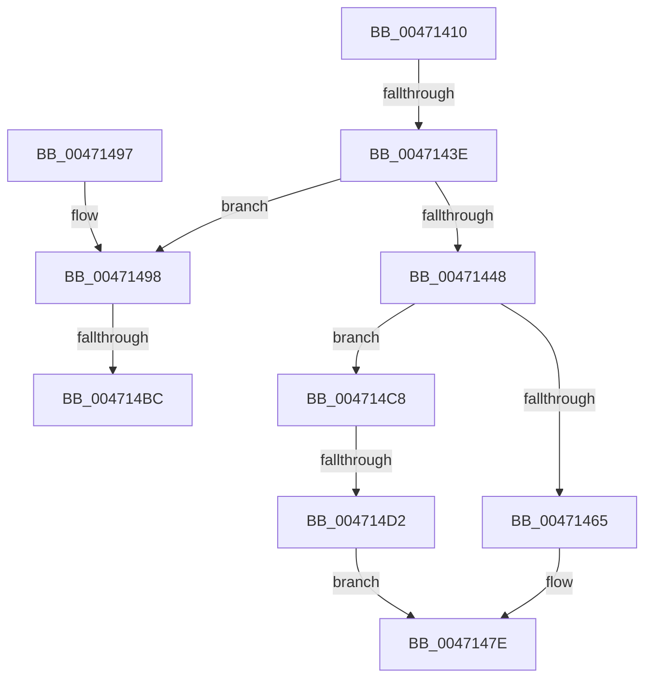

# HvlpAcquireHypercallPage

- RVA: `0x00471410`–`0x004714D6` (길이 `198` bytes)
- VA: `0x0000000140471410`
- 실행 섹션: `.text`
- PDB 이름 있음: `예`; PDB Function 태그: `예`
- unwind 정보 RVA: `0x00088E50`
- 디코드: `51`개 명령, `198/198` bytes 표시
- 미해석 바이트: `0` (있으면 어셈블리에 `.byte`로 보존)

> 이 문서는 커널 이미지의 기계어와 PDB 기호를 분석해 생성했습니다. 4번과 5번은 함수 원형과 자료형을 바이너리 사용 방식에서 추정한 C 해석이며 원본 소스 복구 결과는 아닙니다.

## 1. Dependencies

- 직접 호출 지점: **2**; 고유 호출 대상: **2**
- 직접 호출자로 확인된 함수: **65**
- RIP 상대 이미지 참조: **1**

### Outgoing calls
- `0x00471458` → [ExpInterlockedPopEntrySList](../6B/ExpInterlockedPopEntrySList_function_006BA570.md) (function, `0x006BA570`)
- `0x0047149E` → [KeDisableInterrupts](../21/KeDisableInterrupts_function_00217BE0.md) (function, `0x00217BE0`)

### Direct callers
- [HvlpSlowSendSyntheticClusterIpiEx](../30/HvlpSlowSendSyntheticClusterIpiEx_function_003034E0.md) at `0x00303651`
- [sub_00313017](../31/Unknown_function_00313017.md) at `0x00313078`
- [HvlQueryHypervisorTscAdjustment](../58/HvlQueryHypervisorTscAdjustment_function_0058424C.md) at `0x005842DE`
- [HvlQueryHypervisorTscAdjustment](../58/HvlQueryHypervisorTscAdjustment_function_0058424C.md) at `0x005842FA`
- [HvlGetRootVpSharedPages](../58/HvlGetRootVpSharedPages_function_0058466C.md) at `0x005846BC`
- [HvlGetRootVpSharedPages](../58/HvlGetRootVpSharedPages_function_0058466C.md) at `0x005846D5`
- [HvlQueryNumaDistance](../58/HvlQueryNumaDistance_function_00584A00.md) at `0x00584A50`
- [HvlQueryNumaDistance](../58/HvlQueryNumaDistance_function_00584A00.md) at `0x00584A66`
- [HvlSetupPhysicalFaultNotificationQueue](../58/HvlSetupPhysicalFaultNotificationQueue_function_00584CE0.md) at `0x00584D67`
- [HvlSetupPhysicalFaultNotificationQueue](../58/HvlSetupPhysicalFaultNotificationQueue_function_00584CE0.md) at `0x00584D80`
- [HvlStartBootLogicalProcessors](../58/HvlStartBootLogicalProcessors_function_00584E18.md) at `0x0058514C`
- [HvlpDepositPages](../58/HvlpDepositPages_function_00585474.md) at `0x00585573`
- [HvlpGetLogicalProcessorProperty](../58/HvlpGetLogicalProcessorProperty_function_00585774.md) at `0x005857C6`
- [HvlpGetLogicalProcessorProperty](../58/HvlpGetLogicalProcessorProperty_function_00585774.md) at `0x005857DD`
- [HvlpGetVpIndexFromApicId](../58/HvlpGetVpIndexFromApicId_function_00585880.md) at `0x005858D1`
- [HvlpGetVpIndexFromApicId](../58/HvlpGetVpIndexFromApicId_function_00585880.md) at `0x005858EA`
- [HvlpMapStatisticsPage](../58/HvlpMapStatisticsPage_function_00585B68.md) at `0x00585BC7`
- [HvlpMapStatisticsPage](../58/HvlpMapStatisticsPage_function_00585B68.md) at `0x00585BE1`
- [HvlpSetupSchedulerAssist](../58/HvlpSetupSchedulerAssist_function_005868F8.md) at `0x00586939`
- [HvlpStartLogicalProcessor](../58/HvlpStartLogicalProcessor_function_00586988.md) at `0x00586A17`
- [HvlpStartLogicalProcessor](../58/HvlpStartLogicalProcessor_function_00586988.md) at `0x00586A30`
- [HvlpStartVirtualProcessor](../58/HvlpStartVirtualProcessor_function_00586ADC.md) at `0x00586B0F`
- [HvlpUpdateLpcbIndex](../58/HvlpUpdateLpcbIndex_function_00586BD8.md) at `0x00586C23`
- [HvlpWithdrawPages](../58/HvlpWithdrawPages_function_00586C90.md) at `0x00586D06`
- [HvlpWithdrawPages](../58/HvlpWithdrawPages_function_00586C90.md) at `0x00586D1D`
- [HvlpQueryHypervisorSchedulerType](../58/HvlpQueryHypervisorSchedulerType_function_00586FB4.md) at `0x00587017`
- [HvlpQueryHypervisorSchedulerType](../58/HvlpQueryHypervisorSchedulerType_function_00586FB4.md) at `0x00587031`
- [HvlDmaGetDmaGuardEnabled](../58/HvlDmaGetDmaGuardEnabled_function_00587A50.md) at `0x00587AB4`
- [HvlDmaGetDmaGuardEnabled](../58/HvlDmaGetDmaGuardEnabled_function_00587A50.md) at `0x00587AD0`
- [HvlDmaGetHybridPassthroughReservedRegions](../58/HvlDmaGetHybridPassthroughReservedRegions_function_00587B50.md) at `0x00587BB3`
- [HvlDmaGetHybridPassthroughReservedRegions](../58/HvlDmaGetHybridPassthroughReservedRegions_function_00587B50.md) at `0x00587BCF`
- [HvlEnterSleepState](../58/HvlEnterSleepState_function_00587E50.md) at `0x00587E98`
- [HvlGetDeviceCapabilities](../58/HvlGetDeviceCapabilities_function_00587EF0.md) at `0x00587F50`
- [HvlGetDeviceCapabilities](../58/HvlGetDeviceCapabilities_function_00587EF0.md) at `0x00587F6A`
- [HvlGetSystemPasidCapabilities](../58/HvlGetSystemPasidCapabilities_function_00588520.md) at `0x0058864A`
- [HvlGetSystemPasidCapabilities](../58/HvlGetSystemPasidCapabilities_function_00588520.md) at `0x00588663`
- [HvlHvDebuggerPowerHandler](../58/HvlHvDebuggerPowerHandler_function_00588770.md) at `0x005887B1`
- [HvlLpReadCpuid](../58/HvlLpReadCpuid_function_00588900.md) at `0x0058895A`
- [HvlLpReadCpuid](../58/HvlLpReadCpuid_function_00588900.md) at `0x0058896F`
- [HvlLpWritebackInvalidate](../58/HvlLpWritebackInvalidate_function_00588A00.md) at `0x00588A37`
- [HvlMapDeviceInterrupt](../58/HvlMapDeviceInterrupt_function_00588A90.md) at `0x00588B4D`
- [HvlMapDeviceInterrupt](../58/HvlMapDeviceInterrupt_function_00588A90.md) at `0x00588B69`
- [HvlMapDeviceInterrupt](../58/HvlMapDeviceInterrupt_function_00588A90.md) at `0x00588BE0`
- [HvlNotifyAllProcessorsStarted](../58/HvlNotifyAllProcessorsStarted_function_00588CF4.md) at `0x00588D2D`
- [HvlNotifyDebugDeviceAvailable](../58/HvlNotifyDebugDeviceAvailable_function_00588D80.md) at `0x00588DD0`
- [HvlNotifyHpetEnabled](../58/HvlNotifyHpetEnabled_function_00588E60.md) at `0x00588E9F`
- [HvlNotifyRootCrashdump](../58/HvlNotifyRootCrashdump_function_00588EF8.md) at `0x00588F40`
- [HvlQueryAssociatedProcessors](../58/HvlQueryAssociatedProcessors_function_00589060.md) at `0x005890DE`
- [HvlQueryAssociatedProcessors](../58/HvlQueryAssociatedProcessors_function_00589060.md) at `0x005890F7`
- [HvlRegisterDeviceId](../58/HvlRegisterDeviceId_function_005891C0.md) at `0x0058925A`
- [HvlSetHpetConfig](../58/HvlSetHpetConfig_function_00589560.md) at `0x005895EB`
- [HvlSetHpetConfig](../58/HvlSetHpetConfig_function_00589560.md) at `0x0058965D`
- [HvlSetHpetConfig](../58/HvlSetHpetConfig_function_00589560.md) at `0x00589679`
- [HvlSetPartitionProperty](../58/HvlSetPartitionProperty_function_005896F8.md) at `0x0058973E`
- [HvlSetSystemMachineCheckProperty](../58/HvlSetSystemMachineCheckProperty_function_005898D0.md) at `0x00589912`
- [HvlSetSystemSleepProperty](../58/HvlSetSystemSleepProperty_function_00589970.md) at `0x005899BF`
- [HvlUnmapDeviceInterrupt](../58/HvlUnmapDeviceInterrupt_function_00589AE0.md) at `0x00589B29`
- [HvlpDmaSlowFlushDeviceDomainVaList](../58/HvlpDmaSlowFlushDeviceDomainVaList_function_00589CC0.md) at `0x00589D03`
- [HvlpSlowAcknowledgePageRequest](../58/HvlpSlowAcknowledgePageRequest_function_00589E20.md) at `0x00589E57`
- [HvlpSlowFlushPasidAddressList](../58/HvlpSlowFlushPasidAddressList_function_00589EE4.md) at `0x00589F26`
- [HvlChangeIsolatedMemoryVisibility](../58/HvlChangeIsolatedMemoryVisibility_function_00589FD0.md) at `0x0058A017`
- [HvlMapDmaRanges](../58/HvlMapDmaRanges_function_0058A110.md) at `0x0058A157`
- [HvlUnmapDmaRanges](../58/HvlUnmapDmaRanges_function_0058A210.md) at `0x0058A259`
- [HvlNotifyAcpiReenabled](../58/HvlNotifyAcpiReenabled_function_0058A64C.md) at `0x0058A682`
- [HvlPrepareForHibernate](../58/HvlPrepareForHibernate_function_0058A6C4.md) at `0x0058A71B`
- [HvlPrepareForHibernate](../58/HvlPrepareForHibernate_function_0058A6C4.md) at `0x0058A732`
- [HvlPrepareForSecureHibernate](../58/HvlPrepareForSecureHibernate_function_0058A7EC.md) at `0x0058A82C`
- [HvlWakeVirtualProcessors](../58/HvlWakeVirtualProcessors_function_0058AA80.md) at `0x0058AB71`
- [HvlWakeVirtualProcessors](../58/HvlWakeVirtualProcessors_function_0058AA80.md) at `0x0058ABBE`
- [HvlpInitializePowerStatistics](../58/HvlpInitializePowerStatistics_function_0058AC40.md) at `0x0058AC8B`
- [HvlpInitializePowerStatistics](../58/HvlpInitializePowerStatistics_function_0058AC40.md) at `0x0058ACA4`
- [HvlCollectLivedump](../58/HvlCollectLivedump_function_0058B460.md) at `0x0058B54D`
- [HvlCollectLivedump](../58/HvlCollectLivedump_function_0058B460.md) at `0x0058B568`
- [HvlpCheckTscSync](../58/HvlpCheckTscSync_function_0058C300.md) at `0x0058C366`
- [HvlpCheckTscSync](../58/HvlpCheckTscSync_function_0058C300.md) at `0x0058C382`
- [HvlpLogGuestStateScrubbingStatus](../58/HvlpLogGuestStateScrubbingStatus_function_0058C48C.md) at `0x0058C4FA`
- [HvlpLogGuestStateScrubbingStatus](../58/HvlpLogGuestStateScrubbingStatus_function_0058C48C.md) at `0x0058C514`
- [HvlpLogIommuInitStatus](../58/HvlpLogIommuInitStatus_function_0058C724.md) at `0x0058C78E`
- [HvlpLogIommuInitStatus](../58/HvlpLogIommuInitStatus_function_0058C724.md) at `0x0058C7AA`
- [HvlpDetermineEnlightenments](../58/HvlpDetermineEnlightenments_function_0058CC9C.md) at `0x0058D014`
- [HvlpQueryExtendedCapabilities](../58/HvlpQueryExtendedCapabilities_function_0058D2C8.md) at `0x0058D30B`
- [HvlpApplyIoCachePolicy](../58/HvlpApplyIoCachePolicy_function_0058D45C.md) at `0x0058D4A4`
- [HvlpInvokeGetPageListHypercall](../58/HvlpInvokeGetPageListHypercall_function_0058D7AC.md) at `0x0058D7F1`
- [HvlpSecureFlushLargeRangeList](../6A/HvlpSecureFlushLargeRangeList_function_006A7C38.md) at `0x006A7C94`
- [HvlpSlowFlushAddressSpaceTbEx](../6A/HvlpSlowFlushAddressSpaceTbEx_function_006A7D48.md) at `0x006A7D99`
- [HvlNotifyPageHeat](../6A/HvlNotifyPageHeat_function_006A7E60.md) at `0x006A7F07`
- [HvlNotifyPageHeat](../6A/HvlNotifyPageHeat_function_006A7E60.md) at `0x006A7F37`
- [sub_006E0708](../6E/Unknown_function_006E0708.md) at `0x006E071C`
- [sub_006E0708](../6E/Unknown_function_006E0708.md) at `0x006E0768`
- [sub_006E0928](../6E/Unknown_function_006E0928.md) at `0x006E09A1`
- [sub_006FB0BC](../6F/Unknown_function_006FB0BC.md) at `0x006FB17A`
- [HvlpCreateRootVirtualProcessor](../../page/71/HvlpCreateRootVirtualProcessor_function_00718280.md) at `0x007182F9`
- [HvlpLpCpuid](../../page/71/HvlpLpCpuid_function_007183B4.md) at `0x0071844C`
- [HvlpLpCpuid](../../page/71/HvlpLpCpuid_function_007183B4.md) at `0x00718461`
- [HvlGetMicrocodeLatency](../../page/71/HvlGetMicrocodeLatency_function_007184E0.md) at `0x00718536`
- [HvlGetMicrocodeLatency](../../page/71/HvlGetMicrocodeLatency_function_007184E0.md) at `0x00718550`

### Static image references
- `0x0047143E` → RVA `0x00FC6A90` (`ALMOSTRO`; read)

## 2. Other-region calls and transfers

- 다른 실행 섹션으로 향하는 call: **0**
- call이 아닌 외부 분기/꼬리 이동: **4**
  - `0x00471438` → [sub_006F3C0A + 0x21](../6F/Unknown_function_006F3C0A.md) (`tail-transfer`)
  - `0x004714B6` → [sub_006F3C0A](../6F/Unknown_function_006F3C0A.md) (`tail-transfer`)
  - `0x004714C3` → [sub_006F3C0A + 0x18](../6F/Unknown_function_006F3C0A.md) (`tail-transfer`)
  - `0x004714CC` → [sub_006F3C0A + 0x21](../6F/Unknown_function_006F3C0A.md) (`tail-transfer`)

## 3. Assembly (complete function range)

```asm
00471410  48 89 5C 24 08                  mov qword ptr [rsp + 8], rbx
00471415  48 89 6C 24 10                  mov qword ptr [rsp + 0x10], rbp
0047141A  48 89 74 24 18                  mov qword ptr [rsp + 0x18], rsi
0047141F  57                              push rdi
00471420  41 56                           push r14
00471422  41 57                           push r15
00471424  48 83 EC 20                     sub rsp, 0x20
00471428  33 DB                           xor ebx, ebx
0047142A  4D 8B F9                        mov r15, r9
0047142D  4D 8B F0                        mov r14, r8
00471430  8B F2                           mov esi, edx
00471432  48 8B F9                        mov rdi, rcx
00471435  F6 C2 08                        test dl, 8
00471438  0F 85 ED 27 28 00               jne 0x1406f3c2b
0047143E  8B 05 4C 56 B5 00               mov eax, dword ptr [rip + 0xb5564c]
00471444  A8 08                           test al, 8
00471446  74 50                           je 0x140471498
00471448  65 48 8B 2C 25 20 00 00 00      mov rbp, qword ptr gs:[0x20]
00471451  48 8D 8D C0 8B 00 00            lea rcx, [rbp + 0x8bc0]
00471458  E8 13 91 24 00                  call 0x1406ba570
0047145D  48 8B D8                        mov rbx, rax
00471460  48 85 C0                        test rax, rax
00471463  74 63                           je 0x1404714c8
00471465  C7 07 01 00 00 00               mov dword ptr [rdi], 1
0047146B  48 89 6F 08                     mov qword ptr [rdi + 8], rbp
0047146F  48 89 47 10                     mov qword ptr [rdi + 0x10], rax
00471473  48 8B 40 10                     mov rax, qword ptr [rax + 0x10]
00471477  48 89 47 18                     mov qword ptr [rdi + 0x18], rax
0047147B  48 8B C3                        mov rax, rbx
0047147E  48 8B 5C 24 40                  mov rbx, qword ptr [rsp + 0x40]
00471483  48 8B 6C 24 48                  mov rbp, qword ptr [rsp + 0x48]
00471488  48 8B 74 24 50                  mov rsi, qword ptr [rsp + 0x50]
0047148D  48 83 C4 20                     add rsp, 0x20
00471491  41 5F                           pop r15
00471493  41 5E                           pop r14
00471495  5F                              pop rdi
00471496  C3                              ret
00471497  CC                              int3
00471498  C7 01 04 00 00 00               mov dword ptr [rcx], 4
0047149E  E8 3D 67 DA FF                  call 0x140217be0
004714A3  88 47 08                        mov byte ptr [rdi + 8], al
004714A6  89 77 0C                        mov dword ptr [rdi + 0xc], esi
004714A9  65 48 8B 04 25 20 00 00 00      mov rax, qword ptr gs:[0x20]
004714B2  40 F6 C6 01                     test sil, 1
004714B6  0F 84 4E 27 28 00               je 0x1406f3c0a
004714BC  48 8B 98 00 8C 00 00            mov rbx, qword ptr [rax + 0x8c00]
004714C3  E9 5A 27 28 00                  jmp 0x1406f3c22
004714C8  40 F6 C6 04                     test sil, 4
004714CC  0F 84 59 27 28 00               je 0x1406f3c2b
004714D2  33 C0                           xor eax, eax
004714D4  EB A8                           jmp 0x14047147e
```

## 4. C-style interpretation (structured pseudocode)

```c
__int64 __fastcall HvlpAcquireHypercallPage(__int64 a1, int a2, __int64 a3, __int64 a4)
{
    __int64 result;
    __int64 v_rbx;
    __int64 v_rsp;
    unsigned __int64 v_stack_p10;
    unsigned __int64 v_stack_p18;
    unsigned __int64 v_stack_p8;

    v_stack_p8 = v_rbx;
    v_stack_p10 = v_rbp;
    v_stack_p18 = v_rsi;
    v_rsp = (v_rsp) - (32);
    v_rbx = 0;
    if ((((unsigned __int8)((unsigned int)(*(unsigned int *)(v_rip + 11884108)))) & (8)) == 0) goto loc_00471498;
    result = ExpInterlockedPopEntrySList(*(unsigned __int64 *)(gs_base + (0 + 32)) + 35776, a2, a3, a4);
    if (result == 0) goto loc_004714C8;
    *(unsigned int *)(a1) = 1;
    *(unsigned __int64 *)(a1 + 8) = *(unsigned __int64 *)(gs_base + (0 + 32));
    *(unsigned __int64 *)(a1 + 16) = result;
    *(unsigned __int64 *)(a1 + 24) = *(unsigned __int64 *)(result + 16);
loc_0047147E:
    v_rsp = (v_rsp) + (32);
    return result;
loc_00471498:
    *(unsigned int *)(*(unsigned __int64 *)(gs_base + (0 + 32)) + 35776) = 4;
    result = KeDisableInterrupts(*(unsigned __int64 *)(gs_base + (0 + 32)) + 35776, a2, a3, a4);
    *(unsigned __int8 *)(a1 + 8) = (unsigned __int8)(result);
    *(unsigned int *)(a1 + 12) = (unsigned int)(v_stack_p18);
loc_004714C8:
    result = 0;
    goto loc_0047147E;
}
```

## 5. (Beta) C Style

```c
int64_t HvlpAcquireHypercallPage(void *Arg1, int32_t Arg2, int64_t Arg3, int64_t Arg4)
{
    uint8_t *arg1 = (uint8_t *)Arg1;

    int64_t result;
    int64_t local_rbx;
    int64_t local_rsp;
    uint64_t v_stack_p10;
    uint64_t v_stack_p18;
    uint64_t v_stack_p8;

    v_stack_p8 = local_rbx;
    v_stack_p10 = local_rbp;
    v_stack_p18 = local_rsi;
    local_rsp = (local_rsp) - (32);
    local_rbx = 0;
    if ((((uint8_t)((uint32_t)(*(uint32_t *)(v_rip + 0xB5564C)))) & (8)) == 0) goto loc_00471498;
    result = ExpInterlockedPopEntrySList(*(uint64_t *)(gs_base + (0 + 0x20)) + 35776, Arg2, Arg3, Arg4);
    if (result == 0) goto loc_004714C8;
    *(uint32_t *)(arg1) = 1;
    *(uint64_t *)(arg1 + 0x8) = *(uint64_t *)(gs_base + (0 + 0x20));
    *(uint64_t *)(arg1 + 0x10) = result;
    *(uint64_t *)(arg1 + 0x18) = *(uint64_t *)(result + 0x10);
loc_0047147E:
    local_rsp = (local_rsp) + (32);
    return result;
loc_00471498:
    *(uint32_t *)(*(uint64_t *)(gs_base + (0 + 0x20)) + 0x8BC0) = 4;
    result = KeDisableInterrupts(*(uint64_t *)(gs_base + (0 + 0x20)) + 35776, Arg2, Arg3, Arg4);
    *(uint8_t *)(arg1 + 0x8) = (uint8_t)(result);
    *(uint32_t *)(arg1 + 0xC) = (uint32_t)(v_stack_p18);
loc_004714C8:
    result = 0;
    goto loc_0047147E;
}
```

### 관측된 메모리 오프셋

구조체 형식이 확인되지 않은 접근은 인자 기준의 오프셋으로만 기록했습니다.

| 기준 인자 | 오프셋 표현 | 폭 (bit) | 접근 |
|---|---:|---:|---|
| `Arg1` | `+ 0x0` | `32` | `W` |
| `Arg1` | `+ 0x8` | `8` | `W` |
| `Arg1` | `+ 0x8` | `64` | `W` |
| `Arg1` | `+ 0xC` | `32` | `W` |
| `Arg1` | `+ 0x10` | `64` | `W` |
| `Arg1` | `+ 0x18` | `64` | `W` |

## 6. Execution-region graph

[열기: 2D/3D 그래프와 함수 탐색 컨트롤 패널](../../../control-panel.html?section=text&rva=0x00471410&view=graph)

- 2D 그래프는 위에서 아래로 흐르고, 3D 그래프는 빈 공간을 드래그해 회전합니다. Shift+드래그는 이동, 휠은 확대·축소, 함수 노드 선택은 대상 보고서 이동입니다.

### Static fallback


