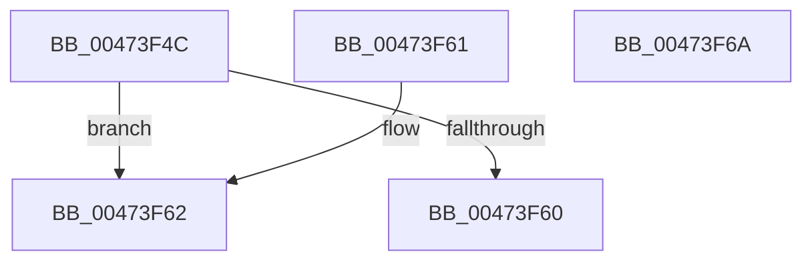

# IoDiskIoAttributionReference

- RVA: `0x00473F4C`–`0x00473F6B` (길이 `31` bytes)
- VA: `0x0000000140473F4C`
- 실행 섹션: `.text`
- PDB 이름 있음: `예`; PDB Function 태그: `아니요`
- unwind 정보 RVA: `0x000DB714`
- 디코드: `11`개 명령, `31/31` bytes 표시
- 미해석 바이트: `0` (있으면 어셈블리에 `.byte`로 보존)

> 이 문서는 커널 이미지의 기계어와 PDB 기호를 분석해 생성했습니다. 4번과 5번은 함수 원형과 자료형을 바이너리 사용 방식에서 추정한 C 해석이며 원본 소스 복구 결과는 아닙니다.

## 1. Dependencies

- 직접 호출 지점: **0**; 고유 호출 대상: **0**
- 직접 호출자로 확인된 함수: **1**
- RIP 상대 이미지 참조: **0**

### Outgoing calls
- 직접 디코드된 call 명령이 없습니다.

### Direct callers
- [IoDiskIoAttributionAllocate](../../page/9F/IoDiskIoAttributionAllocate_function_009F7F6C.md) at `0x009F8000`

### Static image references
- 디코드된 RIP-relative 메모리 참조가 없습니다.

## 2. Other-region calls and transfers

- 다른 실행 섹션으로 향하는 call: **0**
- 별도 외부 분기/꼬리 이동을 확인하지 못했습니다.

## 3. Assembly (complete function range)

```asm
00473F4C  B8 01 00 00 00                  mov eax, 1
00473F51  F0 48 0F C1 41 20               lock xadd qword ptr [rcx + 0x20], rax
00473F57  48 FF C0                        inc rax
00473F5A  48 83 F8 01                     cmp rax, 1
00473F5E  7E 02                           jle 0x140473f62
00473F60  C3                              ret
00473F61  CC                              int3
00473F62  B9 0E 00 00 00                  mov ecx, 0xe
00473F67  CD 29                           int 0x29
00473F69  C3                              ret
00473F6A  CC                              int3
```

## 4. C-style interpretation (structured pseudocode)

```c
__int64 __fastcall IoDiskIoAttributionReference(__int64 a1)
{
    __int64 result;

    result = (1) + 1;
    if (result <= 1) goto loc_00473F62;
    return result;
loc_00473F62:
    return result;
}
```

## 5. (Beta) C Style

```c
int64_t IoDiskIoAttributionReference(void *Arg1)
{
    uint8_t *arg1 = (uint8_t *)Arg1;

    int64_t result;

    result = (1) + 1;
    if (result <= 1) goto loc_00473F62;
    return result;
loc_00473F62:
    return result;
}
```

### 관측된 메모리 오프셋

구조체 형식이 확인되지 않은 접근은 인자 기준의 오프셋으로만 기록했습니다.

| 기준 인자 | 오프셋 표현 | 폭 (bit) | 접근 |
|---|---:|---:|---|
| `Arg1` | `+ 0x20` | `64` | `R/W` |

## 6. Execution-region graph

[열기: 2D/3D 그래프와 함수 탐색 컨트롤 패널](../../../control-panel.html?section=text&rva=0x00473F4C&view=graph)

- 2D 그래프는 위에서 아래로 흐르고, 3D 그래프는 빈 공간을 드래그해 회전합니다. Shift+드래그는 이동, 휠은 확대·축소, 함수 노드 선택은 대상 보고서 이동입니다.

### Static fallback


