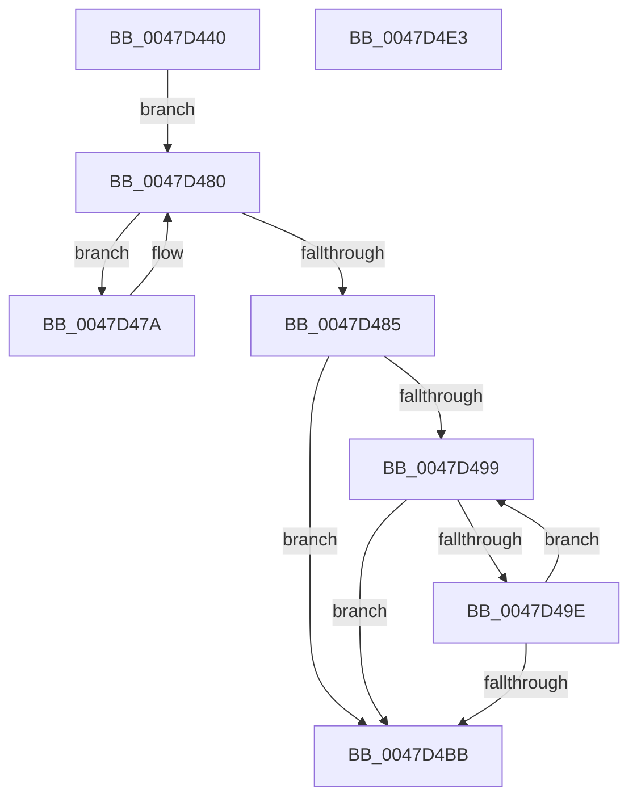

# IoEnumerateDeviceObjectList

- RVA: `0x0047D440`–`0x0047D4E4` (길이 `164` bytes)
- VA: `0x000000014047D440`
- 실행 섹션: `.text`
- PDB 이름 있음: `예`; PDB Function 태그: `아니요`
- unwind 정보 RVA: `0x00060300`
- 디코드: `52`개 명령, `164/164` bytes 표시
- 미해석 바이트: `0` (있으면 어셈블리에 `.byte`로 보존)

> 이 문서는 커널 이미지의 기계어와 PDB 기호를 분석해 생성했습니다. 4번과 5번은 함수 원형과 자료형을 바이너리 사용 방식에서 추정한 C 해석이며 원본 소스 복구 결과는 아닙니다.

## 1. Dependencies

- 직접 호출 지점: **3**; 고유 호출 대상: **3**
- 직접 호출자로 확인된 함수: **0**
- RIP 상대 이미지 참조: **0**

### Outgoing calls
- `0x0047D469` → [KeAcquireQueuedSpinLock](../27/KeAcquireQueuedSpinLock_function_00273D80.md) (function, `0x00273D80`)
- `0x0047D4A6` → [ObfReferenceObjectWithTag](../21/ObfReferenceObjectWithTag_function_00210710.md) (function, `0x00210710`)
- `0x0047D4C3` → [KeReleaseQueuedSpinLock](../27/KeReleaseQueuedSpinLock_function_00272540.md) (function, `0x00272540`)

### Direct callers
- 이 함수 시작 RVA로 연결되는 직접 call은 확인되지 않았습니다. 간접 호출은 완전히 역산할 수 없습니다.

### Static image references
- 디코드된 RIP-relative 메모리 참조가 없습니다.

## 2. Other-region calls and transfers

- 다른 실행 섹션으로 향하는 call: **0**
- 별도 외부 분기/꼬리 이동을 확인하지 못했습니다.

## 3. Assembly (complete function range)

```asm
0047D440  48 89 5C 24 08                  mov qword ptr [rsp + 8], rbx
0047D445  48 89 6C 24 10                  mov qword ptr [rsp + 0x10], rbp
0047D44A  48 89 74 24 18                  mov qword ptr [rsp + 0x18], rsi
0047D44F  57                              push rdi
0047D450  41 56                           push r14
0047D452  41 57                           push r15
0047D454  48 83 EC 20                     sub rsp, 0x20
0047D458  48 8B E9                        mov rbp, rcx
0047D45B  33 DB                           xor ebx, ebx
0047D45D  49 8B F1                        mov rsi, r9
0047D460  41 8B F8                        mov edi, r8d
0047D463  4C 8B F2                        mov r14, rdx
0047D466  8D 4B 0A                        lea ecx, [rbx + 0xa]
0047D469  E8 12 69 DF FF                  call 0x140273d80
0047D46E  4C 8B 45 08                     mov r8, qword ptr [rbp + 8]
0047D472  44 8A F8                        mov r15b, al
0047D475  C1 EF 03                        shr edi, 3
0047D478  EB 06                           jmp 0x14047d480
0047D47A  4D 8B 40 10                     mov r8, qword ptr [r8 + 0x10]
0047D47E  FF C3                           inc ebx
0047D480  4D 85 C0                        test r8, r8
0047D483  75 F5                           jne 0x14047d47a
0047D485  3B FB                           cmp edi, ebx
0047D487  89 1E                           mov dword ptr [rsi], ebx
0047D489  48 8B 5D 08                     mov rbx, qword ptr [rbp + 8]
0047D48D  1B F6                           sbb esi, esi
0047D48F  81 E6 23 00 00 C0               and esi, 0xc0000023
0047D495  85 FF                           test edi, edi
0047D497  74 22                           je 0x14047d4bb
0047D499  48 85 DB                        test rbx, rbx
0047D49C  74 1D                           je 0x14047d4bb
0047D49E  BA 44 66 6C 74                  mov edx, 0x746c6644
0047D4A3  48 8B CB                        mov rcx, rbx
0047D4A6  E8 65 32 D9 FF                  call 0x140210710
0047D4AB  49 89 1E                        mov qword ptr [r14], rbx
0047D4AE  49 83 C6 08                     add r14, 8
0047D4B2  48 8B 5B 10                     mov rbx, qword ptr [rbx + 0x10]
0047D4B6  83 C7 FF                        add edi, -1
0047D4B9  75 DE                           jne 0x14047d499
0047D4BB  41 8A D7                        mov dl, r15b
0047D4BE  B9 0A 00 00 00                  mov ecx, 0xa
0047D4C3  E8 78 50 DF FF                  call 0x140272540
0047D4C8  48 8B 5C 24 40                  mov rbx, qword ptr [rsp + 0x40]
0047D4CD  8B C6                           mov eax, esi
0047D4CF  48 8B 74 24 50                  mov rsi, qword ptr [rsp + 0x50]
0047D4D4  48 8B 6C 24 48                  mov rbp, qword ptr [rsp + 0x48]
0047D4D9  48 83 C4 20                     add rsp, 0x20
0047D4DD  41 5F                           pop r15
0047D4DF  41 5E                           pop r14
0047D4E1  5F                              pop rdi
0047D4E2  C3                              ret
0047D4E3  CC                              int3
```

## 4. C-style interpretation (structured pseudocode)

```c
__int64 __fastcall IoEnumerateDeviceObjectList(__int64 a1, __int64 a2, int a3, __int64 a4)
{
    __int64 result;
    __int64 v_r14;
    __int64 v_rbx;
    __int64 v_rdi;
    __int64 v_rsi;
    __int64 v_rsp;
    unsigned __int64 v_stack_p10;
    unsigned __int64 v_stack_p18;
    unsigned __int64 v_stack_p8;

    v_stack_p8 = v_rbx;
    v_stack_p10 = v_rbp;
    v_stack_p18 = v_rsi;
    v_rsp = (v_rsp) - (32);
    v_rbx = 0;
    result = KeAcquireQueuedSpinLock(v_rbx + 10, a2, a3, a4);
    v_rdi = (unsigned int)(((unsigned int)(a3)) >> (3));
    goto loc_0047D480;
loc_0047D47A:
    v_rbx = (unsigned int)((v_rbx) + 1);
loc_0047D480:
    if (*(unsigned __int64 *)(*(unsigned __int64 *)(a1 + 8) + 16) != 0) goto loc_0047D47A;
    *(unsigned int *)(a4) = (unsigned int)(v_rbx);
    v_rsi = (unsigned int)((a4) & (0xC0000023ULL));
    if ((unsigned int)(v_rdi) == 0) goto loc_0047D4BB;
loc_0047D499:
    if (*(unsigned __int64 *)(a1 + 8) == 0) goto loc_0047D4BB;
    result = ObfReferenceObjectWithTag(*(unsigned __int64 *)(a1 + 8), (unsigned int)(0x746C6644ULL), *(unsigned __int64 *)(*(unsigned __int64 *)(a1 + 8) + 16), a4);
    *(unsigned __int64 *)(a2) = *(unsigned __int64 *)(a1 + 8);
    v_r14 = (a2) + (8);
    v_rdi = (unsigned int)((v_rdi) + (-1));
    if (condition_is_not_equal) goto loc_0047D499;
loc_0047D4BB:
    result = KeReleaseQueuedSpinLock(10, (unsigned __int8)((unsigned __int8)(result)), *(unsigned __int64 *)(*(unsigned __int64 *)(a1 + 8) + 16), a4);
    v_rsp = (v_rsp) + (32);
    return (unsigned int)((unsigned int)(v_rsi));
}
```

## 5. (Beta) C Style

```c
int64_t IoEnumerateDeviceObjectList(void *Arg1, void *Arg2, int32_t Arg3, void *Arg4)
{
    uint8_t *arg1 = (uint8_t *)Arg1;
    uint8_t *arg2 = (uint8_t *)Arg2;
    uint8_t *arg4 = (uint8_t *)Arg4;

    int64_t result;
    int64_t local_r14;
    int64_t local_rbx;
    int64_t local_rdi;
    int64_t local_rsi;
    int64_t local_rsp;
    uint64_t v_stack_p10;
    uint64_t v_stack_p18;
    uint64_t v_stack_p8;

    v_stack_p8 = local_rbx;
    v_stack_p10 = local_rbp;
    v_stack_p18 = local_rsi;
    local_rsp = (local_rsp) - (32);
    local_rbx = 0;
    result = KeAcquireQueuedSpinLock(local_rbx + 10, Arg2, Arg3, Arg4);
    local_rdi = (uint32_t)(((uint32_t)(Arg3)) >> (3));
    goto loc_0047D480;
loc_0047D47A:
    local_rbx = (uint32_t)((local_rbx) + 1);
loc_0047D480:
    if (*(uint64_t *)(*(uint64_t *)(arg1 + 0x8) + 0x10) != 0) goto loc_0047D47A;
    *(uint32_t *)(arg4) = (uint32_t)(local_rbx);
    local_rsi = (uint32_t)((Arg4) & (0xC0000023ULL));
    if ((uint32_t)(local_rdi) == 0) goto loc_0047D4BB;
loc_0047D499:
    if (*(uint64_t *)(arg1 + 0x8) == 0) goto loc_0047D4BB;
    result = ObfReferenceObjectWithTag(*(uint64_t *)(arg1 + 0x8), (uint32_t)(0x746C6644ULL), *(uint64_t *)(*(uint64_t *)(arg1 + 0x8) + 0x10), Arg4);
    *(uint64_t *)(arg2) = *(uint64_t *)(arg1 + 0x8);
    local_r14 = (Arg2) + (8);
    local_rdi = (uint32_t)((local_rdi) + (-1));
    if (condition_is_not_equal) goto loc_0047D499;
loc_0047D4BB:
    result = KeReleaseQueuedSpinLock(10, (uint8_t)((uint8_t)(result)), *(uint64_t *)(*(uint64_t *)(arg1 + 0x8) + 0x10), Arg4);
    local_rsp = (local_rsp) + (32);
    return (uint32_t)((uint32_t)(local_rsi));
}
```

### 관측된 메모리 오프셋

구조체 형식이 확인되지 않은 접근은 인자 기준의 오프셋으로만 기록했습니다.

| 기준 인자 | 오프셋 표현 | 폭 (bit) | 접근 |
|---|---:|---:|---|
| `Arg1` | `+ 0x8` | `64` | `R` |
| `Arg2` | `+ 0x0` | `64` | `W` |
| `Arg4` | `+ 0x0` | `32` | `W` |

## 6. Execution-region graph

[열기: 2D/3D 그래프와 함수 탐색 컨트롤 패널](../../../control-panel.html?section=text&rva=0x0047D440&view=graph)

- 2D 그래프는 위에서 아래로 흐르고, 3D 그래프는 빈 공간을 드래그해 회전합니다. Shift+드래그는 이동, 휠은 확대·축소, 함수 노드 선택은 대상 보고서 이동입니다.

### Static fallback


