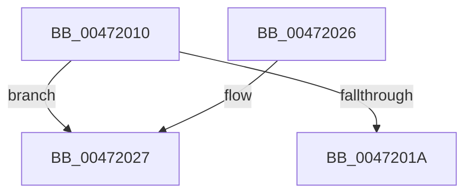

# IoFreeWorkItem

- RVA: `0x00472010`–`0x00472044` (길이 `52` bytes)
- VA: `0x0000000140472010`
- 실행 섹션: `.text`
- PDB 이름 있음: `예`; PDB Function 태그: `아니요`
- unwind 정보 RVA: `0x000A82A0`
- 디코드: `15`개 명령, `52/52` bytes 표시
- 미해석 바이트: `0` (있으면 어셈블리에 `.byte`로 보존)

> 이 문서는 커널 이미지의 기계어와 PDB 기호를 분석해 생성했습니다. 4번과 5번은 함수 원형과 자료형을 바이너리 사용 방식에서 추정한 C 해석이며 원본 소스 복구 결과는 아닙니다.

## 1. Dependencies

- 직접 호출 지점: **2**; 고유 호출 대상: **2**
- 직접 호출자로 확인된 함수: **1**
- RIP 상대 이미지 참조: **0**

### Outgoing calls
- `0x0047201C` → [ExFreePoolWithTag](../../poolcode/B8/ExFreePoolWithTag_function_00B82870.md) (function, `0x00B82870`)
- `0x0047203E` → [KeBugCheckEx](../4F/KeBugCheckEx_function_004FD660.md) (function, `0x004FD660`)

### Direct callers
- [PnpDeviceCompletionRequestDestroyWorkItem](PnpDeviceCompletionRequestDestroyWorkItem_function_00471FC0.md) at `0x00471FE6`

### Static image references
- 디코드된 RIP-relative 메모리 참조가 없습니다.

## 2. Other-region calls and transfers

- 다른 실행 섹션으로 향하는 call: **1**
  - `0x0047201C` → [ExFreePoolWithTag](../../poolcode/B8/ExFreePoolWithTag_function_00B82870.md) (`.text` → `POOLCODE`)
- 별도 외부 분기/꼬리 이동을 확인하지 못했습니다.

## 3. Assembly (complete function range)

```asm
00472010  48 83 EC 38                     sub rsp, 0x38
00472014  48 83 39 00                     cmp qword ptr [rcx], 0
00472018  75 0D                           jne 0x140472027
0047201A  33 D2                           xor edx, edx
0047201C  E8 4F 08 71 00                  call 0x140b82870
00472021  48 83 C4 38                     add rsp, 0x38
00472025  C3                              ret
00472026  CC                              int3
00472027  48 83 64 24 20 00               and qword ptr [rsp + 0x20], 0
0047202D  4C 8D 49 20                     lea r9, [rcx + 0x20]
00472031  4C 8B C1                        mov r8, rcx
00472034  BA 02 00 00 00                  mov edx, 2
00472039  B9 E4 00 00 00                  mov ecx, 0xe4
0047203E  E8 1D B6 08 00                  call 0x1404fd660
00472043  CC                              int3
```

## 4. C-style interpretation (structured pseudocode)

```c
__int64 __fastcall IoFreeWorkItem(__int64 a1, int a2)
{
    __int64 result;
    __int64 v_rsp;
    unsigned __int64 v_stack_p20;

    v_rsp = (v_rsp) - (56);
    if ((*(unsigned __int64 *)(a1)) != 0) goto loc_00472027;
    a2 = 0;
    result = ExFreePoolWithTag(a1, a2, a3, a4);
    v_rsp = (v_rsp) + (56);
    return result;
loc_00472027:
    result = KeBugCheckEx(228, 2, a1, a1 + 32);
    return result;
}
```

## 5. (Beta) C Style

```c
int64_t IoFreeWorkItem(void *Arg1, int32_t Arg2)
{
    uint8_t *arg1 = (uint8_t *)Arg1;

    int64_t result;
    int64_t local_rsp;
    uint64_t v_stack_p20;

    local_rsp = (local_rsp) - (56);
    if ((*(uint64_t *)(arg1)) != 0) goto loc_00472027;
    Arg2 = 0;
    result = ExFreePoolWithTag(Arg1, Arg2, a3, a4);
    local_rsp = (local_rsp) + (56);
    return result;
loc_00472027:
    result = KeBugCheckEx(228, 2, Arg1, Arg1 + 32);
    return result;
}
```

### 관측된 메모리 오프셋

구조체 형식이 확인되지 않은 접근은 인자 기준의 오프셋으로만 기록했습니다.

| 기준 인자 | 오프셋 표현 | 폭 (bit) | 접근 |
|---|---:|---:|---|
| `Arg1` | `+ 0x0` | `64` | `R` |
| `Arg1` | `+ 0x20` | `64` | `R` |

## 6. Execution-region graph

[열기: 2D/3D 그래프와 함수 탐색 컨트롤 패널](../../../control-panel.html?section=text&rva=0x00472010&view=graph)

- 2D 그래프는 위에서 아래로 흐르고, 3D 그래프는 빈 공간을 드래그해 회전합니다. Shift+드래그는 이동, 휠은 확대·축소, 함수 노드 선택은 대상 보고서 이동입니다.

### Static fallback


