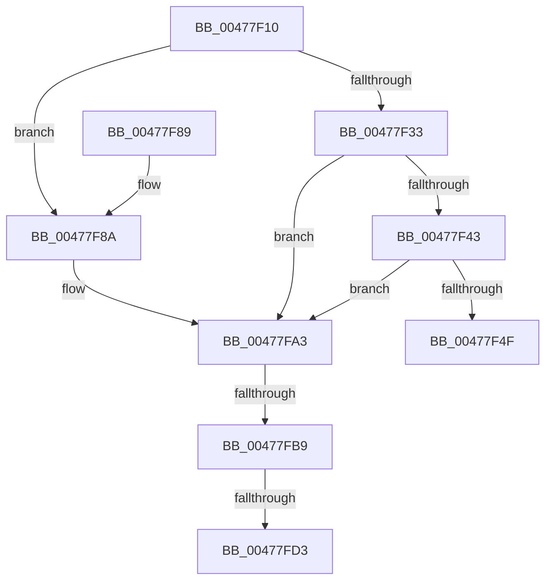

# IoInvalidateDeviceState

- RVA: `0x00477F10`–`0x00477FF1` (길이 `225` bytes)
- VA: `0x0000000140477F10`
- 실행 섹션: `.text`
- PDB 이름 있음: `예`; PDB Function 태그: `예`
- unwind 정보 RVA: `0x000878D0`
- 디코드: `58`개 명령, `225/225` bytes 표시
- 미해석 바이트: `0` (있으면 어셈블리에 `.byte`로 보존)

> 이 문서는 커널 이미지의 기계어와 PDB 기호를 분석해 생성했습니다. 4번과 5번은 함수 원형과 자료형을 바이너리 사용 방식에서 추정한 C 해석이며 원본 소스 복구 결과는 아닙니다.

## 1. Dependencies

- 직접 호출 지점: **7**; 고유 호출 대상: **4**
- 직접 호출자로 확인된 함수: **0**
- RIP 상대 이미지 참조: **0**

### Outgoing calls
- `0x00477F4F` → [Feature_IoInvalidateDeviceState_Unconditional__private_ReportDeviceUsage](Feature_IoInvalidateDeviceState_Unconditional__private_ReportDeviceUsage_function_00478C84.md) (function, `0x00478C84`)
- `0x00477F6F` → [PnpRequestDeviceAction](PnpRequestDeviceAction_function_00477FF8.md) (function, `0x00477FF8`)
- `0x00477F9D` → [KeBugCheckEx](../4F/KeBugCheckEx_function_004FD660.md) (function, `0x004FD660`)
- `0x00477FA7` → [IoAddTriageDumpDataBlock](../42/IoAddTriageDumpDataBlock_function_00428374.md) (function, `0x00428374`)
- `0x00477FBD` → [IoAddTriageDumpDataBlock](../42/IoAddTriageDumpDataBlock_function_00428374.md) (function, `0x00428374`)
- `0x00477FD5` → [IoAddTriageDumpDataBlock](../42/IoAddTriageDumpDataBlock_function_00428374.md) (function, `0x00428374`)
- `0x00477FE6` → [IoAddTriageDumpDataBlock](../42/IoAddTriageDumpDataBlock_function_00428374.md) (function, `0x00428374`)

### Direct callers
- 이 함수 시작 RVA로 연결되는 직접 call은 확인되지 않았습니다. 간접 호출은 완전히 역산할 수 없습니다.

### Static image references
- 디코드된 RIP-relative 메모리 참조가 없습니다.

## 2. Other-region calls and transfers

- 다른 실행 섹션으로 향하는 call: **0**
- call이 아닌 외부 분기/꼬리 이동: **3**
  - `0x00477FB3` → [sub_006F44EC](../6F/Unknown_function_006F44EC.md) (`tail-transfer`)
  - `0x00477FCD` → [sub_006F44EC](../6F/Unknown_function_006F44EC.md) (`tail-transfer`)
  - `0x00477FEC` → [sub_006F44EC](../6F/Unknown_function_006F44EC.md) (`tail-transfer`)

## 3. Assembly (complete function range)

```asm
00477F10  48 89 5C 24 08                  mov qword ptr [rsp + 8], rbx
00477F15  48 89 6C 24 10                  mov qword ptr [rsp + 0x10], rbp
00477F1A  48 89 74 24 18                  mov qword ptr [rsp + 0x18], rsi
00477F1F  57                              push rdi
00477F20  48 83 EC 40                     sub rsp, 0x40
00477F24  33 F6                           xor esi, esi
00477F26  48 8B D9                        mov rbx, rcx
00477F29  BD 02 00 00 00                  mov ebp, 2
00477F2E  48 85 C9                        test rcx, rcx
00477F31  74 57                           je 0x140477f8a
00477F33  48 8B 81 38 01 00 00            mov rax, qword ptr [rcx + 0x138]
00477F3A  48 8B 40 28                     mov rax, qword ptr [rax + 0x28]
00477F3E  48 85 C0                        test rax, rax
00477F41  74 60                           je 0x140477fa3
00477F43  F7 80 8C 01 00 00 00 00 02 00   test dword ptr [rax + 0x18c], 0x20000
00477F4D  75 54                           jne 0x140477fa3
00477F4F  E8 30 0D 00 00                  call 0x140478c84
00477F54  48 89 74 24 30                  mov qword ptr [rsp + 0x30], rsi
00477F59  8D 55 09                        lea edx, [rbp + 9]
00477F5C  48 89 74 24 28                  mov qword ptr [rsp + 0x28], rsi
00477F61  45 33 C9                        xor r9d, r9d
00477F64  45 33 C0                        xor r8d, r8d
00477F67  48 89 74 24 20                  mov qword ptr [rsp + 0x20], rsi
00477F6C  48 8B CB                        mov rcx, rbx
00477F6F  E8 84 00 00 00                  call 0x140477ff8
00477F74  48 8B 5C 24 50                  mov rbx, qword ptr [rsp + 0x50]
00477F79  48 8B 6C 24 58                  mov rbp, qword ptr [rsp + 0x58]
00477F7E  48 8B 74 24 60                  mov rsi, qword ptr [rsp + 0x60]
00477F83  48 83 C4 40                     add rsp, 0x40
00477F87  5F                              pop rdi
00477F88  C3                              ret
00477F89  CC                              int3
00477F8A  45 33 C9                        xor r9d, r9d
00477F8D  48 89 74 24 20                  mov qword ptr [rsp + 0x20], rsi
00477F92  4C 8B C3                        mov r8, rbx
00477F95  48 8B D5                        mov rdx, rbp
00477F98  B9 CA 00 00 00                  mov ecx, 0xca
00477F9D  E8 BE 56 08 00                  call 0x1404fd660
00477FA2  CC                              int3
00477FA3  0F B7 51 02                     movzx edx, word ptr [rcx + 2]
00477FA7  E8 C8 03 FB FF                  call 0x140428374
00477FAC  48 8B 4B 08                     mov rcx, qword ptr [rbx + 8]
00477FB0  48 85 C9                        test rcx, rcx
00477FB3  0F 84 33 C5 27 00               je 0x1406f44ec
00477FB9  0F BF 51 02                     movsx edx, word ptr [rcx + 2]
00477FBD  E8 B2 03 FB FF                  call 0x140428374
00477FC2  48 8B 4B 08                     mov rcx, qword ptr [rbx + 8]
00477FC6  48 83 C1 38                     add rcx, 0x38
00477FCA  66 39 31                        cmp word ptr [rcx], si
00477FCD  0F 84 19 C5 27 00               je 0x1406f44ec
00477FD3  8B D5                           mov edx, ebp
00477FD5  E8 9A 03 FB FF                  call 0x140428374
00477FDA  48 8B 4B 08                     mov rcx, qword ptr [rbx + 8]
00477FDE  0F B7 51 38                     movzx edx, word ptr [rcx + 0x38]
00477FE2  48 8B 49 40                     mov rcx, qword ptr [rcx + 0x40]
00477FE6  E8 89 03 FB FF                  call 0x140428374
00477FEB  90                              nop
00477FEC  E9 FB C4 27 00                  jmp 0x1406f44ec
```

## 4. C-style interpretation (structured pseudocode)

```c
__int64 __fastcall IoInvalidateDeviceState(__int64 a1, __int64 a2, int a3, int a4)
{
    __int64 result;
    __int64 v_rsi;
    __int64 v_rsp;
    unsigned __int64 v_stack_m18;
    unsigned __int64 v_stack_m20;
    unsigned __int64 v_stack_m28;
    unsigned __int64 v_stack_p10;
    unsigned __int64 v_stack_p18;
    unsigned __int64 v_stack_p20;
    unsigned __int64 v_stack_p8;

    v_stack_p8 = v_rbx;
    v_stack_p10 = v_rbp;
    v_stack_p18 = v_rsi;
    v_rsp = (v_rsp) - (64);
    v_rsi = 0;
    if (a1 == 0) goto loc_00477F8A;
    if (*(unsigned __int64 *)(*(unsigned __int64 *)(a1 + 312) + 40) == 0) goto loc_00477FA3;
    if (((*(unsigned int *)(*(unsigned __int64 *)(*(unsigned __int64 *)(a1 + 312) + 40) + 396)) & (0x20000ULL)) != 0) goto loc_00477FA3;
    result = Feature_IoInvalidateDeviceState_Unconditional__private_ReportDeviceUsage(a1, a2, a3, a4);
    v_stack_m18 = 0;
    v_stack_m20 = 0;
    a4 = 0;
    a3 = 0;
    v_stack_m28 = 0;
    result = PnpRequestDeviceAction(a1, 2 + 9, a3, a4);
    v_rsp = (v_rsp) + (64);
    return result;
loc_00477F8A:
    a4 = 0;
    v_stack_p20 = v_stack_p18;
    result = KeBugCheckEx(202, v_stack_p10, v_stack_p8, a4);
loc_00477FA3:
    result = IoAddTriageDumpDataBlock(202, *(unsigned __int16 *)(202 + 2), v_stack_p8, a4);
    result = IoAddTriageDumpDataBlock(*(unsigned __int64 *)(v_stack_p8 + 8), (__int16)(*(unsigned __int16 *)(*(unsigned __int64 *)(v_stack_p8 + 8) + 2)), v_stack_p8, a4);
    a1 = (*(unsigned __int64 *)(v_stack_p8 + 8)) + (56);
    result = IoAddTriageDumpDataBlock(a1, (unsigned int)((unsigned int)(v_stack_p10)), v_stack_p8, a4);
    result = IoAddTriageDumpDataBlock(*(unsigned __int64 *)(*(unsigned __int64 *)(v_stack_p8 + 8) + 64), *(unsigned __int16 *)(*(unsigned __int64 *)(v_stack_p8 + 8) + 56), v_stack_p8, a4);
}
```

## 5. (Beta) C Style

```c
int64_t IoInvalidateDeviceState(void *Arg1, int64_t Arg2, int32_t Arg3, int32_t Arg4)
{
    uint8_t *arg1 = (uint8_t *)Arg1;

    int64_t result;
    int64_t local_rsi;
    int64_t local_rsp;
    uint64_t v_stack_m18;
    uint64_t v_stack_m20;
    uint64_t v_stack_m28;
    uint64_t v_stack_p10;
    uint64_t v_stack_p18;
    uint64_t v_stack_p20;
    uint64_t v_stack_p8;

    v_stack_p8 = local_rbx;
    v_stack_p10 = local_rbp;
    v_stack_p18 = local_rsi;
    local_rsp = (local_rsp) - (64);
    local_rsi = 0;
    if (Arg1 == NULL) goto loc_00477F8A;
    if (*(uint64_t *)(*(uint64_t *)(arg1 + 0x138) + 0x28) == 0) goto loc_00477FA3;
    if (((*(uint32_t *)(*(uint64_t *)(*(uint64_t *)(arg1 + 0x138) + 0x28) + 0x18C)) & (0x20000ULL)) != 0) goto loc_00477FA3;
    result = Feature_IoInvalidateDeviceState_Unconditional__private_ReportDeviceUsage(Arg1, Arg2, Arg3, Arg4);
    v_stack_m18 = 0;
    v_stack_m20 = 0;
    Arg4 = 0;
    Arg3 = 0;
    v_stack_m28 = 0;
    result = PnpRequestDeviceAction(Arg1, 2 + 9, Arg3, Arg4);
    local_rsp = (local_rsp) + (64);
    return result;
loc_00477F8A:
    Arg4 = 0;
    v_stack_p20 = v_stack_p18;
    result = KeBugCheckEx(202, v_stack_p10, v_stack_p8, Arg4);
loc_00477FA3:
    result = IoAddTriageDumpDataBlock(202, *(uint16_t *)(202 + 0x2), v_stack_p8, Arg4);
    result = IoAddTriageDumpDataBlock(*(uint64_t *)(v_stack_p8 + 0x8), (int16_t)(*(uint16_t *)(*(uint64_t *)(v_stack_p8 + 0x8) + 0x2)), v_stack_p8, Arg4);
    Arg1 = (*(uint64_t *)(v_stack_p8 + 0x8)) + (56);
    result = IoAddTriageDumpDataBlock(Arg1, (uint32_t)((uint32_t)(v_stack_p10)), v_stack_p8, Arg4);
    result = IoAddTriageDumpDataBlock(*(uint64_t *)(*(uint64_t *)(v_stack_p8 + 0x8) + 0x40), *(uint16_t *)(*(uint64_t *)(v_stack_p8 + 0x8) + 0x38), v_stack_p8, Arg4);
}
```

### 관측된 메모리 오프셋

구조체 형식이 확인되지 않은 접근은 인자 기준의 오프셋으로만 기록했습니다.

| 기준 인자 | 오프셋 표현 | 폭 (bit) | 접근 |
|---|---:|---:|---|
| `Arg1` | `+ 0x8` | `64` | `R` |

## 6. Execution-region graph

[열기: 2D/3D 그래프와 함수 탐색 컨트롤 패널](../../../control-panel.html?section=text&rva=0x00477F10&view=graph)

- 2D 그래프는 위에서 아래로 흐르고, 3D 그래프는 빈 공간을 드래그해 회전합니다. Shift+드래그는 이동, 휠은 확대·축소, 함수 노드 선택은 대상 보고서 이동입니다.

### Static fallback


