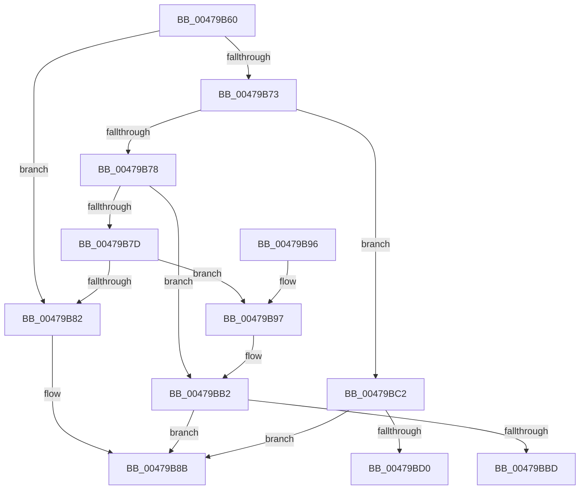

# IoReportInterruptActive

- RVA: `0x00479B60`–`0x00479BD5` (길이 `117` bytes)
- VA: `0x0000000140479B60`
- 실행 섹션: `.text`
- PDB 이름 있음: `예`; PDB Function 태그: `예`
- unwind 정보 RVA: `0x00087E24`
- 디코드: `38`개 명령, `117/117` bytes 표시
- 미해석 바이트: `0` (있으면 어셈블리에 `.byte`로 보존)

> 이 문서는 커널 이미지의 기계어와 PDB 기호를 분석해 생성했습니다. 4번과 5번은 함수 원형과 자료형을 바이너리 사용 방식에서 추정한 C 해석이며 원본 소스 복구 결과는 아닙니다.

## 1. Dependencies

- 직접 호출 지점: **2**; 고유 호출 대상: **2**
- 직접 호출자로 확인된 함수: **0**
- RIP 상대 이미지 참조: **0**

### Outgoing calls
- `0x00479B86` → [IopUnmaskInterrupt](IopUnmaskInterrupt_function_00479BDC.md) (function, `0x00479BDC`)
- `0x00479BAC` → [KeBugCheckEx](../4F/KeBugCheckEx_function_004FD660.md) (function, `0x004FD660`)

### Direct callers
- 이 함수 시작 RVA로 연결되는 직접 call은 확인되지 않았습니다. 간접 호출은 완전히 역산할 수 없습니다.

### Static image references
- 디코드된 RIP-relative 메모리 참조가 없습니다.

## 2. Other-region calls and transfers

- 다른 실행 섹션으로 향하는 call: **0**
- call이 아닌 외부 분기/꼬리 이동: **2**
  - `0x00479BBD` → [sub_006F483C](../6F/Unknown_function_006F483C.md) (`tail-transfer`)
  - `0x00479BD0` → [sub_006F483C + 0x1F](../6F/Unknown_function_006F483C.md) (`tail-transfer`)

## 3. Assembly (complete function range)

```asm
00479B60  48 89 5C 24 08                  mov qword ptr [rsp + 8], rbx
00479B65  57                              push rdi
00479B66  48 83 EC 30                     sub rsp, 0x30
00479B6A  8B 11                           mov edx, dword ptr [rcx]
00479B6C  8B C2                           mov eax, edx
00479B6E  83 E8 01                        sub eax, 1
00479B71  74 0F                           je 0x140479b82
00479B73  83 E8 01                        sub eax, 1
00479B76  74 4A                           je 0x140479bc2
00479B78  83 E8 01                        sub eax, 1
00479B7B  74 35                           je 0x140479bb2
00479B7D  83 F8 01                        cmp eax, 1
00479B80  75 15                           jne 0x140479b97
00479B82  48 8B 49 08                     mov rcx, qword ptr [rcx + 8]
00479B86  E8 51 00 00 00                  call 0x140479bdc
00479B8B  48 8B 5C 24 40                  mov rbx, qword ptr [rsp + 0x40]
00479B90  48 83 C4 30                     add rsp, 0x30
00479B94  5F                              pop rdi
00479B95  C3                              ret
00479B96  CC                              int3
00479B97  33 DB                           xor ebx, ebx
00479B99  4C 8B C2                        mov r8, rdx
00479B9C  45 33 C9                        xor r9d, r9d
00479B9F  48 89 5C 24 20                  mov qword ptr [rsp + 0x20], rbx
00479BA4  B9 CA 00 00 00                  mov ecx, 0xca
00479BA9  8D 53 0C                        lea edx, [rbx + 0xc]
00479BAC  E8 AF 3A 08 00                  call 0x1404fd660
00479BB1  CC                              int3
00479BB2  48 8B 79 08                     mov rdi, qword ptr [rcx + 8]
00479BB6  33 DB                           xor ebx, ebx
00479BB8  39 5F 04                        cmp dword ptr [rdi + 4], ebx
00479BBB  76 CE                           jbe 0x140479b8b
00479BBD  E9 7A AC 27 00                  jmp 0x1406f483c
00479BC2  48 8B 79 08                     mov rdi, qword ptr [rcx + 8]
00479BC6  33 DB                           xor ebx, ebx
00479BC8  39 9F 24 01 00 00               cmp dword ptr [rdi + 0x124], ebx
00479BCE  76 BB                           jbe 0x140479b8b
00479BD0  E9 86 AC 27 00                  jmp 0x1406f485b
```

## 4. C-style interpretation (structured pseudocode)

```c
__int64 __fastcall IoReportInterruptActive(__int64 a1, __int64 a2, __int64 a3, int a4)
{
    __int64 result;
    __int64 v_rbx;
    __int64 v_rsp;
    unsigned __int64 v_stack_p20;
    unsigned __int64 v_stack_p8;

    v_stack_p8 = v_rbx;
    v_rsp = (v_rsp) - (48);
    result = (unsigned int)(((unsigned int)((unsigned int)((unsigned int)(*(unsigned int *)(a1))))) - (1));
    if (condition_is_equal) goto loc_00479B82;
    result = (unsigned int)((result) - (1));
    if (condition_is_equal) goto loc_00479BC2;
    result = (unsigned int)((result) - (1));
    if (condition_is_equal) goto loc_00479BB2;
    if (((unsigned int)(result)) != 1) goto loc_00479B97;
loc_00479B82:
    result = IopUnmaskInterrupt(*(unsigned __int64 *)(a1 + 8), (unsigned int)(*(unsigned int *)(a1)), a3, a4);
loc_00479B8B:
    v_rsp = (v_rsp) + (48);
    return result;
loc_00479B97:
    v_rbx = 0;
    a4 = 0;
    v_stack_p20 = 0;
    result = KeBugCheckEx(202, v_rbx + 12, (unsigned int)(*(unsigned int *)(a1)), a4);
loc_00479BB2:
    v_rbx = 0;
    if ((*(unsigned int *)(*(unsigned __int64 *)(202 + 8) + 4)) <= 0) goto loc_00479B8B;
loc_00479BC2:
    v_rbx = 0;
    if ((*(unsigned int *)(*(unsigned __int64 *)(202 + 8) + 292)) <= 0) goto loc_00479B8B;
}
```

## 5. (Beta) C Style

```c
int64_t IoReportInterruptActive(void *Arg1, int64_t Arg2, int64_t Arg3, int32_t Arg4)
{
    uint8_t *arg1 = (uint8_t *)Arg1;

    int64_t result;
    int64_t local_rbx;
    int64_t local_rsp;
    uint64_t v_stack_p20;
    uint64_t v_stack_p8;

    v_stack_p8 = local_rbx;
    local_rsp = (local_rsp) - (48);
    result = (uint32_t)(((uint32_t)((uint32_t)((uint32_t)(*(uint32_t *)(arg1))))) - (1));
    if (condition_is_equal) goto loc_00479B82;
    result = (uint32_t)((result) - (1));
    if (condition_is_equal) goto loc_00479BC2;
    result = (uint32_t)((result) - (1));
    if (condition_is_equal) goto loc_00479BB2;
    if (((uint32_t)(result)) != 1) goto loc_00479B97;
loc_00479B82:
    result = IopUnmaskInterrupt(*(uint64_t *)(arg1 + 0x8), (uint32_t)(*(uint32_t *)(arg1)), Arg3, Arg4);
loc_00479B8B:
    local_rsp = (local_rsp) + (48);
    return result;
loc_00479B97:
    local_rbx = 0;
    Arg4 = 0;
    v_stack_p20 = 0;
    result = KeBugCheckEx(202, local_rbx + 12, (uint32_t)(*(uint32_t *)(arg1)), Arg4);
loc_00479BB2:
    local_rbx = 0;
    if ((*(uint32_t *)(*(uint64_t *)(202 + 0x8) + 0x4)) <= 0) goto loc_00479B8B;
loc_00479BC2:
    local_rbx = 0;
    if ((*(uint32_t *)(*(uint64_t *)(202 + 0x8) + 0x124)) <= 0) goto loc_00479B8B;
}
```

### 관측된 메모리 오프셋

구조체 형식이 확인되지 않은 접근은 인자 기준의 오프셋으로만 기록했습니다.

| 기준 인자 | 오프셋 표현 | 폭 (bit) | 접근 |
|---|---:|---:|---|
| `Arg1` | `+ 0x0` | `32` | `R` |
| `Arg1` | `+ 0x8` | `64` | `R` |

## 6. Execution-region graph

[열기: 2D/3D 그래프와 함수 탐색 컨트롤 패널](../../../control-panel.html?section=text&rva=0x00479B60&view=graph)

- 2D 그래프는 위에서 아래로 흐르고, 3D 그래프는 빈 공간을 드래그해 회전합니다. Shift+드래그는 이동, 휠은 확대·축소, 함수 노드 선택은 대상 보고서 이동입니다.

### Static fallback


