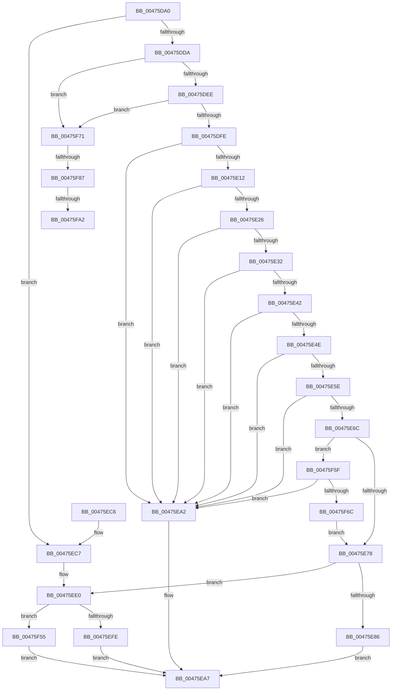

# IoReportTargetDeviceChangeAsynchronous

- RVA: `0x00475DA0`–`0x00475FC0` (길이 `544` bytes)
- VA: `0x0000000140475DA0`
- 실행 섹션: `.text`
- PDB 이름 있음: `예`; PDB Function 태그: `예`
- unwind 정보 RVA: `0x000ACC0C`
- 디코드: `140`개 명령, `544/544` bytes 표시
- 미해석 바이트: `0` (있으면 어셈블리에 `.byte`로 보존)

> 이 문서는 커널 이미지의 기계어와 PDB 기호를 분석해 생성했습니다. 4번과 5번은 함수 원형과 자료형을 바이너리 사용 방식에서 추정한 C 해석이며 원본 소스 복구 결과는 아닙니다.

## 1. Dependencies

- 직접 호출 지점: **13**; 고유 호출 대상: **8**
- 직접 호출자로 확인된 함수: **3**
- RIP 상대 이미지 참조: **4**

### Outgoing calls
- `0x00475E1C` → [RtlCompareMemory](../6B/RtlCompareMemory_function_006BA670.md) (function, `0x006BA670`)
- `0x00475E38` → [RtlCompareMemory](../6B/RtlCompareMemory_function_006BA670.md) (function, `0x006BA670`)
- `0x00475E54` → [RtlCompareMemory](../6B/RtlCompareMemory_function_006BA670.md) (function, `0x006BA670`)
- `0x00475E9B` → [PnpSetCustomTargetEvent](../../page/95/PnpSetCustomTargetEvent_function_009519E8.md) (function, `0x009519E8`)
- `0x00475EDA` → [KeBugCheckEx](../4F/KeBugCheckEx_function_004FD660.md) (function, `0x004FD660`)
- `0x00475EF1` → [ExAllocatePool2](../../poolcode/B8/ExAllocatePool2_function_00B820F0.md) (function, `0x00B820F0`)
- `0x00475F06` → [ObfReferenceObjectWithTag](../21/ObfReferenceObjectWithTag_function_00210710.md) (function, `0x00210710`)
- `0x00475F1F` → [memcpy](../6C/memcpy_function_006C6840.md) (function, `0x006C6840`)
- `0x00475F46` → [ExQueueWorkItem](../2F/ExQueueWorkItem_function_002F9520.md) (function, `0x002F9520`)
- `0x00475F75` → [IoAddTriageDumpDataBlock](../42/IoAddTriageDumpDataBlock_function_00428374.md) (function, `0x00428374`)
- `0x00475F8B` → [IoAddTriageDumpDataBlock](../42/IoAddTriageDumpDataBlock_function_00428374.md) (function, `0x00428374`)
- `0x00475FA4` → [IoAddTriageDumpDataBlock](../42/IoAddTriageDumpDataBlock_function_00428374.md) (function, `0x00428374`)
- `0x00475FB5` → [IoAddTriageDumpDataBlock](../42/IoAddTriageDumpDataBlock_function_00428374.md) (function, `0x00428374`)

### Direct callers
- [sub_006F45AA](../6F/Unknown_function_006F45AA.md) at `0x006F467D`
- [RawMountVolume](../../page/9A/RawMountVolume_function_009A4844.md) at `0x009A4A37`
- [FsRtlNotifyVolumeEventEx](../../page/A6/FsRtlNotifyVolumeEventEx_function_00A66DC0.md) at `0x00A66E49`

### Static image references
- `0x00475E02` → RVA `0x0001A210` (`.rdata`; read)
- `0x00475E26` → RVA `0x00012320` (`.rdata`; read)
- `0x00475E42` → RVA `0x0001A220` (`.rdata`; read)
- `0x00475F28` → RVA `0x00729E20` (`PnpReportTargetDeviceChangeAsyncWorker`; read)

## 2. Other-region calls and transfers

- 다른 실행 섹션으로 향하는 call: **2**
  - `0x00475E9B` → [PnpSetCustomTargetEvent](../../page/95/PnpSetCustomTargetEvent_function_009519E8.md) (`.text` → `PAGE`)
  - `0x00475EF1` → [ExAllocatePool2](../../poolcode/B8/ExAllocatePool2_function_00B820F0.md) (`.text` → `POOLCODE`)
- call이 아닌 외부 분기/꼬리 이동: **3**
  - `0x00475F81` → [sub_006F43A4](../6F/Unknown_function_006F43A4.md) (`tail-transfer`)
  - `0x00475F9C` → [sub_006F43A4](../6F/Unknown_function_006F43A4.md) (`tail-transfer`)
  - `0x00475FBB` → [sub_006F43A4](../6F/Unknown_function_006F43A4.md) (`tail-transfer`)

## 3. Assembly (complete function range)

```asm
00475DA0  48 8B C4                        mov rax, rsp
00475DA3  48 89 58 08                     mov qword ptr [rax + 8], rbx
00475DA7  48 89 68 10                     mov qword ptr [rax + 0x10], rbp
00475DAB  48 89 70 18                     mov qword ptr [rax + 0x18], rsi
00475DAF  48 89 78 20                     mov qword ptr [rax + 0x20], rdi
00475DB3  41 54                           push r12
00475DB5  41 56                           push r14
00475DB7  41 57                           push r15
00475DB9  48 83 EC 30                     sub rsp, 0x30
00475DBD  45 33 FF                        xor r15d, r15d
00475DC0  49 8B E9                        mov rbp, r9
00475DC3  4D 8B F0                        mov r14, r8
00475DC6  48 8B F2                        mov rsi, rdx
00475DC9  48 8B D9                        mov rbx, rcx
00475DCC  BF 02 00 00 00                  mov edi, 2
00475DD1  48 85 C9                        test rcx, rcx
00475DD4  0F 84 ED 00 00 00               je 0x140475ec7
00475DDA  48 8B 81 38 01 00 00            mov rax, qword ptr [rcx + 0x138]
00475DE1  48 8B 40 28                     mov rax, qword ptr [rax + 0x28]
00475DE5  48 85 C0                        test rax, rax
00475DE8  0F 84 83 01 00 00               je 0x140475f71
00475DEE  F7 80 8C 01 00 00 00 00 02 00   test dword ptr [rax + 0x18c], 0x20000
00475DF8  0F 85 73 01 00 00               jne 0x140475f71
00475DFE  48 8D 7A 04                     lea rdi, [rdx + 4]
00475E02  48 8D 15 07 44 BA FF            lea rdx, [rip - 0x45bbf9]
00475E09  48 3B FA                        cmp rdi, rdx
00475E0C  0F 84 90 00 00 00               je 0x140475ea2
00475E12  45 8D 67 10                     lea r12d, [r15 + 0x10]
00475E16  48 8B CF                        mov rcx, rdi
00475E19  45 8B C4                        mov r8d, r12d
00475E1C  E8 4F 48 24 00                  call 0x1406ba670
00475E21  49 3B C4                        cmp rax, r12
00475E24  74 7C                           je 0x140475ea2
00475E26  48 8D 15 F3 C4 B9 FF            lea rdx, [rip - 0x463b0d]
00475E2D  48 3B FA                        cmp rdi, rdx
00475E30  74 70                           je 0x140475ea2
00475E32  45 8B C4                        mov r8d, r12d
00475E35  48 8B CF                        mov rcx, rdi
00475E38  E8 33 48 24 00                  call 0x1406ba670
00475E3D  49 3B C4                        cmp rax, r12
00475E40  74 60                           je 0x140475ea2
00475E42  48 8D 15 D7 43 BA FF            lea rdx, [rip - 0x45bc29]
00475E49  48 3B FA                        cmp rdi, rdx
00475E4C  74 54                           je 0x140475ea2
00475E4E  45 8B C4                        mov r8d, r12d
00475E51  48 8B CF                        mov rcx, rdi
00475E54  E8 17 48 24 00                  call 0x1406ba670
00475E59  49 3B C4                        cmp rax, r12
00475E5C  74 44                           je 0x140475ea2
00475E5E  0F B7 4E 02                     movzx ecx, word ptr [rsi + 2]
00475E62  45 8D 47 24                     lea r8d, [r15 + 0x24]
00475E66  66 41 3B C8                     cmp cx, r8w
00475E6A  72 36                           jb 0x140475ea2
00475E6C  8B 56 20                        mov edx, dword ptr [rsi + 0x20]
00475E6F  83 FA FF                        cmp edx, -1
00475E72  0F 85 E7 00 00 00               jne 0x140475f5f
00475E78  44 0F 20 C0                     mov rax, cr8
00475E7C  BF 02 00 00 00                  mov edi, 2
00475E81  40 3A C7                        cmp al, dil
00475E84  74 5A                           je 0x140475ee0
00475E86  48 89 74 24 28                  mov qword ptr [rsp + 0x28], rsi
00475E8B  4D 8B CE                        mov r9, r14
00475E8E  45 33 C0                        xor r8d, r8d
00475E91  48 89 6C 24 20                  mov qword ptr [rsp + 0x20], rbp
00475E96  33 D2                           xor edx, edx
00475E98  48 8B CB                        mov rcx, rbx
00475E9B  E8 48 BB 4D 00                  call 0x1409519e8
00475EA0  EB 05                           jmp 0x140475ea7
00475EA2  B8 10 00 00 C0                  mov eax, 0xc0000010
00475EA7  48 8B 5C 24 50                  mov rbx, qword ptr [rsp + 0x50]
00475EAC  48 8B 6C 24 58                  mov rbp, qword ptr [rsp + 0x58]
00475EB1  48 8B 74 24 60                  mov rsi, qword ptr [rsp + 0x60]
00475EB6  48 8B 7C 24 68                  mov rdi, qword ptr [rsp + 0x68]
00475EBB  48 83 C4 30                     add rsp, 0x30
00475EBF  41 5F                           pop r15
00475EC1  41 5E                           pop r14
00475EC3  41 5C                           pop r12
00475EC5  C3                              ret
00475EC6  CC                              int3
00475EC7  45 33 C9                        xor r9d, r9d
00475ECA  4C 89 7C 24 20                  mov qword ptr [rsp + 0x20], r15
00475ECF  4C 8B C3                        mov r8, rbx
00475ED2  48 8B D7                        mov rdx, rdi
00475ED5  B9 CA 00 00 00                  mov ecx, 0xca
00475EDA  E8 81 77 08 00                  call 0x1404fd660
00475EDF  CC                              int3
00475EE0  48 8B D1                        mov rdx, rcx
00475EE3  41 B8 50 6E 70 38               mov r8d, 0x38706e50
00475EE9  B9 40 00 00 00                  mov ecx, 0x40
00475EEE  48 03 D1                        add rdx, rcx
00475EF1  E8 FA C1 70 00                  call 0x140b820f0
00475EF6  48 8B F8                        mov rdi, rax
00475EF9  48 85 C0                        test rax, rax
00475EFC  74 57                           je 0x140475f55
00475EFE  BA 50 6E 70 4E                  mov edx, 0x4e706e50
00475F03  48 8B CB                        mov rcx, rbx
00475F06  E8 05 A8 D9 FF                  call 0x140210710
00475F0B  48 8D 4F 40                     lea rcx, [rdi + 0x40]
00475F0F  48 89 5F 20                     mov qword ptr [rdi + 0x20], rbx
00475F13  48 89 4F 38                     mov qword ptr [rdi + 0x38], rcx
00475F17  48 8B D6                        mov rdx, rsi
00475F1A  44 0F B7 46 02                  movzx r8d, word ptr [rsi + 2]
00475F1F  E8 1C 09 25 00                  call 0x1406c6840
00475F24  4C 89 77 28                     mov qword ptr [rdi + 0x28], r14
00475F28  48 8D 05 F1 3E 2B 00            lea rax, [rip + 0x2b3ef1]
00475F2F  48 89 6F 30                     mov qword ptr [rdi + 0x30], rbp
00475F33  BA 01 00 00 00                  mov edx, 1
00475F38  48 8B CF                        mov rcx, rdi
00475F3B  48 89 47 10                     mov qword ptr [rdi + 0x10], rax
00475F3F  48 89 7F 18                     mov qword ptr [rdi + 0x18], rdi
00475F43  4C 89 3F                        mov qword ptr [rdi], r15
00475F46  E8 D5 35 E8 FF                  call 0x1402f9520
00475F4B  B8 03 01 00 00                  mov eax, 0x103
00475F50  E9 52 FF FF FF                  jmp 0x140475ea7
00475F55  B8 9A 00 00 C0                  mov eax, 0xc000009a
00475F5A  E9 48 FF FF FF                  jmp 0x140475ea7
00475F5F  8B C1                           mov eax, ecx
00475F61  41 2B C0                        sub eax, r8d
00475F64  3B D0                           cmp edx, eax
00475F66  0F 8F 36 FF FF FF               jg 0x140475ea2
00475F6C  E9 07 FF FF FF                  jmp 0x140475e78
00475F71  0F B7 51 02                     movzx edx, word ptr [rcx + 2]
00475F75  E8 FA 23 FB FF                  call 0x140428374
00475F7A  48 8B 4B 08                     mov rcx, qword ptr [rbx + 8]
00475F7E  48 85 C9                        test rcx, rcx
00475F81  0F 84 1D E4 27 00               je 0x1406f43a4
00475F87  0F BF 51 02                     movsx edx, word ptr [rcx + 2]
00475F8B  E8 E4 23 FB FF                  call 0x140428374
00475F90  48 8B 4B 08                     mov rcx, qword ptr [rbx + 8]
00475F94  48 83 C1 38                     add rcx, 0x38
00475F98  66 44 39 39                     cmp word ptr [rcx], r15w
00475F9C  0F 84 02 E4 27 00               je 0x1406f43a4
00475FA2  8B D7                           mov edx, edi
00475FA4  E8 CB 23 FB FF                  call 0x140428374
00475FA9  48 8B 4B 08                     mov rcx, qword ptr [rbx + 8]
00475FAD  0F B7 51 38                     movzx edx, word ptr [rcx + 0x38]
00475FB1  48 8B 49 40                     mov rcx, qword ptr [rcx + 0x40]
00475FB5  E8 BA 23 FB FF                  call 0x140428374
00475FBA  90                              nop
00475FBB  E9 E4 E3 27 00                  jmp 0x1406f43a4
```

## 4. C-style interpretation (structured pseudocode)

```c
__int64 __fastcall IoReportTargetDeviceChangeAsynchronous(__int64 a1, __int64 a2, __int64 a3, __int64 a4)
{
    __int64 result;
    __int64 v_r15;
    __int64 v_rsp;
    unsigned __int64 v_stack_m20;
    unsigned __int64 v_stack_m28;
    unsigned __int64 v_stack_p10;
    unsigned __int64 v_stack_p18;
    unsigned __int64 v_stack_p20;
    unsigned __int64 v_stack_p8;

    *(unsigned __int64 *)(v_rsp + 8) = v_rbx;
    *(unsigned __int64 *)(v_rsp + 16) = v_rbp;
    *(unsigned __int64 *)(v_rsp + 24) = v_rsi;
    *(unsigned __int64 *)(v_rsp + 32) = v_rdi;
    v_rsp = (v_rsp) - (48);
    v_r15 = 0;
    if (a1 == 0) goto loc_00475EC7;
    if (*(unsigned __int64 *)(*(unsigned __int64 *)(a1 + 312) + 40) == 0) goto loc_00475F71;
    if (((*(unsigned int *)(*(unsigned __int64 *)(*(unsigned __int64 *)(a1 + 312) + 40) + 396)) & (0x20000ULL)) != 0) goto loc_00475F71;
    if ((a2 + 4) == (v_rip - 4570105)) goto loc_00475EA2;
    result = RtlCompareMemory(a2 + 4, v_rip - 4570105, (unsigned int)((unsigned int)(v_r15 + 16)), a4);
    if (result == (v_r15 + 16)) goto loc_00475EA2;
    if ((a2 + 4) == (v_rip - 4602637)) goto loc_00475EA2;
    result = RtlCompareMemory(a2 + 4, v_rip - 4602637, (unsigned int)((unsigned int)(v_r15 + 16)), a4);
    if (result == (v_r15 + 16)) goto loc_00475EA2;
    if ((a2 + 4) == (v_rip - 4570153)) goto loc_00475EA2;
    result = RtlCompareMemory(a2 + 4, v_rip - 4570153, (unsigned int)((unsigned int)(v_r15 + 16)), a4);
    if (result == (v_r15 + 16)) goto loc_00475EA2;
    if (((unsigned __int16)(*(unsigned __int16 *)(a2 + 2))) < ((unsigned __int16)(v_r15 + 36))) goto loc_00475EA2;
    if (((unsigned int)((unsigned int)(*(unsigned int *)(a2 + 32)))) != -1) goto loc_00475F5F;
loc_00475E78:
    if (((unsigned __int8)(v_cr8)) == 2) goto loc_00475EE0;
    v_stack_m20 = a2;
    a3 = 0;
    v_stack_m28 = a4;
    a2 = 0;
    result = PnpSetCustomTargetEvent(a1, a2, a3, a3);
    goto loc_00475EA7;
loc_00475EA2:
loc_00475EA7:
    v_rsp = (v_rsp) + (48);
    return (unsigned int)(0xC0000010ULL);
loc_00475EC7:
    a4 = 0;
    v_stack_p20 = 0;
    result = KeBugCheckEx(202, v_stack_p20, v_stack_p8, a4);
loc_00475EE0:
    a2 = (202) + (64);
    result = ExAllocatePool2(64, a2, (unsigned int)(0x38706E50ULL), a4);
    if (result == 0) goto loc_00475F55;
    result = ObfReferenceObjectWithTag(v_stack_p8, (unsigned int)(0x4E706E50ULL), (unsigned int)(0x38706E50ULL), a4);
    *(unsigned __int64 *)(result + 32) = v_stack_p8;
    *(unsigned __int64 *)(result + 56) = result + 64;
    result = memcpy(result + 64, v_stack_p18, *(unsigned __int16 *)(v_stack_p18 + 2), a4);
    *(unsigned __int64 *)(result + 40) = 0;
    *(unsigned __int64 *)(result + 48) = v_stack_p10;
    *(unsigned __int64 *)(result + 16) = v_rip + 2834161;
    *(unsigned __int64 *)(result + 24) = result;
    *(unsigned __int64 *)(result) = 0;
    result = ExQueueWorkItem(result, 1, *(unsigned __int16 *)(v_stack_p18 + 2), a4);
    goto loc_00475EA7;
loc_00475F55:
    goto loc_00475EA7;
loc_00475F5F:
    result = (unsigned int)(((unsigned int)((unsigned int)(result))) - ((unsigned int)(*(unsigned __int16 *)(v_stack_p18 + 2))));
    if (1 > ((unsigned int)(result))) goto loc_00475EA2;
    goto loc_00475E78;
loc_00475F71:
    result = IoAddTriageDumpDataBlock(result, *(unsigned __int16 *)(result + 2), *(unsigned __int16 *)(v_stack_p18 + 2), a4);
    result = IoAddTriageDumpDataBlock(*(unsigned __int64 *)(v_stack_p8 + 8), (__int16)(*(unsigned __int16 *)(*(unsigned __int64 *)(v_stack_p8 + 8) + 2)), *(unsigned __int16 *)(v_stack_p18 + 2), a4);
    a1 = (*(unsigned __int64 *)(v_stack_p8 + 8)) + (56);
    result = IoAddTriageDumpDataBlock(a1, (unsigned int)((unsigned int)(result)), *(unsigned __int16 *)(v_stack_p18 + 2), a4);
    result = IoAddTriageDumpDataBlock(*(unsigned __int64 *)(*(unsigned __int64 *)(v_stack_p8 + 8) + 64), *(unsigned __int16 *)(*(unsigned __int64 *)(v_stack_p8 + 8) + 56), *(unsigned __int16 *)(v_stack_p18 + 2), a4);
}
```

## 5. (Beta) C Style

```c
int64_t IoReportTargetDeviceChangeAsynchronous(void *Arg1, void *Arg2, int64_t Arg3, int64_t Arg4)
{
    uint8_t *arg1 = (uint8_t *)Arg1;
    uint8_t *arg2 = (uint8_t *)Arg2;

    int64_t result;
    int64_t local_r15;
    int64_t local_rsp;
    uint64_t v_stack_m20;
    uint64_t v_stack_m28;
    uint64_t v_stack_p10;
    uint64_t v_stack_p18;
    uint64_t v_stack_p20;
    uint64_t v_stack_p8;

    *(uint64_t *)(local_rsp + 0x8) = local_rbx;
    *(uint64_t *)(local_rsp + 0x10) = local_rbp;
    *(uint64_t *)(local_rsp + 0x18) = local_rsi;
    *(uint64_t *)(local_rsp + 0x20) = local_rdi;
    local_rsp = (local_rsp) - (48);
    local_r15 = 0;
    if (Arg1 == NULL) goto loc_00475EC7;
    if (*(uint64_t *)(*(uint64_t *)(arg1 + 0x138) + 0x28) == 0) goto loc_00475F71;
    if (((*(uint32_t *)(*(uint64_t *)(*(uint64_t *)(arg1 + 0x138) + 0x28) + 0x18C)) & (0x20000ULL)) != 0) goto loc_00475F71;
    if ((Arg2 + 4) == (v_rip - 4570105)) goto loc_00475EA2;
    result = RtlCompareMemory(Arg2 + 4, v_rip - 4570105, (uint32_t)((uint32_t)(local_r15 + 16)), Arg4);
    if (result == (local_r15 + 16)) goto loc_00475EA2;
    if ((Arg2 + 4) == (v_rip - 4602637)) goto loc_00475EA2;
    result = RtlCompareMemory(Arg2 + 4, v_rip - 4602637, (uint32_t)((uint32_t)(local_r15 + 16)), Arg4);
    if (result == (local_r15 + 16)) goto loc_00475EA2;
    if ((Arg2 + 4) == (v_rip - 4570153)) goto loc_00475EA2;
    result = RtlCompareMemory(Arg2 + 4, v_rip - 4570153, (uint32_t)((uint32_t)(local_r15 + 16)), Arg4);
    if (result == (local_r15 + 16)) goto loc_00475EA2;
    if (((uint16_t)(*(uint16_t *)(arg2 + 0x2))) < ((uint16_t)(local_r15 + 36))) goto loc_00475EA2;
    if (((uint32_t)((uint32_t)(*(uint32_t *)(arg2 + 0x20)))) != -1) goto loc_00475F5F;
loc_00475E78:
    if (((uint8_t)(v_cr8)) == 2) goto loc_00475EE0;
    v_stack_m20 = Arg2;
    Arg3 = 0;
    v_stack_m28 = Arg4;
    Arg2 = 0;
    result = PnpSetCustomTargetEvent(Arg1, Arg2, Arg3, Arg3);
    goto loc_00475EA7;
loc_00475EA2:
loc_00475EA7:
    local_rsp = (local_rsp) + (48);
    return (uint32_t)(0xC0000010ULL);
loc_00475EC7:
    Arg4 = 0;
    v_stack_p20 = 0;
    result = KeBugCheckEx(202, v_stack_p20, v_stack_p8, Arg4);
loc_00475EE0:
    Arg2 = (202) + (64);
    result = ExAllocatePool2(64, Arg2, (uint32_t)(0x38706E50ULL), Arg4);
    if (result == 0) goto loc_00475F55;
    result = ObfReferenceObjectWithTag(v_stack_p8, (uint32_t)(0x4E706E50ULL), (uint32_t)(0x38706E50ULL), Arg4);
    *(uint64_t *)(result + 0x20) = v_stack_p8;
    *(uint64_t *)(result + 0x38) = result + 64;
    result = memcpy(result + 64, v_stack_p18, *(uint16_t *)(v_stack_p18 + 0x2), Arg4);
    *(uint64_t *)(result + 0x28) = 0;
    *(uint64_t *)(result + 0x30) = v_stack_p10;
    *(uint64_t *)(result + 0x10) = v_rip + 2834161;
    *(uint64_t *)(result + 0x18) = result;
    *(uint64_t *)(result) = 0;
    result = ExQueueWorkItem(result, 1, *(uint16_t *)(v_stack_p18 + 0x2), Arg4);
    goto loc_00475EA7;
loc_00475F55:
    goto loc_00475EA7;
loc_00475F5F:
    result = (uint32_t)(((uint32_t)((uint32_t)(result))) - ((uint32_t)(*(uint16_t *)(v_stack_p18 + 0x2))));
    if (1 > ((uint32_t)(result))) goto loc_00475EA2;
    goto loc_00475E78;
loc_00475F71:
    result = IoAddTriageDumpDataBlock(result, *(uint16_t *)(result + 0x2), *(uint16_t *)(v_stack_p18 + 0x2), Arg4);
    result = IoAddTriageDumpDataBlock(*(uint64_t *)(v_stack_p8 + 0x8), (int16_t)(*(uint16_t *)(*(uint64_t *)(v_stack_p8 + 0x8) + 0x2)), *(uint16_t *)(v_stack_p18 + 0x2), Arg4);
    Arg1 = (*(uint64_t *)(v_stack_p8 + 0x8)) + (56);
    result = IoAddTriageDumpDataBlock(Arg1, (uint32_t)((uint32_t)(result)), *(uint16_t *)(v_stack_p18 + 0x2), Arg4);
    result = IoAddTriageDumpDataBlock(*(uint64_t *)(*(uint64_t *)(v_stack_p8 + 0x8) + 0x40), *(uint16_t *)(*(uint64_t *)(v_stack_p8 + 0x8) + 0x38), *(uint16_t *)(v_stack_p18 + 0x2), Arg4);
}
```

### 관측된 메모리 오프셋

구조체 형식이 확인되지 않은 접근은 인자 기준의 오프셋으로만 기록했습니다.

| 기준 인자 | 오프셋 표현 | 폭 (bit) | 접근 |
|---|---:|---:|---|
| `Arg1` | `+ 0x8` | `64` | `R` |
| `Arg2` | `+ 0x2` | `16` | `R` |
| `Arg2` | `+ 0x4` | `64` | `R` |
| `Arg2` | `+ 0x20` | `32` | `R` |

## 6. Execution-region graph

[열기: 2D/3D 그래프와 함수 탐색 컨트롤 패널](../../../control-panel.html?section=text&rva=0x00475DA0&view=graph)

- 2D 그래프는 위에서 아래로 흐르고, 3D 그래프는 빈 공간을 드래그해 회전합니다. Shift+드래그는 이동, 휠은 확대·축소, 함수 노드 선택은 대상 보고서 이동입니다.

### Static fallback


