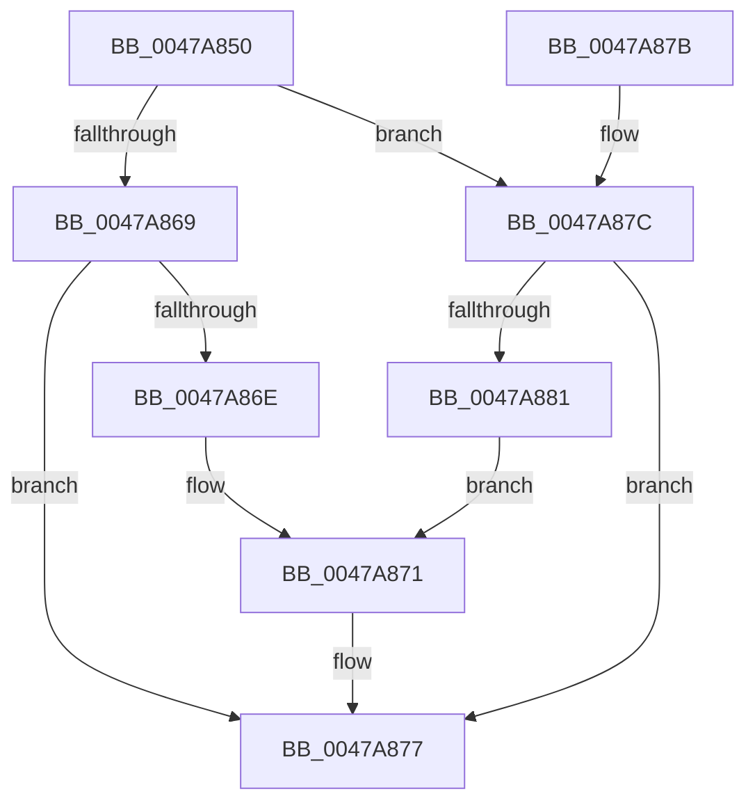

# IoSetFileOrigin

- RVA: `0x0047A850`–`0x0047A887` (길이 `55` bytes)
- VA: `0x000000014047A850`
- 실행 섹션: `.text`
- PDB 이름 있음: `예`; PDB Function 태그: `아니요`
- unwind 정보 RVA: `0x000DB714`
- 디코드: `19`개 명령, `55/55` bytes 표시
- 미해석 바이트: `0` (있으면 어셈블리에 `.byte`로 보존)

> 이 문서는 커널 이미지의 기계어와 PDB 기호를 분석해 생성했습니다. 4번과 5번은 함수 원형과 자료형을 바이너리 사용 방식에서 추정한 C 해석이며 원본 소스 복구 결과는 아닙니다.

## 1. Dependencies

- 직접 호출 지점: **0**; 고유 호출 대상: **0**
- 직접 호출자로 확인된 함수: **0**
- RIP 상대 이미지 참조: **0**

### Outgoing calls
- 직접 디코드된 call 명령이 없습니다.

### Direct callers
- 이 함수 시작 RVA로 연결되는 직접 call은 확인되지 않았습니다. 간접 호출은 완전히 역산할 수 없습니다.

### Static image references
- 디코드된 RIP-relative 메모리 참조가 없습니다.

## 2. Other-region calls and transfers

- 다른 실행 섹션으로 향하는 call: **0**
- 별도 외부 분기/꼬리 이동을 확인하지 못했습니다.

## 3. Assembly (complete function range)

```asm
0047A850  8B 41 50                        mov eax, dword ptr [rcx + 0x50]
0047A853  41 BA 00 00 00 01               mov r10d, 0x1000000
0047A859  44 8B C8                        mov r9d, eax
0047A85C  41 B8 30 00 00 C0               mov r8d, 0xc0000030
0047A862  45 23 CA                        and r9d, r10d
0047A865  84 D2                           test dl, dl
0047A867  74 13                           je 0x14047a87c
0047A869  45 85 C9                        test r9d, r9d
0047A86C  75 09                           jne 0x14047a877
0047A86E  41 0B C2                        or eax, r10d
0047A871  45 33 C0                        xor r8d, r8d
0047A874  89 41 50                        mov dword ptr [rcx + 0x50], eax
0047A877  41 8B C0                        mov eax, r8d
0047A87A  C3                              ret
0047A87B  CC                              int3
0047A87C  45 85 C9                        test r9d, r9d
0047A87F  74 F6                           je 0x14047a877
0047A881  0F BA F0 18                     btr eax, 0x18
0047A885  EB EA                           jmp 0x14047a871
```

## 4. C-style interpretation (structured pseudocode)

```c
__int64 __fastcall IoSetFileOrigin(__int64 a1, unsigned __int8 a2)
{
    __int64 result;

    a4 = (unsigned int)(((unsigned int)((unsigned int)((unsigned int)(*(unsigned int *)(a1 + 80))))) & ((unsigned int)((unsigned int)(0x1000000ULL))));
    if (a2 == 0) goto loc_0047A87C;
    if ((unsigned int)(a4) != 0) goto loc_0047A877;
    result = (unsigned int)(((unsigned int)(*(unsigned int *)(a1 + 80))) | ((unsigned int)((unsigned int)(0x1000000ULL))));
loc_0047A871:
    a3 = 0;
    *(unsigned int *)(a1 + 80) = (unsigned int)(result);
loc_0047A877:
    return 0;
loc_0047A87C:
    if ((unsigned int)(a4) == 0) goto loc_0047A877;
    goto loc_0047A871;
}
```

## 5. (Beta) C Style

```c
int64_t IoSetFileOrigin(void *Arg1, uint8_t Arg2)
{
    uint8_t *arg1 = (uint8_t *)Arg1;

    int64_t result;

    a4 = (uint32_t)(((uint32_t)((uint32_t)((uint32_t)(*(uint32_t *)(arg1 + 0x50))))) & ((uint32_t)((uint32_t)(0x1000000ULL))));
    if (Arg2 == 0) goto loc_0047A87C;
    if ((uint32_t)(a4) != 0) goto loc_0047A877;
    result = (uint32_t)(((uint32_t)(*(uint32_t *)(arg1 + 0x50))) | ((uint32_t)((uint32_t)(0x1000000ULL))));
loc_0047A871:
    a3 = 0;
    *(uint32_t *)(arg1 + 0x50) = (uint32_t)(result);
loc_0047A877:
    return 0;
loc_0047A87C:
    if ((uint32_t)(a4) == 0) goto loc_0047A877;
    goto loc_0047A871;
}
```

### 관측된 메모리 오프셋

구조체 형식이 확인되지 않은 접근은 인자 기준의 오프셋으로만 기록했습니다.

| 기준 인자 | 오프셋 표현 | 폭 (bit) | 접근 |
|---|---:|---:|---|
| `Arg1` | `+ 0x50` | `32` | `R` |
| `Arg1` | `+ 0x50` | `32` | `W` |

## 6. Execution-region graph

[열기: 2D/3D 그래프와 함수 탐색 컨트롤 패널](../../../control-panel.html?section=text&rva=0x0047A850&view=graph)

- 2D 그래프는 위에서 아래로 흐르고, 3D 그래프는 빈 공간을 드래그해 회전합니다. Shift+드래그는 이동, 휠은 확대·축소, 함수 노드 선택은 대상 보고서 이동입니다.

### Static fallback


