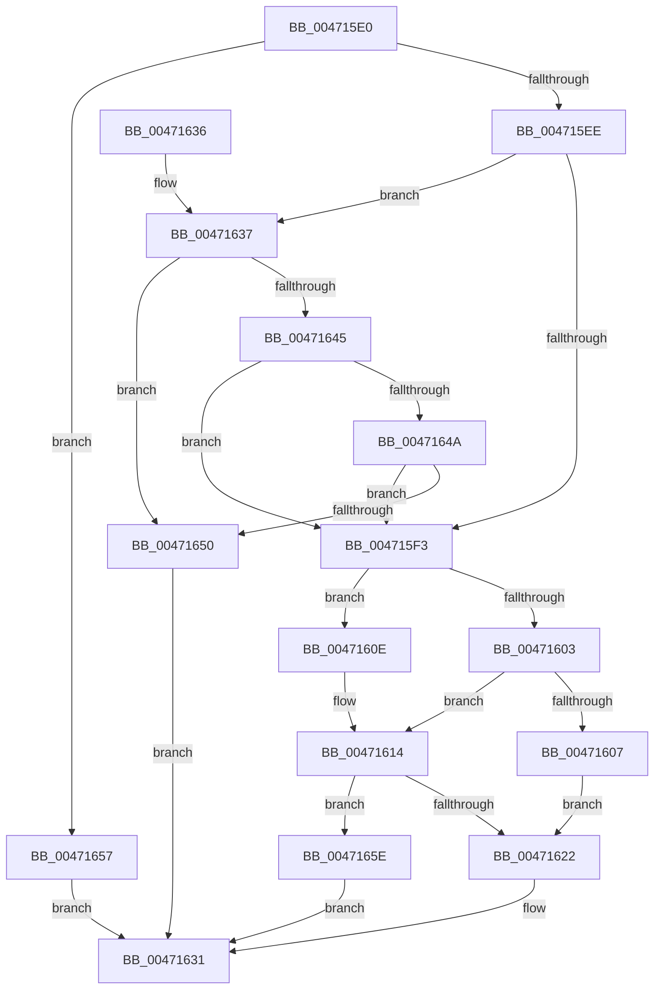

# IoSetGenericIrpExtension

- RVA: `0x004715E0`–`0x00471665` (길이 `133` bytes)
- VA: `0x00000001404715E0`
- 실행 섹션: `.text`
- PDB 이름 있음: `예`; PDB Function 태그: `아니요`
- unwind 정보 RVA: `0x0005C80C`
- 디코드: `41`개 명령, `133/133` bytes 표시
- 미해석 바이트: `0` (있으면 어셈블리에 `.byte`로 보존)

> 이 문서는 커널 이미지의 기계어와 PDB 기호를 분석해 생성했습니다. 4번과 5번은 함수 원형과 자료형을 바이너리 사용 방식에서 추정한 C 해석이며 원본 소스 복구 결과는 아닙니다.

## 1. Dependencies

- 직접 호출 지점: **1**; 고유 호출 대상: **1**
- 직접 호출자로 확인된 함수: **1**
- RIP 상대 이미지 참조: **0**

### Outgoing calls
- `0x0047162A` → [memcpy](../6C/memcpy_function_006C6840.md) (function, `0x006C6840`)

### Direct callers
- [StRtlIoStorInfoSetNvCachePriority](../6A/StRtlIoStorInfoSetNvCachePriority_function_006A5D50.md) at `0x006A5DB5`

### Static image references
- 디코드된 RIP-relative 메모리 참조가 없습니다.

## 2. Other-region calls and transfers

- 다른 실행 섹션으로 향하는 call: **0**
- 별도 외부 분기/꼬리 이동을 확인하지 못했습니다.

## 3. Assembly (complete function range)

```asm
004715E0  48 83 EC 28                     sub rsp, 0x28
004715E4  4C 8B D1                        mov r10, rcx
004715E7  66 41 83 F8 04                  cmp r8w, 4
004715EC  77 69                           ja 0x140471657
004715EE  45 84 C9                        test r9b, r9b
004715F1  74 44                           je 0x140471637
004715F3  48 8B 89 C8 00 00 00            mov rcx, qword ptr [rcx + 0xc8]
004715FA  41 8A 42 47                     mov al, byte ptr [r10 + 0x47]
004715FE  48 85 C9                        test rcx, rcx
00471601  74 0B                           je 0x14047160e
00471603  84 C0                           test al, al
00471605  78 0D                           js 0x140471614
00471607  66 83 49 02 04                  or word ptr [rcx + 2], 4
0047160C  EB 14                           jmp 0x140471622
0047160E  0C 80                           or al, 0x80
00471610  41 88 42 47                     mov byte ptr [r10 + 0x47], al
00471614  B8 C4 00 00 00                  mov eax, 0xc4
00471619  4A 8D 0C 10                     lea rcx, [rax + r10]
0047161D  48 85 C9                        test rcx, rcx
00471620  74 3C                           je 0x14047165e
00471622  45 0F B7 C0                     movzx r8d, r8w
00471626  48 83 C1 04                     add rcx, 4
0047162A  E8 11 52 25 00                  call 0x1406c6840
0047162F  33 C0                           xor eax, eax
00471631  48 83 C4 28                     add rsp, 0x28
00471635  C3                              ret
00471636  CC                              int3
00471637  48 8B 81 C8 00 00 00            mov rax, qword ptr [rcx + 0xc8]
0047163E  90                              nop
0047163F  80 79 47 00                     cmp byte ptr [rcx + 0x47], 0
00471643  7C 0B                           jl 0x140471650
00471645  48 85 C0                        test rax, rax
00471648  74 A9                           je 0x1404715f3
0047164A  F6 40 02 04                     test byte ptr [rax + 2], 4
0047164E  74 A3                           je 0x1404715f3
00471650  B8 21 00 00 C0                  mov eax, 0xc0000021
00471655  EB DA                           jmp 0x140471631
00471657  B8 0D 00 00 C0                  mov eax, 0xc000000d
0047165C  EB D3                           jmp 0x140471631
0047165E  B8 9A 00 00 C0                  mov eax, 0xc000009a
00471663  EB CC                           jmp 0x140471631
```

## 4. C-style interpretation (structured pseudocode)

```c
__int64 __fastcall IoSetGenericIrpExtension(__int64 a1, __int64 a2, unsigned __int16 a3, unsigned __int8 a4)
{
    __int64 result;
    __int64 v_rsp;

    v_rsp = (v_rsp) - (40);
    if (a3 > 4) goto loc_00471657;
    if (a4 == 0) goto loc_00471637;
loc_004715F3:
    if (*(unsigned __int64 *)(a1 + 200) == 0) goto loc_0047160E;
    if (sign_flag) goto loc_00471614;
    goto loc_00471622;
loc_0047160E:
    result = (unsigned __int8)((*(unsigned __int8 *)(a1 + 71)) | (128));
    *(unsigned __int8 *)(a1 + 71) = (unsigned __int8)(result);
loc_00471614:
    if (196 + a1 * 1 == 0) goto loc_0047165E;
loc_00471622:
    a1 = (196 + a1 * 1) + (4);
    result = memcpy(a1, a2, a3, a4);
    result = 0;
loc_00471631:
    v_rsp = (v_rsp) + (40);
    return result;
loc_00471637:
    if ((*(unsigned __int8 *)(a1 + 71)) < 0) goto loc_00471650;
    if (*(unsigned __int64 *)(a1 + 200) == 0) goto loc_004715F3;
    if (((*(unsigned __int8 *)(*(unsigned __int64 *)(a1 + 200) + 2)) & (4)) == 0) goto loc_004715F3;
loc_00471650:
    goto loc_00471631;
loc_00471657:
    goto loc_00471631;
loc_0047165E:
    goto loc_00471631;
}
```

## 5. (Beta) C Style

```c
int64_t IoSetGenericIrpExtension(void *Arg1, int64_t Arg2, uint16_t Arg3, uint8_t Arg4)
{
    uint8_t *arg1 = (uint8_t *)Arg1;

    int64_t result;
    int64_t local_rsp;

    local_rsp = (local_rsp) - (40);
    if (Arg3 > 4) goto loc_00471657;
    if (Arg4 == 0) goto loc_00471637;
loc_004715F3:
    if (*(uint64_t *)(arg1 + 0xC8) == 0) goto loc_0047160E;
    if (sign_flag) goto loc_00471614;
    goto loc_00471622;
loc_0047160E:
    result = (uint8_t)((*(uint8_t *)(arg1 + 0x47)) | (128));
    *(uint8_t *)(arg1 + 0x47) = (uint8_t)(result);
loc_00471614:
    if (196 + Arg1 * 1 == 0) goto loc_0047165E;
loc_00471622:
    Arg1 = (196 + Arg1 * 1) + (4);
    result = memcpy(Arg1, Arg2, Arg3, Arg4);
    result = 0;
loc_00471631:
    local_rsp = (local_rsp) + (40);
    return result;
loc_00471637:
    if ((*(uint8_t *)(arg1 + 0x47)) < 0) goto loc_00471650;
    if (*(uint64_t *)(arg1 + 0xC8) == 0) goto loc_004715F3;
    if (((*(uint8_t *)(*(uint64_t *)(arg1 + 0xC8) + 0x2)) & (4)) == 0) goto loc_004715F3;
loc_00471650:
    goto loc_00471631;
loc_00471657:
    goto loc_00471631;
loc_0047165E:
    goto loc_00471631;
}
```

### 관측된 메모리 오프셋

구조체 형식이 확인되지 않은 접근은 인자 기준의 오프셋으로만 기록했습니다.

| 기준 인자 | 오프셋 표현 | 폭 (bit) | 접근 |
|---|---:|---:|---|
| `Arg1` | `+ 0x47` | `8` | `R` |
| `Arg1` | `+ 0x47` | `8` | `W` |
| `Arg1` | `+ 0xC8` | `64` | `R` |

## 6. Execution-region graph

[열기: 2D/3D 그래프와 함수 탐색 컨트롤 패널](../../../control-panel.html?section=text&rva=0x004715E0&view=graph)

- 2D 그래프는 위에서 아래로 흐르고, 3D 그래프는 빈 공간을 드래그해 회전합니다. Shift+드래그는 이동, 휠은 확대·축소, 함수 노드 선택은 대상 보고서 이동입니다.

### Static fallback


