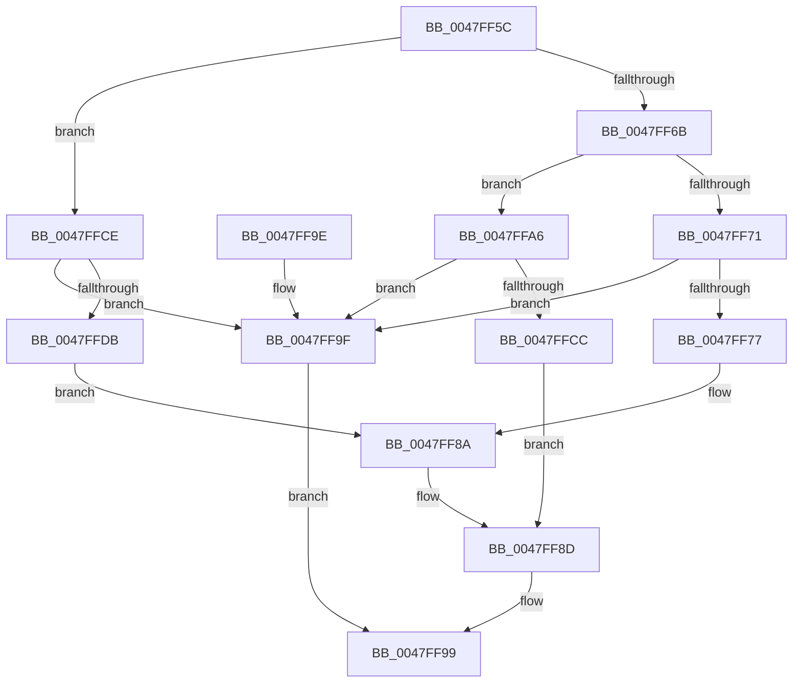

# IommupProcessPhysicalAddress

- RVA: `0x0047FF5C`–`0x0047FFF7` (길이 `155` bytes)
- VA: `0x000000014047FF5C`
- 실행 섹션: `.text`
- PDB 이름 있음: `예`; PDB Function 태그: `아니요`
- unwind 정보 RVA: `0x000AE384`
- 디코드: `48`개 명령, `155/155` bytes 표시
- 미해석 바이트: `0` (있으면 어셈블리에 `.byte`로 보존)

> 이 문서는 커널 이미지의 기계어와 PDB 기호를 분석해 생성했습니다. 4번과 5번은 함수 원형과 자료형을 바이너리 사용 방식에서 추정한 C 해석이며 원본 소스 복구 결과는 아닙니다.

## 1. Dependencies

- 직접 호출 지점: **1**; 고유 호출 대상: **1**
- 직접 호출자로 확인된 함수: **1**
- RIP 상대 이미지 참조: **0**

### Outgoing calls
- `0x0047FFD2` → [IommupValidateMdl](../56/IommupValidateMdl_function_005689D0.md) (function, `0x005689D0`)

### Direct callers
- [IommuMapReservedLogicalRange](../56/IommuMapReservedLogicalRange_function_005680F0.md) at `0x0056815D`

### Static image references
- 디코드된 RIP-relative 메모리 참조가 없습니다.

## 2. Other-region calls and transfers

- 다른 실행 섹션으로 향하는 call: **0**
- 별도 외부 분기/꼬리 이동을 확인하지 못했습니다.

## 3. Assembly (complete function range)

```asm
0047FF5C  48 83 EC 28                     sub rsp, 0x28
0047FF60  44 8B 11                        mov r10d, dword ptr [rcx]
0047FF63  4C 8B DA                        mov r11, rdx
0047FF66  45 85 D2                        test r10d, r10d
0047FF69  74 63                           je 0x14047ffce
0047FF6B  41 83 EA 01                     sub r10d, 1
0047FF6F  74 35                           je 0x14047ffa6
0047FF71  41 83 FA 01                     cmp r10d, 1
0047FF75  75 28                           jne 0x14047ff9f
0047FF77  48 8B 41 08                     mov rax, qword ptr [rcx + 8]
0047FF7B  41 C6 00 00                     mov byte ptr [r8], 0
0047FF7F  4C 8B 41 10                     mov r8, qword ptr [rcx + 0x10]
0047FF83  49 C1 E0 0C                     shl r8, 0xc
0047FF87  4C 89 02                        mov qword ptr [rdx], r8
0047FF8A  49 89 01                        mov qword ptr [r9], rax
0047FF8D  49 F7 D8                        neg r8
0047FF90  1B C0                           sbb eax, eax
0047FF92  F7 D0                           not eax
0047FF94  25 0D 00 00 C0                  and eax, 0xc000000d
0047FF99  48 83 C4 28                     add rsp, 0x28
0047FF9D  C3                              ret
0047FF9E  CC                              int3
0047FF9F  B8 0D 00 00 C0                  mov eax, 0xc000000d
0047FFA4  EB F3                           jmp 0x14047ff99
0047FFA6  48 8B 41 08                     mov rax, qword ptr [rcx + 8]
0047FFAA  41 C6 00 01                     mov byte ptr [r8], 1
0047FFAE  4C 8B 41 10                     mov r8, qword ptr [rcx + 0x10]
0047FFB2  48 8B 4C 24 50                  mov rcx, qword ptr [rsp + 0x50]
0047FFB7  4C 89 02                        mov qword ptr [rdx], r8
0047FFBA  48 89 01                        mov qword ptr [rcx], rax
0047FFBD  48 99                           cqo
0047FFBF  B9 00 10 00 00                  mov ecx, 0x1000
0047FFC4  48 F7 F9                        idiv rcx
0047FFC7  48 85 D2                        test rdx, rdx
0047FFCA  75 D3                           jne 0x14047ff9f
0047FFCC  EB BF                           jmp 0x14047ff8d
0047FFCE  48 8B 49 08                     mov rcx, qword ptr [rcx + 8]
0047FFD2  E8 F9 89 0E 00                  call 0x1405689d0
0047FFD7  84 C0                           test al, al
0047FFD9  74 C4                           je 0x14047ff9f
0047FFDB  8B 41 2C                        mov eax, dword ptr [rcx + 0x2c]
0047FFDE  48 C1 E8 0C                     shr rax, 0xc
0047FFE2  48 83 C0 06                     add rax, 6
0047FFE6  41 C6 00 00                     mov byte ptr [r8], 0
0047FFEA  44 8B 41 28                     mov r8d, dword ptr [rcx + 0x28]
0047FFEE  4D 89 03                        mov qword ptr [r11], r8
0047FFF1  48 8D 04 C1                     lea rax, [rcx + rax*8]
0047FFF5  EB 93                           jmp 0x14047ff8a
```

## 4. C-style interpretation (structured pseudocode)

```c
__int64 __fastcall IommupProcessPhysicalAddress(__int64 a1, __int64 a2, __int64 a3, __int64 a4, __int64 a5)
{
    __int64 result;
    __int64 v_r10;
    __int64 v_rsp;

    v_rsp = (v_rsp) - (40);
    if ((unsigned int)((unsigned int)(*(unsigned int *)(a1))) == 0) goto loc_0047FFCE;
    v_r10 = (unsigned int)(((unsigned int)(*(unsigned int *)(a1))) - (1));
    if (condition_is_equal) goto loc_0047FFA6;
    if (((unsigned int)(v_r10)) != 1) goto loc_0047FF9F;
    *(unsigned __int8 *)(a3) = 0;
    a3 = (*(unsigned __int64 *)(a1 + 16)) << (12);
    *(unsigned __int64 *)(a2) = a3;
loc_0047FF8A:
    *(unsigned __int64 *)(a4) = *(unsigned __int64 *)(a1 + 8);
loc_0047FF8D:
    a3 = -(a3);
    result = (unsigned int)(~(*(unsigned __int64 *)(a1 + 8)));
    result = (unsigned int)((result) & (0xC000000DULL));
loc_0047FF99:
    v_rsp = (v_rsp) + (40);
    return result;
loc_0047FF9F:
    goto loc_0047FF99;
loc_0047FFA6:
    *(unsigned __int8 *)(a3) = 1;
    *(unsigned __int64 *)(a2) = *(unsigned __int64 *)(a1 + 16);
    *(unsigned __int64 *)(a5) = *(unsigned __int64 *)(a1 + 8);
    if (a2 != 0) goto loc_0047FF9F;
    goto loc_0047FF8D;
loc_0047FFCE:
    result = IommupValidateMdl(*(unsigned __int64 *)((unsigned int)(0x1000ULL) + 8), a2, *(unsigned __int64 *)(a1 + 16), a4);
    if ((unsigned __int8)(result) == 0) goto loc_0047FF9F;
    result = ((unsigned int)(*(unsigned int *)(*(unsigned __int64 *)((unsigned int)(0x1000ULL) + 8) + 44))) >> (12);
    result = (result) + (6);
    *(unsigned __int8 *)(*(unsigned __int64 *)(a1 + 16)) = 0;
    *(unsigned __int64 *)(a2) = (unsigned int)(*(unsigned int *)(*(unsigned __int64 *)((unsigned int)(0x1000ULL) + 8) + 40));
    goto loc_0047FF8A;
}
```

## 5. (Beta) C Style

```c
int64_t IommupProcessPhysicalAddress(void *Arg1, void *Arg2, void *Arg3, int64_t Arg4, void *Arg5)
{
    uint8_t *arg1 = (uint8_t *)Arg1;
    uint8_t *arg2 = (uint8_t *)Arg2;
    uint8_t *arg3 = (uint8_t *)Arg3;
    uint8_t *arg5 = (uint8_t *)Arg5;

    int64_t result;
    int64_t local_r10;
    int64_t local_rsp;

    local_rsp = (local_rsp) - (40);
    if ((uint32_t)((uint32_t)(*(uint32_t *)(arg1))) == 0) goto loc_0047FFCE;
    local_r10 = (uint32_t)(((uint32_t)(*(uint32_t *)(arg1))) - (1));
    if (condition_is_equal) goto loc_0047FFA6;
    if (((uint32_t)(local_r10)) != 1) goto loc_0047FF9F;
    *(uint8_t *)(arg3) = 0;
    Arg3 = (*(uint64_t *)(arg1 + 0x10)) << (12);
    *(void **)(arg2) = Arg3;
loc_0047FF8A:
    *(uint64_t *)(Arg4) = *(uint64_t *)(arg1 + 0x8);
loc_0047FF8D:
    Arg3 = -(Arg3);
    result = (uint32_t)(~(*(uint64_t *)(arg1 + 0x8)));
    result = (uint32_t)((result) & (0xC000000DULL));
loc_0047FF99:
    local_rsp = (local_rsp) + (40);
    return result;
loc_0047FF9F:
    goto loc_0047FF99;
loc_0047FFA6:
    *(uint8_t *)(arg3) = 1;
    *(uint64_t *)(arg2) = *(uint64_t *)(arg1 + 0x10);
    *(uint64_t *)(arg5) = *(uint64_t *)(arg1 + 0x8);
    if (Arg2 != NULL) goto loc_0047FF9F;
    goto loc_0047FF8D;
loc_0047FFCE:
    result = IommupValidateMdl(*(uint64_t *)((uint32_t)(0x1000ULL) + 0x8), Arg2, *(uint64_t *)(arg1 + 0x10), Arg4);
    if ((uint8_t)(result) == 0) goto loc_0047FF9F;
    result = ((uint32_t)(*(uint32_t *)(*(uint64_t *)((uint32_t)(0x1000ULL) + 0x8) + 0x2C))) >> (12);
    result = (result) + (6);
    *(uint8_t *)(*(uint64_t *)(arg1 + 0x10)) = 0;
    *(uint64_t *)(arg2) = (uint32_t)(*(uint32_t *)(*(uint64_t *)((uint32_t)(0x1000ULL) + 0x8) + 0x28));
    goto loc_0047FF8A;
}
```

### 관측된 메모리 오프셋

구조체 형식이 확인되지 않은 접근은 인자 기준의 오프셋으로만 기록했습니다.

| 기준 인자 | 오프셋 표현 | 폭 (bit) | 접근 |
|---|---:|---:|---|
| `Arg1` | `+ 0x0` | `32` | `R` |
| `Arg1` | `+ 0x8` | `64` | `R` |
| `Arg1` | `+ 0x10` | `64` | `R` |
| `Arg2` | `+ 0x0` | `64` | `W` |
| `Arg3` | `+ 0x0` | `8` | `W` |
| `Arg5` | `+ 0x0` | `64` | `W` |

## 6. Execution-region graph

[열기: 2D/3D 그래프와 함수 탐색 컨트롤 패널](../../../control-panel.html?section=text&rva=0x0047FF5C&view=graph)

- 2D 그래프는 위에서 아래로 흐르고, 3D 그래프는 빈 공간을 드래그해 회전합니다. Shift+드래그는 이동, 휠은 확대·축소, 함수 노드 선택은 대상 보고서 이동입니다.

### Static fallback


