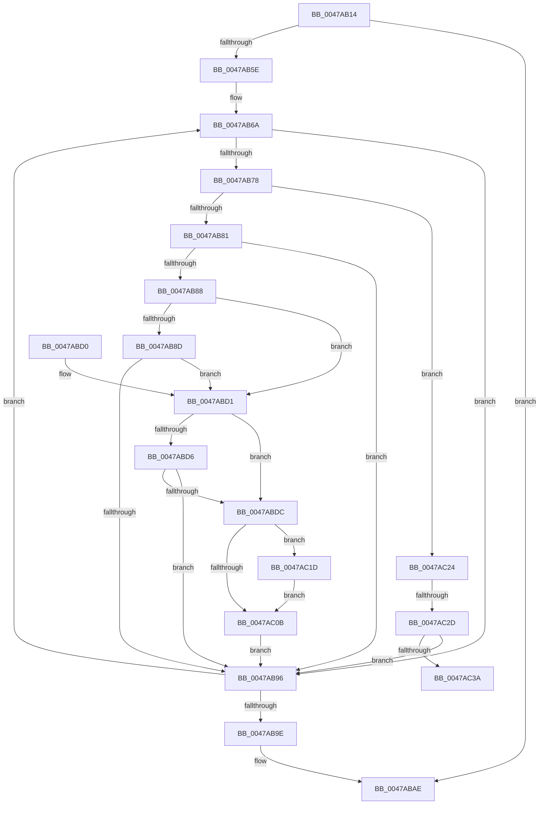

# IopCancelIrpsInCurrentThreadList

- RVA: `0x0047AB14`–`0x0047AC3F` (길이 `299` bytes)
- VA: `0x000000014047AB14`
- 실행 섹션: `.text`
- PDB 이름 있음: `예`; PDB Function 태그: `예`
- unwind 정보 RVA: `0x000AD378`
- 디코드: `85`개 명령, `299/299` bytes 표시
- 미해석 바이트: `0` (있으면 어셈블리에 `.byte`로 보존)

> 이 문서는 커널 이미지의 기계어와 PDB 기호를 분석해 생성했습니다. 4번과 5번은 함수 원형과 자료형을 바이너리 사용 방식에서 추정한 C 해석이며 원본 소스 복구 결과는 아닙니다.

## 1. Dependencies

- 직접 호출 지점: **6**; 고유 호출 대상: **5**
- 직접 호출자로 확인된 함수: **2**
- RIP 상대 이미지 참조: **1**

### Outgoing calls
- `0x0047AB4C` → [KeAcquireSpinLockRaiseToDpc](../20/KeAcquireSpinLockRaiseToDpc_function_00208470.md) (function, `0x00208470`)
- `0x0047ABB3` → [KeReleaseSpinLock](../39/KeReleaseSpinLock_function_00392BA0.md) (function, `0x00392BA0`)
- `0x0047ABE8` → [KeReleaseSpinLock](../39/KeReleaseSpinLock_function_00392BA0.md) (function, `0x00392BA0`)
- `0x0047ABF1` → [IoCancelIrp](../27/IoCancelIrp_function_002720E0.md) (function, `0x002720E0`)
- `0x0047AC0E` → [KeAcquireSpinLockAtDpcLevel](../20/KeAcquireSpinLockAtDpcLevel_function_00208430.md) (function, `0x00208430`)
- `0x0047AC1D` → [KiRaiseIrqlProcessIrqlFlags](../4F/KiRaiseIrqlProcessIrqlFlags_function_004F56FC.md) (function, `0x004F56FC`)

### Direct callers
- [IopCancelIrpsInThreadList](../../page/8C/IopCancelIrpsInThreadList_function_008C9E18.md) at `0x008C9E4F`
- [IopCancelIrpsInCurrentThreadListApcRoutine](../../page/A8/IopCancelIrpsInCurrentThreadListApcRoutine_function_00A88700.md) at `0x00A88721`

### Static image references
- `0x0047AC02` → RVA `0x00FC6D20` (`ALMOSTRO`; read)

## 2. Other-region calls and transfers

- 다른 실행 섹션으로 향하는 call: **0**
- call이 아닌 외부 분기/꼬리 이동: **2**
  - `0x0047AC27` → [sub_006F496E](../6F/Unknown_function_006F496E.md) (`tail-transfer`)
  - `0x0047AC3A` → [sub_006F496E](../6F/Unknown_function_006F496E.md) (`tail-transfer`)

## 3. Assembly (complete function range)

```asm
0047AB14  48 89 5C 24 08                  mov qword ptr [rsp + 8], rbx
0047AB19  44 88 4C 24 20                  mov byte ptr [rsp + 0x20], r9b
0047AB1E  48 89 54 24 10                  mov qword ptr [rsp + 0x10], rdx
0047AB23  55                              push rbp
0047AB24  56                              push rsi
0047AB25  57                              push rdi
0047AB26  41 54                           push r12
0047AB28  41 55                           push r13
0047AB2A  41 56                           push r14
0047AB2C  41 57                           push r15
0047AB2E  48 83 EC 30                     sub rsp, 0x30
0047AB32  48 8D BA 18 06 00 00            lea rdi, [rdx + 0x618]
0047AB39  4C 8B F1                        mov r14, rcx
0047AB3C  48 8B CF                        mov rcx, rdi
0047AB3F  4C 8D A2 40 05 00 00            lea r12, [rdx + 0x540]
0047AB46  49 8B E8                        mov rbp, r8
0047AB49  45 33 FF                        xor r15d, r15d
0047AB4C  E8 1F D9 D8 FF                  call 0x140208470
0047AB51  49 8B 34 24                     mov rsi, qword ptr [r12]
0047AB55  88 44 24 20                     mov byte ptr [rsp + 0x20], al
0047AB59  4C 3B E6                        cmp r12, rsi
0047AB5C  74 50                           je 0x14047abae
0047AB5E  44 8A AC 24 88 00 00 00         mov r13b, byte ptr [rsp + 0x88]
0047AB66  41 8D 57 02                     lea edx, [r15 + 2]
0047AB6A  0F BE 4E 22                     movsx ecx, byte ptr [rsi + 0x22]
0047AB6E  0F BE 46 23                     movsx eax, byte ptr [rsi + 0x23]
0047AB72  03 CA                           add ecx, edx
0047AB74  3B C1                           cmp eax, ecx
0047AB76  7D 1E                           jge 0x14047ab96
0047AB78  45 84 ED                        test r13b, r13b
0047AB7B  0F 85 A3 00 00 00               jne 0x14047ac24
0047AB81  8B 46 F0                        mov eax, dword ptr [rsi - 0x10]
0047AB84  84 C2                           test dl, al
0047AB86  75 0E                           jne 0x14047ab96
0047AB88  4D 85 F6                        test r14, r14
0047AB8B  74 44                           je 0x14047abd1
0047AB8D  4C 39 B6 A0 00 00 00            cmp qword ptr [rsi + 0xa0], r14
0047AB94  74 3B                           je 0x14047abd1
0047AB96  48 8B 36                        mov rsi, qword ptr [rsi]
0047AB99  4C 3B E6                        cmp r12, rsi
0047AB9C  75 CC                           jne 0x14047ab6a
0047AB9E  48 8B 7C 24 78                  mov rdi, qword ptr [rsp + 0x78]
0047ABA3  8A 44 24 20                     mov al, byte ptr [rsp + 0x20]
0047ABA7  48 81 C7 18 06 00 00            add rdi, 0x618
0047ABAE  8A D0                           mov dl, al
0047ABB0  48 8B CF                        mov rcx, rdi
0047ABB3  E8 E8 7F F1 FF                  call 0x140392ba0
0047ABB8  48 8B 5C 24 70                  mov rbx, qword ptr [rsp + 0x70]
0047ABBD  41 8B C7                        mov eax, r15d
0047ABC0  48 83 C4 30                     add rsp, 0x30
0047ABC4  41 5F                           pop r15
0047ABC6  41 5E                           pop r14
0047ABC8  41 5D                           pop r13
0047ABCA  41 5C                           pop r12
0047ABCC  5F                              pop rdi
0047ABCD  5E                              pop rsi
0047ABCE  5D                              pop rbp
0047ABCF  C3                              ret
0047ABD0  CC                              int3
0047ABD1  48 85 ED                        test rbp, rbp
0047ABD4  74 06                           je 0x14047abdc
0047ABD6  48 39 6E 28                     cmp qword ptr [rsi + 0x28], rbp
0047ABDA  75 BA                           jne 0x14047ab96
0047ABDC  41 BF 01 00 00 00               mov r15d, 1
0047ABE2  48 8B CF                        mov rcx, rdi
0047ABE5  41 8A D7                        mov dl, r15b
0047ABE8  E8 B3 7F F1 FF                  call 0x140392ba0
0047ABED  48 8D 4E E0                     lea rcx, [rsi - 0x20]
0047ABF1  E8 EA 74 DF FF                  call 0x1402720e0
0047ABF6  44 0F 20 C1                     mov rcx, cr8
0047ABFA  41 8D 57 01                     lea edx, [r15 + 1]
0047ABFE  44 0F 22 C2                     mov cr8, rdx
0047AC02  83 3D 17 C1 B4 00 00            cmp dword ptr [rip + 0xb4c117], 0
0047AC09  75 12                           jne 0x14047ac1d
0047AC0B  48 8B CF                        mov rcx, rdi
0047AC0E  E8 1D D8 D8 FF                  call 0x140208430
0047AC13  BA 02 00 00 00                  mov edx, 2
0047AC18  E9 79 FF FF FF                  jmp 0x14047ab96
0047AC1D  E8 DA AA 07 00                  call 0x1404f56fc
0047AC22  EB E7                           jmp 0x14047ac0b
0047AC24  4D 85 F6                        test r14, r14
0047AC27  0F 84 41 9D 27 00               je 0x1406f496e
0047AC2D  4C 39 B6 A0 00 00 00            cmp qword ptr [rsi + 0xa0], r14
0047AC34  0F 85 5C FF FF FF               jne 0x14047ab96
0047AC3A  E9 2F 9D 27 00                  jmp 0x1406f496e
```

## 4. C-style interpretation (structured pseudocode)

```c
__int64 __fastcall IopCancelIrpsInCurrentThreadList(__int64 a1, __int64 a2, __int64 a3, unsigned __int8 a4)
{
    __int64 result;
    __int64 v_r15;
    __int64 v_rdi;
    __int64 v_rsp;
    unsigned __int8 v_stack_m48;
    unsigned __int64 v_stack_p10;
    unsigned __int8 v_stack_p20;
    unsigned __int64 v_stack_p8;

    v_stack_p8 = v_rbx;
    v_stack_p20 = a4;
    v_stack_p10 = a2;
    v_rsp = (v_rsp) - (48);
    v_r15 = 0;
    result = KeAcquireSpinLockRaiseToDpc(a2 + 1560, a2, a3, a4);
    v_stack_m48 = (unsigned __int8)(result);
    if ((a2 + 1344) == (*(unsigned __int64 *)(a2 + 1344))) goto loc_0047ABAE;
loc_0047AB6A:
    a1 = (unsigned int)(((__int8)(*(unsigned __int8 *)(*(unsigned __int64 *)(a2 + 1344) + 34))) + ((unsigned int)(v_r15 + 2)));
    if (((unsigned int)((__int8)(*(unsigned __int8 *)(*(unsigned __int64 *)(a2 + 1344) + 35)))) >= ((unsigned int)(a1))) goto loc_0047AB96;
    if ((unsigned __int8)(v_stack_p20) != 0) goto loc_0047AC24;
    if ((((unsigned __int8)(v_r15 + 2)) & ((unsigned __int8)((unsigned int)(*(unsigned int *)(*(unsigned __int64 *)(a2 + 1344) - 16))))) != 0) goto loc_0047AB96;
    if (a1 == 0) goto loc_0047ABD1;
    if ((*(unsigned __int64 *)(*(unsigned __int64 *)(a2 + 1344) + 160)) == a1) goto loc_0047ABD1;
loc_0047AB96:
    if ((a2 + 1344) != (*(unsigned __int64 *)(*(unsigned __int64 *)(a2 + 1344)))) goto loc_0047AB6A;
    v_rdi = (v_stack_p10) + (0x618ULL);
loc_0047ABAE:
    result = KeReleaseSpinLock(v_rdi, (unsigned __int8)(v_stack_m48), a3, a4);
    v_rsp = (v_rsp) + (48);
    return 0;
loc_0047ABD1:
    if (a3 == 0) goto loc_0047ABDC;
    if ((*(unsigned __int64 *)(*(unsigned __int64 *)(*(unsigned __int64 *)(a2 + 1344)) + 40)) != a3) goto loc_0047AB96;
loc_0047ABDC:
    result = KeReleaseSpinLock(v_rdi, 1, a3, a4);
    result = IoCancelIrp(*(unsigned __int64 *)(*(unsigned __int64 *)(a2 + 1344)) - 32, 1, a3, a4);
    if ((*(unsigned int *)(v_rip + 11845911)) != 0) goto loc_0047AC1D;
loc_0047AC0B:
    result = KeAcquireSpinLockAtDpcLevel(v_rdi, 1 + 1, a3, a4);
    goto loc_0047AB96;
loc_0047AC1D:
    result = KiRaiseIrqlProcessIrqlFlags(v_rdi, 2, a3, a4);
    goto loc_0047AC0B;
loc_0047AC24:
    if ((*(unsigned __int64 *)(*(unsigned __int64 *)(*(unsigned __int64 *)(a2 + 1344)) + 160)) != a1) goto loc_0047AB96;
}
```

## 5. (Beta) C Style

```c
int64_t IopCancelIrpsInCurrentThreadList(int64_t Arg1, void *Arg2, int64_t Arg3, uint8_t Arg4)
{
    uint8_t *arg2 = (uint8_t *)Arg2;

    int64_t result;
    int64_t local_r15;
    int64_t local_rdi;
    int64_t local_rsp;
    uint8_t v_stack_m48;
    uint64_t v_stack_p10;
    uint8_t v_stack_p20;
    uint64_t v_stack_p8;

    v_stack_p8 = local_rbx;
    v_stack_p20 = Arg4;
    v_stack_p10 = Arg2;
    local_rsp = (local_rsp) - (48);
    local_r15 = 0;
    result = KeAcquireSpinLockRaiseToDpc(Arg2 + 1560, Arg2, Arg3, Arg4);
    v_stack_m48 = (uint8_t)(result);
    if ((Arg2 + 1344) == (*(uint64_t *)(arg2 + 0x540))) goto loc_0047ABAE;
loc_0047AB6A:
    Arg1 = (uint32_t)(((int8_t)(*(uint8_t *)(*(uint64_t *)(arg2 + 0x540) + 0x22))) + ((uint32_t)(local_r15 + 2)));
    if (((uint32_t)((int8_t)(*(uint8_t *)(*(uint64_t *)(arg2 + 0x540) + 0x23)))) >= ((uint32_t)(Arg1))) goto loc_0047AB96;
    if ((uint8_t)(v_stack_p20) != 0) goto loc_0047AC24;
    if ((((uint8_t)(local_r15 + 2)) & ((uint8_t)((uint32_t)(*(uint32_t *)(*(uint64_t *)(arg2 + 0x540) - 0x10))))) != 0) goto loc_0047AB96;
    if (Arg1 == 0) goto loc_0047ABD1;
    if ((*(uint64_t *)(*(uint64_t *)(arg2 + 0x540) + 0xA0)) == Arg1) goto loc_0047ABD1;
loc_0047AB96:
    if ((Arg2 + 1344) != (*(uint64_t *)(*(uint64_t *)(arg2 + 0x540)))) goto loc_0047AB6A;
    local_rdi = (v_stack_p10) + (0x618ULL);
loc_0047ABAE:
    result = KeReleaseSpinLock(local_rdi, (uint8_t)(v_stack_m48), Arg3, Arg4);
    local_rsp = (local_rsp) + (48);
    return 0;
loc_0047ABD1:
    if (Arg3 == 0) goto loc_0047ABDC;
    if ((*(uint64_t *)(*(uint64_t *)(*(uint64_t *)(arg2 + 0x540)) + 0x28)) != Arg3) goto loc_0047AB96;
loc_0047ABDC:
    result = KeReleaseSpinLock(local_rdi, 1, Arg3, Arg4);
    result = IoCancelIrp(*(uint64_t *)(*(uint64_t *)(arg2 + 0x540)) - 32, 1, Arg3, Arg4);
    if ((*(uint32_t *)(v_rip + 0xB4C117)) != 0) goto loc_0047AC1D;
loc_0047AC0B:
    result = KeAcquireSpinLockAtDpcLevel(local_rdi, 1 + 1, Arg3, Arg4);
    goto loc_0047AB96;
loc_0047AC1D:
    result = KiRaiseIrqlProcessIrqlFlags(local_rdi, 2, Arg3, Arg4);
    goto loc_0047AC0B;
loc_0047AC24:
    if ((*(uint64_t *)(*(uint64_t *)(*(uint64_t *)(arg2 + 0x540)) + 0xA0)) != Arg1) goto loc_0047AB96;
}
```

### 관측된 메모리 오프셋

구조체 형식이 확인되지 않은 접근은 인자 기준의 오프셋으로만 기록했습니다.

| 기준 인자 | 오프셋 표현 | 폭 (bit) | 접근 |
|---|---:|---:|---|
| `Arg2` | `+ 0x0` | `64` | `R` |
| `Arg2` | `+ 0x540` | `64` | `R` |
| `Arg2` | `+ 0x618` | `64` | `R` |

## 6. Execution-region graph

[열기: 2D/3D 그래프와 함수 탐색 컨트롤 패널](../../../control-panel.html?section=text&rva=0x0047AB14&view=graph)

- 2D 그래프는 위에서 아래로 흐르고, 3D 그래프는 빈 공간을 드래그해 회전합니다. Shift+드래그는 이동, 휠은 확대·축소, 함수 노드 선택은 대상 보고서 이동입니다.

### Static fallback


