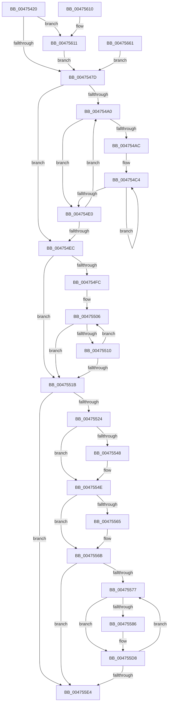

# IopIrpStackProfilerDpcRoutine

- RVA: `0x00475420`–`0x00475666` (길이 `582` bytes)
- VA: `0x0000000140475420`
- 실행 섹션: `.text`
- PDB 이름 있음: `예`; PDB Function 태그: `아니요`
- unwind 정보 RVA: `0x000ACB3C`
- 디코드: `139`개 명령, `582/582` bytes 표시
- 미해석 바이트: `0` (있으면 어셈블리에 `.byte`로 보존)

> 이 문서는 커널 이미지의 기계어와 PDB 기호를 분석해 생성했습니다. 4번과 5번은 함수 원형과 자료형을 바이너리 사용 방식에서 추정한 C 해석이며 원본 소스 복구 결과는 아닙니다.

## 1. Dependencies

- 직접 호출 지점: **7**; 고유 호출 대상: **5**
- 직접 호출자로 확인된 함수: **0**
- RIP 상대 이미지 참조: **7**

### Outgoing calls
- `0x00475464` → [memset](../6C/memset_function_006C6C40.md) (function, `0x006C6C40`)
- `0x0047548D` → [memset](../6C/memset_function_006C6C40.md) (function, `0x006C6C40`)
- `0x004754A2` → [KeGetPrcb](../2D/KeGetPrcb_function_002D85D0.md) (function, `0x002D85D0`)
- `0x0047552C` → [IopProcessIrpStackProfiler](IopProcessIrpStackProfiler_function_0047566C.md) (function, `0x0047566C`)
- `0x00475579` → [KeGetPrcb](../2D/KeGetPrcb_function_002D85D0.md) (function, `0x002D85D0`)
- `0x004755F7` → [_security_check_cookie](../6A/_security_check_cookie_function_006AC640.md) (function, `0x006AC640`)
- `0x00475655` → [KiCustomAccessRoutine2](../6B/KiCustomAccessRoutine2_function_006BC100.md) (function, `0x006BC100`)

### Direct callers
- 이 함수 시작 RVA로 연결되는 직접 call은 확인되지 않았습니다. 간접 호출은 완전히 역산할 수 없습니다.

### Static image references
- `0x00475430` → RVA `0x00E0A740` (`.data`; read)
- `0x00475496` → RVA `0x00FC6A80` (`ALMOSTRO`; read)
- `0x004754F1` → RVA `0x00F8D560` (`.data`; read)
- `0x00475500` → RVA `0x00F8D564` (`.data`; read)
- `0x00475539` → RVA `0x00F8D564` (`.data`; write)
- `0x00475556` → RVA `0x00F8D560` (`.data`; write)
- `0x004755E4` → RVA `0x00F8D210` (`.data`; read/write)

## 2. Other-region calls and transfers

- 다른 실행 섹션으로 향하는 call: **0**
- 별도 외부 분기/꼬리 이동을 확인하지 못했습니다.

## 3. Assembly (complete function range)

```asm
00475420  48 89 5C 24 18                  mov qword ptr [rsp + 0x18], rbx
00475425  56                              push rsi
00475426  57                              push rdi
00475427  41 56                           push r14
00475429  48 81 EC 00 02 00 00            sub rsp, 0x200
00475430  48 8B 05 09 53 99 00            mov rax, qword ptr [rip + 0x995309]
00475437  48 33 C4                        xor rax, rsp
0047543A  48 89 84 24 F0 01 00 00         mov qword ptr [rsp + 0x1f0], rax
00475442  48 89 A4 24 48 01 00 00         mov qword ptr [rsp + 0x148], rsp
0047544A  4D 8B F1                        mov r14, r9
0047544D  49 8B F8                        mov rdi, r8
00475450  48 8B F2                        mov rsi, rdx
00475453  48 8B D9                        mov rbx, rcx
00475456  33 D2                           xor edx, edx
00475458  44 8D 42 5B                     lea r8d, [rdx + 0x5b]
0047545C  48 8D 8C 24 90 00 00 00         lea rcx, [rsp + 0x90]
00475464  E8 D7 17 25 00                  call 0x1406c6c40
00475469  48 8B C6                        mov rax, rsi
0047546C  48 C1 F8 2F                     sar rax, 0x2f
00475470  48 FF C0                        inc rax
00475473  48 83 F8 01                     cmp rax, 1
00475477  0F 87 94 01 00 00               ja 0x140475611
0047547D  33 D2                           xor edx, edx
0047547F  41 B8 A0 00 00 00               mov r8d, 0xa0
00475485  48 8D 8C 24 50 01 00 00         lea rcx, [rsp + 0x150]
0047548D  E8 AE 17 25 00                  call 0x1406c6c40
00475492  33 FF                           xor edi, edi
00475494  33 DB                           xor ebx, ebx
00475496  8B 05 E4 15 B5 00               mov eax, dword ptr [rip + 0xb515e4]
0047549C  85 C0                           test eax, eax
0047549E  74 4C                           je 0x1404754ec
004754A0  8B CB                           mov ecx, ebx
004754A2  E8 29 31 E6 FF                  call 0x1402d85d0
004754A7  48 85 C0                        test rax, rax
004754AA  74 34                           je 0x1404754e0
004754AC  8B 88 90 93 00 00               mov ecx, dword ptr [rax + 0x9390]
004754B2  2B 88 E4 93 00 00               sub ecx, dword ptr [rax + 0x93e4]
004754B8  48 03 F9                        add rdi, rcx
004754BB  33 D2                           xor edx, edx
004754BD  4C 8D 80 40 93 00 00            lea r8, [rax + 0x9340]
004754C4  41 8B 00                        mov eax, dword ptr [r8]
004754C7  41 2B 40 54                     sub eax, dword ptr [r8 + 0x54]
004754CB  48 01 84 D4 50 01 00 00         add qword ptr [rsp + rdx*8 + 0x150], rax
004754D3  48 FF C2                        inc rdx
004754D6  4D 8D 40 04                     lea r8, [r8 + 4]
004754DA  48 83 FA 14                     cmp rdx, 0x14
004754DE  7C E4                           jl 0x1404754c4
004754E0  FF C3                           inc ebx
004754E2  8B 05 98 15 B5 00               mov eax, dword ptr [rip + 0xb51598]
004754E8  3B D8                           cmp ebx, eax
004754EA  72 B4                           jb 0x1404754a0
004754EC  BA 14 00 00 00                  mov edx, 0x14
004754F1  8B 05 69 80 B1 00               mov eax, dword ptr [rip + 0xb18069]
004754F7  48 3B F8                        cmp rdi, rax
004754FA  76 1F                           jbe 0x14047551b
004754FC  33 D2                           xor edx, edx
004754FE  33 C9                           xor ecx, ecx
00475500  8B 05 5E 80 B1 00               mov eax, dword ptr [rip + 0xb1805e]
00475506  48 39 84 CC 50 01 00 00         cmp qword ptr [rsp + rcx*8 + 0x150], rax
0047550E  77 0B                           ja 0x14047551b
00475510  FF C2                           inc edx
00475512  48 FF C1                        inc rcx
00475515  48 83 F9 14                     cmp rcx, 0x14
00475519  7C EB                           jl 0x140475506
0047551B  83 FA 14                        cmp edx, 0x14
0047551E  0F 84 C0 00 00 00               je 0x1404755e4
00475524  48 8D 8C 24 50 01 00 00         lea rcx, [rsp + 0x150]
0047552C  E8 3B 01 00 00                  call 0x14047566c
00475531  8B 05 2D 80 B1 00               mov eax, dword ptr [rip + 0xb1802d]
00475537  03 C0                           add eax, eax
00475539  89 05 25 80 B1 00               mov dword ptr [rip + 0xb18025], eax
0047553F  B9 00 19 00 00                  mov ecx, 0x1900
00475544  3B C1                           cmp eax, ecx
00475546  76 06                           jbe 0x14047554e
00475548  89 0D 16 80 B1 00               mov dword ptr [rip + 0xb18016], ecx
0047554E  8B 05 0C 80 B1 00               mov eax, dword ptr [rip + 0xb1800c]
00475554  03 C0                           add eax, eax
00475556  89 05 04 80 B1 00               mov dword ptr [rip + 0xb18004], eax
0047555C  B9 00 7D 00 00                  mov ecx, 0x7d00
00475561  3B C1                           cmp eax, ecx
00475563  76 06                           jbe 0x14047556b
00475565  89 0D F5 7F B1 00               mov dword ptr [rip + 0xb17ff5], ecx
0047556B  33 DB                           xor ebx, ebx
0047556D  8B 05 0D 15 B5 00               mov eax, dword ptr [rip + 0xb5150d]
00475573  85 C0                           test eax, eax
00475575  74 6D                           je 0x1404755e4
00475577  8B CB                           mov ecx, ebx
00475579  E8 52 30 E6 FF                  call 0x1402d85d0
0047557E  48 8B C8                        mov rcx, rax
00475581  48 85 C0                        test rax, rax
00475584  74 52                           je 0x1404755d8
00475586  0F 10 80 40 93 00 00            movups xmm0, xmmword ptr [rax + 0x9340]
0047558D  0F 11 80 94 93 00 00            movups xmmword ptr [rax + 0x9394], xmm0
00475594  0F 10 88 50 93 00 00            movups xmm1, xmmword ptr [rax + 0x9350]
0047559B  0F 11 88 A4 93 00 00            movups xmmword ptr [rax + 0x93a4], xmm1
004755A2  0F 10 80 60 93 00 00            movups xmm0, xmmword ptr [rax + 0x9360]
004755A9  0F 11 80 B4 93 00 00            movups xmmword ptr [rax + 0x93b4], xmm0
004755B0  0F 10 88 70 93 00 00            movups xmm1, xmmword ptr [rax + 0x9370]
004755B7  0F 11 88 C4 93 00 00            movups xmmword ptr [rax + 0x93c4], xmm1
004755BE  0F 10 80 80 93 00 00            movups xmm0, xmmword ptr [rax + 0x9380]
004755C5  0F 11 80 D4 93 00 00            movups xmmword ptr [rax + 0x93d4], xmm0
004755CC  8B 80 90 93 00 00               mov eax, dword ptr [rax + 0x9390]
004755D2  89 81 E4 93 00 00               mov dword ptr [rcx + 0x93e4], eax
004755D8  FF C3                           inc ebx
004755DA  8B 05 A0 14 B5 00               mov eax, dword ptr [rip + 0xb514a0]
004755E0  3B D8                           cmp ebx, eax
004755E2  72 93                           jb 0x140475577
004755E4  F0 83 0D 24 7C B1 00 04         lock or dword ptr [rip + 0xb17c24], 4
004755EC  48 8B 8C 24 F0 01 00 00         mov rcx, qword ptr [rsp + 0x1f0]
004755F4  48 33 CC                        xor rcx, rsp
004755F7  E8 44 70 23 00                  call 0x1406ac640
004755FC  48 8B 9C 24 30 02 00 00         mov rbx, qword ptr [rsp + 0x230]
00475604  48 81 C4 00 02 00 00            add rsp, 0x200
0047560B  41 5E                           pop r14
0047560D  5F                              pop rdi
0047560E  5E                              pop rsi
0047560F  C3                              ret
00475610  CC                              int3
00475611  83 64 24 30 00                  and dword ptr [rsp + 0x30], 0
00475616  C6 03 00                        mov byte ptr [rbx], 0
00475619  49 8B C6                        mov rax, r14
0047561C  48 C1 E8 08                     shr rax, 8
00475620  48 89 43 20                     mov qword ptr [rbx + 0x20], rax
00475624  48 89 BC 24 E3 00 00 00         mov qword ptr [rsp + 0xe3], rdi
0047562C  8B CF                           mov ecx, edi
0047562E  48 8B C6                        mov rax, rsi
00475631  48 D3 C0                        rol rax, cl
00475634  48 89 84 24 A3 00 00 00         mov qword ptr [rsp + 0xa3], rax
0047563C  48 8B C3                        mov rax, rbx
0047563F  48 D3 C8                        ror rax, cl
00475642  48 89 84 24 CB 00 00 00         mov qword ptr [rsp + 0xcb], rax
0047564A  4C 31 73 28                     xor qword ptr [rbx + 0x28], r14
0047564E  48 31 7B 30                     xor qword ptr [rbx + 0x30], rdi
00475652  48 8B CE                        mov rcx, rsi
00475655  E8 A6 6A 24 00                  call 0x1406bc100
0047565A  90                              nop
0047565B  90                              nop
0047565C  E9 1C FE FF FF                  jmp 0x14047547d
00475661  E9 17 FE FF FF                  jmp 0x14047547d
```

## 4. C-style interpretation (structured pseudocode)

```c
__int64 __fastcall IopIrpStackProfilerDpcRoutine(__int64 a1, __int64 a2, __int64 a3, __int64 a4)
{
    __int64 result;
    __int64 v_rbx;
    __int64 v_rdi;
    __int64 v_rsp;
    unsigned __int64 v_stack_m188;
    unsigned __int64 v_stack_m28;
    unsigned __int64 v_stack_mC8;
    unsigned __int64 v_stack_mD0;
    unsigned __int64 v_stack_p18;
    unsigned int v_stack_p30;
    unsigned __int64 v_stack_pA3;
    unsigned __int64 v_stack_pCB;
    unsigned __int64 v_stack_pE3;

    v_stack_p18 = v_rbx;
    v_rsp = (v_rsp) - (512);
    result = (*(unsigned __int64 *)(v_rip + 10048265)) ^ (v_rsp);
    v_stack_m28 = result;
    v_stack_mD0 = v_rsp;
    a2 = 0;
    result = memset(v_stack_m188, a2, a2 + 91, a4);
    result = (0) >> (47);
    result = (result) + 1;
    if (result > 1) goto loc_00475611;
loc_0047547D:
    a2 = 0;
    result = memset(v_stack_mC8, a2, 160, a4);
    v_rdi = 0;
    v_rbx = 0;
    if ((unsigned int)((unsigned int)(*(unsigned int *)(v_rip + 11867620))) == 0) goto loc_004754EC;
loc_004754A0:
    result = KeGetPrcb(0, a2, 160, a4);
    if (result == 0) goto loc_004754E0;
    a1 = (unsigned int)(((unsigned int)(*(unsigned int *)(result + 37776))) - (*(unsigned int *)(result + 37860)));
    v_rdi = (v_rdi) + (a1);
    a2 = 0;
loc_004754C4:
    result = (unsigned int)(((unsigned int)(*(unsigned int *)(result + 37696))) - (*(unsigned int *)(result + 37696 + 84)));
    a2 = (a2) + 1;
    if (a2 < 20) goto loc_004754C4;
loc_004754E0:
    v_rbx = (unsigned int)((v_rbx) + 1);
    if (((unsigned int)(v_rbx)) < ((unsigned int)((unsigned int)(*(unsigned int *)(v_rip + 11867544))))) goto loc_004754A0;
loc_004754EC:
    if (v_rdi <= ((unsigned int)(*(unsigned int *)(v_rip + 11632745)))) goto loc_0047551B;
    a2 = 0;
    a1 = 0;
loc_00475506:
    if ((*(unsigned __int64 *)(v_rsp + a1 * 8 + 336)) > ((unsigned int)(*(unsigned int *)(v_rip + 11632734)))) goto loc_0047551B;
    a2 = (unsigned int)((a2) + 1);
    a1 = (a1) + 1;
    if (a1 < 20) goto loc_00475506;
loc_0047551B:
    if (((unsigned int)(a2)) == 20) goto loc_004755E4;
    result = IopProcessIrpStackProfiler(v_stack_mC8, a2, result + 37696 + 4, a4);
    result = (unsigned int)(((unsigned int)(*(unsigned int *)(v_rip + 11632685))) + ((unsigned int)((unsigned int)(*(unsigned int *)(v_rip + 11632685)))));
    *(unsigned int *)(v_rip + 11632677) = (unsigned int)(result);
    if (((unsigned int)(result)) >= = ((unsigned int)((unsigned int)(0x1900ULL)))) {
        *(unsigned int *)(v_rip + 11632662) = (unsigned int)((unsigned int)(0x1900ULL));
    }
    result = (unsigned int)(((unsigned int)(*(unsigned int *)(v_rip + 11632652))) + ((unsigned int)((unsigned int)(*(unsigned int *)(v_rip + 11632652)))));
    *(unsigned int *)(v_rip + 11632644) = (unsigned int)(result);
    if (((unsigned int)(result)) >= = ((unsigned int)((unsigned int)(0x7D00ULL)))) {
        *(unsigned int *)(v_rip + 11632629) = (unsigned int)((unsigned int)(0x7D00ULL));
    }
    v_rbx = 0;
    if ((unsigned int)((unsigned int)(*(unsigned int *)(v_rip + 11867405))) == 0) goto loc_004755E4;
loc_00475577:
    result = KeGetPrcb(0, a2, result + 37696 + 4, a4);
    if (result != 0) {
        *(unsigned __int64 *)(result + 37780) = v_xmm0;
        *(unsigned __int64 *)(result + 37796) = v_xmm1;
        *(unsigned __int64 *)(result + 37812) = v_xmm0;
        *(unsigned __int64 *)(result + 37828) = v_xmm1;
        *(unsigned __int64 *)(result + 37844) = v_xmm0;
        result = *(unsigned int *)(result + 37776);
        *(unsigned int *)(result + 37860) = (unsigned int)(result);
    }
    v_rbx = (unsigned int)((v_rbx) + 1);
    if (((unsigned int)(v_rbx)) < ((unsigned int)((unsigned int)(*(unsigned int *)(v_rip + 11867296))))) goto loc_00475577;
loc_004755E4:
    a1 = (v_stack_m28) ^ (v_rsp);
    result = _security_check_cookie(a1, a2, result + 37696 + 4, a4);
    v_rsp = (v_rsp) + (512);
    return result;
loc_00475611:
    *(unsigned __int8 *)(v_stack_p18) = 0;
    result = (a4) >> (8);
    *(unsigned __int64 *)(v_stack_p18 + 32) = result;
    v_stack_pE3 = v_rdi;
    v_stack_pA3 = a2;
    v_stack_pCB = v_stack_p18;
    result = KiCustomAccessRoutine2(a2, a2, result + 37696 + 4, a4);
    goto loc_0047547D;
}
```

## 5. (Beta) C Style

```c
int64_t IopIrpStackProfilerDpcRoutine(void *Arg1, int64_t Arg2, int64_t Arg3, int64_t Arg4)
{
    uint8_t *arg1 = (uint8_t *)Arg1;

    int64_t result;
    int64_t local_rbx;
    int64_t local_rdi;
    int64_t local_rsp;
    uint64_t v_stack_m188;
    uint64_t v_stack_m28;
    uint64_t v_stack_mC8;
    uint64_t v_stack_mD0;
    uint64_t v_stack_p18;
    uint32_t v_stack_p30;
    uint64_t v_stack_pA3;
    uint64_t v_stack_pCB;
    uint64_t v_stack_pE3;

    v_stack_p18 = local_rbx;
    local_rsp = (local_rsp) - (512);
    result = (*(uint64_t *)(v_rip + 0x995309)) ^ (local_rsp);
    v_stack_m28 = result;
    v_stack_mD0 = local_rsp;
    Arg2 = 0;
    result = memset(v_stack_m188, Arg2, Arg2 + 91, Arg4);
    result = (0) >> (47);
    result = (result) + 1;
    if (result > 1) goto loc_00475611;
loc_0047547D:
    Arg2 = 0;
    result = memset(v_stack_mC8, Arg2, 160, Arg4);
    local_rdi = 0;
    local_rbx = 0;
    if ((uint32_t)((uint32_t)(*(uint32_t *)(v_rip + 0xB515E4))) == 0) goto loc_004754EC;
loc_004754A0:
    result = KeGetPrcb(0, Arg2, 160, Arg4);
    if (result == 0) goto loc_004754E0;
    Arg1 = (uint32_t)(((uint32_t)(*(uint32_t *)(result + 0x9390))) - (*(uint32_t *)(result + 0x93E4)));
    local_rdi = (local_rdi) + (Arg1);
    Arg2 = 0;
loc_004754C4:
    result = (uint32_t)(((uint32_t)(*(uint32_t *)(result + 0x9340))) - (*(uint32_t *)(result + 0x9340 + 0x54)));
    Arg2 = (Arg2) + 1;
    if (Arg2 < 20) goto loc_004754C4;
loc_004754E0:
    local_rbx = (uint32_t)((local_rbx) + 1);
    if (((uint32_t)(local_rbx)) < ((uint32_t)((uint32_t)(*(uint32_t *)(v_rip + 0xB51598))))) goto loc_004754A0;
loc_004754EC:
    if (local_rdi <= ((uint32_t)(*(uint32_t *)(v_rip + 0xB18069)))) goto loc_0047551B;
    Arg2 = 0;
    Arg1 = 0;
loc_00475506:
    if ((*(uint64_t *)(local_rsp + arg1 * 8 + 0x150)) > ((uint32_t)(*(uint32_t *)(v_rip + 0xB1805E)))) goto loc_0047551B;
    Arg2 = (uint32_t)((Arg2) + 1);
    Arg1 = (Arg1) + 1;
    if (Arg1 < 20) goto loc_00475506;
loc_0047551B:
    if (((uint32_t)(Arg2)) == 20) goto loc_004755E4;
    result = IopProcessIrpStackProfiler(v_stack_mC8, Arg2, result + 37696 + 4, Arg4);
    result = (uint32_t)(((uint32_t)(*(uint32_t *)(v_rip + 0xB1802D))) + ((uint32_t)((uint32_t)(*(uint32_t *)(v_rip + 0xB1802D)))));
    *(uint32_t *)(v_rip + 0xB18025) = (uint32_t)(result);
    if (((uint32_t)(result)) >= = ((uint32_t)((uint32_t)(0x1900ULL)))) {
        *(uint32_t *)(v_rip + 0xB18016) = (uint32_t)((uint32_t)(0x1900ULL));
    }
    result = (uint32_t)(((uint32_t)(*(uint32_t *)(v_rip + 0xB1800C))) + ((uint32_t)((uint32_t)(*(uint32_t *)(v_rip + 0xB1800C)))));
    *(uint32_t *)(v_rip + 0xB18004) = (uint32_t)(result);
    if (((uint32_t)(result)) >= = ((uint32_t)((uint32_t)(0x7D00ULL)))) {
        *(uint32_t *)(v_rip + 0xB17FF5) = (uint32_t)((uint32_t)(0x7D00ULL));
    }
    local_rbx = 0;
    if ((uint32_t)((uint32_t)(*(uint32_t *)(v_rip + 0xB5150D))) == 0) goto loc_004755E4;
loc_00475577:
    result = KeGetPrcb(0, Arg2, result + 37696 + 4, Arg4);
    if (result != 0) {
        *(uint64_t *)(result + 0x9394) = v_xmm0;
        *(uint64_t *)(result + 0x93A4) = v_xmm1;
        *(uint64_t *)(result + 0x93B4) = v_xmm0;
        *(uint64_t *)(result + 0x93C4) = v_xmm1;
        *(uint64_t *)(result + 0x93D4) = v_xmm0;
        result = *(uint32_t *)(result + 0x9390);
        *(uint32_t *)(result + 0x93E4) = (uint32_t)(result);
    }
    local_rbx = (uint32_t)((local_rbx) + 1);
    if (((uint32_t)(local_rbx)) < ((uint32_t)((uint32_t)(*(uint32_t *)(v_rip + 0xB514A0))))) goto loc_00475577;
loc_004755E4:
    Arg1 = (v_stack_m28) ^ (local_rsp);
    result = _security_check_cookie(Arg1, Arg2, result + 37696 + 4, Arg4);
    local_rsp = (local_rsp) + (512);
    return result;
loc_00475611:
    *(uint8_t *)(v_stack_p18) = 0;
    result = (Arg4) >> (8);
    *(uint64_t *)(v_stack_p18 + 0x20) = result;
    v_stack_pE3 = local_rdi;
    v_stack_pA3 = Arg2;
    v_stack_pCB = v_stack_p18;
    result = KiCustomAccessRoutine2(Arg2, Arg2, result + 37696 + 4, Arg4);
    goto loc_0047547D;
}
```

### 관측된 메모리 오프셋

구조체 형식이 확인되지 않은 접근은 인자 기준의 오프셋으로만 기록했습니다.

| 기준 인자 | 오프셋 표현 | 폭 (bit) | 접근 |
|---|---:|---:|---|
| `Arg1` | `+ 0x0` | `8` | `W` |
| `Arg1` | `+ 0x20` | `64` | `W` |
| `Arg1` | `+ 0x28` | `64` | `R/W` |
| `Arg1` | `+ 0x30` | `64` | `R/W` |

## 6. Execution-region graph

[열기: 2D/3D 그래프와 함수 탐색 컨트롤 패널](../../../control-panel.html?section=text&rva=0x00475420&view=graph)

- 2D 그래프는 위에서 아래로 흐르고, 3D 그래프는 빈 공간을 드래그해 회전합니다. Shift+드래그는 이동, 휠은 확대·축소, 함수 노드 선택은 대상 보고서 이동입니다.

### Static fallback


