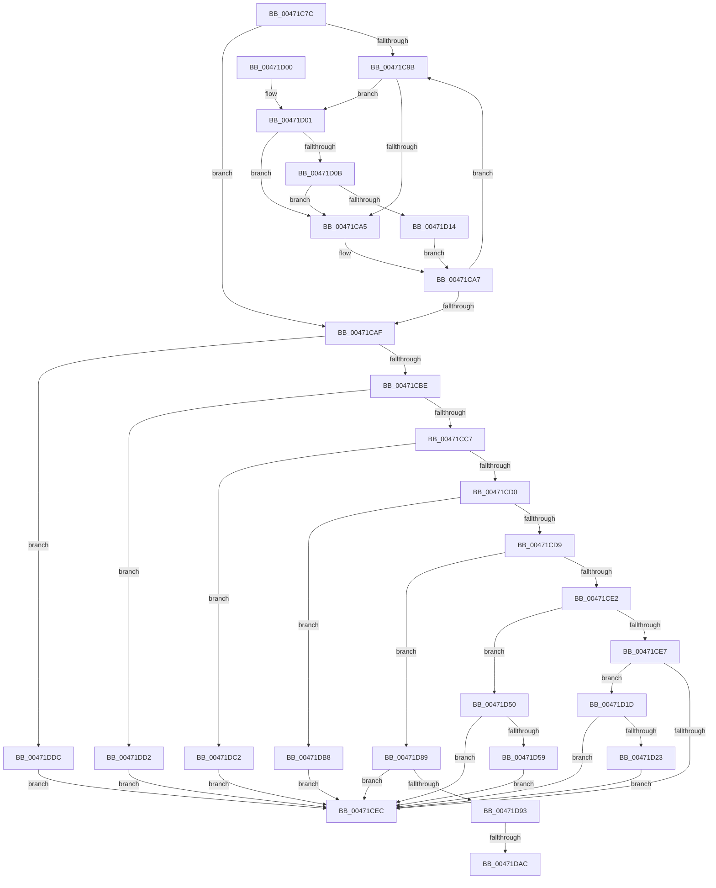

# IopLiveDumpProcessCorralStateChange

- RVA: `0x00471C7C`–`0x00471DE9` (길이 `365` bytes)
- VA: `0x0000000140471C7C`
- 실행 섹션: `.text`
- PDB 이름 있음: `예`; PDB Function 태그: `예`
- unwind 정보 RVA: `0x000AC360`
- 디코드: `89`개 명령, `365/365` bytes 표시
- 미해석 바이트: `0` (있으면 어셈블리에 `.byte`로 보존)

> 이 문서는 커널 이미지의 기계어와 PDB 기호를 분석해 생성했습니다. 4번과 5번은 함수 원형과 자료형을 바이너리 사용 방식에서 추정한 C 해석이며 원본 소스 복구 결과는 아닙니다.

## 1. Dependencies

- 직접 호출 지점: **8**; 고유 호출 대상: **8**
- 직접 호출자로 확인된 함수: **2**
- RIP 상대 이미지 참조: **3**

### Outgoing calls
- `0x00471D0B` → [KiCheckVpBackingLongSpinWaitHypercall](../30/KiCheckVpBackingLongSpinWaitHypercall_function_0030F490.md) (function, `0x0030F490`)
- `0x00471D16` → [HvlNotifyLongSpinWait](../30/HvlNotifyLongSpinWait_function_0030F460.md) (function, `0x0030F460`)
- `0x00471D45` → [KeRestoreSupervisorState](../5B/KeRestoreSupervisorState_function_005B9C30.md) (function, `0x005B9C30`)
- `0x00471D7B` → [KeSaveSupervisorState](../5B/KeSaveSupervisorState_function_005B9CB4.md) (function, `0x005B9CB4`)
- `0x00471DB8` → [KeResumeClockTimerSafe](../5B/KeResumeClockTimerSafe_function_005BB334.md) (function, `0x005BB334`)
- `0x00471DC8` → [IopLiveDumpBufferDumpData](../59/IopLiveDumpBufferDumpData_function_0059A938.md) (function, `0x0059A938`)
- `0x00471DD2` → [KeSuspendClockTimerSafe](../5B/KeSuspendClockTimerSafe_function_005BB394.md) (function, `0x005BB394`)
- `0x00471DDC` → [KeDisableInterrupts](../21/KeDisableInterrupts_function_00217BE0.md) (function, `0x00217BE0`)

### Direct callers
- [IopLiveDumpCorralDpc](../59/IopLiveDumpCorralDpc_function_0059B6B0.md) at `0x0059B700`
- [IopLiveDumpInitiateCorralStateChange](../59/IopLiveDumpInitiateCorralStateChange_function_0059CA5C.md) at `0x0059CAA5`

### Static image references
- `0x00471C9D` → RVA `0x00FC52AC` (`ALMOSTRO`; reference)
- `0x00471D01` → RVA `0x00FC6AB8` (`ALMOSTRO`; read)
- `0x00471D50` → RVA `0x00E66180` (`.data`; read)

## 2. Other-region calls and transfers

- 다른 실행 섹션으로 향하는 call: **0**
- call이 아닌 외부 분기/꼬리 이동: **2**
  - `0x00471DA6` → [sub_006F3CE0 + 0x18](../6F/Unknown_function_006F3CE0.md) (`tail-transfer`)
  - `0x00471DB3` → [sub_006F3CE0](../6F/Unknown_function_006F3CE0.md) (`tail-transfer`)

## 3. Assembly (complete function range)

```asm
00471C7C  48 89 5C 24 08                  mov qword ptr [rsp + 8], rbx
00471C81  48 89 74 24 10                  mov qword ptr [rsp + 0x10], rsi
00471C86  57                              push rdi
00471C87  48 83 EC 20                     sub rsp, 0x20
00471C8B  8B 41 0C                        mov eax, dword ptr [rcx + 0xc]
00471C8E  33 F6                           xor esi, esi
00471C90  48 8B DA                        mov rbx, rdx
00471C93  48 8B F9                        mov rdi, rcx
00471C96  3B 42 04                        cmp eax, dword ptr [rdx + 4]
00471C99  75 14                           jne 0x140471caf
00471C9B  FF C6                           inc esi
00471C9D  85 35 09 36 B5 00               test dword ptr [rip + 0xb53609], esi
00471CA3  74 5C                           je 0x140471d01
00471CA5  F3 90                           pause
00471CA7  8B 47 0C                        mov eax, dword ptr [rdi + 0xc]
00471CAA  3B 43 04                        cmp eax, dword ptr [rbx + 4]
00471CAD  74 EC                           je 0x140471c9b
00471CAF  8B 47 0C                        mov eax, dword ptr [rdi + 0xc]
00471CB2  89 43 04                        mov dword ptr [rbx + 4], eax
00471CB5  83 E8 02                        sub eax, 2
00471CB8  0F 84 1E 01 00 00               je 0x140471ddc
00471CBE  83 E8 01                        sub eax, 1
00471CC1  0F 84 0B 01 00 00               je 0x140471dd2
00471CC7  83 E8 01                        sub eax, 1
00471CCA  0F 84 F2 00 00 00               je 0x140471dc2
00471CD0  83 E8 01                        sub eax, 1
00471CD3  0F 84 DF 00 00 00               je 0x140471db8
00471CD9  83 E8 01                        sub eax, 1
00471CDC  0F 84 A7 00 00 00               je 0x140471d89
00471CE2  83 E8 01                        sub eax, 1
00471CE5  74 69                           je 0x140471d50
00471CE7  83 F8 01                        cmp eax, 1
00471CEA  74 31                           je 0x140471d1d
00471CEC  F0 FF 47 10                     lock inc dword ptr [rdi + 0x10]
00471CF0  48 8B 5C 24 30                  mov rbx, qword ptr [rsp + 0x30]
00471CF5  48 8B 74 24 38                  mov rsi, qword ptr [rsp + 0x38]
00471CFA  48 83 C4 20                     add rsp, 0x20
00471CFE  5F                              pop rdi
00471CFF  C3                              ret
00471D00  CC                              int3
00471D01  8B 05 B1 4D B5 00               mov eax, dword ptr [rip + 0xb54db1]
00471D07  A8 40                           test al, 0x40
00471D09  74 9A                           je 0x140471ca5
00471D0B  E8 80 D7 E9 FF                  call 0x14030f490
00471D10  84 C0                           test al, al
00471D12  74 91                           je 0x140471ca5
00471D14  8B CE                           mov ecx, esi
00471D16  E8 45 D7 E9 FF                  call 0x14030f460
00471D1B  EB 8A                           jmp 0x140471ca7
00471D1D  80 7B 09 00                     cmp byte ptr [rbx + 9], 0
00471D21  74 C9                           je 0x140471cec
00471D23  65 48 8B 0C 25 20 00 00 00      mov rcx, qword ptr gs:[0x20]
00471D2C  48 BA F0 05 00 00 80 F7 FF FF   movabs rdx, 0xfffff780000005f0
00471D36  48 8B 12                        mov rdx, qword ptr [rdx]
00471D39  48 8B 89 C0 06 00 00            mov rcx, qword ptr [rcx + 0x6c0]
00471D40  48 0F BA EA 08                  bts rdx, 8
00471D45  E8 E6 7E 14 00                  call 0x1405b9c30
00471D4A  C6 43 09 00                     mov byte ptr [rbx + 9], 0
00471D4E  EB 9C                           jmp 0x140471cec
00471D50  80 3D 29 44 9F 00 00            cmp byte ptr [rip + 0x9f4429], 0
00471D57  74 93                           je 0x140471cec
00471D59  65 48 8B 0C 25 20 00 00 00      mov rcx, qword ptr gs:[0x20]
00471D62  48 BA F0 05 00 00 80 F7 FF FF   movabs rdx, 0xfffff780000005f0
00471D6C  48 8B 12                        mov rdx, qword ptr [rdx]
00471D6F  48 8B 89 C0 06 00 00            mov rcx, qword ptr [rcx + 0x6c0]
00471D76  48 0F BA EA 08                  bts rdx, 8
00471D7B  E8 34 7F 14 00                  call 0x1405b9cb4
00471D80  C6 43 09 01                     mov byte ptr [rbx + 9], 1
00471D84  E9 63 FF FF FF                  jmp 0x140471cec
00471D89  80 7B 08 00                     cmp byte ptr [rbx + 8], 0
00471D8D  0F 84 59 FF FF FF               je 0x140471cec
00471D93  65 48 8B 0C 25 20 00 00 00      mov rcx, qword ptr gs:[0x20]
00471D9C  4C 8B 81 B8 8E 00 00            mov r8, qword ptr [rcx + 0x8eb8]
00471DA3  4D 85 C0                        test r8, r8
00471DA6  0F 84 4C 1F 28 00               je 0x1406f3cf8
00471DAC  41 0F 0D 08                     prefetchw byte ptr [r8]
00471DB0  41 8B 00                        mov eax, dword ptr [r8]
00471DB3  E9 28 1F 28 00                  jmp 0x1406f3ce0
00471DB8  E8 77 95 14 00                  call 0x1405bb334
00471DBD  E9 2A FF FF FF                  jmp 0x140471cec
00471DC2  48 8B D3                        mov rdx, rbx
00471DC5  48 8B CF                        mov rcx, rdi
00471DC8  E8 6B 8B 12 00                  call 0x14059a938
00471DCD  E9 1A FF FF FF                  jmp 0x140471cec
00471DD2  E8 BD 95 14 00                  call 0x1405bb394
00471DD7  E9 10 FF FF FF                  jmp 0x140471cec
00471DDC  E8 FF 5D DA FF                  call 0x140217be0
00471DE1  88 43 08                        mov byte ptr [rbx + 8], al
00471DE4  E9 03 FF FF FF                  jmp 0x140471cec
```

## 4. C-style interpretation (structured pseudocode)

```c
__int64 __fastcall IopLiveDumpProcessCorralStateChange(__int64 a1, __int64 a2)
{
    __int64 result;
    __int64 v_rsi;
    __int64 v_rsp;
    unsigned __int64 v_stack_p10;
    unsigned __int64 v_stack_p8;

    v_stack_p8 = v_rbx;
    v_stack_p10 = v_rsi;
    v_rsp = (v_rsp) - (32);
    v_rsi = 0;
    if (((unsigned int)((unsigned int)(*(unsigned int *)(a1 + 12)))) != (*(unsigned int *)(a2 + 4))) goto loc_00471CAF;
loc_00471C9B:
    v_rsi = (unsigned int)((v_rsi) + 1);
    if (((*(unsigned int *)(v_rip + 11875849)) & ((unsigned int)(v_rsi))) == 0) goto loc_00471D01;
loc_00471CA5:
loc_00471CA7:
    if (((unsigned int)((unsigned int)(*(unsigned int *)(a1 + 12)))) == (*(unsigned int *)(a2 + 4))) goto loc_00471C9B;
loc_00471CAF:
    *(unsigned int *)(a2 + 4) = (unsigned int)((unsigned int)(*(unsigned int *)(a1 + 12)));
    result = (unsigned int)(((unsigned int)(*(unsigned int *)(a1 + 12))) - (2));
    if (condition_is_equal) goto loc_00471DDC;
    result = (unsigned int)((result) - (1));
    if (condition_is_equal) goto loc_00471DD2;
    result = (unsigned int)((result) - (1));
    if (condition_is_equal) goto loc_00471DC2;
    result = (unsigned int)((result) - (1));
    if (condition_is_equal) goto loc_00471DB8;
    result = (unsigned int)((result) - (1));
    if (condition_is_equal) goto loc_00471D89;
    result = (unsigned int)((result) - (1));
    if (condition_is_equal) goto loc_00471D50;
    if (((unsigned int)(result)) == 1) goto loc_00471D1D;
loc_00471CEC:
    v_rsp = (v_rsp) + (32);
    return result;
loc_00471D01:
    if ((((unsigned __int8)((unsigned int)(*(unsigned int *)(v_rip + 11881905)))) & (64)) == 0) goto loc_00471CA5;
    result = KiCheckVpBackingLongSpinWaitHypercall(a1, a2, a3, a4);
    if ((unsigned __int8)(result) == 0) goto loc_00471CA5;
    result = HvlNotifyLongSpinWait((unsigned int)((unsigned int)(v_stack_p10)), a2, a3, a4);
    goto loc_00471CA7;
loc_00471D1D:
    if ((*(unsigned __int8 *)(v_stack_p8 + 9)) == 0) goto loc_00471CEC;
    result = KeRestoreSupervisorState(*(unsigned __int64 *)(*(unsigned __int64 *)(gs_base + (0 + 32)) + 1728), *(unsigned __int64 *)(a2), a3, a4);
    *(unsigned __int8 *)(v_stack_p8 + 9) = 0;
    goto loc_00471CEC;
loc_00471D50:
    if ((*(unsigned __int8 *)(v_rip + 10437673)) == 0) goto loc_00471CEC;
    result = KeSaveSupervisorState(*(unsigned __int64 *)(*(unsigned __int64 *)(gs_base + (0 + 32)) + 1728), *(unsigned __int64 *)(*(unsigned __int64 *)(a2)), a3, a4);
    *(unsigned __int8 *)(v_stack_p8 + 9) = 1;
    goto loc_00471CEC;
loc_00471D89:
    if ((*(unsigned __int8 *)(v_stack_p8 + 8)) == 0) goto loc_00471CEC;
loc_00471DB8:
    result = KeResumeClockTimerSafe(*(unsigned __int64 *)(gs_base + (0 + 32)), *(unsigned __int64 *)(*(unsigned __int64 *)(a2)), *(unsigned __int64 *)(*(unsigned __int64 *)(gs_base + (0 + 32)) + 36536), a4);
    goto loc_00471CEC;
loc_00471DC2:
    result = IopLiveDumpBufferDumpData(a1, v_stack_p8, *(unsigned __int64 *)(*(unsigned __int64 *)(gs_base + (0 + 32)) + 36536), a4);
    goto loc_00471CEC;
loc_00471DD2:
    result = KeSuspendClockTimerSafe(a1, v_stack_p8, *(unsigned __int64 *)(*(unsigned __int64 *)(gs_base + (0 + 32)) + 36536), a4);
    goto loc_00471CEC;
loc_00471DDC:
    result = KeDisableInterrupts(a1, v_stack_p8, *(unsigned __int64 *)(*(unsigned __int64 *)(gs_base + (0 + 32)) + 36536), a4);
    *(unsigned __int8 *)(v_stack_p8 + 8) = (unsigned __int8)(result);
    goto loc_00471CEC;
}
```

## 5. (Beta) C Style

```c
int64_t IopLiveDumpProcessCorralStateChange(void *Arg1, void *Arg2)
{
    uint8_t *arg1 = (uint8_t *)Arg1;
    uint8_t *arg2 = (uint8_t *)Arg2;

    int64_t result;
    int64_t local_rsi;
    int64_t local_rsp;
    uint64_t v_stack_p10;
    uint64_t v_stack_p8;

    v_stack_p8 = local_rbx;
    v_stack_p10 = local_rsi;
    local_rsp = (local_rsp) - (32);
    local_rsi = 0;
    if (((uint32_t)((uint32_t)(*(uint32_t *)(arg1 + 0xC)))) != (*(uint32_t *)(arg2 + 0x4))) goto loc_00471CAF;
loc_00471C9B:
    local_rsi = (uint32_t)((local_rsi) + 1);
    if (((*(uint32_t *)(v_rip + 0xB53609)) & ((uint32_t)(local_rsi))) == 0) goto loc_00471D01;
loc_00471CA5:
loc_00471CA7:
    if (((uint32_t)((uint32_t)(*(uint32_t *)(arg1 + 0xC)))) == (*(uint32_t *)(arg2 + 0x4))) goto loc_00471C9B;
loc_00471CAF:
    *(uint32_t *)(arg2 + 0x4) = (uint32_t)((uint32_t)(*(uint32_t *)(arg1 + 0xC)));
    result = (uint32_t)(((uint32_t)(*(uint32_t *)(arg1 + 0xC))) - (2));
    if (condition_is_equal) goto loc_00471DDC;
    result = (uint32_t)((result) - (1));
    if (condition_is_equal) goto loc_00471DD2;
    result = (uint32_t)((result) - (1));
    if (condition_is_equal) goto loc_00471DC2;
    result = (uint32_t)((result) - (1));
    if (condition_is_equal) goto loc_00471DB8;
    result = (uint32_t)((result) - (1));
    if (condition_is_equal) goto loc_00471D89;
    result = (uint32_t)((result) - (1));
    if (condition_is_equal) goto loc_00471D50;
    if (((uint32_t)(result)) == 1) goto loc_00471D1D;
loc_00471CEC:
    local_rsp = (local_rsp) + (32);
    return result;
loc_00471D01:
    if ((((uint8_t)((uint32_t)(*(uint32_t *)(v_rip + 0xB54DB1)))) & (64)) == 0) goto loc_00471CA5;
    result = KiCheckVpBackingLongSpinWaitHypercall(Arg1, Arg2, a3, a4);
    if ((uint8_t)(result) == 0) goto loc_00471CA5;
    result = HvlNotifyLongSpinWait((uint32_t)((uint32_t)(v_stack_p10)), Arg2, a3, a4);
    goto loc_00471CA7;
loc_00471D1D:
    if ((*(uint8_t *)(v_stack_p8 + 0x9)) == 0) goto loc_00471CEC;
    result = KeRestoreSupervisorState(*(uint64_t *)(*(uint64_t *)(gs_base + (0 + 0x20)) + 0x6C0), *(uint64_t *)(arg2), a3, a4);
    *(uint8_t *)(v_stack_p8 + 0x9) = 0;
    goto loc_00471CEC;
loc_00471D50:
    if ((*(uint8_t *)(v_rip + 0x9F4429)) == 0) goto loc_00471CEC;
    result = KeSaveSupervisorState(*(uint64_t *)(*(uint64_t *)(gs_base + (0 + 0x20)) + 0x6C0), *(uint64_t *)(*(uint64_t *)(arg2)), a3, a4);
    *(uint8_t *)(v_stack_p8 + 0x9) = 1;
    goto loc_00471CEC;
loc_00471D89:
    if ((*(uint8_t *)(v_stack_p8 + 0x8)) == 0) goto loc_00471CEC;
loc_00471DB8:
    result = KeResumeClockTimerSafe(*(uint64_t *)(gs_base + (0 + 0x20)), *(uint64_t *)(*(uint64_t *)(arg2)), *(uint64_t *)(*(uint64_t *)(gs_base + (0 + 0x20)) + 0x8EB8), a4);
    goto loc_00471CEC;
loc_00471DC2:
    result = IopLiveDumpBufferDumpData(Arg1, v_stack_p8, *(uint64_t *)(*(uint64_t *)(gs_base + (0 + 0x20)) + 0x8EB8), a4);
    goto loc_00471CEC;
loc_00471DD2:
    result = KeSuspendClockTimerSafe(Arg1, v_stack_p8, *(uint64_t *)(*(uint64_t *)(gs_base + (0 + 0x20)) + 0x8EB8), a4);
    goto loc_00471CEC;
loc_00471DDC:
    result = KeDisableInterrupts(Arg1, v_stack_p8, *(uint64_t *)(*(uint64_t *)(gs_base + (0 + 0x20)) + 0x8EB8), a4);
    *(uint8_t *)(v_stack_p8 + 0x8) = (uint8_t)(result);
    goto loc_00471CEC;
}
```

### 관측된 메모리 오프셋

구조체 형식이 확인되지 않은 접근은 인자 기준의 오프셋으로만 기록했습니다.

| 기준 인자 | 오프셋 표현 | 폭 (bit) | 접근 |
|---|---:|---:|---|
| `Arg1` | `+ 0xC` | `32` | `R` |
| `Arg1` | `+ 0x10` | `32` | `R/W` |
| `Arg2` | `+ 0x4` | `32` | `R` |
| `Arg2` | `+ 0x4` | `32` | `W` |
| `Arg2` | `+ 0x8` | `8` | `R` |
| `Arg2` | `+ 0x8` | `8` | `W` |
| `Arg2` | `+ 0x9` | `8` | `R` |
| `Arg2` | `+ 0x9` | `8` | `W` |

## 6. Execution-region graph

[열기: 2D/3D 그래프와 함수 탐색 컨트롤 패널](../../../control-panel.html?section=text&rva=0x00471C7C&view=graph)

- 2D 그래프는 위에서 아래로 흐르고, 3D 그래프는 빈 공간을 드래그해 회전합니다. Shift+드래그는 이동, 휠은 확대·축소, 함수 노드 선택은 대상 보고서 이동입니다.

### Static fallback


