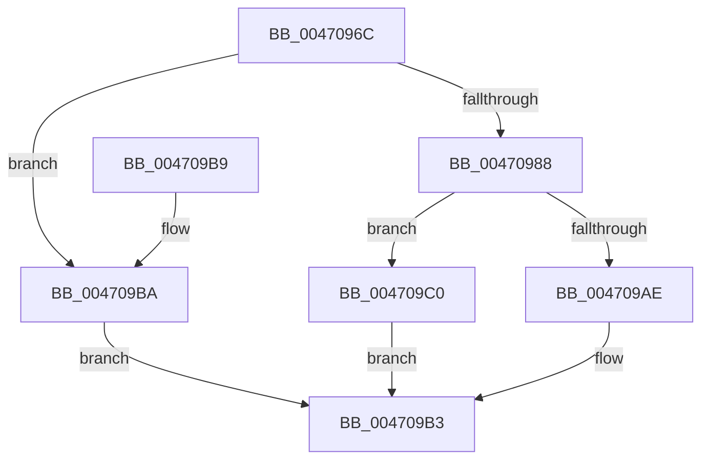

# IopPoHandleIrp

- RVA: `0x0047096C`–`0x004709C7` (길이 `91` bytes)
- VA: `0x000000014047096C`
- 실행 섹션: `.text`
- PDB 이름 있음: `예`; PDB Function 태그: `아니요`
- unwind 정보 RVA: `0x0006AD84`
- 디코드: `26`개 명령, `91/91` bytes 표시
- 미해석 바이트: `0` (있으면 어셈블리에 `.byte`로 보존)

> 이 문서는 커널 이미지의 기계어와 PDB 기호를 분석해 생성했습니다. 4번과 5번은 함수 원형과 자료형을 바이너리 사용 방식에서 추정한 C 해석이며 원본 소스 복구 결과는 아닙니다.

## 1. Dependencies

- 직접 호출 지점: **3**; 고유 호출 대상: **3**
- 직접 호출자로 확인된 함수: **2**
- RIP 상대 이미지 참조: **1**

### Outgoing calls
- `0x0047097F` → [PoHandleIrp](PoHandleIrp_function_004709D0.md) (function, `0x004709D0`)
- `0x004709AE` → [IopPowerDispatch](IopPowerDispatch_function_00470BF0.md) (function, `0x00470BF0`)
- `0x004709C0` → [guard_dispatch_icall](../6B/guard_dispatch_icall_function_006BAAD0.md) (function, `0x006BAAD0`)

### Direct callers
- [IofCallDriver](../29/IofCallDriver_function_0029B4B0.md) at `0x0029B547`
- [IopfCallDriver](../29/IopfCallDriver_function_0029C474.md) at `0x0029C4EF`

### Static image references
- `0x0047099F` → RVA `0x00470BF0` (`IopPowerDispatch`; read)

## 2. Other-region calls and transfers

- 다른 실행 섹션으로 향하는 call: **0**
- 별도 외부 분기/꼬리 이동을 확인하지 못했습니다.

## 3. Assembly (complete function range)

```asm
0047096C  40 53                           push rbx
0047096E  48 83 EC 20                     sub rsp, 0x20
00470972  83 64 24 38 00                  and dword ptr [rsp + 0x38], 0
00470977  48 8D 54 24 38                  lea rdx, [rsp + 0x38]
0047097C  48 8B D9                        mov rbx, rcx
0047097F  E8 4C 00 00 00                  call 0x1404709d0
00470984  84 C0                           test al, al
00470986  75 32                           jne 0x1404709ba
00470988  48 8B 83 B8 00 00 00            mov rax, qword ptr [rbx + 0xb8]
0047098F  0F B6 10                        movzx edx, byte ptr [rax]
00470992  48 8B 48 28                     mov rcx, qword ptr [rax + 0x28]
00470996  48 8B 41 08                     mov rax, qword ptr [rcx + 8]
0047099A  48 8B 44 D0 70                  mov rax, qword ptr [rax + rdx*8 + 0x70]
0047099F  48 8D 15 4A 02 00 00            lea rdx, [rip + 0x24a]
004709A6  48 3B C2                        cmp rax, rdx
004709A9  48 8B D3                        mov rdx, rbx
004709AC  75 12                           jne 0x1404709c0
004709AE  E8 3D 02 00 00                  call 0x140470bf0
004709B3  48 83 C4 20                     add rsp, 0x20
004709B7  5B                              pop rbx
004709B8  C3                              ret
004709B9  CC                              int3
004709BA  8B 44 24 38                     mov eax, dword ptr [rsp + 0x38]
004709BE  EB F3                           jmp 0x1404709b3
004709C0  E8 0B A1 24 00                  call 0x1406baad0
004709C5  EB EC                           jmp 0x1404709b3
```

## 4. C-style interpretation (structured pseudocode)

```c
__int64 __fastcall IopPoHandleIrp(__int64 a1)
{
    __int64 result;
    __int64 v_rsp;
    unsigned int v_stack_p10;
    unsigned int v_stack_p38;

    v_rsp = (v_rsp) - (32);
    result = PoHandleIrp(a1, v_stack_p10, a3, a4);
    if ((unsigned __int8)(result) != 0) goto loc_004709BA;
    if ((*(unsigned __int64 *)(*(unsigned __int64 *)(*(unsigned __int64 *)(*(unsigned __int64 *)(a1 + 184) + 40) + 8) + *(unsigned __int8 *)(*(unsigned __int64 *)(a1 + 184)) * 8 + 112)) != (v_rip + 586)) goto loc_004709C0;
    result = IopPowerDispatch(*(unsigned __int64 *)(*(unsigned __int64 *)(a1 + 184) + 40), a1, a3, a4);
loc_004709B3:
    v_rsp = (v_rsp) + (32);
    return result;
loc_004709BA:
    goto loc_004709B3;
loc_004709C0:
    result = guard_dispatch_icall(*(unsigned __int64 *)(*(unsigned __int64 *)(a1 + 184) + 40), a1, a3, a4);
    goto loc_004709B3;
}
```

## 5. (Beta) C Style

```c
int64_t IopPoHandleIrp(void *Arg1)
{
    uint8_t *arg1 = (uint8_t *)Arg1;

    int64_t result;
    int64_t local_rsp;
    uint32_t v_stack_p10;
    uint32_t v_stack_p38;

    local_rsp = (local_rsp) - (32);
    result = PoHandleIrp(Arg1, v_stack_p10, a3, a4);
    if ((uint8_t)(result) != 0) goto loc_004709BA;
    if ((*(uint64_t *)(*(uint64_t *)(*(uint64_t *)(*(uint64_t *)(arg1 + 0xB8) + 0x28) + 0x8) + *(uint8_t *)(*(uint64_t *)(arg1 + 0xB8)) * 8 + 0x70)) != (v_rip + 586)) goto loc_004709C0;
    result = IopPowerDispatch(*(uint64_t *)(*(uint64_t *)(arg1 + 0xB8) + 0x28), Arg1, a3, a4);
loc_004709B3:
    local_rsp = (local_rsp) + (32);
    return result;
loc_004709BA:
    goto loc_004709B3;
loc_004709C0:
    result = guard_dispatch_icall(*(uint64_t *)(*(uint64_t *)(arg1 + 0xB8) + 0x28), Arg1, a3, a4);
    goto loc_004709B3;
}
```

### 관측된 메모리 오프셋

구조체 형식이 확인되지 않은 접근은 인자 기준의 오프셋으로만 기록했습니다.

| 기준 인자 | 오프셋 표현 | 폭 (bit) | 접근 |
|---|---:|---:|---|
| `Arg1` | `+ 0xB8` | `64` | `R` |

## 6. Execution-region graph

[열기: 2D/3D 그래프와 함수 탐색 컨트롤 패널](../../../control-panel.html?section=text&rva=0x0047096C&view=graph)

- 2D 그래프는 위에서 아래로 흐르고, 3D 그래프는 빈 공간을 드래그해 회전합니다. Shift+드래그는 이동, 휠은 확대·축소, 함수 노드 선택은 대상 보고서 이동입니다.

### Static fallback


