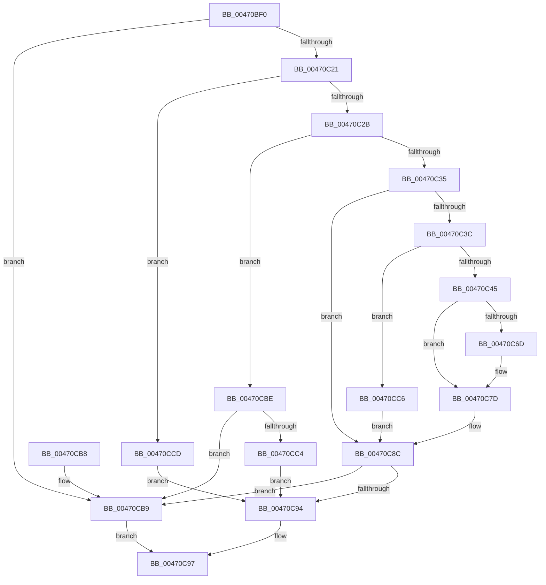

# IopPowerDispatch

- RVA: `0x00470BF0`–`0x00470CE1` (길이 `241` bytes)
- VA: `0x0000000140470BF0`
- 실행 섹션: `.text`
- PDB 이름 있음: `예`; PDB Function 태그: `아니요`
- unwind 정보 RVA: `0x000A1038`
- 디코드: `67`개 명령, `241/241` bytes 표시
- 미해석 바이트: `0` (있으면 어셈블리에 `.byte`로 보존)

> 이 문서는 커널 이미지의 기계어와 PDB 기호를 분석해 생성했습니다. 4번과 5번은 함수 원형과 자료형을 바이너리 사용 방식에서 추정한 C 해석이며 원본 소스 복구 결과는 아닙니다.

## 1. Dependencies

- 직접 호출 지점: **3**; 고유 호출 대상: **3**
- 직접 호출자로 확인된 함수: **1**
- RIP 상대 이미지 참조: **2**

### Outgoing calls
- `0x00470C56` → [KeAcquireSpinLockRaiseToDpc](../20/KeAcquireSpinLockRaiseToDpc_function_00208470.md) (function, `0x00208470`)
- `0x00470C87` → [KeReleaseSpinLock](../39/KeReleaseSpinLock_function_00392BA0.md) (function, `0x00392BA0`)
- `0x00470C9C` → [IofCompleteRequest](../29/IofCompleteRequest_function_0029B5C0.md) (function, `0x0029B5C0`)

### Direct callers
- [IopPoHandleIrp](IopPoHandleIrp_function_0047096C.md) at `0x004709AE`

### Static image references
- `0x00470C48` → RVA `0x00F0CA80` (`.data`; read)
- `0x00470CD1` → RVA `0x00F0CFC0` (`.data`; read)

## 2. Other-region calls and transfers

- 다른 실행 섹션으로 향하는 call: **0**
- 별도 외부 분기/꼬리 이동을 확인하지 못했습니다.

## 3. Assembly (complete function range)

```asm
00470BF0  48 89 5C 24 08                  mov qword ptr [rsp + 8], rbx
00470BF5  48 89 6C 24 10                  mov qword ptr [rsp + 0x10], rbp
00470BFA  48 89 74 24 18                  mov qword ptr [rsp + 0x18], rsi
00470BFF  57                              push rdi
00470C00  48 83 EC 20                     sub rsp, 0x20
00470C04  48 8B E9                        mov rbp, rcx
00470C07  33 FF                           xor edi, edi
00470C09  48 8B 8A B8 00 00 00            mov rcx, qword ptr [rdx + 0xb8]
00470C10  48 8B F2                        mov rsi, rdx
00470C13  44 0F B6 41 01                  movzx r8d, byte ptr [rcx + 1]
00470C18  45 85 C0                        test r8d, r8d
00470C1B  0F 84 98 00 00 00               je 0x140470cb9
00470C21  41 83 E8 01                     sub r8d, 1
00470C25  0F 84 A2 00 00 00               je 0x140470ccd
00470C2B  41 83 E8 01                     sub r8d, 1
00470C2F  0F 85 89 00 00 00               jne 0x140470cbe
00470C35  8B 51 10                        mov edx, dword ptr [rcx + 0x10]
00470C38  85 D2                           test edx, edx
00470C3A  74 50                           je 0x140470c8c
00470C3C  83 FA 01                        cmp edx, 1
00470C3F  0F 85 81 00 00 00               jne 0x140470cc6
00470C45  8B 59 18                        mov ebx, dword ptr [rcx + 0x18]
00470C48  48 8D 0D 31 BE A9 00            lea rcx, [rip + 0xa9be31]
00470C4F  48 8B AD 38 01 00 00            mov rbp, qword ptr [rbp + 0x138]
00470C56  E8 15 78 D9 FF                  call 0x140208470
00470C5B  8B 55 10                        mov edx, dword ptr [rbp + 0x10]
00470C5E  44 8A C0                        mov r8b, al
00470C61  8B C2                           mov eax, edx
00470C63  C1 E8 04                        shr eax, 4
00470C66  83 E0 0F                        and eax, 0xf
00470C69  3B C3                           cmp eax, ebx
00470C6B  74 10                           je 0x140470c7d
00470C6D  C1 E3 04                        shl ebx, 4
00470C70  33 DA                           xor ebx, edx
00470C72  81 E3 F0 00 00 00               and ebx, 0xf0
00470C78  33 DA                           xor ebx, edx
00470C7A  89 5D 10                        mov dword ptr [rbp + 0x10], ebx
00470C7D  41 8A D0                        mov dl, r8b
00470C80  48 8D 0D F9 BD A9 00            lea rcx, [rip + 0xa9bdf9]
00470C87  E8 14 1F F2 FF                  call 0x140392ba0
00470C8C  81 FF BB 00 00 C0               cmp edi, 0xc00000bb
00470C92  74 25                           je 0x140470cb9
00470C94  89 7E 30                        mov dword ptr [rsi + 0x30], edi
00470C97  33 D2                           xor edx, edx
00470C99  48 8B CE                        mov rcx, rsi
00470C9C  E8 1F A9 E2 FF                  call 0x14029b5c0
00470CA1  48 8B 5C 24 30                  mov rbx, qword ptr [rsp + 0x30]
00470CA6  8B C7                           mov eax, edi
00470CA8  48 8B 6C 24 38                  mov rbp, qword ptr [rsp + 0x38]
00470CAD  48 8B 74 24 40                  mov rsi, qword ptr [rsp + 0x40]
00470CB2  48 83 C4 20                     add rsp, 0x20
00470CB6  5F                              pop rdi
00470CB7  C3                              ret
00470CB8  CC                              int3
00470CB9  8B 7E 30                        mov edi, dword ptr [rsi + 0x30]
00470CBC  EB D9                           jmp 0x140470c97
00470CBE  41 83 F8 01                     cmp r8d, 1
00470CC2  75 F5                           jne 0x140470cb9
00470CC4  EB CE                           jmp 0x140470c94
00470CC6  BF BB 00 00 C0                  mov edi, 0xc00000bb
00470CCB  EB BF                           jmp 0x140470c8c
00470CCD  48 8B 49 08                     mov rcx, qword ptr [rcx + 8]
00470CD1  8B 05 E9 C2 A9 00               mov eax, dword ptr [rip + 0xa9c2e9]
00470CD7  89 01                           mov dword ptr [rcx], eax
00470CD9  89 41 04                        mov dword ptr [rcx + 4], eax
00470CDC  89 41 08                        mov dword ptr [rcx + 8], eax
00470CDF  EB B3                           jmp 0x140470c94
```

## 4. C-style interpretation (structured pseudocode)

```c
__int64 __fastcall IopPowerDispatch(__int64 a1, __int64 a2)
{
    __int64 result;
    __int64 v_rbx;
    __int64 v_rdi;
    __int64 v_rsp;
    unsigned __int64 v_stack_p10;
    unsigned __int64 v_stack_p18;
    unsigned __int64 v_stack_p8;

    v_stack_p8 = v_rbx;
    v_stack_p10 = v_rbp;
    v_stack_p18 = v_rsi;
    v_rsp = (v_rsp) - (32);
    v_rdi = 0;
    if ((unsigned int)(*(unsigned __int8 *)(*(unsigned __int64 *)(a2 + 184) + 1)) == 0) goto loc_00470CB9;
    a3 = (unsigned int)((*(unsigned __int8 *)(*(unsigned __int64 *)(a2 + 184) + 1)) - (1));
    if (condition_is_equal) goto loc_00470CCD;
    a3 = (unsigned int)((a3) - (1));
    if (condition_is_not_equal) goto loc_00470CBE;
    if ((unsigned int)((unsigned int)(*(unsigned int *)(*(unsigned __int64 *)(a2 + 184) + 16))) == 0) goto loc_00470C8C;
    if (((unsigned int)((unsigned int)(*(unsigned int *)(*(unsigned __int64 *)(a2 + 184) + 16)))) != 1) goto loc_00470CC6;
    result = KeAcquireSpinLockRaiseToDpc(v_rip + 11124273, (unsigned int)(*(unsigned int *)(*(unsigned __int64 *)(a2 + 184) + 16)), a3, a4);
    result = (unsigned int)(((unsigned int)((unsigned int)((unsigned int)(*(unsigned int *)(*(unsigned __int64 *)(a1 + 312) + 16))))) >> (4));
    result = (unsigned int)((result) & (15));
    v_rbx = (unsigned int)(*(unsigned int *)(*(unsigned __int64 *)(a2 + 184) + 24));
    if (((unsigned int)(result)) != ((unsigned int)((unsigned int)(*(unsigned int *)(*(unsigned __int64 *)(a2 + 184) + 24))))) {
        v_rbx = (unsigned int)(((unsigned int)(*(unsigned int *)(*(unsigned __int64 *)(a2 + 184) + 24))) << (4));
        v_rbx = (unsigned int)((v_rbx) ^ ((unsigned int)((unsigned int)(*(unsigned int *)(*(unsigned __int64 *)(a1 + 312) + 16)))));
        v_rbx = (unsigned int)((v_rbx) & (240));
        v_rbx = (unsigned int)((v_rbx) ^ ((unsigned int)((unsigned int)(*(unsigned int *)(*(unsigned __int64 *)(a1 + 312) + 16)))));
        *(unsigned int *)(*(unsigned __int64 *)(a1 + 312) + 16) = (unsigned int)(v_rbx);
    }
    result = KeReleaseSpinLock(v_rip + 11124217, (unsigned __int8)((unsigned __int8)(result)), (unsigned __int8)(result), a4);
loc_00470C8C:
    if (0 == 0xC00000BBULL) goto loc_00470CB9;
loc_00470C94:
    *(unsigned int *)(a2 + 48) = 0;
loc_00470C97:
    a2 = 0;
    result = IofCompleteRequest(0, a2, (unsigned __int8)(result), a4);
    v_rsp = (v_rsp) + (32);
    return 0;
loc_00470CB9:
    goto loc_00470C97;
loc_00470CBE:
    if (((unsigned int)((unsigned __int8)(result))) != 1) goto loc_00470CB9;
    goto loc_00470C94;
loc_00470CC6:
    goto loc_00470C8C;
loc_00470CCD:
    *(unsigned int *)(*(unsigned __int64 *)(0 + 8)) = (unsigned int)((unsigned int)(*(unsigned int *)(v_rip + 11125481)));
    *(unsigned int *)(*(unsigned __int64 *)(0 + 8) + 4) = (unsigned int)((unsigned int)(*(unsigned int *)(v_rip + 11125481)));
    *(unsigned int *)(*(unsigned __int64 *)(0 + 8) + 8) = (unsigned int)((unsigned int)(*(unsigned int *)(v_rip + 11125481)));
    goto loc_00470C94;
}
```

## 5. (Beta) C Style

```c
int64_t IopPowerDispatch(void *Arg1, void *Arg2)
{
    uint8_t *arg1 = (uint8_t *)Arg1;
    uint8_t *arg2 = (uint8_t *)Arg2;

    int64_t result;
    int64_t local_rbx;
    int64_t local_rdi;
    int64_t local_rsp;
    uint64_t v_stack_p10;
    uint64_t v_stack_p18;
    uint64_t v_stack_p8;

    v_stack_p8 = local_rbx;
    v_stack_p10 = local_rbp;
    v_stack_p18 = local_rsi;
    local_rsp = (local_rsp) - (32);
    local_rdi = 0;
    if ((uint32_t)(*(uint8_t *)(*(uint64_t *)(arg2 + 0xB8) + 0x1)) == 0) goto loc_00470CB9;
    a3 = (uint32_t)((*(uint8_t *)(*(uint64_t *)(arg2 + 0xB8) + 0x1)) - (1));
    if (condition_is_equal) goto loc_00470CCD;
    a3 = (uint32_t)((a3) - (1));
    if (condition_is_not_equal) goto loc_00470CBE;
    if ((uint32_t)((uint32_t)(*(uint32_t *)(*(uint64_t *)(arg2 + 0xB8) + 0x10))) == 0) goto loc_00470C8C;
    if (((uint32_t)((uint32_t)(*(uint32_t *)(*(uint64_t *)(arg2 + 0xB8) + 0x10)))) != 1) goto loc_00470CC6;
    result = KeAcquireSpinLockRaiseToDpc(v_rip + 11124273, (uint32_t)(*(uint32_t *)(*(uint64_t *)(arg2 + 0xB8) + 0x10)), a3, a4);
    result = (uint32_t)(((uint32_t)((uint32_t)((uint32_t)(*(uint32_t *)(*(uint64_t *)(arg1 + 0x138) + 0x10))))) >> (4));
    result = (uint32_t)((result) & (15));
    local_rbx = (uint32_t)(*(uint32_t *)(*(uint64_t *)(arg2 + 0xB8) + 0x18));
    if (((uint32_t)(result)) != ((uint32_t)((uint32_t)(*(uint32_t *)(*(uint64_t *)(arg2 + 0xB8) + 0x18))))) {
        local_rbx = (uint32_t)(((uint32_t)(*(uint32_t *)(*(uint64_t *)(arg2 + 0xB8) + 0x18))) << (4));
        local_rbx = (uint32_t)((local_rbx) ^ ((uint32_t)((uint32_t)(*(uint32_t *)(*(uint64_t *)(arg1 + 0x138) + 0x10)))));
        local_rbx = (uint32_t)((local_rbx) & (240));
        local_rbx = (uint32_t)((local_rbx) ^ ((uint32_t)((uint32_t)(*(uint32_t *)(*(uint64_t *)(arg1 + 0x138) + 0x10)))));
        *(uint32_t *)(*(uint64_t *)(arg1 + 0x138) + 0x10) = (uint32_t)(local_rbx);
    }
    result = KeReleaseSpinLock(v_rip + 11124217, (uint8_t)((uint8_t)(result)), (uint8_t)(result), a4);
loc_00470C8C:
    if (0 == 0xC00000BBULL) goto loc_00470CB9;
loc_00470C94:
    *(uint32_t *)(arg2 + 0x30) = 0;
loc_00470C97:
    Arg2 = 0;
    result = IofCompleteRequest(0, Arg2, (uint8_t)(result), a4);
    local_rsp = (local_rsp) + (32);
    return 0;
loc_00470CB9:
    goto loc_00470C97;
loc_00470CBE:
    if (((uint32_t)((uint8_t)(result))) != 1) goto loc_00470CB9;
    goto loc_00470C94;
loc_00470CC6:
    goto loc_00470C8C;
loc_00470CCD:
    *(uint32_t *)(*(uint64_t *)(0 + 0x8)) = (uint32_t)((uint32_t)(*(uint32_t *)(v_rip + 0xA9C2E9)));
    *(uint32_t *)(*(uint64_t *)(0 + 0x8) + 0x4) = (uint32_t)((uint32_t)(*(uint32_t *)(v_rip + 0xA9C2E9)));
    *(uint32_t *)(*(uint64_t *)(0 + 0x8) + 0x8) = (uint32_t)((uint32_t)(*(uint32_t *)(v_rip + 0xA9C2E9)));
    goto loc_00470C94;
}
```

### 관측된 메모리 오프셋

구조체 형식이 확인되지 않은 접근은 인자 기준의 오프셋으로만 기록했습니다.

| 기준 인자 | 오프셋 표현 | 폭 (bit) | 접근 |
|---|---:|---:|---|
| `Arg1` | `+ 0x138` | `64` | `R` |
| `Arg2` | `+ 0x30` | `32` | `R` |
| `Arg2` | `+ 0x30` | `32` | `W` |
| `Arg2` | `+ 0xB8` | `64` | `R` |

## 6. Execution-region graph

[열기: 2D/3D 그래프와 함수 탐색 컨트롤 패널](../../../control-panel.html?section=text&rva=0x00470BF0&view=graph)

- 2D 그래프는 위에서 아래로 흐르고, 3D 그래프는 빈 공간을 드래그해 회전합니다. Shift+드래그는 이동, 휠은 확대·축소, 함수 노드 선택은 대상 보고서 이동입니다.

### Static fallback


