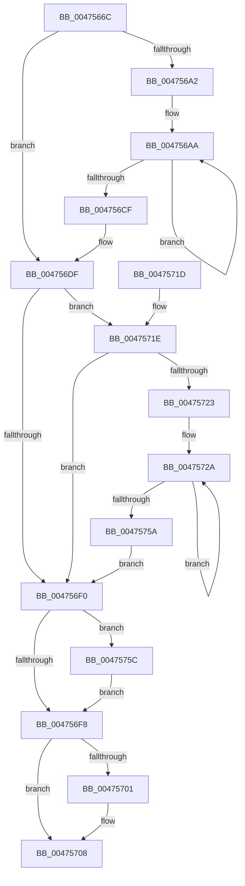

# IopProcessIrpStackProfiler

- RVA: `0x0047566C`–`0x00475764` (길이 `248` bytes)
- VA: `0x000000014047566C`
- 실행 섹션: `.text`
- PDB 이름 있음: `예`; PDB Function 태그: `아니요`
- unwind 정보 RVA: `0x000ACBBC`
- 디코드: `68`개 명령, `248/248` bytes 표시
- 미해석 바이트: `0` (있으면 어셈블리에 `.byte`로 보존)

> 이 문서는 커널 이미지의 기계어와 PDB 기호를 분석해 생성했습니다. 4번과 5번은 함수 원형과 자료형을 바이너리 사용 방식에서 추정한 C 해석이며 원본 소스 복구 결과는 아닙니다.

## 1. Dependencies

- 직접 호출 지점: **0**; 고유 호출 대상: **0**
- 직접 호출자로 확인된 함수: **1**
- RIP 상대 이미지 참조: **6**

### Outgoing calls
- 직접 디코드된 call 명령이 없습니다.

### Direct callers
- [IopIrpStackProfilerDpcRoutine](IopIrpStackProfilerDpcRoutine_function_00475420.md) at `0x0047552C`

### Static image references
- `0x0047567F` → RVA `0x00F8D210` (`.data`; read)
- `0x00475688` → RVA `0x00F8D40C` (`.data`; read)
- `0x00475691` → RVA `0x00F8D408` (`.data`; read)
- `0x004756CF` → RVA `0x00F8D564` (`.data`; read)
- `0x00475701` → RVA `0x00F8D408` (`.data`; write)
- `0x0047575C` → RVA `0x00F8D40C` (`.data`; write)

## 2. Other-region calls and transfers

- 다른 실행 섹션으로 향하는 call: **0**
- 별도 외부 분기/꼬리 이동을 확인하지 못했습니다.

## 3. Assembly (complete function range)

```asm
0047566C  48 8B C4                        mov rax, rsp
0047566F  48 89 58 08                     mov qword ptr [rax + 8], rbx
00475673  48 89 68 10                     mov qword ptr [rax + 0x10], rbp
00475677  48 89 70 18                     mov qword ptr [rax + 0x18], rsi
0047567B  48 89 78 20                     mov qword ptr [rax + 0x20], rdi
0047567F  8B 05 8B 7B B1 00               mov eax, dword ptr [rip + 0xb17b8b]
00475685  45 33 C9                        xor r9d, r9d
00475688  8B 15 7E 7D B1 00               mov edx, dword ptr [rip + 0xb17d7e]
0047568E  4C 8B D9                        mov r11, rcx
00475691  44 8B 05 70 7D B1 00            mov r8d, dword ptr [rip + 0xb17d70]
00475698  41 8B F1                        mov esi, r9d
0047569B  41 8B E9                        mov ebp, r9d
0047569E  A8 01                           test al, 1
004756A0  74 3D                           je 0x1404756df
004756A2  45 8D 51 0A                     lea r10d, [r9 + 0xa]
004756A6  48 8D 59 50                     lea rbx, [rcx + 0x50]
004756AA  48 8B 0B                        mov rcx, qword ptr [rbx]
004756AD  41 8B C2                        mov eax, r10d
004756B0  49 3B C9                        cmp rcx, r9
004756B3  48 8D 5B 08                     lea rbx, [rbx + 8]
004756B7  48 8B F9                        mov rdi, rcx
004756BA  49 0F 46 F9                     cmovbe rdi, r9
004756BE  0F 46 C2                        cmovbe eax, edx
004756C1  41 FF C2                        inc r10d
004756C4  8B D0                           mov edx, eax
004756C6  4C 8B CF                        mov r9, rdi
004756C9  41 83 FA 14                     cmp r10d, 0x14
004756CD  72 DB                           jb 0x1404756aa
004756CF  8B 05 8F 7E B1 00               mov eax, dword ptr [rip + 0xb17e8f]
004756D5  48 3B F8                        cmp rdi, rax
004756D8  0F 42 15 2D 7D B1 00            cmovb edx, dword ptr [rip + 0xb17d2d]
004756DF  8B 05 2B 7B B1 00               mov eax, dword ptr [rip + 0xb17b2b]
004756E5  41 B9 02 00 00 00               mov r9d, 2
004756EB  41 84 C1                        test r9b, al
004756EE  75 2E                           jne 0x14047571e
004756F0  39 15 16 7D B1 00               cmp dword ptr [rip + 0xb17d16], edx
004756F6  75 64                           jne 0x14047575c
004756F8  44 39 05 09 7D B1 00            cmp dword ptr [rip + 0xb17d09], r8d
004756FF  74 07                           je 0x140475708
00475701  44 89 05 00 7D B1 00            mov dword ptr [rip + 0xb17d00], r8d
00475708  48 8B 5C 24 08                  mov rbx, qword ptr [rsp + 8]
0047570D  48 8B 6C 24 10                  mov rbp, qword ptr [rsp + 0x10]
00475712  48 8B 74 24 18                  mov rsi, qword ptr [rsp + 0x18]
00475717  48 8B 7C 24 20                  mov rdi, qword ptr [rsp + 0x20]
0047571C  C3                              ret
0047571D  CC                              int3
0047571E  41 3B D1                        cmp edx, r9d
00475721  76 CD                           jbe 0x1404756f0
00475723  44 8B D2                        mov r10d, edx
00475726  49 83 C3 10                     add r11, 0x10
0047572A  49 03 2B                        add rbp, qword ptr [r11]
0047572D  41 8B C1                        mov eax, r9d
00475730  41 8B C9                        mov ecx, r9d
00475733  4D 8D 5B 08                     lea r11, [r11 + 8]
00475737  49 2B CA                        sub rcx, r10
0047573A  48 0F AF CD                     imul rcx, rbp
0047573E  48 3B CE                        cmp rcx, rsi
00475741  41 0F 4D C0                     cmovge eax, r8d
00475745  41 FF C1                        inc r9d
00475748  48 3B CE                        cmp rcx, rsi
0047574B  44 8B C0                        mov r8d, eax
0047574E  48 0F 4D CE                     cmovge rcx, rsi
00475752  48 8B F1                        mov rsi, rcx
00475755  44 3B CA                        cmp r9d, edx
00475758  72 D0                           jb 0x14047572a
0047575A  EB 94                           jmp 0x1404756f0
0047575C  89 15 AA 7C B1 00               mov dword ptr [rip + 0xb17caa], edx
00475762  EB 94                           jmp 0x1404756f8
```

## 4. C-style interpretation (structured pseudocode)

```c
__int64 __fastcall IopProcessIrpStackProfiler(__int64 a1, __int64 a2, __int64 a3, int a4)
{
    __int64 result;
    __int64 v_r10;
    __int64 v_r11;
    __int64 v_rbp;
    __int64 v_rdi;
    unsigned __int64 v_stack_p10;
    unsigned __int64 v_stack_p18;
    unsigned __int64 v_stack_p20;
    unsigned __int64 v_stack_p8;

    *(unsigned __int64 *)(v_rsp + 8) = v_rbx;
    *(unsigned __int64 *)(v_rsp + 16) = v_rbp;
    *(unsigned __int64 *)(v_rsp + 24) = v_rsi;
    *(unsigned __int64 *)(v_rsp + 32) = v_rdi;
    a4 = 0;
    if ((((unsigned __int8)((unsigned int)(*(unsigned int *)(v_rip + 11631499)))) & (1)) == 0) goto loc_004756DF;
loc_004756AA:
    v_rdi = *(unsigned __int64 *)(a1 + 80);
    if ((*(unsigned __int64 *)(a1 + 80)) <= 0) { v_rdi = 0; }
    result = (unsigned int)((unsigned int)(a4 + 10));
    if ((*(unsigned __int64 *)(a1 + 80)) <= 0) { result = (unsigned int)((unsigned int)(*(unsigned int *)(v_rip + 11631998))); }
    v_r10 = (unsigned int)((a4 + 10) + 1);
    if (((unsigned int)(v_r10)) < 20) goto loc_004756AA;
    a2 = (unsigned int)((unsigned int)(result));
    if (v_rdi < ((unsigned int)(*(unsigned int *)(v_rip + 11632271)))) { a2 = *(unsigned int *)(v_rip + 11631917); }
loc_004756DF:
    if (((2) & ((unsigned __int8)((unsigned int)(*(unsigned int *)(v_rip + 11631403))))) != 0) goto loc_0047571E;
loc_004756F0:
    if ((*(unsigned int *)(v_rip + 11631894)) != ((unsigned int)(a2))) goto loc_0047575C;
loc_004756F8:
    if ((*(unsigned int *)(v_rip + 11631881)) != ((unsigned int)((unsigned int)(*(unsigned int *)(v_rip + 11631984))))) {
        *(unsigned int *)(v_rip + 11631872) = (unsigned int)((unsigned int)(*(unsigned int *)(v_rip + 11631984)));
    }
    return (unsigned int)(*(unsigned int *)(v_rip + 11631403));
loc_0047571E:
    if (((unsigned int)(a2)) <= 2) goto loc_004756F0;
    v_r11 = (a1) + (16);
loc_0047572A:
    v_rbp = (v_stack_p10) + (*(unsigned __int64 *)(v_r11));
    a1 = (2) - ((unsigned int)((unsigned int)(a2)));
    a1 = (a1) * (v_rbp);
    result = 2;
    if (a1 >= v_stack_p18) { result = (unsigned int)((unsigned int)(*(unsigned int *)(v_rip + 11631984))); }
    a4 = (unsigned int)((2) + 1);
    if (a1 >= v_stack_p18) { a1 = v_stack_p18; }
    if (a4 < ((unsigned int)(a2))) goto loc_0047572A;
    goto loc_004756F0;
loc_0047575C:
    *(unsigned int *)(v_rip + 11631786) = (unsigned int)(a2);
    goto loc_004756F8;
}
```

## 5. (Beta) C Style

```c
int64_t IopProcessIrpStackProfiler(void *Arg1, int64_t Arg2, int64_t Arg3, int32_t Arg4)
{
    uint8_t *arg1 = (uint8_t *)Arg1;

    int64_t result;
    int64_t local_r10;
    int64_t local_r11;
    int64_t local_rbp;
    int64_t local_rdi;
    uint64_t v_stack_p10;
    uint64_t v_stack_p18;
    uint64_t v_stack_p20;
    uint64_t v_stack_p8;

    *(uint64_t *)(local_rsp + 0x8) = local_rbx;
    *(uint64_t *)(local_rsp + 0x10) = local_rbp;
    *(uint64_t *)(local_rsp + 0x18) = local_rsi;
    *(uint64_t *)(local_rsp + 0x20) = local_rdi;
    Arg4 = 0;
    if ((((uint8_t)((uint32_t)(*(uint32_t *)(v_rip + 0xB17B8B)))) & (1)) == 0) goto loc_004756DF;
loc_004756AA:
    local_rdi = *(uint64_t *)(arg1 + 0x50);
    if ((*(uint64_t *)(arg1 + 0x50)) <= 0) { local_rdi = 0; }
    result = (uint32_t)((uint32_t)(Arg4 + 10));
    if ((*(uint64_t *)(arg1 + 0x50)) <= 0) { result = (uint32_t)((uint32_t)(*(uint32_t *)(v_rip + 0xB17D7E))); }
    local_r10 = (uint32_t)((Arg4 + 10) + 1);
    if (((uint32_t)(local_r10)) < 20) goto loc_004756AA;
    Arg2 = (uint32_t)((uint32_t)(result));
    if (local_rdi < ((uint32_t)(*(uint32_t *)(v_rip + 0xB17E8F)))) { Arg2 = *(uint32_t *)(v_rip + 0xB17D2D); }
loc_004756DF:
    if (((2) & ((uint8_t)((uint32_t)(*(uint32_t *)(v_rip + 0xB17B2B))))) != 0) goto loc_0047571E;
loc_004756F0:
    if ((*(uint32_t *)(v_rip + 0xB17D16)) != ((uint32_t)(Arg2))) goto loc_0047575C;
loc_004756F8:
    if ((*(uint32_t *)(v_rip + 0xB17D09)) != ((uint32_t)((uint32_t)(*(uint32_t *)(v_rip + 0xB17D70))))) {
        *(uint32_t *)(v_rip + 0xB17D00) = (uint32_t)((uint32_t)(*(uint32_t *)(v_rip + 0xB17D70)));
    }
    return (uint32_t)(*(uint32_t *)(v_rip + 0xB17B2B));
loc_0047571E:
    if (((uint32_t)(Arg2)) <= 2) goto loc_004756F0;
    local_r11 = (Arg1) + (16);
loc_0047572A:
    local_rbp = (v_stack_p10) + (*(uint64_t *)(local_r11));
    Arg1 = (2) - ((uint32_t)((uint32_t)(Arg2)));
    Arg1 = (Arg1) * (local_rbp);
    result = 2;
    if (Arg1 >= v_stack_p18) { result = (uint32_t)((uint32_t)(*(uint32_t *)(v_rip + 0xB17D70))); }
    Arg4 = (uint32_t)((2) + 1);
    if (Arg1 >= v_stack_p18) { Arg1 = v_stack_p18; }
    if (Arg4 < ((uint32_t)(Arg2))) goto loc_0047572A;
    goto loc_004756F0;
loc_0047575C:
    *(uint32_t *)(v_rip + 0xB17CAA) = (uint32_t)(Arg2);
    goto loc_004756F8;
}
```

### 관측된 메모리 오프셋

구조체 형식이 확인되지 않은 접근은 인자 기준의 오프셋으로만 기록했습니다.

| 기준 인자 | 오프셋 표현 | 폭 (bit) | 접근 |
|---|---:|---:|---|
| `Arg1` | `+ 0x0` | `64` | `R` |
| `Arg1` | `+ 0x8` | `64` | `R` |
| `Arg1` | `+ 0x50` | `64` | `R` |

## 6. Execution-region graph

[열기: 2D/3D 그래프와 함수 탐색 컨트롤 패널](../../../control-panel.html?section=text&rva=0x0047566C&view=graph)

- 2D 그래프는 위에서 아래로 흐르고, 3D 그래프는 빈 공간을 드래그해 회전합니다. Shift+드래그는 이동, 휠은 확대·축소, 함수 노드 선택은 대상 보고서 이동입니다.

### Static fallback


