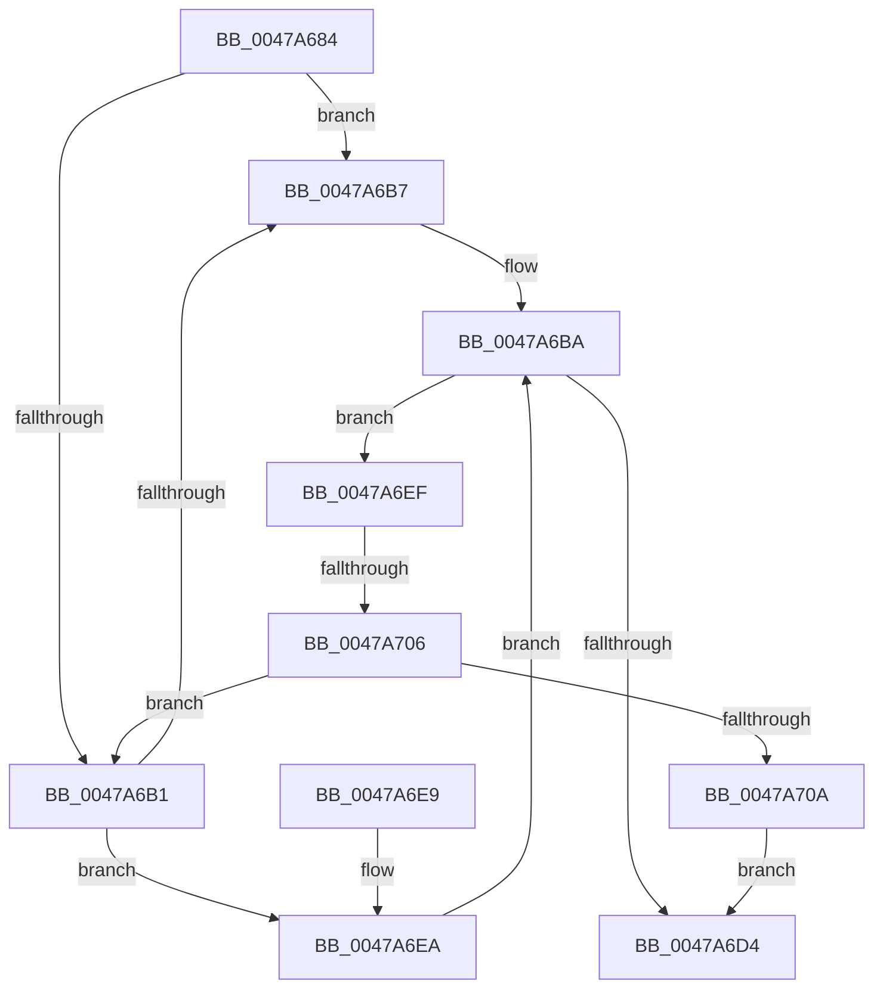

# IopWaitForLockAlertable

- RVA: `0x0047A684`–`0x0047A711` (길이 `141` bytes)
- VA: `0x000000014047A684`
- 실행 섹션: `.text`
- PDB 이름 있음: `예`; PDB Function 태그: `예`
- unwind 정보 RVA: `0x000AD1B0`
- 디코드: `41`개 명령, `141/141` bytes 표시
- 미해석 바이트: `0` (있으면 어셈블리에 `.byte`로 보존)

> 이 문서는 커널 이미지의 기계어와 PDB 기호를 분석해 생성했습니다. 4번과 5번은 함수 원형과 자료형을 바이너리 사용 방식에서 추정한 C 해석이며 원본 소스 복구 결과는 아닙니다.

## 1. Dependencies

- 직접 호출 지점: **1**; 고유 호출 대상: **1**
- 직접 호출자로 확인된 함수: **3**
- RIP 상대 이미지 참조: **0**

### Outgoing calls
- `0x0047A6C8` → [KeWaitForSingleObject](../20/KeWaitForSingleObject_function_0020E6B0.md) (function, `0x0020E6B0`)

### Direct callers
- [IopWaitAndAcquireFileObjectLock](../../page/8A/IopWaitAndAcquireFileObjectLock_function_008AE6D8.md) at `0x008AE727`
- [IopMountVolume](../../page/A3/IopMountVolume_function_00A329D0.md) at `0x00A32ABF`
- [sub_00B39BB0](../../page/B3/Unknown_function_00B39BB0.md) at `0x00B39BE5`

### Static image references
- 디코드된 RIP-relative 메모리 참조가 없습니다.

## 2. Other-region calls and transfers

- 다른 실행 섹션으로 향하는 call: **0**
- call이 아닌 외부 분기/꼬리 이동: **1**
  - `0x0047A700` → [sub_006F4958](../6F/Unknown_function_006F4958.md) (`tail-transfer`)

## 3. Assembly (complete function range)

```asm
0047A684  48 89 5C 24 08                  mov qword ptr [rsp + 8], rbx
0047A689  48 89 6C 24 10                  mov qword ptr [rsp + 0x10], rbp
0047A68E  48 89 74 24 18                  mov qword ptr [rsp + 0x18], rsi
0047A693  57                              push rdi
0047A694  48 83 EC 30                     sub rsp, 0x30
0047A698  41 8A C0                        mov al, r8b
0047A69B  41 8A D8                        mov bl, r8b
0047A69E  F6 D8                           neg al
0047A6A0  40 8A F2                        mov sil, dl
0047A6A3  48 8B E9                        mov rbp, rcx
0047A6A6  40 1A FF                        sbb dil, dil
0047A6A9  40 22 FA                        and dil, dl
0047A6AC  45 84 C0                        test r8b, r8b
0047A6AF  75 06                           jne 0x14047a6b7
0047A6B1  40 80 FE 01                     cmp sil, 1
0047A6B5  75 33                           jne 0x14047a6ea
0047A6B7  41 B1 01                        mov r9b, 1
0047A6BA  48 83 64 24 20 00               and qword ptr [rsp + 0x20], 0
0047A6C0  44 8A C7                        mov r8b, dil
0047A6C3  33 D2                           xor edx, edx
0047A6C5  48 8B CD                        mov rcx, rbp
0047A6C8  E8 E3 3F D9 FF                  call 0x14020e6b0
0047A6CD  3D 01 01 00 00                  cmp eax, 0x101
0047A6D2  74 1B                           je 0x14047a6ef
0047A6D4  48 8B 5C 24 40                  mov rbx, qword ptr [rsp + 0x40]
0047A6D9  48 8B 6C 24 48                  mov rbp, qword ptr [rsp + 0x48]
0047A6DE  48 8B 74 24 50                  mov rsi, qword ptr [rsp + 0x50]
0047A6E3  48 83 C4 30                     add rsp, 0x30
0047A6E7  5F                              pop rdi
0047A6E8  C3                              ret
0047A6E9  CC                              int3
0047A6EA  45 32 C9                        xor r9b, r9b
0047A6ED  EB CB                           jmp 0x14047a6ba
0047A6EF  65 48 8B 04 25 88 01 00 00      mov rax, qword ptr gs:[0x188]
0047A6F8  8B 80 A0 05 00 00               mov eax, dword ptr [rax + 0x5a0]
0047A6FE  84 DB                           test bl, bl
0047A700  0F 85 52 A2 27 00               jne 0x1406f4958
0047A706  A8 01                           test al, 1
0047A708  74 A7                           je 0x14047a6b1
0047A70A  B8 4B 00 00 C0                  mov eax, 0xc000004b
0047A70F  EB C3                           jmp 0x14047a6d4
```

## 4. C-style interpretation (structured pseudocode)

```c
__int64 __fastcall IopWaitForLockAlertable(__int64 a1, int a2, unsigned __int8 a3)
{
    __int64 result;
    __int64 v_rdi;
    __int64 v_rsp;
    unsigned __int64 v_stack_m18;
    unsigned __int64 v_stack_p10;
    unsigned __int64 v_stack_p18;
    unsigned __int64 v_stack_p8;

    v_stack_p8 = v_rbx;
    v_stack_p10 = v_rbp;
    v_stack_p18 = v_rsi;
    v_rsp = (v_rsp) - (48);
    result = (unsigned __int8)(-(a3));
    v_rdi = (unsigned __int8)((v_rdi) & ((unsigned __int8)(a2)));
    if (a3 != 0) goto loc_0047A6B7;
loc_0047A6B1:
    if (((unsigned __int8)((unsigned __int8)(a2))) != 1) goto loc_0047A6EA;
loc_0047A6B7:
loc_0047A6BA:
    a2 = 0;
    result = KeWaitForSingleObject(a1, a2, (unsigned __int8)(v_rdi), 1);
    if (((unsigned int)(result)) == 257) goto loc_0047A6EF;
loc_0047A6D4:
    v_rsp = (v_rsp) + (48);
    return result;
loc_0047A6EA:
    a4 = 0;
    goto loc_0047A6BA;
loc_0047A6EF:
    if ((((unsigned __int8)((unsigned int)(*(unsigned int *)(*(unsigned __int64 *)(gs_base + (0 + 392)) + 1440)))) & (1)) == 0) goto loc_0047A6B1;
    goto loc_0047A6D4;
}
```

## 5. (Beta) C Style

```c
int64_t IopWaitForLockAlertable(int64_t Arg1, int32_t Arg2, uint8_t Arg3)
{
    int64_t result;
    int64_t local_rdi;
    int64_t local_rsp;
    uint64_t v_stack_m18;
    uint64_t v_stack_p10;
    uint64_t v_stack_p18;
    uint64_t v_stack_p8;

    v_stack_p8 = local_rbx;
    v_stack_p10 = local_rbp;
    v_stack_p18 = local_rsi;
    local_rsp = (local_rsp) - (48);
    result = (uint8_t)(-(Arg3));
    local_rdi = (uint8_t)((local_rdi) & ((uint8_t)(Arg2)));
    if (Arg3 != 0) goto loc_0047A6B7;
loc_0047A6B1:
    if (((uint8_t)((uint8_t)(Arg2))) != 1) goto loc_0047A6EA;
loc_0047A6B7:
loc_0047A6BA:
    Arg2 = 0;
    result = KeWaitForSingleObject(Arg1, Arg2, (uint8_t)(local_rdi), 1);
    if (((uint32_t)(result)) == 257) goto loc_0047A6EF;
loc_0047A6D4:
    local_rsp = (local_rsp) + (48);
    return result;
loc_0047A6EA:
    a4 = 0;
    goto loc_0047A6BA;
loc_0047A6EF:
    if ((((uint8_t)((uint32_t)(*(uint32_t *)(*(uint64_t *)(gs_base + (0 + 0x188)) + 0x5A0)))) & (1)) == 0) goto loc_0047A6B1;
    goto loc_0047A6D4;
}
```

## 6. Execution-region graph

[열기: 2D/3D 그래프와 함수 탐색 컨트롤 패널](../../../control-panel.html?section=text&rva=0x0047A684&view=graph)

- 2D 그래프는 위에서 아래로 흐르고, 3D 그래프는 빈 공간을 드래그해 회전합니다. Shift+드래그는 이동, 휠은 확대·축소, 함수 노드 선택은 대상 보고서 이동입니다.

### Static fallback


