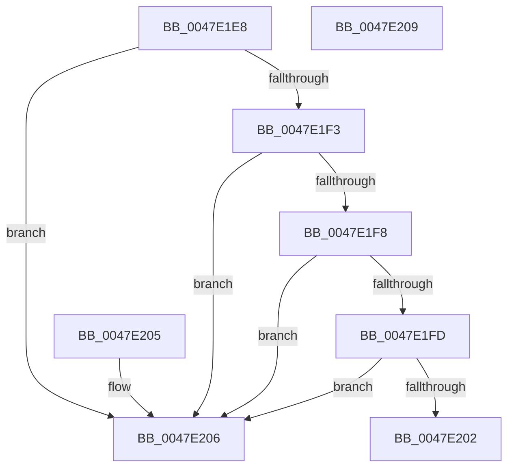

# IsFixedSizeType

- RVA: `0x0047E1E8`–`0x0047E20A` (길이 `34` bytes)
- VA: `0x000000014047E1E8`
- 실행 섹션: `.text`
- PDB 이름 있음: `예`; PDB Function 태그: `아니요`
- unwind 정보 RVA: `0x000DB714`
- 디코드: `15`개 명령, `34/34` bytes 표시
- 미해석 바이트: `0` (있으면 어셈블리에 `.byte`로 보존)

> 이 문서는 커널 이미지의 기계어와 PDB 기호를 분석해 생성했습니다. 4번과 5번은 함수 원형과 자료형을 바이너리 사용 방식에서 추정한 C 해석이며 원본 소스 복구 결과는 아닙니다.

## 1. Dependencies

- 직접 호출 지점: **0**; 고유 호출 대상: **0**
- 직접 호출자로 확인된 함수: **1**
- RIP 상대 이미지 참조: **0**

### Outgoing calls
- 직접 디코드된 call 명령이 없습니다.

### Direct callers
- [PnpValidatePropertyData](../../page/8F/PnpValidatePropertyData_function_008F7658.md) at `0x008F76CE`
- [PnpValidatePropertyData](../../page/8F/PnpValidatePropertyData_function_008F7658.md) at `0x008F7873`

### Static image references
- 디코드된 RIP-relative 메모리 참조가 없습니다.

## 2. Other-region calls and transfers

- 다른 실행 섹션으로 향하는 call: **0**
- 별도 외부 분기/꼬리 이동을 확인하지 못했습니다.

## 3. Assembly (complete function range)

```asm
0047E1E8  81 E1 FF 0F 00 00               and ecx, 0xfff
0047E1EE  83 E9 12                        sub ecx, 0x12
0047E1F1  74 13                           je 0x14047e206
0047E1F3  83 E9 01                        sub ecx, 1
0047E1F6  74 0E                           je 0x14047e206
0047E1F8  83 E9 01                        sub ecx, 1
0047E1FB  74 09                           je 0x14047e206
0047E1FD  83 F9 05                        cmp ecx, 5
0047E200  74 04                           je 0x14047e206
0047E202  B0 01                           mov al, 1
0047E204  C3                              ret
0047E205  CC                              int3
0047E206  32 C0                           xor al, al
0047E208  C3                              ret
0047E209  CC                              int3
```

## 4. C-style interpretation (structured pseudocode)

```c
__int64 __fastcall IsFixedSizeType(int a1)
{
    __int64 result;

    a1 = (unsigned int)((a1) & (0xFFFULL));
    a1 = (unsigned int)((a1) - (18));
    if (condition_is_equal) goto loc_0047E206;
    a1 = (unsigned int)((a1) - (1));
    if (condition_is_equal) goto loc_0047E206;
    a1 = (unsigned int)((a1) - (1));
    if (condition_is_equal) goto loc_0047E206;
    if (a1 == 5) goto loc_0047E206;
    return 1;
loc_0047E206:
    result = 0;
    return result;
}
```

## 5. (Beta) C Style

```c
int64_t IsFixedSizeType(int32_t Arg1)
{
    int64_t result;

    Arg1 = (uint32_t)((Arg1) & (0xFFFULL));
    Arg1 = (uint32_t)((Arg1) - (18));
    if (condition_is_equal) goto loc_0047E206;
    Arg1 = (uint32_t)((Arg1) - (1));
    if (condition_is_equal) goto loc_0047E206;
    Arg1 = (uint32_t)((Arg1) - (1));
    if (condition_is_equal) goto loc_0047E206;
    if (Arg1 == 5) goto loc_0047E206;
    return 1;
loc_0047E206:
    result = 0;
    return result;
}
```

## 6. Execution-region graph

[열기: 2D/3D 그래프와 함수 탐색 컨트롤 패널](../../../control-panel.html?section=text&rva=0x0047E1E8&view=graph)

- 2D 그래프는 위에서 아래로 흐르고, 3D 그래프는 빈 공간을 드래그해 회전합니다. Shift+드래그는 이동, 휠은 확대·축소, 함수 노드 선택은 대상 보고서 이동입니다.

### Static fallback


