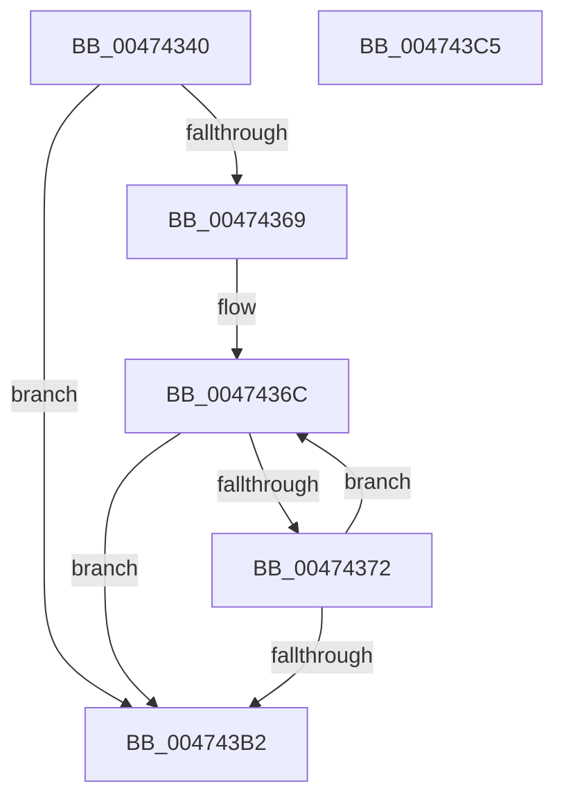

# IvtSlConfigureLeafPhysicalPfn

- RVA: `0x00474340`–`0x004743C6` (길이 `134` bytes)
- VA: `0x0000000140474340`
- 실행 섹션: `.text`
- PDB 이름 있음: `예`; PDB Function 태그: `아니요`
- unwind 정보 RVA: `0x00069588`
- 디코드: `40`개 명령, `134/134` bytes 표시
- 미해석 바이트: `0` (있으면 어셈블리에 `.byte`로 보존)

> 이 문서는 커널 이미지의 기계어와 PDB 기호를 분석해 생성했습니다. 4번과 5번은 함수 원형과 자료형을 바이너리 사용 방식에서 추정한 C 해석이며 원본 소스 복구 결과는 아닙니다.

## 1. Dependencies

- 직접 호출 지점: **0**; 고유 호출 대상: **0**
- 직접 호출자로 확인된 함수: **0**
- RIP 상대 이미지 참조: **0**

### Outgoing calls
- 직접 디코드된 call 명령이 없습니다.

### Direct callers
- 이 함수 시작 RVA로 연결되는 직접 call은 확인되지 않았습니다. 간접 호출은 완전히 역산할 수 없습니다.

### Static image references
- 디코드된 RIP-relative 메모리 참조가 없습니다.

## 2. Other-region calls and transfers

- 다른 실행 섹션으로 향하는 call: **0**
- 별도 외부 분기/꼬리 이동을 확인하지 못했습니다.

## 3. Assembly (complete function range)

```asm
00474340  48 89 5C 24 08                  mov qword ptr [rsp + 8], rbx
00474345  48 89 74 24 10                  mov qword ptr [rsp + 0x10], rsi
0047434A  48 89 7C 24 18                  mov qword ptr [rsp + 0x18], rdi
0047434F  41 8B F8                        mov edi, r8d
00474352  41 8B F0                        mov esi, r8d
00474355  83 E6 01                        and esi, 1
00474358  83 E7 02                        and edi, 2
0047435B  45 33 DB                        xor r11d, r11d
0047435E  48 8B DA                        mov rbx, rdx
00474361  4C 8B D1                        mov r10, rcx
00474364  45 85 C9                        test r9d, r9d
00474367  74 49                           je 0x1404743b2
00474369  48 2B D9                        sub rbx, rcx
0047436C  49 83 3A 00                     cmp qword ptr [r10], 0
00474370  75 40                           jne 0x1404743b2
00474372  8B C7                           mov eax, edi
00474374  F7 D8                           neg eax
00474376  8B C6                           mov eax, esi
00474378  4D 1B C0                        sbb r8, r8
0047437B  41 FF C3                        inc r11d
0047437E  41 83 E0 02                     and r8d, 2
00474382  4C 0B C0                        or r8, rax
00474385  48 B8 FF 0F 00 00 00 00 F0 FF   movabs rax, 0xfff0000000000fff
0047438F  4D 89 02                        mov qword ptr [r10], r8
00474392  4A 8B 14 13                     mov rdx, qword ptr [rbx + r10]
00474396  48 C1 E2 0C                     shl rdx, 0xc
0047439A  48 8B CA                        mov rcx, rdx
0047439D  49 33 C8                        xor rcx, r8
004743A0  48 23 C8                        and rcx, rax
004743A3  48 33 CA                        xor rcx, rdx
004743A6  49 89 0A                        mov qword ptr [r10], rcx
004743A9  49 83 C2 08                     add r10, 8
004743AD  45 3B D9                        cmp r11d, r9d
004743B0  72 BA                           jb 0x14047436c
004743B2  48 8B 5C 24 08                  mov rbx, qword ptr [rsp + 8]
004743B7  41 8B C3                        mov eax, r11d
004743BA  48 8B 74 24 10                  mov rsi, qword ptr [rsp + 0x10]
004743BF  48 8B 7C 24 18                  mov rdi, qword ptr [rsp + 0x18]
004743C4  C3                              ret
004743C5  CC                              int3
```

## 4. C-style interpretation (structured pseudocode)

```c
__int64 __fastcall IvtSlConfigureLeafPhysicalPfn(__int64 a1, __int64 a2, __int64 a3, int a4)
{
    __int64 result;
    __int64 v_r10;
    __int64 v_r11;
    __int64 v_rbx;
    __int64 v_rdi;
    __int64 v_rsi;
    unsigned __int64 v_stack_p10;
    unsigned __int64 v_stack_p18;
    unsigned __int64 v_stack_p8;

    v_stack_p8 = v_rbx;
    v_stack_p10 = v_rsi;
    v_stack_p18 = v_rdi;
    v_rsi = (unsigned int)(((unsigned int)((unsigned int)(a3))) & (1));
    v_rdi = (unsigned int)(((unsigned int)((unsigned int)(a3))) & (2));
    v_r11 = 0;
    if (a4 == 0) goto loc_004743B2;
    v_rbx = (a2) - (a1);
loc_0047436C:
    if ((*(unsigned __int64 *)(a1)) != 0) goto loc_004743B2;
    result = (unsigned int)(-((unsigned int)((unsigned int)(v_rdi))));
    v_r11 = (unsigned int)((v_r11) + 1);
    a3 = (unsigned int)((a3) & (2));
    a3 = (a3) | ((unsigned int)((unsigned int)(v_rsi)));
    *(unsigned __int64 *)(a1) = a3;
    a2 = (*(unsigned __int64 *)(v_rbx + a1 * 1)) << (12);
    a1 = (a2) ^ (a3);
    a1 = (a1) & ((unsigned int)((unsigned int)(v_rsi)));
    a1 = (a1) ^ (a2);
    *(unsigned __int64 *)(a1) = a1;
    v_r10 = (a1) + (8);
    if (((unsigned int)(v_r11)) < a4) goto loc_0047436C;
loc_004743B2:
    return (unsigned int)((unsigned int)(v_r11));
}
```

## 5. (Beta) C Style

```c
int64_t IvtSlConfigureLeafPhysicalPfn(void *Arg1, void *Arg2, int64_t Arg3, int32_t Arg4)
{
    uint8_t *arg1 = (uint8_t *)Arg1;
    uint8_t *arg2 = (uint8_t *)Arg2;

    int64_t result;
    int64_t local_r10;
    int64_t local_r11;
    int64_t local_rbx;
    int64_t local_rdi;
    int64_t local_rsi;
    uint64_t v_stack_p10;
    uint64_t v_stack_p18;
    uint64_t v_stack_p8;

    v_stack_p8 = local_rbx;
    v_stack_p10 = local_rsi;
    v_stack_p18 = local_rdi;
    local_rsi = (uint32_t)(((uint32_t)((uint32_t)(Arg3))) & (1));
    local_rdi = (uint32_t)(((uint32_t)((uint32_t)(Arg3))) & (2));
    local_r11 = 0;
    if (Arg4 == 0) goto loc_004743B2;
    local_rbx = (Arg2) - (Arg1);
loc_0047436C:
    if ((*(uint64_t *)(arg1)) != 0) goto loc_004743B2;
    result = (uint32_t)(-((uint32_t)((uint32_t)(local_rdi))));
    local_r11 = (uint32_t)((local_r11) + 1);
    Arg3 = (uint32_t)((Arg3) & (2));
    Arg3 = (Arg3) | ((uint32_t)((uint32_t)(local_rsi)));
    *(uint64_t *)(arg1) = Arg3;
    Arg2 = (*(uint64_t *)(local_rbx + arg1 * 1)) << (12);
    Arg1 = (Arg2) ^ (Arg3);
    Arg1 = (Arg1) & ((uint32_t)((uint32_t)(local_rsi)));
    Arg1 = (Arg1) ^ (Arg2);
    *(void **)(arg1) = Arg1;
    local_r10 = (Arg1) + (8);
    if (((uint32_t)(local_r11)) < Arg4) goto loc_0047436C;
loc_004743B2:
    return (uint32_t)((uint32_t)(local_r11));
}
```

### 관측된 메모리 오프셋

구조체 형식이 확인되지 않은 접근은 인자 기준의 오프셋으로만 기록했습니다.

| 기준 인자 | 오프셋 표현 | 폭 (bit) | 접근 |
|---|---:|---:|---|
| `Arg1` | `+ 0x0` | `64` | `R` |
| `Arg1` | `+ 0x0` | `64` | `W` |
| `Arg2` | `+ 0x0 + r10*1` | `64` | `R` |

## 6. Execution-region graph

[열기: 2D/3D 그래프와 함수 탐색 컨트롤 패널](../../../control-panel.html?section=text&rva=0x00474340&view=graph)

- 2D 그래프는 위에서 아래로 흐르고, 3D 그래프는 빈 공간을 드래그해 회전합니다. Shift+드래그는 이동, 휠은 확대·축소, 함수 노드 선택은 대상 보고서 이동입니다.

### Static fallback


