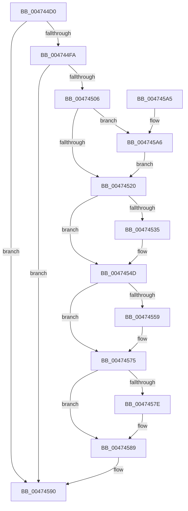

# KeAbUserModeEntryFree

- RVA: `0x004744D0`–`0x004745B2` (길이 `226` bytes)
- VA: `0x00000001404744D0`
- 실행 섹션: `.text`
- PDB 이름 있음: `예`; PDB Function 태그: `아니요`
- unwind 정보 RVA: `0x000AC7DC`
- 디코드: `58`개 명령, `226/226` bytes 표시
- 미해석 바이트: `0` (있으면 어셈블리에 `.byte`로 보존)

> 이 문서는 커널 이미지의 기계어와 PDB 기호를 분석해 생성했습니다. 4번과 5번은 함수 원형과 자료형을 바이너리 사용 방식에서 추정한 C 해석이며 원본 소스 복구 결과는 아닙니다.

## 1. Dependencies

- 직접 호출 지점: **3**; 고유 호출 대상: **3**
- 직접 호출자로 확인된 함수: **1**
- RIP 상대 이미지 참조: **1**

### Outgoing calls
- `0x00474548` → [KiAbEntryFreeAndEnableInterrupts](../26/KiAbEntryFreeAndEnableInterrupts_function_002622D0.md) (function, `0x002622D0`)
- `0x00474584` → [KiLowerIrqlProcessIrqlFlags](../4F/KiLowerIrqlProcessIrqlFlags_function_004F5698.md) (function, `0x004F5698`)
- `0x004745A8` → [KiRaiseIrqlProcessIrqlFlags](../4F/KiRaiseIrqlProcessIrqlFlags_function_004F56FC.md) (function, `0x004F56FC`)

### Direct callers
- [NtSetInformationThread](../../page/8C/NtSetInformationThread_function_008C9F60.md) at `0x008CA590`

### Static image references
- `0x00474513` → RVA `0x00FC6D20` (`ALMOSTRO`; read)

## 2. Other-region calls and transfers

- 다른 실행 섹션으로 향하는 call: **0**
- 별도 외부 분기/꼬리 이동을 확인하지 못했습니다.

## 3. Assembly (complete function range)

```asm
004744D0  48 89 5C 24 10                  mov qword ptr [rsp + 0x10], rbx
004744D5  48 89 6C 24 18                  mov qword ptr [rsp + 0x18], rbp
004744DA  48 89 74 24 20                  mov qword ptr [rsp + 0x20], rsi
004744DF  57                              push rdi
004744E0  48 83 EC 30                     sub rsp, 0x30
004744E4  48 8B B9 78 04 00 00            mov rdi, qword ptr [rcx + 0x478]
004744EB  48 8B EA                        mov rbp, rdx
004744EE  48 8B F1                        mov rsi, rcx
004744F1  48 85 FF                        test rdi, rdi
004744F4  0F 84 96 00 00 00               je 0x140474590
004744FA  0F B6 47 0C                     movzx eax, byte ptr [rdi + 0xc]
004744FE  3B E8                           cmp ebp, eax
00474500  0F 83 8A 00 00 00               jae 0x140474590
00474506  44 0F 20 C3                     mov rbx, cr8
0047450A  BA 02 00 00 00                  mov edx, 2
0047450F  44 0F 22 C2                     mov cr8, rdx
00474513  83 3D 06 28 B5 00 00            cmp dword ptr [rip + 0xb52806], 0
0047451A  0F 85 86 00 00 00               jne 0x1404745a6
00474520  8B ED                           mov ebp, ebp
00474522  48 6B CD 58                     imul rcx, rbp, 0x58
00474526  48 83 C1 10                     add rcx, 0x10
0047452A  48 03 CF                        add rcx, rdi
0047452D  48 8B 01                        mov rax, qword ptr [rcx]
00474530  48 85 C0                        test rax, rax
00474533  74 18                           je 0x14047454d
00474535  FA                              cli
00474536  48 83 64 24 20 00               and qword ptr [rsp + 0x20], 0
0047453C  41 B9 01 00 00 00               mov r9d, 1
00474542  45 33 C0                        xor r8d, r8d
00474545  48 8B D6                        mov rdx, rsi
00474548  E8 83 DD DE FF                  call 0x1402622d0
0047454D  48 8B 8E 20 03 00 00            mov rcx, qword ptr [rsi + 0x320]
00474554  48 85 C9                        test rcx, rcx
00474557  74 1C                           je 0x140474575
00474559  48 8B 04 E9                     mov rax, qword ptr [rcx + rbp*8]
0047455D  48 89 44 24 40                  mov qword ptr [rsp + 0x40], rax
00474562  48 C1 E8 38                     shr rax, 0x38
00474566  24 7F                           and al, 0x7f
00474568  88 44 24 47                     mov byte ptr [rsp + 0x47], al
0047456C  48 8B 44 24 40                  mov rax, qword ptr [rsp + 0x40]
00474571  48 89 04 E9                     mov qword ptr [rcx + rbp*8], rax
00474575  83 3D A4 27 B5 00 00            cmp dword ptr [rip + 0xb527a4], 0
0047457C  74 0B                           je 0x140474589
0047457E  44 0F 20 C1                     mov rcx, cr8
00474582  8A D3                           mov dl, bl
00474584  E8 0F 11 08 00                  call 0x1404f5698
00474589  0F B6 C3                        movzx eax, bl
0047458C  44 0F 22 C0                     mov cr8, rax
00474590  48 8B 5C 24 48                  mov rbx, qword ptr [rsp + 0x48]
00474595  48 8B 6C 24 50                  mov rbp, qword ptr [rsp + 0x50]
0047459A  48 8B 74 24 58                  mov rsi, qword ptr [rsp + 0x58]
0047459F  48 83 C4 30                     add rsp, 0x30
004745A3  5F                              pop rdi
004745A4  C3                              ret
004745A5  CC                              int3
004745A6  8A CB                           mov cl, bl
004745A8  E8 4F 11 08 00                  call 0x1404f56fc
004745AD  E9 6E FF FF FF                  jmp 0x140474520
```

## 4. C-style interpretation (structured pseudocode)

```c
__int64 __fastcall KeAbUserModeEntryFree(__int64 a1, __int64 a2, int a3)
{
    __int64 result;
    __int64 v_rsp;
    unsigned __int64 v_stack_m18;
    unsigned __int64 v_stack_p10;
    unsigned __int64 v_stack_p18;
    unsigned __int64 v_stack_p20;
    unsigned __int64 v_stack_p8;
    unsigned __int8 v_stack_pF;

    v_stack_p10 = v_rbx;
    v_stack_p18 = v_rbp;
    v_stack_p20 = v_rsi;
    v_rsp = (v_rsp) - (48);
    if (*(unsigned __int64 *)(a1 + 1144) == 0) goto loc_00474590;
    if (((unsigned int)(a2)) >= ((unsigned int)(*(unsigned __int8 *)(*(unsigned __int64 *)(a1 + 1144) + 12)))) goto loc_00474590;
    if ((*(unsigned int *)(v_rip + 11872262)) != 0) goto loc_004745A6;
loc_00474520:
    a1 = (a1) * ((unsigned int)((unsigned int)(a2)));
    a1 = (a1) + (16);
    a1 = (a1) + (*(unsigned __int64 *)(a1 + 1144));
    result = *(unsigned __int64 *)(a1);
    if (*(unsigned __int64 *)(a1) != 0) {
        a4 = 1;
        a3 = 0;
        a2 = a1;
        result = KiAbEntryFreeAndEnableInterrupts(a1, a2, a3, a4);
    }
    if (*(unsigned __int64 *)(a1 + 800) != 0) {
        result = *(unsigned __int64 *)(*(unsigned __int64 *)(a1 + 800) + (unsigned int)((unsigned int)(a2)) * 8);
        v_stack_p8 = result;
        result = (result) >> (56);
        result = (unsigned __int8)((result) & (127));
        v_stack_pF = (unsigned __int8)(result);
        result = v_stack_p8;
        *(unsigned __int64 *)(*(unsigned __int64 *)(a1 + 800) + (unsigned int)((unsigned int)(a2)) * 8) = result;
    }
    if ((*(unsigned int *)(v_rip + 11872164)) != 0) {
        a1 = 2;
        a2 = (unsigned __int8)(v_cr8);
        result = KiLowerIrqlProcessIrqlFlags(a1, a2, a3, a4);
    }
loc_00474590:
    v_rsp = (v_rsp) + (48);
    return (unsigned __int8)(v_cr8);
loc_004745A6:
    result = KiRaiseIrqlProcessIrqlFlags((unsigned __int8)(v_stack_p10), a2, a3, a4);
    goto loc_00474520;
}
```

## 5. (Beta) C Style

```c
int64_t KeAbUserModeEntryFree(void *Arg1, int64_t Arg2, int32_t Arg3)
{
    uint8_t *arg1 = (uint8_t *)Arg1;

    int64_t result;
    int64_t local_rsp;
    uint64_t v_stack_m18;
    uint64_t v_stack_p10;
    uint64_t v_stack_p18;
    uint64_t v_stack_p20;
    uint64_t v_stack_p8;
    uint8_t v_stack_pF;

    v_stack_p10 = local_rbx;
    v_stack_p18 = local_rbp;
    v_stack_p20 = local_rsi;
    local_rsp = (local_rsp) - (48);
    if (*(uint64_t *)(arg1 + 0x478) == 0) goto loc_00474590;
    if (((uint32_t)(Arg2)) >= ((uint32_t)(*(uint8_t *)(*(uint64_t *)(arg1 + 0x478) + 0xC)))) goto loc_00474590;
    if ((*(uint32_t *)(v_rip + 0xB52806)) != 0) goto loc_004745A6;
loc_00474520:
    Arg1 = (Arg1) * ((uint32_t)((uint32_t)(Arg2)));
    Arg1 = (Arg1) + (16);
    Arg1 = (Arg1) + (*(uint64_t *)(arg1 + 0x478));
    result = *(uint64_t *)(arg1);
    if (*(uint64_t *)(arg1) != 0) {
        a4 = 1;
        Arg3 = 0;
        Arg2 = Arg1;
        result = KiAbEntryFreeAndEnableInterrupts(Arg1, Arg2, Arg3, a4);
    }
    if (*(uint64_t *)(arg1 + 0x320) != 0) {
        result = *(uint64_t *)(*(uint64_t *)(arg1 + 0x320) + (uint32_t)((uint32_t)(Arg2)) * 8);
        v_stack_p8 = result;
        result = (result) >> (56);
        result = (uint8_t)((result) & (127));
        v_stack_pF = (uint8_t)(result);
        result = v_stack_p8;
        *(uint64_t *)(*(uint64_t *)(arg1 + 0x320) + (uint32_t)((uint32_t)(Arg2)) * 8) = result;
    }
    if ((*(uint32_t *)(v_rip + 0xB527A4)) != 0) {
        Arg1 = 2;
        Arg2 = (uint8_t)(v_cr8);
        result = KiLowerIrqlProcessIrqlFlags(Arg1, Arg2, Arg3, a4);
    }
loc_00474590:
    local_rsp = (local_rsp) + (48);
    return (uint8_t)(v_cr8);
loc_004745A6:
    result = KiRaiseIrqlProcessIrqlFlags((uint8_t)(v_stack_p10), Arg2, Arg3, a4);
    goto loc_00474520;
}
```

### 관측된 메모리 오프셋

구조체 형식이 확인되지 않은 접근은 인자 기준의 오프셋으로만 기록했습니다.

| 기준 인자 | 오프셋 표현 | 폭 (bit) | 접근 |
|---|---:|---:|---|
| `Arg1` | `+ 0x320` | `64` | `R` |
| `Arg1` | `+ 0x478` | `64` | `R` |

## 6. Execution-region graph

[열기: 2D/3D 그래프와 함수 탐색 컨트롤 패널](../../../control-panel.html?section=text&rva=0x004744D0&view=graph)

- 2D 그래프는 위에서 아래로 흐르고, 3D 그래프는 빈 공간을 드래그해 회전합니다. Shift+드래그는 이동, 휠은 확대·축소, 함수 노드 선택은 대상 보고서 이동입니다.

### Static fallback


