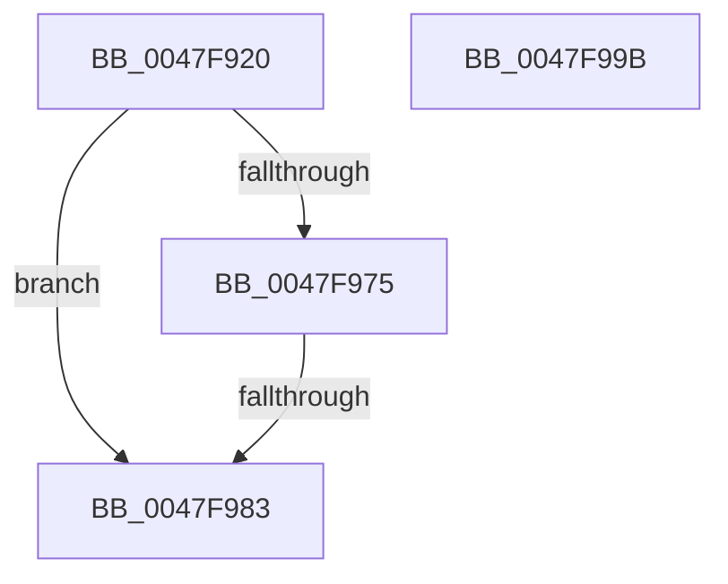

# KeDispatchSecondaryInterrupt

- RVA: `0x0047F920`–`0x0047F99C` (길이 `124` bytes)
- VA: `0x000000014047F920`
- 실행 섹션: `.text`
- PDB 이름 있음: `예`; PDB Function 태그: `예`
- unwind 정보 RVA: `0x000AE1B4`
- 디코드: `37`개 명령, `124/124` bytes 표시
- 미해석 바이트: `0` (있으면 어셈블리에 `.byte`로 보존)

> 이 문서는 커널 이미지의 기계어와 PDB 기호를 분석해 생성했습니다. 4번과 5번은 함수 원형과 자료형을 바이너리 사용 방식에서 추정한 C 해석이며 원본 소스 복구 결과는 아닙니다.

## 1. Dependencies

- 직접 호출 지점: **1**; 고유 호출 대상: **1**
- 직접 호출자로 확인된 함수: **1**
- RIP 상대 이미지 참조: **0**

### Outgoing calls
- `0x0047F969` → [KiInterruptDispatchCommon](../39/KiInterruptDispatchCommon_function_0039F3D0.md) (function, `0x0039F3D0`)

### Direct callers
- [HalpInvokeIsrForGsiv](HalpInvokeIsrForGsiv_function_0047F8D0.md) at `0x0047F90B`

### Static image references
- 디코드된 RIP-relative 메모리 참조가 없습니다.

## 2. Other-region calls and transfers

- 다른 실행 섹션으로 향하는 call: **0**
- call이 아닌 외부 분기/꼬리 이동: **1**
  - `0x0047F97D` → [sub_006F4E68](../6F/Unknown_function_006F4E68.md) (`tail-transfer`)

## 3. Assembly (complete function range)

```asm
0047F920  4C 8B DC                        mov r11, rsp
0047F923  49 89 5B 08                     mov qword ptr [r11 + 8], rbx
0047F927  49 89 6B 18                     mov qword ptr [r11 + 0x18], rbp
0047F92B  49 89 73 20                     mov qword ptr [r11 + 0x20], rsi
0047F92F  57                              push rdi
0047F930  48 83 EC 40                     sub rsp, 0x40
0047F934  49 8D 43 E8                     lea rax, [r11 - 0x18]
0047F938  49 89 43 F0                     mov qword ptr [r11 - 0x10], rax
0047F93C  49 8D 43 E8                     lea rax, [r11 - 0x18]
0047F940  49 89 43 E8                     mov qword ptr [r11 - 0x18], rax
0047F944  44 0F 20 C3                     mov rbx, cr8
0047F948  33 ED                           xor ebp, ebp
0047F94A  4D 89 43 D8                     mov qword ptr [r11 - 0x28], r8
0047F94E  49 8D 7B E8                     lea rdi, [r11 - 0x18]
0047F952  84 DB                           test bl, bl
0047F954  48 0F 44 FD                     cmove rdi, rbp
0047F958  C1 EA 14                        shr edx, 0x14
0047F95B  83 E2 01                        and edx, 1
0047F95E  4C 8B CF                        mov r9, rdi
0047F961  44 8B C2                        mov r8d, edx
0047F964  8B D1                           mov edx, ecx
0047F966  8D 4D 01                        lea ecx, [rbp + 1]
0047F969  E8 62 FA F1 FF                  call 0x14039f3d0
0047F96E  40 8A F0                        mov sil, al
0047F971  84 DB                           test bl, bl
0047F973  74 0E                           je 0x14047f983
0047F975  40 88 6C 24 58                  mov byte ptr [rsp + 0x58], bpl
0047F97A  48 39 3F                        cmp qword ptr [rdi], rdi
0047F97D  0F 85 E5 54 27 00               jne 0x1406f4e68
0047F983  48 8B 5C 24 50                  mov rbx, qword ptr [rsp + 0x50]
0047F988  40 8A C6                        mov al, sil
0047F98B  48 8B 74 24 68                  mov rsi, qword ptr [rsp + 0x68]
0047F990  48 8B 6C 24 60                  mov rbp, qword ptr [rsp + 0x60]
0047F995  48 83 C4 40                     add rsp, 0x40
0047F999  5F                              pop rdi
0047F99A  C3                              ret
0047F99B  CC                              int3
```

## 4. C-style interpretation (structured pseudocode)

```c
__int64 __fastcall KeDispatchSecondaryInterrupt(int a1, int a2, __int64 a3)
{
    __int64 result;
    __int64 v_rbp;
    __int64 v_rdi;
    __int64 v_rsp;
    unsigned __int8 v_stack_p10;
    unsigned __int64 v_stack_p18;
    unsigned __int64 v_stack_p20;
    unsigned __int64 v_stack_p8;

    *(unsigned __int64 *)(v_rsp + 8) = v_rbx;
    *(unsigned __int64 *)(v_rsp + 24) = v_rbp;
    *(unsigned __int64 *)(v_rsp + 32) = v_rsi;
    v_rsp = (v_rsp) - (64);
    *(unsigned __int64 *)(v_rsp - 16) = v_rsp - 24;
    *(unsigned __int64 *)(v_rsp - 24) = v_rsp - 24;
    v_rbp = 0;
    *(unsigned __int64 *)(v_rsp - 40) = a3;
    v_rdi = v_rsp - 24;
    if ((unsigned __int8)(v_cr8) == 0) { v_rdi = 0; }
    a2 = (unsigned int)((a2) >> (20));
    a2 = (unsigned int)((a2) & (1));
    result = KiInterruptDispatchCommon(v_rbp + 1, (unsigned int)(a1), (unsigned int)(a2), v_rdi);
    if ((unsigned __int8)(v_cr8) == 0) goto loc_0047F983;
    v_stack_p10 = 0;
loc_0047F983:
    v_rsp = (v_rsp) + (64);
    return (unsigned __int8)((unsigned __int8)(result));
}
```

## 5. (Beta) C Style

```c
int64_t KeDispatchSecondaryInterrupt(int32_t Arg1, int32_t Arg2, int64_t Arg3)
{
    int64_t result;
    int64_t local_rbp;
    int64_t local_rdi;
    int64_t local_rsp;
    uint8_t v_stack_p10;
    uint64_t v_stack_p18;
    uint64_t v_stack_p20;
    uint64_t v_stack_p8;

    *(uint64_t *)(local_rsp + 0x8) = local_rbx;
    *(uint64_t *)(local_rsp + 0x18) = local_rbp;
    *(uint64_t *)(local_rsp + 0x20) = local_rsi;
    local_rsp = (local_rsp) - (64);
    *(uint64_t *)(local_rsp - 0x10) = local_rsp - 24;
    *(uint64_t *)(local_rsp - 0x18) = local_rsp - 24;
    local_rbp = 0;
    *(uint64_t *)(local_rsp - 0x28) = Arg3;
    local_rdi = local_rsp - 24;
    if ((uint8_t)(v_cr8) == 0) { local_rdi = 0; }
    Arg2 = (uint32_t)((Arg2) >> (20));
    Arg2 = (uint32_t)((Arg2) & (1));
    result = KiInterruptDispatchCommon(local_rbp + 1, (uint32_t)(Arg1), (uint32_t)(Arg2), local_rdi);
    if ((uint8_t)(v_cr8) == 0) goto loc_0047F983;
    v_stack_p10 = 0;
loc_0047F983:
    local_rsp = (local_rsp) + (64);
    return (uint8_t)((uint8_t)(result));
}
```

## 6. Execution-region graph

[열기: 2D/3D 그래프와 함수 탐색 컨트롤 패널](../../../control-panel.html?section=text&rva=0x0047F920&view=graph)

- 2D 그래프는 위에서 아래로 흐르고, 3D 그래프는 빈 공간을 드래그해 회전합니다. Shift+드래그는 이동, 휠은 확대·축소, 함수 노드 선택은 대상 보고서 이동입니다.

### Static fallback


