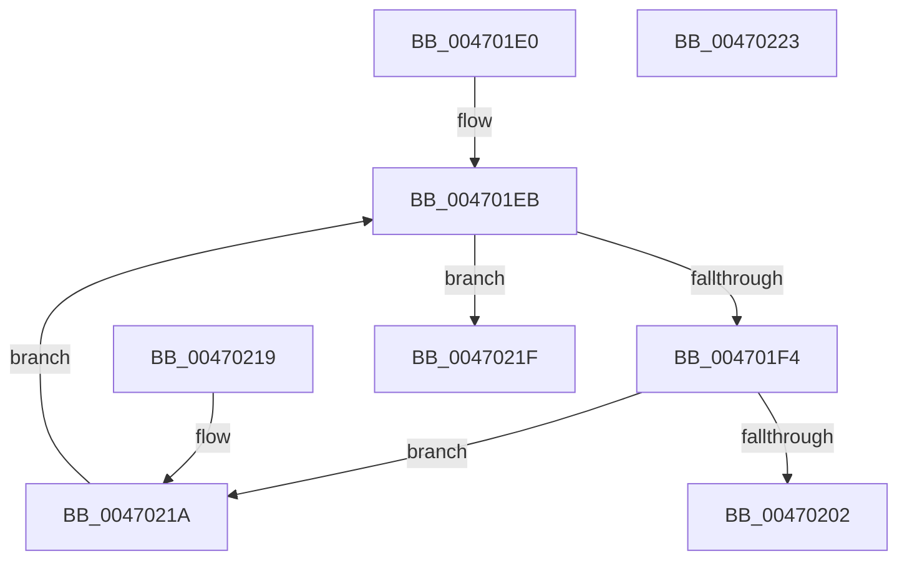

# KeFindFirstSetRightAffinityEx

- RVA: `0x004701E0`–`0x00470224` (길이 `68` bytes)
- VA: `0x00000001404701E0`
- 실행 섹션: `.text`
- PDB 이름 있음: `예`; PDB Function 태그: `아니요`
- unwind 정보 RVA: `0x000DB714`
- 디코드: `22`개 명령, `68/68` bytes 표시
- 미해석 바이트: `0` (있으면 어셈블리에 `.byte`로 보존)

> 이 문서는 커널 이미지의 기계어와 PDB 기호를 분석해 생성했습니다. 4번과 5번은 함수 원형과 자료형을 바이너리 사용 방식에서 추정한 C 해석이며 원본 소스 복구 결과는 아닙니다.

## 1. Dependencies

- 직접 호출 지점: **0**; 고유 호출 대상: **0**
- 직접 호출자로 확인된 함수: **3**
- RIP 상대 이미지 참조: **1**

### Outgoing calls
- 직접 디코드된 call 명령이 없습니다.

### Direct callers
- [PpmCheckContinueExecution](../2D/PpmCheckContinueExecution_function_002D836C.md) at `0x002D8473`
- [PpmParkComputeUnparkMask](../46/PpmParkComputeUnparkMask_function_0046F9C4.md) at `0x0046FF6C`
- [PpmParkComputeUnparkMaskEx](../5E/PpmParkComputeUnparkMaskEx_function_005E05E0.md) at `0x005E0EBA`
- [PpmParkComputeUnparkMaskEx](../5E/PpmParkComputeUnparkMaskEx_function_005E05E0.md) at `0x005E0FA8`

### Static image references
- `0x0047020D` → RVA `0x00F231B8` (`.data`; read)

## 2. Other-region calls and transfers

- 다른 실행 섹션으로 향하는 call: **0**
- 별도 외부 분기/꼬리 이동을 확인하지 못했습니다.

## 3. Assembly (complete function range)

```asm
004701E0  44 0F B7 11                     movzx r10d, word ptr [rcx]
004701E4  45 33 DB                        xor r11d, r11d
004701E7  41 0F B7 D3                     movzx edx, r11w
004701EB  44 0F BF C2                     movsx r8d, dx
004701EF  45 3B C2                        cmp r8d, r10d
004701F2  7D 2B                           jge 0x14047021f
004701F4  48 0F BF C2                     movsx rax, dx
004701F8  4C 8B 4C C1 08                  mov r9, qword ptr [rcx + rax*8 + 8]
004701FD  4D 85 C9                        test r9, r9
00470200  74 18                           je 0x14047021a
00470202  49 0F BC C1                     bsf rax, r9
00470206  41 C1 E0 06                     shl r8d, 6
0047020A  44 03 C0                        add r8d, eax
0047020D  48 8B 05 A4 2F AB 00            mov rax, qword ptr [rip + 0xab2fa4]
00470214  42 8B 04 80                     mov eax, dword ptr [rax + r8*4]
00470218  C3                              ret
00470219  CC                              int3
0047021A  66 FF C2                        inc dx
0047021D  EB CC                           jmp 0x1404701eb
0047021F  83 C8 FF                        or eax, 0xffffffff
00470222  C3                              ret
00470223  CC                              int3
```

## 4. C-style interpretation (structured pseudocode)

```c
__int64 __fastcall KeFindFirstSetRightAffinityEx(__int64 a1)
{
    __int64 result;
    __int64 v_r11;

    v_r11 = 0;
loc_004701EB:
    if (((unsigned int)((__int16)(0))) >= ((unsigned int)(*(unsigned __int16 *)(a1)))) goto loc_0047021F;
    if (*(unsigned __int64 *)(a1 + (__int16)(0) * 8 + 8) == 0) goto loc_0047021A;
    a3 = (unsigned int)(((__int16)(0)) << (6));
    a3 = (unsigned int)((a3) + ((unsigned int)((__int16)(0))));
    return (unsigned int)(*(unsigned int *)(*(unsigned __int64 *)(v_rip + 11218852) + a3 * 4));
loc_0047021A:
    a2 = (unsigned __int16)((0) + 1);
    goto loc_004701EB;
loc_0047021F:
    result = (unsigned int)(((unsigned int)(*(unsigned int *)(*(unsigned __int64 *)(v_rip + 11218852) + a3 * 4))) | (0xFFFFFFFFULL));
    return result;
}
```

## 5. (Beta) C Style

```c
int64_t KeFindFirstSetRightAffinityEx(void *Arg1)
{
    uint8_t *arg1 = (uint8_t *)Arg1;

    int64_t result;
    int64_t local_r11;

    local_r11 = 0;
loc_004701EB:
    if (((uint32_t)((int16_t)(0))) >= ((uint32_t)(*(uint16_t *)(arg1)))) goto loc_0047021F;
    if (*(uint64_t *)(arg1 + (int16_t)(0) * 8 + 0x8) == 0) goto loc_0047021A;
    a3 = (uint32_t)(((int16_t)(0)) << (6));
    a3 = (uint32_t)((a3) + ((uint32_t)((int16_t)(0))));
    return (uint32_t)(*(uint32_t *)(*(uint64_t *)(v_rip + 0xAB2FA4) + a3 * 4));
loc_0047021A:
    a2 = (uint16_t)((0) + 1);
    goto loc_004701EB;
loc_0047021F:
    result = (uint32_t)(((uint32_t)(*(uint32_t *)(*(uint64_t *)(v_rip + 0xAB2FA4) + a3 * 4))) | (0xFFFFFFFFULL));
    return result;
}
```

### 관측된 메모리 오프셋

구조체 형식이 확인되지 않은 접근은 인자 기준의 오프셋으로만 기록했습니다.

| 기준 인자 | 오프셋 표현 | 폭 (bit) | 접근 |
|---|---:|---:|---|
| `Arg1` | `+ 0x0` | `16` | `R` |
| `Arg1` | `+ 0x8 + rax*8` | `64` | `R` |

## 6. Execution-region graph

[열기: 2D/3D 그래프와 함수 탐색 컨트롤 패널](../../../control-panel.html?section=text&rva=0x004701E0&view=graph)

- 2D 그래프는 위에서 아래로 흐르고, 3D 그래프는 빈 공간을 드래그해 회전합니다. Shift+드래그는 이동, 휠은 확대·축소, 함수 노드 선택은 대상 보고서 이동입니다.

### Static fallback


