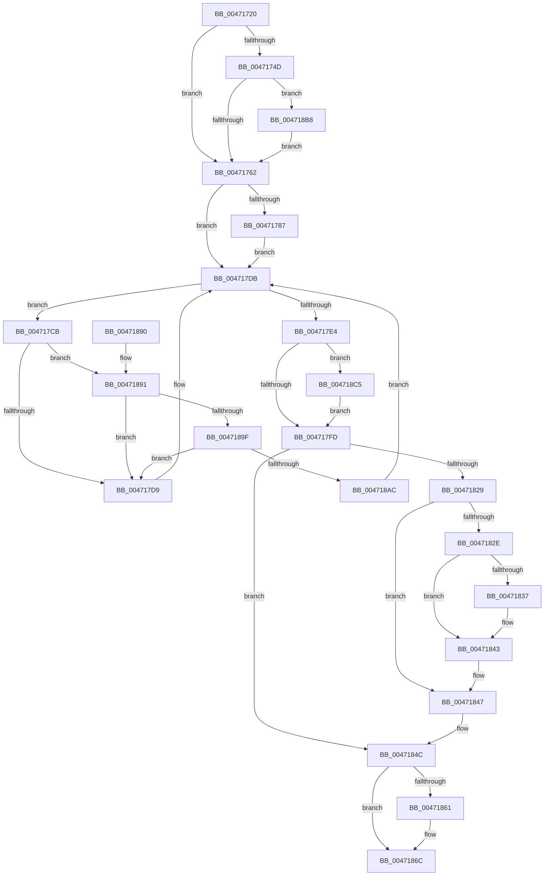

# KeIpiGenericCall

- RVA: `0x00471720`–`0x004718CF` (길이 `431` bytes)
- VA: `0x0000000140471720`
- 실행 섹션: `.text`
- PDB 이름 있음: `예`; PDB Function 태그: `아니요`
- unwind 정보 RVA: `0x000ABF08`
- 디코드: `104`개 명령, `431/431` bytes 표시
- 미해석 바이트: `0` (있으면 어셈블리에 `.byte`로 보존)

> 이 문서는 커널 이미지의 기계어와 PDB 기호를 분석해 생성했습니다. 4번과 5번은 함수 원형과 자료형을 바이너리 사용 방식에서 추정한 C 해석이며 원본 소스 복구 결과는 아닙니다.

## 1. Dependencies

- 직접 호출 지점: **12**; 고유 호출 대상: **10**
- 직접 호출자로 확인된 함수: **16**
- RIP 상대 이미지 참조: **5**

### Outgoing calls
- `0x00471769` → [KeQueryActiveProcessorCountEx](../24/KeQueryActiveProcessorCountEx_function_00249EF0.md) (function, `0x00249EF0`)
- `0x0047177D` → [KeAcquireSpinLockAtDpcLevel](../20/KeAcquireSpinLockAtDpcLevel_function_00208430.md) (function, `0x00208430`)
- `0x004717C4` → [KiIpiSendRequest](../31/KiIpiSendRequest_function_003113C0.md) (function, `0x003113C0`)
- `0x0047181C` → [guard_dispatch_icall](../6B/guard_dispatch_icall_function_006BAAD0.md) (function, `0x006BAAD0`)
- `0x0047183E` → [KiLowerIrqlProcessIrqlFlags](../4F/KiLowerIrqlProcessIrqlFlags_function_004F5698.md) (function, `0x004F5698`)
- `0x00471847` → [KiIpiStallOnPacketTargets](KiIpiStallOnPacketTargets_function_004718D8.md) (function, `0x004718D8`)
- `0x00471853` → [KxReleaseSpinLock](../20/KxReleaseSpinLock_function_00206670.md) (function, `0x00206670`)
- `0x00471867` → [KiLowerIrqlProcessIrqlFlags](../4F/KiLowerIrqlProcessIrqlFlags_function_004F5698.md) (function, `0x004F5698`)
- `0x0047189F` → [KiCheckVpBackingLongSpinWaitHypercall](../30/KiCheckVpBackingLongSpinWaitHypercall_function_0030F490.md) (function, `0x0030F490`)
- `0x004718AE` → [HvlNotifyLongSpinWait](../30/HvlNotifyLongSpinWait_function_0030F460.md) (function, `0x0030F460`)
- `0x004718BB` → [KiRaiseIrqlProcessIrqlFlags](../4F/KiRaiseIrqlProcessIrqlFlags_function_004F56FC.md) (function, `0x004F56FC`)
- `0x004718C5` → [KiRaiseIrqlProcessIrqlFlags](../4F/KiRaiseIrqlProcessIrqlFlags_function_004F56FC.md) (function, `0x004F56FC`)

### Direct callers
- [KeAdjustInterruptTime](../4C/KeAdjustInterruptTime_function_004C9EB0.md) at `0x004C9F20`
- [KeStartProfile](../4E/KeStartProfile_function_004E1120.md) at `0x004E11F5`
- [HalpTimerInitSystem](../53/HalpTimerInitSystem_function_0053CB70.md) at `0x0053CC9B`
- [HalpCmciHandler](../54/HalpCmciHandler_function_00545168.md) at `0x0054533E`
- [HalpTscFallbackToPlatformSource](../54/HalpTscFallbackToPlatformSource_function_0054AD14.md) at `0x0054AD6F`
- [HalpTscSynchronization](../54/HalpTscSynchronization_function_0054AFC0.md) at `0x0054B032`
- [KeOptimizeSpecCtrlSettings](../5B/KeOptimizeSpecCtrlSettings_function_005BE95C.md) at `0x005BE9E5`
- [KeStopProfile](../5C/KeStopProfile_function_005C0640.md) at `0x005C06C8`
- [MiStackTheftFreezeProcessors](../67/MiStackTheftFreezeProcessors_function_0067B274.md) at `0x0067B3F7`
- [MiReapplyImportOptimizationForDriverVerifier](../68/MiReapplyImportOptimizationForDriverVerifier_function_00682268.md) at `0x00682674`
- [MiWritePteHighLevel](../68/MiWritePteHighLevel_function_0068AA08.md) at `0x0068AB15`
- [HalpLoadMicrocode](../../page/70/HalpLoadMicrocode_function_0070B200.md) at `0x0070B3D7`
- [HalpLbrConfigurationWorker](../../page/70/HalpLbrConfigurationWorker_function_0070DA78.md) at `0x0070DB53`
- [KiUpdateSavedSupervisorState](../../pagelk/B6/KiUpdateSavedSupervisorState_function_00B677A0.md) at `0x00B678BC`
- [KiInitializeDynamicProcessorDpc](../../pagelk/B6/KiInitializeDynamicProcessorDpc_function_00B67A30.md) at `0x00B67ACC`
- [KeRestoreMtrrBroadcast](../../pagelk/B6/KeRestoreMtrrBroadcast_function_00B67C90.md) at `0x00B67CD8`

### Static image references
- `0x00471755` → RVA `0x00FC6D20` (`ALMOSTRO`; read)
- `0x0047176E` → RVA `0x00FCF340` (`CACHEALI`; read)
- `0x0047179F` → RVA `0x003A4000` (`KiIpiGenericCallTarget`; read)
- `0x004717CD` → RVA `0x00FC52AC` (`ALMOSTRO`; reference)
- `0x00471891` → RVA `0x00FC6AB8` (`ALMOSTRO`; read)

## 2. Other-region calls and transfers

- 다른 실행 섹션으로 향하는 call: **0**
- 별도 외부 분기/꼬리 이동을 확인하지 못했습니다.

## 3. Assembly (complete function range)

```asm
00471720  48 89 5C 24 10                  mov qword ptr [rsp + 0x10], rbx
00471725  48 89 6C 24 18                  mov qword ptr [rsp + 0x18], rbp
0047172A  48 89 74 24 20                  mov qword ptr [rsp + 0x20], rsi
0047172F  57                              push rdi
00471730  41 54                           push r12
00471732  41 56                           push r14
00471734  48 83 EC 50                     sub rsp, 0x50
00471738  48 8B F2                        mov rsi, rdx
0047173B  48 8B E9                        mov rbp, rcx
0047173E  44 0F 20 C3                     mov rbx, cr8
00471742  41 BC 0C 00 00 00               mov r12d, 0xc
00471748  41 3A DC                        cmp bl, r12b
0047174B  73 15                           jae 0x140471762
0047174D  44 0F 20 C1                     mov rcx, cr8
00471751  45 0F 22 C4                     mov cr8, r12
00471755  83 3D C4 55 B5 00 00            cmp dword ptr [rip + 0xb555c4], 0
0047175C  0F 85 56 01 00 00               jne 0x1404718b8
00471762  B9 FF FF 00 00                  mov ecx, 0xffff
00471767  33 FF                           xor edi, edi
00471769  E8 82 87 DD FF                  call 0x140249ef0
0047176E  48 8D 0D CB DB B5 00            lea rcx, [rip + 0xb5dbcb]
00471775  89 44 24 70                     mov dword ptr [rsp + 0x70], eax
00471779  44 8D 70 FF                     lea r14d, [rax - 1]
0047177D  E8 AE 6C D9 FF                  call 0x140208430
00471782  45 85 F6                        test r14d, r14d
00471785  74 54                           je 0x1404717db
00471787  65 48 8B 0C 25 20 00 00 00      mov rcx, qword ptr gs:[0x20]
00471790  48 8D 44 24 70                  lea rax, [rsp + 0x70]
00471795  48 89 44 24 40                  mov qword ptr [rsp + 0x40], rax
0047179A  4C 8D 4C 24 30                  lea r9, [rsp + 0x30]
0047179F  48 8D 05 5A 28 F3 FF            lea rax, [rip - 0xcd7a6]
004717A6  48 89 6C 24 30                  mov qword ptr [rsp + 0x30], rbp
004717AB  45 33 C0                        xor r8d, r8d
004717AE  48 89 44 24 48                  mov qword ptr [rsp + 0x48], rax
004717B3  8D 57 01                        lea edx, [rdi + 1]
004717B6  48 89 74 24 38                  mov qword ptr [rsp + 0x38], rsi
004717BB  48 C7 44 24 20 05 00 00 00      mov qword ptr [rsp + 0x20], 5
004717C4  E8 F7 FB E9 FF                  call 0x1403113c0
004717C9  EB 10                           jmp 0x1404717db
004717CB  FF C7                           inc edi
004717CD  85 3D D9 3A B5 00               test dword ptr [rip + 0xb53ad9], edi
004717D3  0F 84 B8 00 00 00               je 0x140471891
004717D9  F3 90                           pause
004717DB  8B 44 24 70                     mov eax, dword ptr [rsp + 0x70]
004717DF  83 F8 01                        cmp eax, 1
004717E2  75 E7                           jne 0x1404717cb
004717E4  90                              nop
004717E5  44 0F 20 C1                     mov rcx, cr8
004717E9  8D 50 0D                        lea edx, [rax + 0xd]
004717EC  44 0F 22 C2                     mov cr8, rdx
004717F0  83 3D 29 55 B5 00 00            cmp dword ptr [rip + 0xb55529], 0
004717F7  0F 85 C8 00 00 00               jne 0x1404718c5
004717FD  C7 44 24 70 00 00 00 00         mov dword ptr [rsp + 0x70], 0
00471805  48 8B CE                        mov rcx, rsi
00471808  65 48 8B 04 25 20 00 00 00      mov rax, qword ptr gs:[0x20]
00471811  48 83 A0 98 9A 00 00 00         and qword ptr [rax + 0x9a98], 0
00471819  48 8B C5                        mov rax, rbp
0047181C  E8 AF 92 24 00                  call 0x1406baad0
00471821  48 8B F8                        mov rdi, rax
00471824  45 85 F6                        test r14d, r14d
00471827  74 23                           je 0x14047184c
00471829  41 3A DC                        cmp bl, r12b
0047182C  77 19                           ja 0x140471847
0047182E  83 3D EB 54 B5 00 00            cmp dword ptr [rip + 0xb554eb], 0
00471835  74 0C                           je 0x140471843
00471837  44 0F 20 C1                     mov rcx, cr8
0047183B  41 8A D4                        mov dl, r12b
0047183E  E8 55 3E 08 00                  call 0x1404f5698
00471843  45 0F 22 C4                     mov cr8, r12
00471847  E8 8C 00 00 00                  call 0x1404718d8
0047184C  48 8D 0D ED DA B5 00            lea rcx, [rip + 0xb5daed]
00471853  E8 18 4E D9 FF                  call 0x140206670
00471858  83 3D C1 54 B5 00 00            cmp dword ptr [rip + 0xb554c1], 0
0047185F  74 0B                           je 0x14047186c
00471861  44 0F 20 C1                     mov rcx, cr8
00471865  8A D3                           mov dl, bl
00471867  E8 2C 3E 08 00                  call 0x1404f5698
0047186C  0F B6 C3                        movzx eax, bl
0047186F  44 0F 22 C0                     mov cr8, rax
00471873  4C 8D 5C 24 50                  lea r11, [rsp + 0x50]
00471878  48 8B C7                        mov rax, rdi
0047187B  49 8B 5B 28                     mov rbx, qword ptr [r11 + 0x28]
0047187F  49 8B 6B 30                     mov rbp, qword ptr [r11 + 0x30]
00471883  49 8B 73 38                     mov rsi, qword ptr [r11 + 0x38]
00471887  49 8B E3                        mov rsp, r11
0047188A  41 5E                           pop r14
0047188C  41 5C                           pop r12
0047188E  5F                              pop rdi
0047188F  C3                              ret
00471890  CC                              int3
00471891  8B 05 21 52 B5 00               mov eax, dword ptr [rip + 0xb55221]
00471897  A8 40                           test al, 0x40
00471899  0F 84 3A FF FF FF               je 0x1404717d9
0047189F  E8 EC DB E9 FF                  call 0x14030f490
004718A4  84 C0                           test al, al
004718A6  0F 84 2D FF FF FF               je 0x1404717d9
004718AC  8B CF                           mov ecx, edi
004718AE  E8 AD DB E9 FF                  call 0x14030f460
004718B3  E9 23 FF FF FF                  jmp 0x1404717db
004718B8  41 8A D4                        mov dl, r12b
004718BB  E8 3C 3E 08 00                  call 0x1404f56fc
004718C0  E9 9D FE FF FF                  jmp 0x140471762
004718C5  E8 32 3E 08 00                  call 0x1404f56fc
004718CA  E9 2E FF FF FF                  jmp 0x1404717fd
```

## 4. C-style interpretation (structured pseudocode)

```c
__int64 __fastcall KeIpiGenericCall(__int64 a1, __int64 a2, int a3)
{
    __int64 result;
    __int64 v_rdi;
    __int64 v_rsp;
    unsigned __int64 v_stack_m18;
    unsigned __int64 v_stack_m20;
    unsigned __int64 v_stack_m28;
    unsigned __int64 v_stack_m30;
    unsigned __int64 v_stack_m38;
    unsigned __int64 v_stack_m48;
    unsigned __int64 v_stack_p10;
    unsigned __int64 v_stack_p18;
    unsigned __int64 v_stack_p20;
    unsigned int v_stack_p8;

    v_stack_p10 = v_rbx;
    v_stack_p18 = v_rbp;
    v_stack_p20 = v_rsi;
    v_rsp = (v_rsp) - (80);
    if (((unsigned __int8)(v_cr8)) >= 12) goto loc_00471762;
    if ((*(unsigned int *)(v_rip + 11883972)) != 0) goto loc_004718B8;
loc_00471762:
    v_rdi = 0;
    result = KeQueryActiveProcessorCountEx((unsigned int)(0xFFFFULL), a2, a3, a4);
    v_stack_p8 = (unsigned int)(result);
    result = KeAcquireSpinLockAtDpcLevel(v_rip + 11918283, a2, a3, a4);
    if ((unsigned int)(result - 1) == 0) goto loc_004717DB;
    v_stack_m28 = v_stack_p8;
    v_stack_m38 = a1;
    a3 = 0;
    v_stack_m20 = v_rip - 841638;
    v_stack_m30 = a2;
    v_stack_m48 = 5;
    result = KiIpiSendRequest(*(unsigned __int64 *)(gs_base + (0 + 32)), v_rdi + 1, a3, v_stack_m38);
    goto loc_004717DB;
loc_004717CB:
    v_rdi = (unsigned int)((v_rdi) + 1);
    if (((*(unsigned int *)(v_rip + 11877081)) & ((unsigned int)(v_rdi))) == 0) goto loc_00471891;
loc_004717D9:
loc_004717DB:
    if (((unsigned int)((unsigned int)(v_stack_p8))) != 1) goto loc_004717CB;
    if ((*(unsigned int *)(v_rip + 11883817)) != 0) goto loc_004718C5;
loc_004717FD:
    v_stack_p8 = 0;
    result = guard_dispatch_icall(a2, (unsigned int)(v_stack_p8) + 13, a3, v_stack_m38);
    if ((unsigned int)(result - 1) == 0) goto loc_0047184C;
    if (((unsigned __int8)(v_cr8)) > 12) goto loc_00471847;
    if ((*(unsigned int *)(v_rip + 11883755)) != 0) {
        a1 = (unsigned int)(v_stack_p8) + 13;
        a2 = 12;
        result = KiLowerIrqlProcessIrqlFlags(a1, a2, a3, v_stack_m38);
    }
loc_00471847:
    result = KiIpiStallOnPacketTargets(a1, a2, a3, v_stack_m38);
loc_0047184C:
    result = KxReleaseSpinLock(v_rip + 11918061, a2, a3, v_stack_m38);
    if ((*(unsigned int *)(v_rip + 11883713)) != 0) {
        a1 = 12;
        a2 = (unsigned __int8)(v_cr8);
        result = KiLowerIrqlProcessIrqlFlags(a1, a2, a3, v_stack_m38);
    }
    return result;
loc_00471891:
    if ((((unsigned __int8)((unsigned int)(*(unsigned int *)(v_rip + 11883041)))) & (64)) == 0) goto loc_004717D9;
    result = KiCheckVpBackingLongSpinWaitHypercall(a1, a2, a3, v_stack_m38);
    if ((unsigned __int8)(result) == 0) goto loc_004717D9;
    result = HvlNotifyLongSpinWait((unsigned int)((unsigned int)(result)), a2, a3, v_stack_m38);
    goto loc_004717DB;
loc_004718B8:
    result = KiRaiseIrqlProcessIrqlFlags((unsigned int)((unsigned int)(result)), 12, a3, v_stack_m38);
    goto loc_00471762;
loc_004718C5:
    result = KiRaiseIrqlProcessIrqlFlags((unsigned int)((unsigned int)(result)), 12, a3, v_stack_m38);
    goto loc_004717FD;
}
```

## 5. (Beta) C Style

```c
int64_t KeIpiGenericCall(int64_t Arg1, int64_t Arg2, int32_t Arg3)
{
    int64_t result;
    int64_t local_rdi;
    int64_t local_rsp;
    uint64_t v_stack_m18;
    uint64_t v_stack_m20;
    uint64_t v_stack_m28;
    uint64_t v_stack_m30;
    uint64_t v_stack_m38;
    uint64_t v_stack_m48;
    uint64_t v_stack_p10;
    uint64_t v_stack_p18;
    uint64_t v_stack_p20;
    uint32_t v_stack_p8;

    v_stack_p10 = local_rbx;
    v_stack_p18 = local_rbp;
    v_stack_p20 = local_rsi;
    local_rsp = (local_rsp) - (80);
    if (((uint8_t)(v_cr8)) >= 12) goto loc_00471762;
    if ((*(uint32_t *)(v_rip + 0xB555C4)) != 0) goto loc_004718B8;
loc_00471762:
    local_rdi = 0;
    result = KeQueryActiveProcessorCountEx((uint32_t)(0xFFFFULL), Arg2, Arg3, a4);
    v_stack_p8 = (uint32_t)(result);
    result = KeAcquireSpinLockAtDpcLevel(v_rip + 11918283, Arg2, Arg3, a4);
    if ((uint32_t)(result - 1) == 0) goto loc_004717DB;
    v_stack_m28 = v_stack_p8;
    v_stack_m38 = Arg1;
    Arg3 = 0;
    v_stack_m20 = v_rip - 841638;
    v_stack_m30 = Arg2;
    v_stack_m48 = 5;
    result = KiIpiSendRequest(*(uint64_t *)(gs_base + (0 + 0x20)), local_rdi + 1, Arg3, v_stack_m38);
    goto loc_004717DB;
loc_004717CB:
    local_rdi = (uint32_t)((local_rdi) + 1);
    if (((*(uint32_t *)(v_rip + 0xB53AD9)) & ((uint32_t)(local_rdi))) == 0) goto loc_00471891;
loc_004717D9:
loc_004717DB:
    if (((uint32_t)((uint32_t)(v_stack_p8))) != 1) goto loc_004717CB;
    if ((*(uint32_t *)(v_rip + 0xB55529)) != 0) goto loc_004718C5;
loc_004717FD:
    v_stack_p8 = 0;
    result = guard_dispatch_icall(Arg2, (uint32_t)(v_stack_p8) + 13, Arg3, v_stack_m38);
    if ((uint32_t)(result - 1) == 0) goto loc_0047184C;
    if (((uint8_t)(v_cr8)) > 12) goto loc_00471847;
    if ((*(uint32_t *)(v_rip + 0xB554EB)) != 0) {
        Arg1 = (uint32_t)(v_stack_p8) + 13;
        Arg2 = 12;
        result = KiLowerIrqlProcessIrqlFlags(Arg1, Arg2, Arg3, v_stack_m38);
    }
loc_00471847:
    result = KiIpiStallOnPacketTargets(Arg1, Arg2, Arg3, v_stack_m38);
loc_0047184C:
    result = KxReleaseSpinLock(v_rip + 11918061, Arg2, Arg3, v_stack_m38);
    if ((*(uint32_t *)(v_rip + 0xB554C1)) != 0) {
        Arg1 = 12;
        Arg2 = (uint8_t)(v_cr8);
        result = KiLowerIrqlProcessIrqlFlags(Arg1, Arg2, Arg3, v_stack_m38);
    }
    return result;
loc_00471891:
    if ((((uint8_t)((uint32_t)(*(uint32_t *)(v_rip + 0xB55221)))) & (64)) == 0) goto loc_004717D9;
    result = KiCheckVpBackingLongSpinWaitHypercall(Arg1, Arg2, Arg3, v_stack_m38);
    if ((uint8_t)(result) == 0) goto loc_004717D9;
    result = HvlNotifyLongSpinWait((uint32_t)((uint32_t)(result)), Arg2, Arg3, v_stack_m38);
    goto loc_004717DB;
loc_004718B8:
    result = KiRaiseIrqlProcessIrqlFlags((uint32_t)((uint32_t)(result)), 12, Arg3, v_stack_m38);
    goto loc_00471762;
loc_004718C5:
    result = KiRaiseIrqlProcessIrqlFlags((uint32_t)((uint32_t)(result)), 12, Arg3, v_stack_m38);
    goto loc_004717FD;
}
```

## 6. Execution-region graph

[열기: 2D/3D 그래프와 함수 탐색 컨트롤 패널](../../../control-panel.html?section=text&rva=0x00471720&view=graph)

- 2D 그래프는 위에서 아래로 흐르고, 3D 그래프는 빈 공간을 드래그해 회전합니다. Shift+드래그는 이동, 휠은 확대·축소, 함수 노드 선택은 대상 보고서 이동입니다.

### Static fallback


