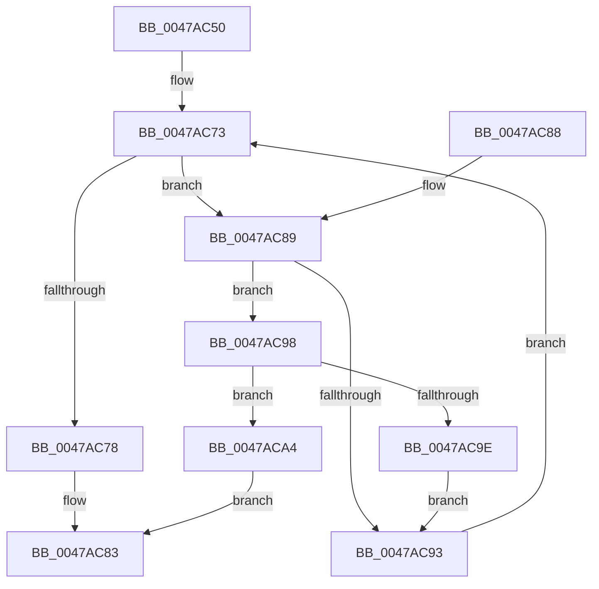

# KeIsSingleGroupAffinityEx

- RVA: `0x0047AC50`–`0x0047ACA8` (길이 `88` bytes)
- VA: `0x000000014047AC50`
- 실행 섹션: `.text`
- PDB 이름 있음: `예`; PDB Function 태그: `아니요`
- unwind 정보 RVA: `0x000AD3A4`
- 디코드: `28`개 명령, `88/88` bytes 표시
- 미해석 바이트: `0` (있으면 어셈블리에 `.byte`로 보존)

> 이 문서는 커널 이미지의 기계어와 PDB 기호를 분석해 생성했습니다. 4번과 5번은 함수 원형과 자료형을 바이너리 사용 방식에서 추정한 C 해석이며 원본 소스 복구 결과는 아닙니다.

## 1. Dependencies

- 직접 호출 지점: **0**; 고유 호출 대상: **0**
- 직접 호출자로 확인된 함수: **2**
- RIP 상대 이미지 참조: **0**

### Outgoing calls
- 직접 디코드된 call 명령이 없습니다.

### Direct callers
- [PpmEventParkNodeCapChangeEx](../5D/PpmEventParkNodeCapChangeEx_function_005DE580.md) at `0x005DE601`
- [PpmEventTraceParkNodeRundownEx](../../page/77/PpmEventTraceParkNodeRundownEx_function_00772E5C.md) at `0x00772F5B`

### Static image references
- 디코드된 RIP-relative 메모리 참조가 없습니다.

## 2. Other-region calls and transfers

- 다른 실행 섹션으로 향하는 call: **0**
- 별도 외부 분기/꼬리 이동을 확인하지 못했습니다.

## 3. Assembly (complete function range)

```asm
0047AC50  48 83 EC 18                     sub rsp, 0x18
0047AC54  45 33 C9                        xor r9d, r9d
0047AC57  4C 8D 04 24                     lea r8, [rsp]
0047AC5B  48 85 D2                        test rdx, rdx
0047AC5E  66 44 89 0C 24                  mov word ptr [rsp], r9w
0047AC63  4C 0F 45 C2                     cmovne r8, rdx
0047AC67  41 0F B7 D1                     movzx edx, r9w
0047AC6B  45 8D 51 20                     lea r10d, [r9 + 0x20]
0047AC6F  66 45 89 10                     mov word ptr [r8], r10w
0047AC73  66 3B 11                        cmp dx, word ptr [rcx]
0047AC76  72 11                           jb 0x14047ac89
0047AC78  66 45 39 10                     cmp word ptr [r8], r10w
0047AC7C  41 0F 95 C1                     setne r9b
0047AC80  41 8B C1                        mov eax, r9d
0047AC83  48 83 C4 18                     add rsp, 0x18
0047AC87  C3                              ret
0047AC88  CC                              int3
0047AC89  0F B7 C2                        movzx eax, dx
0047AC8C  4C 39 4C C1 08                  cmp qword ptr [rcx + rax*8 + 8], r9
0047AC91  75 05                           jne 0x14047ac98
0047AC93  66 FF C2                        inc dx
0047AC96  EB DB                           jmp 0x14047ac73
0047AC98  66 45 39 10                     cmp word ptr [r8], r10w
0047AC9C  75 06                           jne 0x14047aca4
0047AC9E  66 41 89 10                     mov word ptr [r8], dx
0047ACA2  EB EF                           jmp 0x14047ac93
0047ACA4  33 C0                           xor eax, eax
0047ACA6  EB DB                           jmp 0x14047ac83
```

## 4. C-style interpretation (structured pseudocode)

```c
__int64 __fastcall KeIsSingleGroupAffinityEx(__int64 a1, __int64 a2, __int64 a3, int a4)
{
    __int64 result;
    __int64 v_rsp;
    unsigned __int64 v_stack_m18;

    v_rsp = (v_rsp) - (24);
    a4 = 0;
    v_stack_m18 = 0;
    a3 = v_stack_m18;
    if (a2 != 0) { a3 = a2; }
    *(unsigned __int16 *)(a3) = (unsigned __int16)(a4 + 32);
loc_0047AC73:
    if (0 < (*(unsigned __int16 *)(a1))) goto loc_0047AC89;
    a4 = ((*(unsigned __int16 *)(a3)) != ((unsigned __int16)(a4 + 32))) ? 1 : 0;
loc_0047AC83:
    v_rsp = (v_rsp) + (24);
    return (unsigned int)(a4);
loc_0047AC89:
    if ((*(unsigned __int64 *)(a1 + 0 * 8 + 8)) != a4) goto loc_0047AC98;
loc_0047AC93:
    a2 = (unsigned __int16)((0) + 1);
    goto loc_0047AC73;
loc_0047AC98:
    if ((*(unsigned __int16 *)(a3)) != ((unsigned __int16)(a4 + 32))) goto loc_0047ACA4;
    *(unsigned __int16 *)(a3) = (unsigned __int16)(a2);
    goto loc_0047AC93;
loc_0047ACA4:
    result = 0;
    goto loc_0047AC83;
}
```

## 5. (Beta) C Style

```c
int64_t KeIsSingleGroupAffinityEx(void *Arg1, int64_t Arg2, int64_t Arg3, int32_t Arg4)
{
    uint8_t *arg1 = (uint8_t *)Arg1;

    int64_t result;
    int64_t local_rsp;
    uint64_t v_stack_m18;

    local_rsp = (local_rsp) - (24);
    Arg4 = 0;
    v_stack_m18 = 0;
    Arg3 = v_stack_m18;
    if (Arg2 != 0) { Arg3 = Arg2; }
    *(uint16_t *)(Arg3) = (uint16_t)(Arg4 + 32);
loc_0047AC73:
    if (0 < (*(uint16_t *)(arg1))) goto loc_0047AC89;
    Arg4 = ((*(uint16_t *)(Arg3)) != ((uint16_t)(Arg4 + 32))) ? 1 : 0;
loc_0047AC83:
    local_rsp = (local_rsp) + (24);
    return (uint32_t)(Arg4);
loc_0047AC89:
    if ((*(uint64_t *)(arg1 + 0x0 * 8 + 0x8)) != Arg4) goto loc_0047AC98;
loc_0047AC93:
    Arg2 = (uint16_t)((0) + 1);
    goto loc_0047AC73;
loc_0047AC98:
    if ((*(uint16_t *)(Arg3)) != ((uint16_t)(Arg4 + 32))) goto loc_0047ACA4;
    *(uint16_t *)(Arg3) = (uint16_t)(Arg2);
    goto loc_0047AC93;
loc_0047ACA4:
    result = 0;
    goto loc_0047AC83;
}
```

### 관측된 메모리 오프셋

구조체 형식이 확인되지 않은 접근은 인자 기준의 오프셋으로만 기록했습니다.

| 기준 인자 | 오프셋 표현 | 폭 (bit) | 접근 |
|---|---:|---:|---|
| `Arg1` | `+ 0x0` | `16` | `R` |
| `Arg1` | `+ 0x8 + rax*8` | `64` | `R` |

## 6. Execution-region graph

[열기: 2D/3D 그래프와 함수 탐색 컨트롤 패널](../../../control-panel.html?section=text&rva=0x0047AC50&view=graph)

- 2D 그래프는 위에서 아래로 흐르고, 3D 그래프는 빈 공간을 드래그해 회전합니다. Shift+드래그는 이동, 휠은 확대·축소, 함수 노드 선택은 대상 보고서 이동입니다.

### Static fallback


